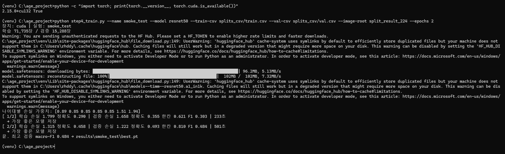
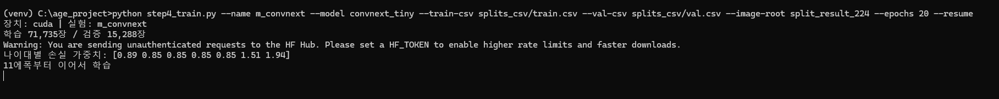
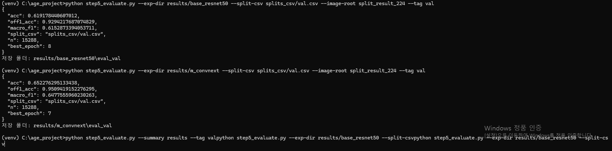
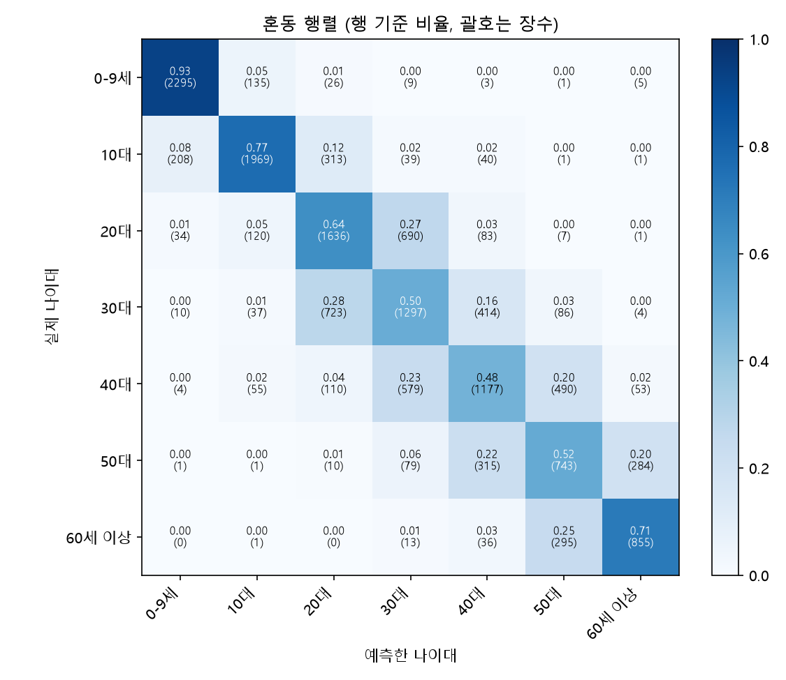
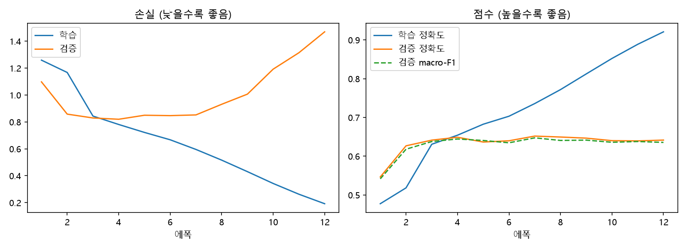
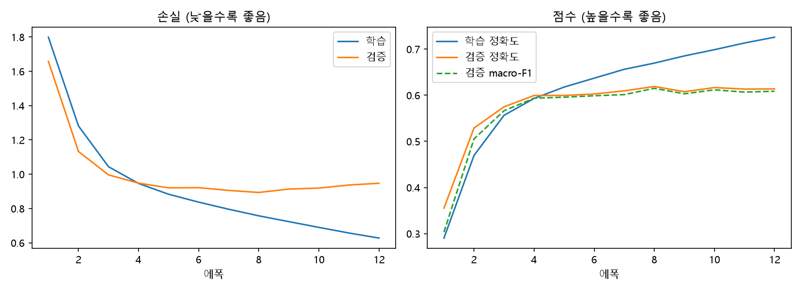
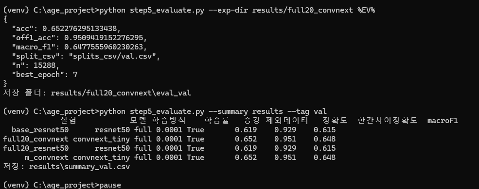

# ConvNeXt-Tiny 학습 기록과 ResNet-50 비교

전처리된 얼굴 사진(224×224)으로 **ConvNeXt-Tiny**를 학습시켜 7개 나이대(0~9세, 10대, 20대, 30대, 40대, 50대, 60세 이상)를 분류하고, 같은 조건으로 학습한 **ResNet-50**과 비교한 결과를 정리한 문서입니다.

- **담당**: 모델 학습 (ResNet-50, ConvNeXt-Tiny)
- **작성일**: 2026년 11월 9일
- 환경 설치, 데이터 분리, 공통 학습 설정은 [ResNet50 폴더](../ResNet50)의 기록과 같습니다.

> **용어 안내**
> - **에폭**: 학습 데이터 전체를 한 번 다 보는 것을 1에폭이라고 합니다.
> - **한 칸 차이 정확도**: 정답이거나 바로 옆 나이대를 맞힌 비율입니다.
> - **macro-F1**: 나이대마다 점수를 따로 낸 뒤 평균한 값입니다. 사진이 적은 나이대의 성능도 똑같이 반영됩니다.

## 결과 요약 (검증 데이터 15,288장)

| 모델 | 정확도 | 한 칸 차이 정확도 | macro-F1 | 가장 좋았던 에폭 | 조기 종료 |
|---|---:|---:|---:|---:|---:|
| ResNet-50 | 61.9% | 92.9% | 0.615 | 8 | 12에폭 |
| **ConvNeXt-Tiny** | **65.2%** | **95.1%** | **0.648** | 7 | 11에폭 |

**ConvNeXt-Tiny가 세 가지 지표 모두에서 더 높았고, 7개 나이대 전부에서 더 잘 맞혔습니다. 다만 과적합은 더 빠르고 크게 나타났습니다.**

조기 종료가 적절했는지 확인하려고 두 모델을 **20에폭까지 추가로 학습**해 봤지만, 최고 성능은 바뀌지 않았습니다(3-3 참고).

## 모델의 역할

- **학습 방식**: 이미 학습된 모델을 가져와 우리 데이터로 추가 학습(미세조정)했습니다. PyTorch와 timm 라이브러리를 사용했습니다.
- **역할**: 최근에 나온 구조의 성능을 작은 CNN, ResNet-50과 비교합니다.

---

## 1. 실행 방법

ResNet-50과 **같은 학습 코드**(`step4_train.py`)를 쓰고, 모델 이름만 바꿔서 실행했습니다. 데이터, 데이터 분리, 학습률, 증강, 손실 가중치, 최대 에폭(20), 배치 크기(64), 조기 종료 조건이 모두 같습니다. 이 폴더의 [`code`](code/) 폴더만으로 ConvNeXt-Tiny의 학습과 평가를 그대로 다시 실행할 수 있습니다.

| 파일 | 하는 일 |
|---|---|
| `common.py` | 나이대 정의, 모델 만들기, 사진 변환(증강·정규화), 평가 지표 계산 |
| `make_split_csv.py` | 팀원이 나눈 `split_result_224` 폴더를 학습용 CSV 파일로 변환 |
| `step4_train.py` | 모델 학습 (`--model convnext_tiny`) |
| `step5_evaluate.py` | 평가, 혼동 행렬·학습 곡선 그리기, 실험 비교표 만들기 |
| `step6_gradcam.py` | Grad-CAM 열지도 만들기 |
| `run_convnext.bat` | ConvNeXt-Tiny 학습과 검증 평가를 한 번에 실행 |
| `train_convnext.py` | 위와 같은 학습 설정을 ConvNeXt 전용 파일 하나로 모은 버전 |
| `requirements.txt` | 필요한 라이브러리 목록 |

날짜별 작업 기록은 [개발일지](../개발일지/KIMDONGHWI)에 있습니다.

```
python step4_train.py --name m_convnext --model convnext_tiny --train-csv splits_csv/train.csv --val-csv splits_csv/val.csv --image-root split_result_224 --epochs 20
```

ConvNeXt 부분만 한 파일로 모은 코드는 [`code/train_convnext.py`](code/train_convnext.py)입니다(설정은 위 명령과 같습니다).

코드에서 ConvNeXt와 직접 관련된 부분은 다음 두 줄입니다.

```python
# 모델: ImageNet으로 사전학습된 ConvNeXt-Tiny를 불러오고, 출력을 7칸(나이대 수)으로 바꿈
model = timm.create_model("convnext_tiny", pretrained=True, num_classes=7)

# Grad-CAM이 들여다볼 층: 모델의 마지막 단계
target_layer = model.stages[-1]
```

---

## 2. 진행 과정

### 2-1. 학습 시작

ResNet-50이 조기 종료된 뒤, 두 모델을 이어서 학습하는 실행 파일(`run_models.bat`)에 따라 ConvNeXt-Tiny 학습이 자동으로 시작되었습니다.


- 사전학습 가중치 `convnext_tiny.in12k_ft_in1k`(약 114MB)를 허깅페이스(Hugging Face)에서 자동으로 내려받았습니다. 사전학습 가중치는 수많은 사진으로 미리 학습을 마친 모델 파일로, 우리 학습의 출발점이 됩니다.
- 나이대별 손실 가중치(`[0.89 0.85 0.85 0.85 0.85 1.51 1.94]`)가 ResNet-50과 똑같이 나와, 같은 데이터와 같은 조건으로 학습한다는 것을 확인했습니다.


| 에폭 | 학습 손실 | 학습 정확도 | 검증 손실 | 검증 정확도 | 한 칸 차이 정확도 | macro-F1 | 걸린 시간 |
|---|---:|---:|---:|---:|---:|---:|---:|
| 1 (ConvNeXt-Tiny) | 1.259 | 0.477 | 1.098 | 0.546 | 0.871 | 0.542 | 167초 |
| 1 (참고: ResNet-50) | 1.799 | 0.290 | 1.658 | 0.355 | 0.621 | 0.303 | 221초 |

- 1에폭은 두 모델 모두 마지막 출력층만 학습하는 단계인데, ConvNeXt가 **처음부터 크게 앞섰습니다**(검증 정확도 54.6% 대 35.5%). 더 많은 사진으로 사전학습되어 있어서, 처음부터 얼굴의 특징을 더 잘 잡아내는 것으로 보입니다.

### 2-2. 조기 종료 (11에폭)

7에폭에서 검증 macro-F1이 가장 높았고(0.648), 8·9·10·11에폭 동안 4번 연속으로 이 기록을 넘지 못해 **11에폭에서 학습이 자동으로 멈췄습니다.** 최종 모델로는 **7에폭의 모델**이 저장되었습니다. 1~11에폭은 중간에 끊기지 않고 한 번에 학습되었습니다.

### 2-3. 이어하기로 12에폭이 한 번 더 실행됨 (결과에는 영향 없음)

학습이 끝난 직후, 앞서 명령 프롬프트에서 눌렀던 Ctrl+C의 영향으로 실행 창이 닫혔습니다. 명령 프롬프트에서 Ctrl+C는 실행을 멈추는 기능입니다. 당시에는 학습이 도중에 끊긴 것으로 판단해 `--resume`(이어하기) 옵션으로 다시 실행했습니다.



```
python step4_train.py --name m_convnext --model convnext_tiny --train-csv splits_csv/train.csv --val-csv splits_csv/val.csv --image-root split_result_224 --epochs 20 --resume
```



- 화면의 "11에폭부터 이어서 학습"은 "11에폭까지 완료된 상태를 불러왔다"는 뜻입니다.
- 당시 학습 코드는 이어하기를 할 때 **이미 조기 종료 조건을 채웠는지 확인하지 않았기** 때문에, 필요 없는 12에폭이 한 번 더 학습되었습니다. 12에폭이 끝난 뒤 조건을 다시 확인하고 멈췄습니다.


| 에폭 | 학습 손실 | 학습 정확도 | 검증 손실 | 검증 정확도 | 한 칸 차이 정확도 | macro-F1 | 걸린 시간 |
|---|---:|---:|---:|---:|---:|---:|---:|
| 12 (추가 실행) | 0.192 | 0.921 | 1.470 | 0.642 | 0.947 | 0.636 | 214초 |

- 12에폭의 macro-F1(0.636)은 최고 기록(0.648)보다 낮아서 **최종 모델(7에폭)은 바뀌지 않았습니다.** 따라서 비교 결과는 한 번에 학습한 것과 같습니다.
- 바뀐 것은 학습 기록(`history.csv`)과 학습 곡선 그래프에 12에폭 한 줄이 추가된 것뿐입니다.
- **코드 수정**: 이어하기를 할 때 이미 조기 종료 조건을 채웠으면 바로 멈추도록 `step4_train.py`와 `train_convnext.py`를 고쳤습니다. 이어하기 문구도 "11에폭까지 완료된 상태를 불러옴 → 12에폭부터 이어서 학습"처럼 헷갈리지 않게 바꿨습니다.

### 2-4. 검증 데이터 평가와 비교표

```
python step5_evaluate.py --exp-dir results/m_convnext --split-csv splits_csv/val.csv --image-root split_result_224 --tag val
python step5_evaluate.py --summary results --tag val
```




| 실험 이름 | 모델 | 학습 방식 | 학습률 | 증강 | 정확도 | 한 칸 차이 정확도 | macro-F1 |
|---|---|---|---|---|---:|---:|---:|
| base_resnet50 | ResNet-50 | 전체 미세조정 | 0.0001 | 적용 | 0.619 | 0.929 | 0.615 |
| m_convnext | ConvNeXt-Tiny | 전체 미세조정 | 0.0001 | 적용 | **0.652** | **0.951** | **0.648** |

모델을 뺀 나머지 조건(학습 방식, 학습률, 증강, 데이터)이 모두 같으므로 **공정한 비교**입니다.

---

## 3. 결과 해석

### 3-1. 혼동 행렬: 나이대별로 얼마나 맞혔나

| ConvNeXt-Tiny | ResNet-50 |
|---|---|
|  |  |

| 실제 나이대 | ResNet-50 | ConvNeXt-Tiny | 차이 |
|---|---:|---:|---:|
| 0~9세 | 91% | **93%** | +2%p |
| 10대 | 75% | **77%** | +2%p |
| 20대 | 58% | **64%** | +6%p |
| 30대 | 47% | **50%** | +3%p |
| 40대 | 45% | **48%** | +3%p |
| 50대 | 48% | **52%** | +4%p |
| 60세 이상 | 66% | **71%** | +5%p |

**① ConvNeXt가 7개 나이대 모두에서 더 잘 맞혔습니다.** 특정 나이대만 좋아진 것이 아니라 전체적으로 나아졌고, 특히 20대(+6%p)와 60세 이상(+5%p)에서 차이가 컸습니다.

**② 어린 나이와 많은 나이는 쉽고, 중간 나이대는 어려웠습니다.**
- 0~9세(91~93%): 아이의 얼굴은 비율과 생김새가 어른과 뚜렷하게 다릅니다.
- 60세 이상(66~71%): 깊은 주름이나 흰머리처럼 눈에 띄는 단서가 있습니다.
- 30~50대(45~52%): 얼굴이 천천히 변하는 시기라 이웃 나이대와 구분하기 어렵습니다.

**③ 데이터의 양보다 얼굴 생김새의 차이가 더 중요했습니다.**
- 처음에는 사진이 가장 적은 50대와 60세 이상이 가장 어려울 것이라고 예상했습니다. 하지만 실제로는 **사진이 가장 많은 30대와 40대(각 12,000장)의 정확도가 가장 낮았습니다.**
- 60세 이상은 사진이 가장 적은데도(5,269장) 70% 안팎을 맞혔습니다. 손실 가중치로 사진이 적은 나이대를 보정한 효과도 있지만, 성능은 **이웃 나이대와 얼굴이 얼마나 비슷한지**에 더 크게 좌우된 것으로 보입니다.

**④ 틀린 경우는 대부분 바로 옆 나이대였습니다.**
- 30대는 20대로 28%, 40대로 16~18% 틀렸고, 20대는 30대로 27% 틀렸습니다. 50대와 60세 이상은 서로 18~26% 헷갈렸습니다.
- 두 칸 이상 떨어진 나이대로 틀린 비율은 대부분 0~2%입니다. 두 칸 이상 크게 틀린 비율은 ResNet-50이 7.1%, ConvNeXt가 4.9%로, **ConvNeXt가 크게 빗나가는 예측을 약 30% 줄였습니다.**

**⑤ 20대는 10대보다 30대로 훨씬 많이 틀렸습니다.** 20대를 10대로 틀린 비율은 5~8%인데, 30대로 틀린 비율은 27%입니다. 화장이나 사진 보정, 데이터셋마다 나이를 매긴 기준(실제 나이와 겉보기 나이)이 다른 점 등이 원인일 수 있습니다.

### 3-2. 학습 곡선: 과적합 비교

| ConvNeXt-Tiny | ResNet-50 |
|---|---|
|  |  |

ConvNeXt 그래프의 마지막 점(12에폭)은 2-3에서 설명한 이어하기로 추가 실행된 에폭입니다.

| 12에폭 기준 | 학습 정확도 | 검증 정확도 | 차이 | 학습 손실 | 검증 손실 |
|---|---:|---:|---:|---:|---:|
| ResNet-50 | 72.6% | 61.4% | 11%p | 0.627 | 0.947 |
| ConvNeXt-Tiny | 92.1% | 64.2% | **28%p** | 0.192 | **1.470** |

- **ResNet-50**: 4에폭 이후 검증 손실은 0.9 근처에서 거의 그대로이고, 학습 손실만 줄어들었습니다. 과적합이 **완만한 편**입니다.
- **ConvNeXt-Tiny**: 검증 손실은 4에폭에서 가장 낮았고(약 0.82), 7에폭 이후 **가파르게 올라 12에폭에는 1.47까지** 늘었습니다. 학습 정확도는 92%까지 올랐지만 검증 정확도는 64~65%에서 멈췄습니다. 학습 사진을 빠르게 외우는 **뚜렷한 과적합**입니다.
- **검증 손실이 가장 낮았던 에폭(4)과 점수가 가장 좋았던 에폭(7)이 다릅니다.** 4에폭 이후의 모델은 정답을 조금씩 더 맞혔지만, 틀릴 때 지나치게 확신해서 손실(벌점)이 커졌습니다. 조기 종료 기준을 손실이 아닌 **macro-F1**로 정했기 때문에, 나이대를 맞히는 목적에 맞는 7에폭 모델이 선택되었습니다.
- 1에폭에서 검증 정확도가 학습 정확도보다 높게 나온 것은, 학습 정확도가 에폭 동안 점점 나아지는 모델의 평균값이고 증강으로 일부러 어렵게 바꾼 사진으로 측정했기 때문입니다.

### 3-3. 20에폭까지 추가 학습: 조기 종료가 적절했나

조기 종료로 멈추지 않았다면 더 좋아졌을지 확인하려고, 두 모델을 저장된 상태에서 이어서 **20에폭까지** 학습했습니다. 원래 결과를 덮어쓰지 않도록 결과 폴더를 복사(`full20_resnet50`, `full20_convnext`)한 뒤, 조기 종료가 걸리지 않게 `--patience 100`을 주었습니다. 학습률 조절은 처음부터 20에폭 기준으로 설정되어 있었기 때문에, 처음부터 20에폭을 학습한 것과 같은 흐름입니다.

```
python step4_train.py --name full20_convnext --model convnext_tiny --train-csv splits_csv/train.csv --val-csv splits_csv/val.csv --image-root split_result_224 --epochs 20 --patience 100 --resume
```


| 에폭 | 학습 손실 | 학습 정확도 | 검증 손실 | 검증 정확도 | 한 칸 차이 정확도 | macro-F1 | 걸린 시간 |
|---|---:|---:|---:|---:|---:|---:|---:|
| 13 | 0.086 | 0.968 | 2.256 | 0.643 | 0.950 | 0.642 | 540초 |
| 14 | 0.106 | 0.958 | 1.840 | 0.644 | 0.952 | 0.639 | 468초 |
| 15 | 0.065 | 0.976 | 2.337 | 0.646 | 0.950 | 0.643 | 409초 |
| 16 | 0.043 | 0.984 | 2.511 | 0.649 | 0.951 | 0.646 | 298초 |
| 17 | 0.029 | 0.989 | 2.630 | 0.649 | 0.952 | 0.646 | 299초 |
| 18 | 0.019 | 0.993 | 2.938 | 0.649 | 0.953 | 0.646 | 303초 |
| 19 | 0.014 | 0.995 | 3.052 | 0.648 | 0.954 | 0.645 | 287초 |
| 20 | 0.011 | **0.996** | **3.064** | 0.650 | 0.954 | 0.647 | 308초 |



| 실험 | 정확도 | 한 칸 차이 정확도 | macro-F1 | 최종 모델 에폭 |
|---|---:|---:|---:|---:|
| ResNet-50 (조기 종료) | 61.9% | 92.9% | 0.615 | 8 |
| ResNet-50 (20에폭까지) | 61.9% | 92.9% | 0.615 | 8 |
| ConvNeXt-Tiny (조기 종료) | 65.2% | 95.1% | 0.648 | 7 |
| ConvNeXt-Tiny (20에폭까지) | 65.2% | 95.1% | 0.648 | 7 |

**① 최고 성능은 바뀌지 않았습니다.** 두 모델 모두 20에폭까지 학습해도 조기 종료 때 고른 에폭(ResNet-50 8, ConvNeXt 7)의 기록을 넘지 못했습니다. 그래서 비교표의 두 줄이 완전히 같습니다. ConvNeXt는 20에폭에 macro-F1 0.647로 최고 기록(0.648)에 가까워졌지만 넘지는 못했습니다.

**② ConvNeXt는 학습 사진을 거의 다 외웠습니다.** 학습 정확도가 99.6%, 학습 손실이 0.011까지 내려갔지만, 검증 정확도는 64~65%에서 그대로였습니다. 외운 만큼 처음 보는 사진을 더 잘 맞히게 되지는 않았습니다.

**③ 검증 손실은 두 배 넘게 늘었는데 정확도는 그대로였습니다.** 검증 손실은 1.47(12에폭)에서 3.06(20에폭)으로 늘었습니다. 맞히는 비율은 비슷한데, 틀릴 때 지나치게 확신하고 틀리게 되어 벌점(손실)만 커진 것입니다. 손실이 아니라 macro-F1로 조기 종료한 것이 적절했다는 근거입니다. 시연 화면에서 보여주는 예측 확률도 지나치게 확신하는 20에폭 모델보다 7에폭 모델이 더 믿을 만합니다.

**④ 두 모델의 과적합 비교 (20에폭 기준)**

| 20에폭 기준 | 학습 정확도 | 검증 정확도 | 차이 | 검증 손실 |
|---|---:|---:|---:|---:|
| ResNet-50 | 81.1% | 61.3% | 약 20%p | 1.020 |
| ConvNeXt-Tiny | **99.6%** | 65.0% | **약 35%p** | **3.064** |

**⑤ 조기 종료로 시간을 아끼고 성능 손해는 없었습니다.** 추가 학습에 ResNet-50은 약 35분, ConvNeXt는 약 50분이 더 들었지만 성능은 나아지지 않았습니다.

### 3-4. ConvNeXt가 더 좋았던 이유와 주의할 점

1. **구조의 차이**: ConvNeXt는 한 번에 더 넓은 영역(7×7)을 보고 최신 설계를 적용해서, 얼굴의 특징을 더 잘 잡아냅니다. 그 대신 학습 사진도 더 빨리 외웁니다(과적합이 더 큼).
2. **사전학습 데이터의 차이 (한계)**: 두 모델이 내려받은 사전학습 가중치가 서로 다릅니다.

| 모델 | 사전학습 가중치 | 사전학습에 쓰인 데이터 |
|---|---|---|
| ResNet-50 | `resnet50.a1_in1k` | ImageNet-1k (1천 종류의 사진) |
| ConvNeXt-Tiny | `convnext_tiny.in12k_ft_in1k` | ImageNet-12k(약 1만 2천 종류)로 먼저 학습한 뒤 ImageNet-1k로 한 번 더 다듬음 |

두 가중치 모두 우리가 직접 고른 것이 아니라, timm 라이브러리가 기본으로 내려받는 버전입니다. 출력층만 학습하는 1에폭부터 ConvNeXt가 크게 앞선 것도 이 영향이 커 보입니다. 따라서 **두 모델의 성능 차이에는 구조의 차이와 사전학습 데이터의 차이가 함께 섞여 있습니다.**

### 3-5. 정리

> ConvNeXt-Tiny는 정확도 65.2%, 한 칸 차이 정확도 95.1%, macro-F1 0.648로 ResNet-50(61.9%, 92.9%, 0.615)보다 모든 지표에서 높았고, 7개 나이대 모두에서 더 잘 맞혔습니다. 두 모델 모두 0~9세와 60세 이상은 잘 맞혔지만 30~50대는 50% 안팎으로 가장 어려워했고, 틀린 경우는 대부분 바로 옆 나이대였습니다. ConvNeXt는 과적합이 빠르고 크게 나타났으며, macro-F1 기준 조기 종료로 11에폭에서 멈추고 7에폭의 모델을 최종 모델로 사용했습니다. 20에폭까지 추가로 학습해도 두 모델의 최고 성능은 바뀌지 않아, 조기 종료가 성능 손해 없이 학습 시간을 줄였음을 확인했습니다. 다만 ConvNeXt는 더 많은 데이터로 사전학습된 가중치를 사용했기 때문에, 성능 차이에는 사전학습 데이터의 영향도 섞여 있습니다.

---

## 4. 앞으로 할 일

- [x] 20에폭까지 추가 학습으로 조기 종료 효과 확인 (3-3)
- [x] 이어하기 때 조기 종료 조건을 다시 확인하도록 학습 코드 수정 (2-3)

- [ ] 최종 모델 정하기(현재 검증 결과로는 ConvNeXt-Tiny). 그 뒤 시험 데이터로 **한 번만** 평가합니다.
  ```
  python step5_evaluate.py --exp-dir results/m_convnext --split-csv splits_csv/test.csv --image-root split_result_224 --tag test
  ```
- [ ] Grad-CAM으로 30대·40대를 틀린 사진에서 모델이 얼굴의 어디를 보고 판단했는지 확인합니다.
  ```
  python step6_gradcam.py --exp-dir results/m_convnext --split-csv splits_csv/val.csv --image-root split_result_224 --per-band 4
  ```
- [ ] (선택) ConvNeXt의 과적합 줄이기: 학습률을 0.00005로 낮추거나 증강을 더 강하게 해서 다시 학습합니다.
- [ ] (선택) 공정한 구조 비교: ConvNeXt도 ImageNet-1k로만 사전학습된 가중치(`convnext_tiny.fb_in1k`)로 학습해, 구조 차이만 비교합니다.
