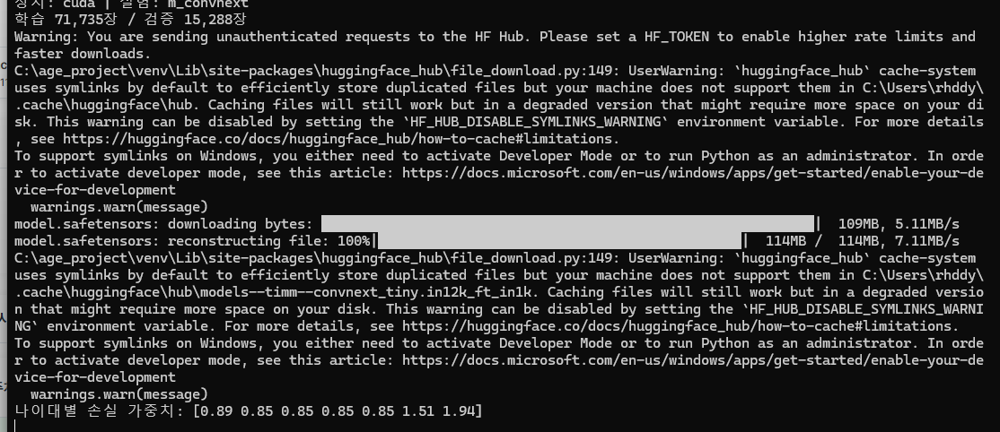
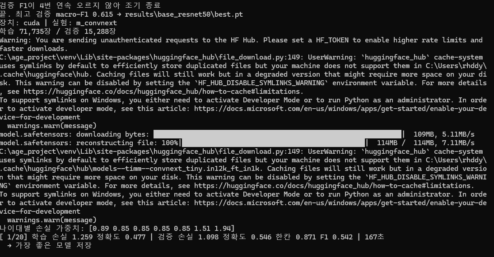
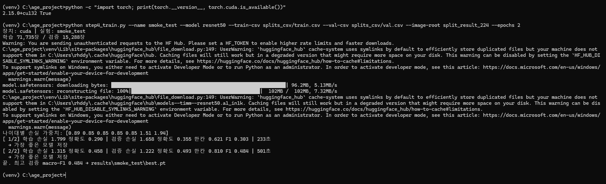
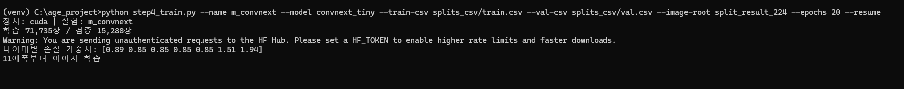
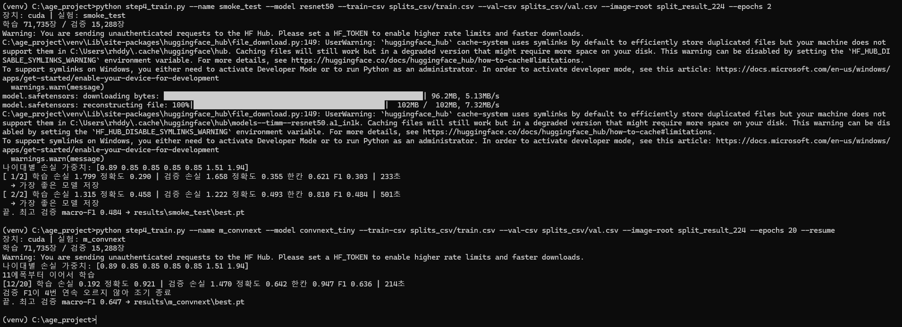
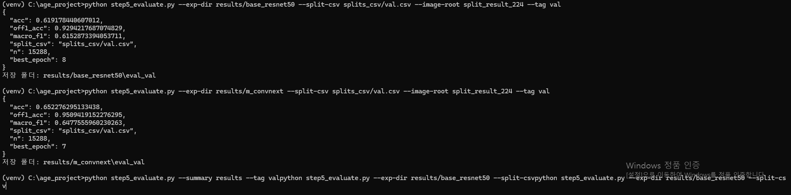
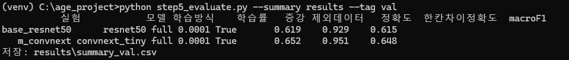
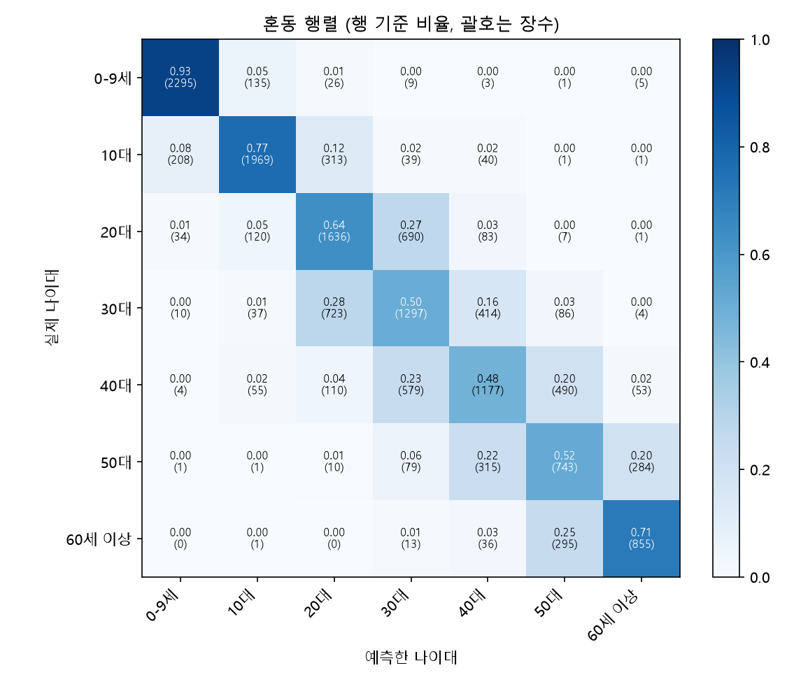
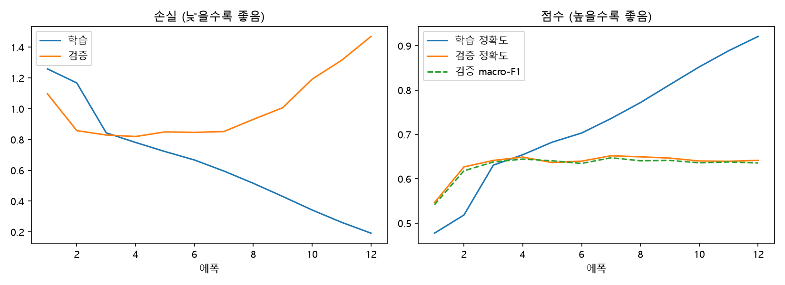
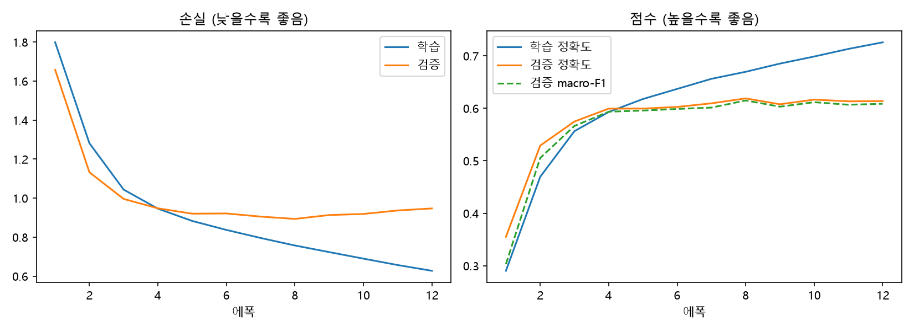

# ConvNeXt-Tiny 학습 기록과 ResNet-50 비교

전처리된 얼굴 이미지(224×224)로 **ConvNeXt-Tiny**를 학습해 7개 나이대(0–9세, 10대, 20대, 30대, 40대, 50대, 60세 이상)를 분류하고, 같은 조건으로 학습한 **ResNet-50**과 비교한 기록입니다.

- 담당: 모델 학습 (ResNet-50, ConvNeXt-Tiny)
- 기록일: 2026-11-09
- 환경 설치, 데이터 분리, 공통 학습 설정은 [`../ResNet50`](../ResNet50) 기록과 같습니다.

## 결과 요약 (검증 데이터 15,288장)

| 모델 | 정확도 | 한 칸 차이 정확도 | macro-F1 | 가장 좋은 에폭 |
|---|---:|---:|---:|---:|
| ResNet-50 | 61.9% | 92.9% | 0.615 | 8 |
| **ConvNeXt-Tiny** | **65.2%** | **95.1%** | **0.648** | 7 |

**ConvNeXt-Tiny가 세 지표 모두 더 높고, 7개 나이대 모두에서 더 잘 맞혔다. 대신 과적합은 더 빠르고 크게 나타났다.**

### 모델 역할

- **학습 방식**: 사전학습 모델 미세조정 (PyTorch + timm)
- **역할**: 최근 구조와 성능 비교 (작은 CNN, ResNet-50과 비교)

---

## 1. 실행 방법

ResNet-50과 **같은 학습 코드**(`step4_train.py`)에서 모델 이름만 바꿔 실행했다. 데이터, 분리, 학습률, 증강, 손실 가중치, 에폭(최대 20), 배치(64), 조기 종료 조건이 모두 같다. 이 폴더의 [`code/`](code/)만으로 ConvNeXt-Tiny 학습·평가를 재현할 수 있다.

| 파일 | 역할 |
|---|---|
| `common.py` | 나이대 정의, 모델 생성, 사진 변환(증강·정규화), 평가 지표 |
| `make_split_csv.py` | 팀원이 나눈 `split_result_224` 폴더 → 학습용 CSV |
| `step4_train.py` | 학습 (`--model convnext_tiny`) |
| `step5_evaluate.py` | 평가, 혼동 행렬·학습 곡선, 실험 비교표 |
| `step6_gradcam.py` | Grad-CAM 열지도 |
| `run_convnext.bat` | ConvNeXt-Tiny 학습 + 검증 평가를 한 번에 실행 |
| `train_convnext.py` | 위 학습 설정을 ConvNeXt 전용 한 파일로 모은 버전 |
| `requirements.txt` | 필요한 라이브러리 |

날짜별 작업 기록은 [`../개발일지/KIMDONGHWI`](../개발일지/KIMDONGHWI)에 있다.

```
python step4_train.py --name m_convnext --model convnext_tiny --train-csv splits_csv/train.csv --val-csv splits_csv/val.csv --image-root split_result_224 --epochs 20
```

ConvNeXt 부분만 한 파일로 모은 코드: [`code/train_convnext.py`](code/train_convnext.py) (설정은 위 명령과 같음)

코드에서 ConvNeXt와 직접 관련된 부분:

```python
# 모델: ImageNet 사전학습 ConvNeXt-Tiny, 출력층 7칸
model = timm.create_model("convnext_tiny", pretrained=True, num_classes=7)

# Grad-CAM이 볼 층: 마지막 단계(stage)
target_layer = model.stages[-1]
```

---

## 2. 진행 과정

### 2-1. 학습 시작

ResNet-50이 조기 종료된 뒤, 두 모델을 이어서 돌리는 실행 파일(`run_models.bat`)에 의해 ConvNeXt-Tiny 학습이 자동으로 시작됐다.



- 사전학습 가중치 `convnext_tiny.in12k_ft_in1k`(약 114MB)를 Hugging Face에서 내려받았다.
- 나이대별 손실 가중치 `[0.89 0.85 0.85 0.85 0.85 1.51 1.94]`가 ResNet-50과 똑같다. 같은 데이터·같은 조건임을 확인했다.



| 에폭 | 학습 손실 | 학습 정확도 | 검증 손실 | 검증 정확도 | 한 칸 차이 정확도 | macro-F1 | 시간 |
|---|---:|---:|---:|---:|---:|---:|---:|
| 1 (ConvNeXt) | 1.259 | 0.477 | 1.098 | 0.546 | 0.871 | 0.542 | 167초 |
| 1 (참고: ResNet-50) | 1.799 | 0.290 | 1.658 | 0.355 | 0.621 | 0.303 | 221초 |

- 1에폭은 두 모델 모두 마지막 출력층만 학습하는 단계인데, ConvNeXt가 **출발부터 크게 앞섰다**(검증 정확도 54.6% 대 35.5%). 더 큰 데이터로 사전학습돼 얼굴 특징을 처음부터 더 잘 뽑아내는 것으로 보인다.

### 2-2. 학습 창이 닫힘 → 이어서 학습

학습 도중 cmd에서 Ctrl+C를 누른 뒤 학습 창이 닫혔다(cmd에서 Ctrl+C는 실행 중지 기능).



학습 코드는 에폭이 끝날 때마다 `last.pt`를 저장하므로, `--resume`을 붙여 저장된 지점부터 이어서 학습했다.

```
python step4_train.py --name m_convnext --model convnext_tiny --train-csv splits_csv/train.csv --val-csv splits_csv/val.csv --image-root split_result_224 --epochs 20 --resume
```



- 창이 닫히기 전에 **11에폭까지 저장**돼 있었고, 12에폭부터 이어서 학습했다.
- 화면 문구는 "11에폭부터 이어서 학습"이지만, 코드가 에폭 번호를 0부터 세서 표시가 하나 어긋난 것이다. 다음 줄이 `[12/20]`으로 나온다.
- 조기 종료 기록(연속으로 점수가 안 오른 횟수)과 최고 모델 정보도 그대로 이어졌다.

### 2-3. 조기 종료



| 에폭 | 학습 손실 | 학습 정확도 | 검증 손실 | 검증 정확도 | 한 칸 차이 정확도 | macro-F1 | 시간 |
|---|---:|---:|---:|---:|---:|---:|---:|
| 12 | 0.192 | 0.921 | 1.470 | 0.642 | 0.947 | 0.636 | 214초 |

- 7에폭 이후 검증 macro-F1이 4에폭 연속 오르지 않아 **12에폭에서 조기 종료**됐다. 저장된 모델은 **7에폭 모델**(최고 검증 macro-F1 0.648)이다.

### 2-4. 검증 데이터 평가와 비교표

```
python step5_evaluate.py --exp-dir results/m_convnext --split-csv splits_csv/val.csv --image-root split_result_224 --tag val
python step5_evaluate.py --summary results --tag val
```





| 실험 | 모델 | 학습 방식 | 학습률 | 증강 | 정확도 | 한 칸 차이 | macro-F1 |
|---|---|---|---|---|---:|---:|---:|
| base_resnet50 | resnet50 | full | 0.0001 | 적용 | 0.619 | 0.929 | 0.615 |
| m_convnext | convnext_tiny | full | 0.0001 | 적용 | **0.652** | **0.951** | **0.648** |

모델 외의 조건(학습 방식, 학습률, 증강, 데이터)이 모두 같아 **공정한 비교**다.

---

## 3. 결과 해석

### 3-1. 혼동 행렬: 나이대별 맞힌 비율

| ConvNeXt-Tiny | ResNet-50 |
|---|---|
|  |  |

| 실제 나이대 | ResNet-50 | ConvNeXt-Tiny | 차이 |
|---|---:|---:|---:|
| 0–9세 | 91% | **93%** | +2%p |
| 10대 | 75% | **77%** | +2%p |
| 20대 | 58% | **64%** | +6%p |
| 30대 | 47% | **50%** | +3%p |
| 40대 | 45% | **48%** | +3%p |
| 50대 | 48% | **52%** | +4%p |
| 60세 이상 | 66% | **71%** | +5%p |

**① ConvNeXt가 7개 나이대 모두에서 더 높다.** 특정 나이대만 좋아진 것이 아니라 전반적으로 나아졌고, 20대(+6%p)와 60세 이상(+5%p)에서 차이가 가장 크다.

**② 양 끝은 쉽고 가운데는 어렵다 (U자 모양).**
- 0–9세(91~93%): 아이 얼굴은 비율과 생김새가 어른과 확연히 다르다.
- 60세 이상(66~71%): 깊은 주름, 흰머리 같은 뚜렷한 단서가 있다.
- 30~50대(45~52%): 얼굴 변화가 서서히 일어나 이웃 나이대와 구분이 어렵다.

**③ 데이터 양보다 생김새 차이가 더 중요했다.**
- 사진이 가장 적은 50대·60세 이상이 가장 어려울 것으로 예상했지만, 실제로는 **사진이 가장 많은(각 12,000장) 30·40대가 가장 낮았다.**
- 60세 이상은 사진이 가장 적은데도(5,269장) 70% 안팎을 맞혔다. 손실 가중치로 적은 나이대를 보정한 효과와 함께, 성능은 **이웃 나이대와 얼마나 비슷하게 생겼는지**에 더 크게 좌우된 것으로 보인다.

**④ 오답의 대부분은 바로 옆 나이대다.**
- 30대 → 20대 28%, 40대 16~18% / 20대 → 30대 27% / 50대 ↔ 60세 이상 18~26%
- 두 칸 이상 떨어진 칸은 대부분 0~2%다. 두 칸 이상 틀린 비율은 ResNet-50 7.1%, ConvNeXt 4.9%로, **ConvNeXt가 크게 빗나가는 예측을 약 30% 줄였다.**

**⑤ 20대는 30대로 틀리는 경우가 반대 방향보다 훨씬 많다.** 20대가 10대로 틀리는 비율은 5~8%인데, 30대로 틀리는 비율은 27%다. 화장·사진 보정, 데이터셋마다 다른 나이 기준(실제 나이 / 보이는 나이) 등이 원인일 수 있다.

### 3-2. 학습 곡선: 과적합 비교

| ConvNeXt-Tiny | ResNet-50 |
|---|---|
|  |  |

| 12에폭 기준 | 학습 정확도 | 검증 정확도 | 차이 | 학습 손실 | 검증 손실 |
|---|---:|---:|---:|---:|---:|
| ResNet-50 | 72.6% | 61.4% | 11%p | 0.627 | 0.947 |
| ConvNeXt-Tiny | 92.1% | 64.2% | **28%p** | 0.192 | **1.470** |

- **ResNet-50:** 4에폭 이후 검증 손실이 0.9 근처에서 평평하고 학습 손실만 줄어든다. 과적합이 **완만**하다.
- **ConvNeXt-Tiny:** 검증 손실이 4에폭에서 가장 낮고(약 0.82), 7에폭 이후 **가파르게 올라 1.47까지** 간다. 학습 정확도는 92%까지 오르지만 검증 정확도는 64~65%에서 멈춘다. 학습 사진을 빠르게 외우는 **뚜렷한 과적합**이다.
- **검증 손실이 가장 낮은 에폭(4)과 점수가 가장 좋은 에폭(7)이 다르다.** 4에폭 이후 모델은 정답은 조금씩 더 맞히지만, 틀릴 때 지나치게 확신해서 손실(벌점)이 커졌다. 조기 종료 기준을 손실이 아닌 **macro-F1**로 정했기 때문에 목적(나이대 맞히기)에 맞는 7에폭 모델이 선택됐다.
- 1에폭에서 검증 정확도가 학습 정확도보다 높은 것은, 학습 정확도가 에폭 동안 점점 나아지는 모델의 평균이고 증강된 사진으로 쟀기 때문이다.

### 3-3. 왜 ConvNeXt가 더 좋았나 (그리고 주의할 점)

1. **구조 차이:** ConvNeXt는 한 번에 더 넓은 영역(7×7)을 보고 최신 설계를 적용해, 얼굴 특징을 더 잘 잡아낸다. 그 대신 학습 사진도 더 빨리 외운다(과적합이 더 큼).
2. **사전학습 데이터 차이 (한계):** 두 모델이 받은 사전학습 가중치가 다르다.

| 모델 | 사전학습 가중치 | 사전학습 데이터 |
|---|---|---|
| ResNet-50 | `resnet50.a1_in1k` | ImageNet-1k |
| ConvNeXt-Tiny | `convnext_tiny.in12k_ft_in1k` | ImageNet-12k로 학습 후 ImageNet-1k로 추가 학습 (더 많은 사진) |

1에폭(출력층만 학습)부터 ConvNeXt가 크게 앞선 것도 이 영향이 커 보인다. 따라서 **성능 차이에는 구조 차이와 사전학습 데이터 차이가 함께 섞여 있다.**

### 3-4. 정리

> ConvNeXt-Tiny가 정확도 65.2%, 한 칸 차이 정확도 95.1%, macro-F1 0.648로 ResNet-50(61.9%, 92.9%, 0.615)보다 모든 지표에서 높았고, 7개 나이대 모두에서 더 잘 맞혔다. 두 모델 모두 0–9세와 60세 이상은 잘 맞혔지만 30~50대는 50% 안팎으로 가장 어려웠으며, 오답의 대부분은 바로 옆 나이대였다. ConvNeXt는 학습 정확도 92% 대 검증 65%로 과적합이 빠르고 크게 나타났고, macro-F1 기준 조기 종료로 7에폭 모델을 사용했다. 단, ConvNeXt는 더 큰 데이터로 사전학습된 가중치를 사용해 성능 차이에 사전학습 데이터 효과가 섞여 있다.

---

## 4. 다음 할 일

- [ ] 최종 모델 결정 (현재 검증 결과로는 ConvNeXt-Tiny) → 시험 데이터(test)로 **한 번만** 평가
  ```
  python step5_evaluate.py --exp-dir results/m_convnext --split-csv splits_csv/test.csv --image-root split_result_224 --tag test
  ```
- [ ] Grad-CAM으로 30·40대를 틀린 사진에서 모델이 어디를 봤는지 확인
  ```
  python step6_gradcam.py --exp-dir results/m_convnext --split-csv splits_csv/val.csv --image-root split_result_224 --per-band 4
  ```
- [ ] (선택) ConvNeXt 과적합 줄이기 실험: 학습률 0.00005 또는 더 강한 증강
