# ConvNeXt-Tiny 학습 기록과 ResNet-50 비교

전처리된 얼굴 사진(224×224)으로 **ConvNeXt-Tiny**를 학습시켜 7개 나이대(0~9세, 10대, 20대, 30대, 40대, 50대, 60세 이상)를 분류하고, 같은 조건으로 학습한 **ResNet-50**과 비교한 결과를 정리한 문서입니다.

- **담당**: 모델 학습 (ResNet-50, ConvNeXt-Tiny)
- **작성일**: 2026년 11월 9일
- 환경 설치, 데이터 분리, 공통 학습 설정은 [ResNet50 폴더](../ResNet50)의 기록과 같습니다.
- **새 데이터로 다시 학습 (2026-11-27)**: 팀 데이터가 `division_224AFAD-X`로 바뀌어 증강 있음/없음을 다시 학습했습니다. 결과는 바로 아래 **[새 데이터 결과](#새-데이터-결과-2026-11-27)**에 있습니다.

> **용어 안내**
> - **에폭**: 학습 데이터 전체를 한 번 다 보는 것을 1에폭이라고 합니다.
> - **한 칸 차이 정확도**: 정답이거나 바로 옆 나이대를 맞힌 비율입니다.
> - **macro-F1**: 나이대마다 점수를 따로 낸 뒤 평균한 값입니다. 사진이 적은 나이대의 성능도 똑같이 반영됩니다.

## 새 데이터 결과 (2026-11-27)

> 이 장은 **새 데이터(`division_224AFAD-X`)** 기준입니다. 데이터가 바뀐 이유와 구성, 분리 결과는 [ResNet50 폴더의 새 데이터 결과](../ResNet50/README.md#새-데이터-결과-2026-11-27)에 있습니다. 그 아래 장들은 이전 데이터 기준이라 숫자를 직접 비교하면 안 됩니다. 전체 비교와 고찰은 [개발일지 05](../개발일지/KIMDONGHWI/2026-11-27_05_새_데이터_재학습과_증강_유무_비교.md)에 있습니다.

### 1) 실행 명령

사전학습 가중치는 ResNet-50과 같은 **ImageNet-1k(`convnext_tiny.fb_in1k`)**이고, 두 실험 모두 **조기 종료 없이 20에폭** 학습했습니다. 한 번에 실행하는 파일은 [`code/run_v2.bat`](code/run_v2.bat)입니다.

```
python step4_train.py --name v2_convnext --model convnext_tiny.fb_in1k --patience 100 --train-csv splits_csv_v2/train.csv --val-csv splits_csv_v2/val.csv --image-root data_v2 --epochs 20
python step4_train.py --name v2_noaug_convnext --model convnext_tiny.fb_in1k --no-augment --patience 100 --train-csv splits_csv_v2/train.csv --val-csv splits_csv_v2/val.csv --image-root data_v2 --epochs 20
python step5_evaluate.py --exp-dir results/v2_convnext --split-csv splits_csv_v2/val.csv --image-root data_v2 --tag val
python step5_evaluate.py --exp-dir results/v2_noaug_convnext --split-csv splits_csv_v2/val.csv --image-root data_v2 --tag val
python step5_evaluate.py --summary results --tag val
```

시작 화면의 `학습 64,353장 / 검증 13,790장`과 `나이대별 손실 가중치: [0.81 1.11 0.84 0.84 0.87 1.36 1.73]`로 새 데이터를 읽은 것을 확인했습니다.

### 2) 증강 없음 학습 기록 (`v2_noaug_convnext`)

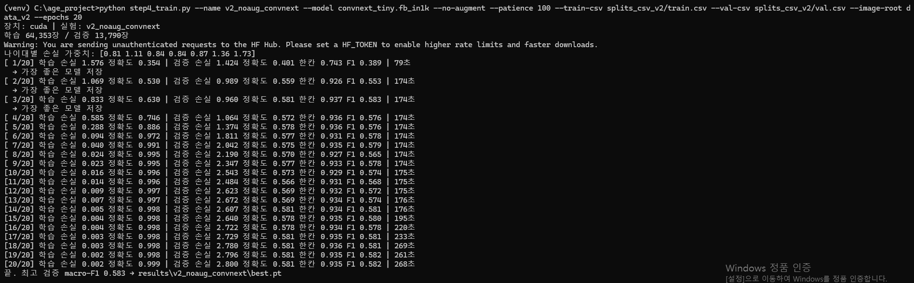

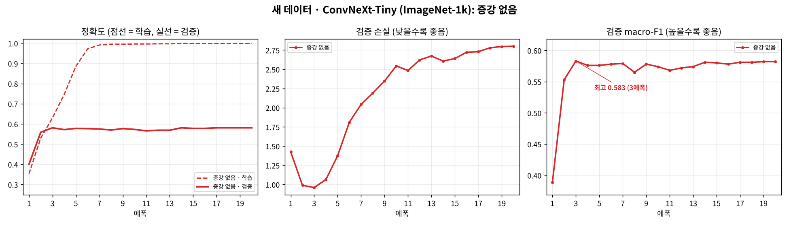

| 에폭 | 학습 정확도 | 검증 정확도 | 검증 손실 | macro-F1 |
|---:|---:|---:|---:|---:|
| 1 | 0.354 | 0.401 | 1.424 | 0.389 |
| 2 | 0.530 | 0.559 | 0.989 | 0.553 |
| **3** | 0.630 | **0.581** | **0.960 (최저)** | **0.583 (최고)** |
| 5 | 0.886 | 0.578 | 1.374 | 0.576 |
| 7 | **0.991** | 0.575 | 2.042 | 0.579 |
| 14 | 0.998 | 0.581 | 2.607 | 0.581 |
| 20 | 0.999 | 0.581 | **2.800** | 0.582 |

- 3에폭에 바로 최고점이 나왔고, 7에폭에 이미 학습 사진을 99% 외웠습니다. 검증 손실은 3에폭 이후 계속 올라 2.80이 되었습니다.
- 14에폭 이후 macro-F1이 0.58대로 다시 올라오지만 3에폭 기록(0.583)은 넘지 못했습니다. 학습률이 0에 가까워지며 결과가 안정된 영향으로 보이고, 이전 데이터에서도 같은 현상이 있었습니다.
- 증강 있음(`v2_convnext`)의 에폭별 기록은 캡처가 없어 평가 결과만 정리했습니다. 최고 에폭은 4입니다.

### 3) 검증 데이터 평가

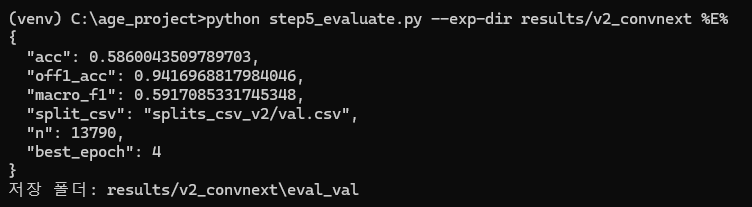

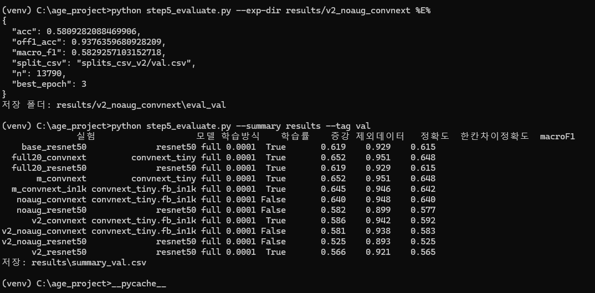

비교표에서 `v2_`로 시작하는 네 줄이 새 데이터 결과입니다.

| 새 데이터 (검증 13,790장) | 정확도 | 한 칸 차이 정확도 | macro-F1 | 가장 좋았던 에폭 |
|---|---:|---:|---:|---:|
| **ConvNeXt-Tiny, 증강 있음** | **58.6%** | **94.2%** | **0.592** | 4 |
| ConvNeXt-Tiny, 증강 없음 | 58.1% | 93.8% | 0.583 | 3 |
| 증강 효과 | +0.5%p | +0.4%p | +0.009 | |

### 4) ResNet-50과 비교 (새 데이터, 네 실험)

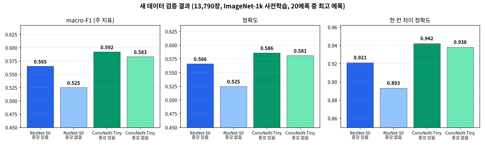

| 모델 | 증강 | 정확도 | 한 칸 차이 정확도 | macro-F1 | 가장 좋았던 에폭 |
|---|---|---:|---:|---:|---:|
| ResNet-50 | 있음 | 56.6% | 92.1% | 0.565 | 11 |
| ResNet-50 | 없음 | 52.5% | 89.3% | 0.525 | 5 |
| **ConvNeXt-Tiny** | **있음** | **58.6%** | **94.2%** | **0.592** | 4 |
| ConvNeXt-Tiny | 없음 | 58.1% | 93.8% | 0.583 | 3 |

| 비교 | 이전 데이터 | 새 데이터 |
|---|---:|---:|
| 모델 차이 (ConvNeXt − ResNet, 둘 다 증강 있음) | +0.027 | **+0.027** |
| ResNet-50 증강 효과 | +0.038 | **+0.040** |
| ConvNeXt-Tiny 증강 효과 | +0.002 | **+0.009** |

### 5) 해석

- **ConvNeXt-Tiny가 다시 가장 좋았습니다.** 사전학습(ImageNet-1k)과 학습 조건이 같은 상태에서 macro-F1이 ResNet-50보다 0.027 높아, 차이는 **구조 효과**로 볼 수 있습니다. 한 칸 차이 정확도도 94.2%로 가장 높아, 크게 틀리는 경우가 가장 적었습니다.
- **ConvNeXt는 증강 효과가 작았습니다 (+0.009).** 증강과 상관없이 3~4에폭에 바로 최고점에 도달해, 증강이 끌어올릴 여지가 적었습니다. 다만 과적합 속도는 확실히 달라, 증강이 없으면 7에폭에 학습 정확도 99%가 되었습니다.
- **증강 효과는 천천히 학습하는 ResNet-50에서 4배 이상 컸습니다 (+0.040).** 증강은 두 모델 모두 과적합을 늦췄지만, 그 효과가 최고 성능으로 이어지는 정도는 모델이 최고점에 얼마나 빨리 도달하느냐에 따라 달랐습니다.
- **증강 없는 ConvNeXt(0.583)도 증강 있는 ResNet-50(0.565)보다 높았습니다.** 이번 실험에서는 구조 차이의 효과가 증강 효과보다 컸습니다.
- **이전 데이터와 같은 결론이 재현되었습니다.** 모델 차이 +0.027은 두 데이터에서 똑같았고, 증강 효과의 크기와 방향도 같았습니다. 각 실험을 한 번씩만 학습했지만 다른 데이터에서 같은 결과가 나와, 결론을 더 믿을 수 있게 되었습니다.
- **최종 모델 후보**: ConvNeXt-Tiny, 증강 있음 (`results/v2_convnext`, 4에폭).

---

## 결과 요약 — 이전 데이터 (검증 데이터 15,288장)

| 모델 | 사전학습 가중치 | 증강 | 정확도 | 한 칸 차이 정확도 | macro-F1 | 가장 좋았던 에폭 | 조기 종료 |
|---|---|---|---:|---:|---:|---:|---:|
| ResNet-50 | ImageNet-1k | 있음 | 61.9% | 92.9% | 0.615 | 8 | 12에폭 |
| ConvNeXt-Tiny (참고) | ImageNet-12k → 1k | 있음 | 65.2% | 95.1% | 0.648 | 7 | 11에폭 |
| **ConvNeXt-Tiny** | **ImageNet-1k** | 있음 | **64.5%** | **94.6%** | **0.642** | 3 | 7에폭 |
| ConvNeXt-Tiny | ImageNet-1k | **없음** | 64.0% | 94.8% | 0.640 | 3 | 없음 (20에폭) |

- **사전학습 조건을 ResNet-50과 같은 ImageNet-1k로 맞춰도 ConvNeXt-Tiny가 모든 지표에서 더 높았습니다** (macro-F1 0.615 → 0.642). 처음 실험은 timm 기본 가중치 때문에 ConvNeXt만 더 큰 데이터(ImageNet-12k)로 사전학습된 가중치를 썼는데, 그 효과는 0.006으로 작았습니다(2-5, 3-4).
- **2026-11-23부터 ConvNeXt-Tiny는 ImageNet-1k 가중치(`convnext_tiny.fb_in1k`) 결과를 기준으로 합니다.** 12k→1k 결과(`m_convnext`)는 참고용으로 남겨 둡니다.
- **증강 유무는 ConvNeXt의 최고 성능에 거의 영향을 주지 않았습니다** (0.642 vs 0.640). 다만 증강이 없으면 과적합이 훨씬 빨리 왔습니다(2-6, 3-6).
- 조기 종료가 적절했는지 확인하려고 20에폭까지 추가로 학습해 봤지만, 최고 성능은 바뀌지 않았습니다(3-3).

## 모델의 역할

- **학습 방식**: 이미 학습된 모델을 가져와 우리 데이터로 추가 학습(미세조정)했습니다. PyTorch와 timm 라이브러리를 사용했습니다.
- **역할**: 최근에 나온 구조의 성능을 작은 CNN, ResNet-50과 비교합니다.

---

## 1. 실행 방법

ResNet-50과 **같은 학습 코드**(`step4_train.py`)를 쓰고, 모델 이름만 바꿔서 실행했습니다. 데이터, 데이터 분리, 학습률, 증강, 손실 가중치, 최대 에폭(20), 배치 크기(64), 조기 종료 조건이 모두 같습니다. 이 폴더의 [`code`](code/) 폴더만으로 ConvNeXt-Tiny의 학습과 평가를 그대로 다시 실행할 수 있습니다.

| 파일 | 하는 일 |
|---|---|
| `common.py` | 나이대 정의, 모델 만들기, 사진 변환(증강·정규화), 평가 지표 계산 |
| `make_split_csv.py` | 팀원이 나눈 `split_result_224` 폴더를 학습용 CSV 파일로 변환 |
| `step4_train.py` | 모델 학습 (`--model convnext_tiny`) |
| `step5_evaluate.py` | 평가, 혼동 행렬·학습 곡선 그리기, 실험 비교표 만들기 |
| `step6_gradcam.py` | Grad-CAM 열지도 만들기 |
| `run_convnext.bat` | ConvNeXt-Tiny 학습과 검증 평가를 한 번에 실행 |
| `run_augment_compare.bat` | ImageNet-1k 가중치로 학습(증강 있음/없음) → 평가 → 비교 그래프까지 한 번에 실행 |
| `run_v2.bat` | **새 데이터**로 증강 있음/없음 학습 → 평가 → 비교표 |
| `plot_history_compare.py` | 두 실험의 `history.csv`를 나란히 그려 비교 (정확도, 검증 손실, 검증 macro-F1) |
| `train_convnext.py` | 위와 같은 학습 설정을 ConvNeXt 전용 파일 하나로 모은 버전 |
| `requirements.txt` | 필요한 라이브러리 목록 |

날짜별 작업 기록은 [개발일지](../개발일지/KIMDONGHWI)에 있습니다.

```
python step4_train.py --name m_convnext --model convnext_tiny --train-csv splits_csv/train.csv --val-csv splits_csv/val.csv --image-root split_result_224 --epochs 20
```

ResNet-50과 사전학습 조건을 맞춘 실험(현재 기준)은 모델 이름 뒤에 가중치 이름만 붙여서 실행합니다.

```
python step4_train.py --name m_convnext_in1k --model convnext_tiny.fb_in1k --train-csv splits_csv/train.csv --val-csv splits_csv/val.csv --image-root split_result_224 --epochs 20
```

ConvNeXt 부분만 한 파일로 모은 코드는 [`code/train_convnext.py`](code/train_convnext.py)입니다(설정은 위 명령과 같습니다).

코드에서 ConvNeXt와 직접 관련된 부분은 다음 두 줄입니다.

```python
# 모델: ImageNet으로 사전학습된 ConvNeXt-Tiny를 불러오고, 출력을 7칸(나이대 수)으로 바꿈
model = timm.create_model("convnext_tiny", pretrained=True, num_classes=7)

# Grad-CAM이 들여다볼 층: 모델의 마지막 단계
target_layer = model.stages[-1]
```

---

## 2. 진행 과정

### 2-1. 학습 시작

ResNet-50이 조기 종료된 뒤, 두 모델을 이어서 학습하는 실행 파일(`run_models.bat`)에 따라 ConvNeXt-Tiny 학습이 자동으로 시작되었습니다.

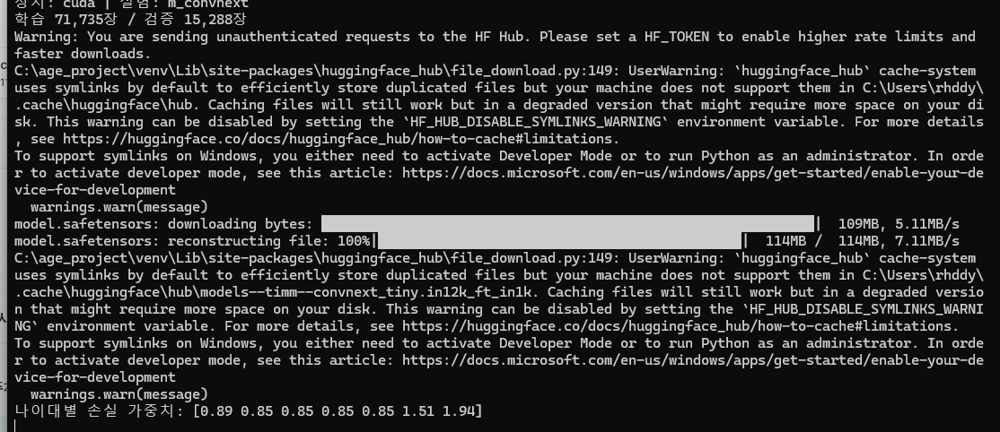

- 사전학습 가중치 `convnext_tiny.in12k_ft_in1k`(약 114MB)를 허깅페이스(Hugging Face)에서 자동으로 내려받았습니다. 사전학습 가중치는 수많은 사진으로 미리 학습을 마친 모델 파일로, 우리 학습의 출발점이 됩니다.
- 나이대별 손실 가중치(`[0.89 0.85 0.85 0.85 0.85 1.51 1.94]`)가 ResNet-50과 똑같이 나와, 같은 데이터와 같은 조건으로 학습한다는 것을 확인했습니다.

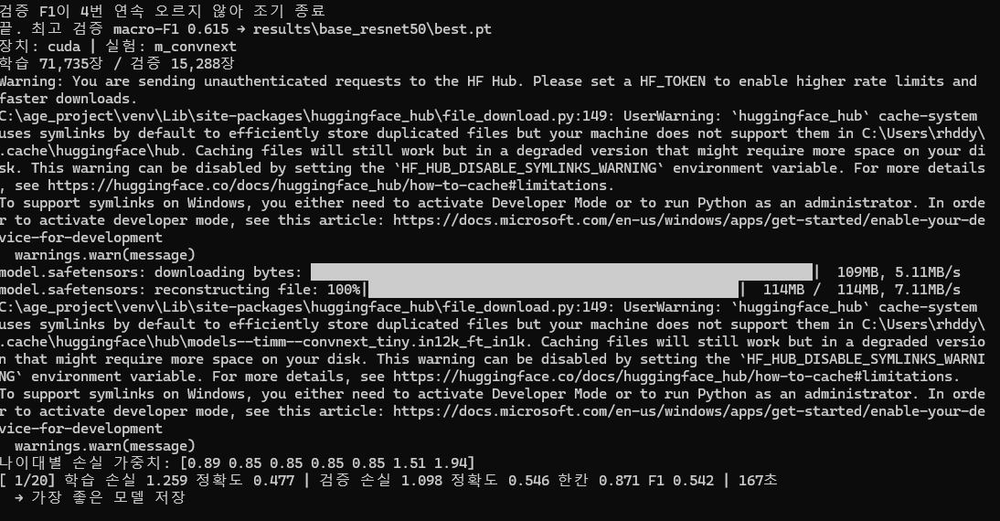

| 에폭 | 학습 손실 | 학습 정확도 | 검증 손실 | 검증 정확도 | 한 칸 차이 정확도 | macro-F1 | 걸린 시간 |
|---|---:|---:|---:|---:|---:|---:|---:|
| 1 (ConvNeXt-Tiny) | 1.259 | 0.477 | 1.098 | 0.546 | 0.871 | 0.542 | 167초 |
| 1 (참고: ResNet-50) | 1.799 | 0.290 | 1.658 | 0.355 | 0.621 | 0.303 | 221초 |

- 1에폭은 두 모델 모두 마지막 출력층만 학습하는 단계인데, ConvNeXt가 **처음부터 크게 앞섰습니다**(검증 정확도 54.6% 대 35.5%). 더 많은 사진으로 사전학습되어 있어서, 처음부터 얼굴의 특징을 더 잘 잡아내는 것으로 보입니다.

### 2-2. 조기 종료 (11에폭)

7에폭에서 검증 macro-F1이 가장 높았고(0.648), 8·9·10·11에폭 동안 4번 연속으로 이 기록을 넘지 못해 **11에폭에서 학습이 자동으로 멈췄습니다.** 최종 모델로는 **7에폭의 모델**이 저장되었습니다. 1~11에폭은 중간에 끊기지 않고 한 번에 학습되었습니다.

### 2-3. 이어하기로 12에폭이 한 번 더 실행됨 (결과에는 영향 없음)

학습이 끝난 직후, 앞서 명령 프롬프트에서 눌렀던 Ctrl+C의 영향으로 실행 창이 닫혔습니다. 명령 프롬프트에서 Ctrl+C는 실행을 멈추는 기능입니다. 당시에는 학습이 도중에 끊긴 것으로 판단해 `--resume`(이어하기) 옵션으로 다시 실행했습니다.


```
python step4_train.py --name m_convnext --model convnext_tiny --train-csv splits_csv/train.csv --val-csv splits_csv/val.csv --image-root split_result_224 --epochs 20 --resume
```


- 화면의 "11에폭부터 이어서 학습"은 "11에폭까지 완료된 상태를 불러왔다"는 뜻입니다.
- 당시 학습 코드는 이어하기를 할 때 **이미 조기 종료 조건을 채웠는지 확인하지 않았기** 때문에, 필요 없는 12에폭이 한 번 더 학습되었습니다. 12에폭이 끝난 뒤 조건을 다시 확인하고 멈췄습니다.

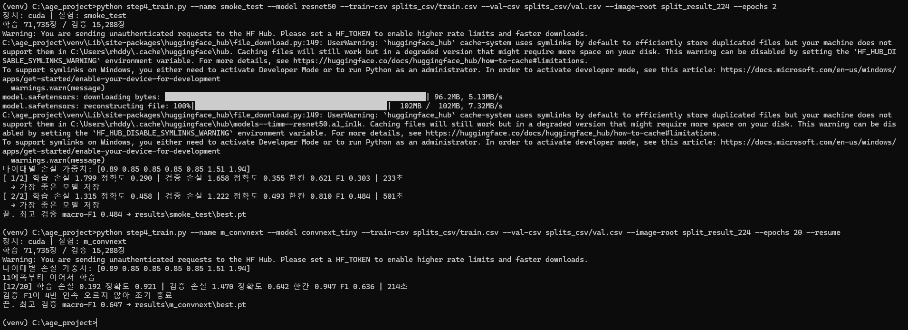

| 에폭 | 학습 손실 | 학습 정확도 | 검증 손실 | 검증 정확도 | 한 칸 차이 정확도 | macro-F1 | 걸린 시간 |
|---|---:|---:|---:|---:|---:|---:|---:|
| 12 (추가 실행) | 0.192 | 0.921 | 1.470 | 0.642 | 0.947 | 0.636 | 214초 |

- 12에폭의 macro-F1(0.636)은 최고 기록(0.648)보다 낮아서 **최종 모델(7에폭)은 바뀌지 않았습니다.** 따라서 비교 결과는 한 번에 학습한 것과 같습니다.
- 바뀐 것은 학습 기록(`history.csv`)과 학습 곡선 그래프에 12에폭 한 줄이 추가된 것뿐입니다.
- **코드 수정**: 이어하기를 할 때 이미 조기 종료 조건을 채웠으면 바로 멈추도록 `step4_train.py`와 `train_convnext.py`를 고쳤습니다. 이어하기 문구도 "11에폭까지 완료된 상태를 불러옴 → 12에폭부터 이어서 학습"처럼 헷갈리지 않게 바꿨습니다.

### 2-4. 검증 데이터 평가와 비교표

```
python step5_evaluate.py --exp-dir results/m_convnext --split-csv splits_csv/val.csv --image-root split_result_224 --tag val
python step5_evaluate.py --summary results --tag val
```


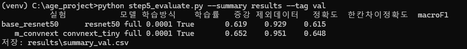

| 실험 이름 | 모델 | 학습 방식 | 학습률 | 증강 | 정확도 | 한 칸 차이 정확도 | macro-F1 |
|---|---|---|---|---|---:|---:|---:|
| base_resnet50 | ResNet-50 | 전체 미세조정 | 0.0001 | 적용 | 0.619 | 0.929 | 0.615 |
| m_convnext | ConvNeXt-Tiny | 전체 미세조정 | 0.0001 | 적용 | **0.652** | **0.951** | **0.648** |

모델을 뺀 나머지 조건(학습 방식, 학습률, 증강, 데이터)이 모두 같으므로 **공정한 비교**입니다. 다만 사전학습 가중치가 달랐던 점은 2-5에서 바로잡았습니다.

### 2-5. ImageNet-1k 가중치로 다시 학습: 사전학습 조건 맞추기 (2026-11-16)

결과를 해석하다가, 두 모델이 내려받은 사전학습 가중치가 서로 다르다는 것을 발견했습니다(3-4). timm에서 `convnext_tiny`라고만 쓰면 기본값인 `convnext_tiny.in12k_ft_in1k`(ImageNet-12k로 먼저 학습한 뒤 1k로 다듬은 가중치)를 받아 오기 때문입니다. ResNet-50(`resnet50.a1_in1k`)과 조건을 맞추려고 **ImageNet-1k로만 사전학습된 공식 가중치 `convnext_tiny.fb_in1k`**로 다시 학습했습니다. 코드는 고치지 않고 `--model` 값만 바꿨습니다.

```
python step4_train.py --name m_convnext_in1k --model convnext_tiny.fb_in1k --train-csv splits_csv/train.csv --val-csv splits_csv/val.csv --image-root split_result_224 --epochs 20
python step5_evaluate.py --exp-dir results/m_convnext_in1k --split-csv splits_csv/val.csv --image-root split_result_224 --tag val
```

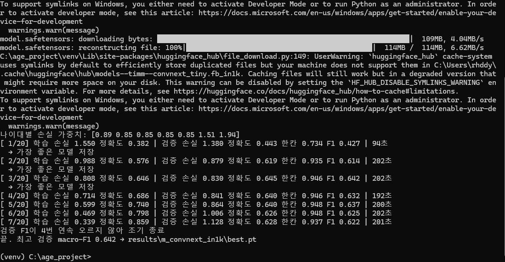

- 처음 실행 때 새 가중치(약 114MB)를 내려받았습니다. 화면의 `symlinks` 경고는 Windows에서 내려받은 파일을 저장하는 방식에 대한 안내라 학습에는 영향이 없습니다.
- **3에폭에서 최고 성능**(검증 macro-F1 0.642)이 나왔고, 4~7에폭은 이 기록을 넘지 못해 **7에폭에서 조기 종료**되었습니다. 12k→1k 가중치(7에폭이 최고)보다 더 빨리 최고점에 도달했습니다.

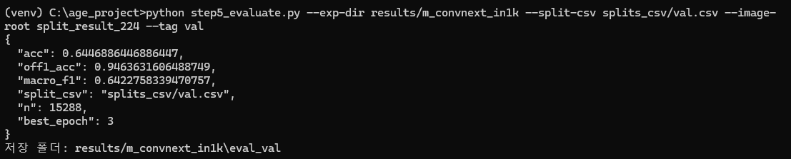

| 사전학습 가중치 | 1에폭 검증 정확도 (출력층만 학습) | 정확도 | 한 칸 차이 정확도 | macro-F1 | 가장 좋았던 에폭 |
|---|---:|---:|---:|---:|---:|
| ResNet-50 (`a1_in1k`) | 35.5% | 61.9% | 92.9% | 0.615 | 8 |
| ConvNeXt-Tiny (`fb_in1k`) | 44.3% | **64.5%** | **94.6%** | **0.642** | 3 |
| ConvNeXt-Tiny (`in12k_ft_in1k`, 참고) | 54.6% | 65.2% | 95.1% | 0.648 | 7 |

해석은 3-4에 있습니다.

### 2-6. 증강 없이 학습: 증강 유무 비교 (2026-11-22)

증강이 실제로 도움이 됐는지 확인하려고, ImageNet-1k 가중치 ConvNeXt를 **증강만 끄고 나머지 조건은 모두 그대로** 둔 채 다시 학습했습니다. 뒤쪽 에폭의 흐름까지 보려고 조기 종료 없이(`--patience 100`) **20에폭까지** 학습했습니다.

```
python step4_train.py --name noaug_convnext --model convnext_tiny.fb_in1k --no-augment --patience 100 --train-csv splits_csv/train.csv --val-csv splits_csv/val.csv --image-root split_result_224 --epochs 20
python step5_evaluate.py --exp-dir results/noaug_convnext --split-csv splits_csv/val.csv --image-root split_result_224 --tag val
```

학습, 평가, 비교 그래프를 한 번에 실행하는 파일은 [`code/run_augment_compare.bat`](code/run_augment_compare.bat)입니다.

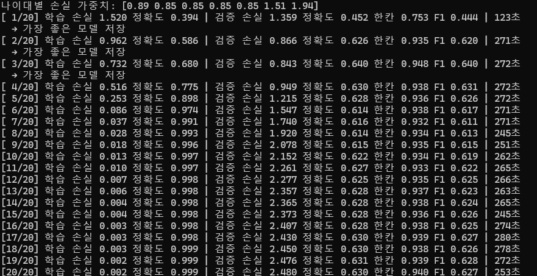

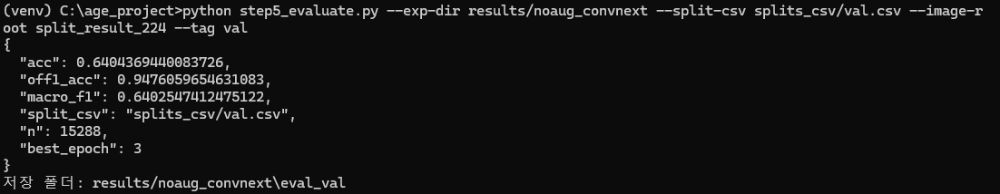

| 에폭 | 학습 정확도 (있음 → **없음**) | 검증 정확도 (있음 → **없음**) | 검증 손실 (있음 → **없음**) | macro-F1 (있음 → **없음**) |
|---:|---|---|---|---|
| 1 | 0.382 → **0.394** | 0.443 → **0.452** | 1.380 → **1.359** | 0.427 → **0.444** |
| 2 | 0.576 → **0.586** | 0.619 → **0.626** | 0.879 → **0.866** | 0.614 → **0.620** |
| 3 | 0.646 → **0.680** | 0.645 → **0.640** | 0.830 → **0.843** | **0.642 (최고)** → **0.640 (최고)** |
| 4 | 0.686 → **0.775** | 0.640 → **0.630** | 0.841 → **0.949** | 0.632 → **0.631** |
| 5 | 0.740 → **0.898** | 0.640 → **0.628** | 0.864 → **1.215** | 0.637 → **0.626** |
| 6 | 0.798 → **0.974** | 0.626 → **0.614** | 1.006 → **1.547** | 0.625 → **0.617** |
| 7 | 0.859 → **0.991** | 0.628 → **0.616** | 1.128 → **1.740** | 0.622 → **0.611** |
| 20 | — → **0.999** | — → **0.630** | — → **2.480** | — → **0.627** |

증강 있는 쪽은 7에폭에서 조기 종료되어 8에폭 이후 기록이 없습니다.

| | 정확도 | 한 칸 차이 정확도 | macro-F1 | 가장 좋았던 에폭 |
|---|---:|---:|---:|---:|
| 증강 있음 (`m_convnext_in1k`) | **64.5%** | 94.6% | **0.642** | 3 |
| 증강 없음 (`noaug_convnext`) | 64.0% | **94.8%** | 0.640 | 3 |
| 차이 | −0.5%p | +0.2%p | −0.002 | 같음 |

해석은 3-6에 있습니다.

---

## 3. 결과 해석

> 3-1 ~ 3-3, 3-5는 처음 실험(`m_convnext`, ImageNet-12k → 1k 가중치) 기준입니다. ImageNet-1k 가중치로 맞춘 결과는 3-4와 3-6에 있습니다.

### 3-1. 혼동 행렬: 나이대별로 얼마나 맞혔나

| ConvNeXt-Tiny | ResNet-50 |
|---|---|
|  |  |

| 실제 나이대 | ResNet-50 | ConvNeXt-Tiny | 차이 |
|---|---:|---:|---:|
| 0~9세 | 91% | **93%** | +2%p |
| 10대 | 75% | **77%** | +2%p |
| 20대 | 58% | **64%** | +6%p |
| 30대 | 47% | **50%** | +3%p |
| 40대 | 45% | **48%** | +3%p |
| 50대 | 48% | **52%** | +4%p |
| 60세 이상 | 66% | **71%** | +5%p |

**① ConvNeXt가 7개 나이대 모두에서 더 잘 맞혔습니다.** 특정 나이대만 좋아진 것이 아니라 전체적으로 나아졌고, 특히 20대(+6%p)와 60세 이상(+5%p)에서 차이가 컸습니다.

**② 어린 나이와 많은 나이는 쉽고, 중간 나이대는 어려웠습니다.**
- 0~9세(91~93%): 아이의 얼굴은 비율과 생김새가 어른과 뚜렷하게 다릅니다.
- 60세 이상(66~71%): 깊은 주름이나 흰머리처럼 눈에 띄는 단서가 있습니다.
- 30~50대(45~52%): 얼굴이 천천히 변하는 시기라 이웃 나이대와 구분하기 어렵습니다.

**③ 데이터의 양보다 얼굴 생김새의 차이가 더 중요했습니다.**
- 처음에는 사진이 가장 적은 50대와 60세 이상이 가장 어려울 것이라고 예상했습니다. 하지만 실제로는 **사진이 가장 많은 30대와 40대(각 12,000장)의 정확도가 가장 낮았습니다.**
- 60세 이상은 사진이 가장 적은데도(5,269장) 70% 안팎을 맞혔습니다. 손실 가중치로 사진이 적은 나이대를 보정한 효과도 있지만, 성능은 **이웃 나이대와 얼굴이 얼마나 비슷한지**에 더 크게 좌우된 것으로 보입니다.

**④ 틀린 경우는 대부분 바로 옆 나이대였습니다.**
- 30대는 20대로 28%, 40대로 16~18% 틀렸고, 20대는 30대로 27% 틀렸습니다. 50대와 60세 이상은 서로 18~26% 헷갈렸습니다.
- 두 칸 이상 떨어진 나이대로 틀린 비율은 대부분 0~2%입니다. 두 칸 이상 크게 틀린 비율은 ResNet-50이 7.1%, ConvNeXt가 4.9%로, **ConvNeXt가 크게 빗나가는 예측을 약 30% 줄였습니다.**

**⑤ 20대는 10대보다 30대로 훨씬 많이 틀렸습니다.** 20대를 10대로 틀린 비율은 5~8%인데, 30대로 틀린 비율은 27%입니다. 화장이나 사진 보정, 데이터셋마다 나이를 매긴 기준(실제 나이와 겉보기 나이)이 다른 점 등이 원인일 수 있습니다.

### 3-2. 학습 곡선: 과적합 비교

| ConvNeXt-Tiny | ResNet-50 |
|---|---|
|  |  |

ConvNeXt 그래프의 마지막 점(12에폭)은 2-3에서 설명한 이어하기로 추가 실행된 에폭입니다.

| 12에폭 기준 | 학습 정확도 | 검증 정확도 | 차이 | 학습 손실 | 검증 손실 |
|---|---:|---:|---:|---:|---:|
| ResNet-50 | 72.6% | 61.4% | 11%p | 0.627 | 0.947 |
| ConvNeXt-Tiny | 92.1% | 64.2% | **28%p** | 0.192 | **1.470** |

- **ResNet-50**: 4에폭 이후 검증 손실은 0.9 근처에서 거의 그대로이고, 학습 손실만 줄어들었습니다. 과적합이 **완만한 편**입니다.
- **ConvNeXt-Tiny**: 검증 손실은 4에폭에서 가장 낮았고(약 0.82), 7에폭 이후 **가파르게 올라 12에폭에는 1.47까지** 늘었습니다. 학습 정확도는 92%까지 올랐지만 검증 정확도는 64~65%에서 멈췄습니다. 학습 사진을 빠르게 외우는 **뚜렷한 과적합**입니다.
- **검증 손실이 가장 낮았던 에폭(4)과 점수가 가장 좋았던 에폭(7)이 다릅니다.** 4에폭 이후의 모델은 정답을 조금씩 더 맞혔지만, 틀릴 때 지나치게 확신해서 손실(벌점)이 커졌습니다. 조기 종료 기준을 손실이 아닌 **macro-F1**로 정했기 때문에, 나이대를 맞히는 목적에 맞는 7에폭 모델이 선택되었습니다.
- 1에폭에서 검증 정확도가 학습 정확도보다 높게 나온 것은, 학습 정확도가 에폭 동안 점점 나아지는 모델의 평균값이고 증강으로 일부러 어렵게 바꾼 사진으로 측정했기 때문입니다.

### 3-3. 20에폭까지 추가 학습: 조기 종료가 적절했나

조기 종료로 멈추지 않았다면 더 좋아졌을지 확인하려고, 두 모델을 저장된 상태에서 이어서 **20에폭까지** 학습했습니다. 원래 결과를 덮어쓰지 않도록 결과 폴더를 복사(`full20_resnet50`, `full20_convnext`)한 뒤, 조기 종료가 걸리지 않게 `--patience 100`을 주었습니다. 학습률 조절은 처음부터 20에폭 기준으로 설정되어 있었기 때문에, 처음부터 20에폭을 학습한 것과 같은 흐름입니다.

```
python step4_train.py --name full20_convnext --model convnext_tiny --train-csv splits_csv/train.csv --val-csv splits_csv/val.csv --image-root split_result_224 --epochs 20 --patience 100 --resume
```

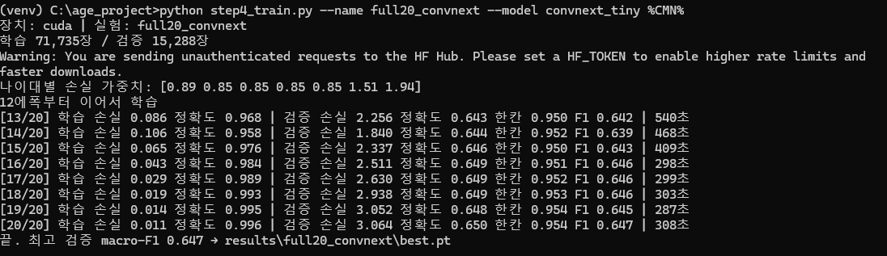

| 에폭 | 학습 손실 | 학습 정확도 | 검증 손실 | 검증 정확도 | 한 칸 차이 정확도 | macro-F1 | 걸린 시간 |
|---|---:|---:|---:|---:|---:|---:|---:|
| 13 | 0.086 | 0.968 | 2.256 | 0.643 | 0.950 | 0.642 | 540초 |
| 14 | 0.106 | 0.958 | 1.840 | 0.644 | 0.952 | 0.639 | 468초 |
| 15 | 0.065 | 0.976 | 2.337 | 0.646 | 0.950 | 0.643 | 409초 |
| 16 | 0.043 | 0.984 | 2.511 | 0.649 | 0.951 | 0.646 | 298초 |
| 17 | 0.029 | 0.989 | 2.630 | 0.649 | 0.952 | 0.646 | 299초 |
| 18 | 0.019 | 0.993 | 2.938 | 0.649 | 0.953 | 0.646 | 303초 |
| 19 | 0.014 | 0.995 | 3.052 | 0.648 | 0.954 | 0.645 | 287초 |
| 20 | 0.011 | **0.996** | **3.064** | 0.650 | 0.954 | 0.647 | 308초 |


| 실험 | 정확도 | 한 칸 차이 정확도 | macro-F1 | 최종 모델 에폭 |
|---|---:|---:|---:|---:|
| ResNet-50 (조기 종료) | 61.9% | 92.9% | 0.615 | 8 |
| ResNet-50 (20에폭까지) | 61.9% | 92.9% | 0.615 | 8 |
| ConvNeXt-Tiny (조기 종료) | 65.2% | 95.1% | 0.648 | 7 |
| ConvNeXt-Tiny (20에폭까지) | 65.2% | 95.1% | 0.648 | 7 |

**① 최고 성능은 바뀌지 않았습니다.** 두 모델 모두 20에폭까지 학습해도 조기 종료 때 고른 에폭(ResNet-50 8, ConvNeXt 7)의 기록을 넘지 못했습니다. 그래서 비교표의 두 줄이 완전히 같습니다. ConvNeXt는 20에폭에 macro-F1 0.647로 최고 기록(0.648)에 가까워졌지만 넘지는 못했습니다.

**② ConvNeXt는 학습 사진을 거의 다 외웠습니다.** 학습 정확도가 99.6%, 학습 손실이 0.011까지 내려갔지만, 검증 정확도는 64~65%에서 그대로였습니다. 외운 만큼 처음 보는 사진을 더 잘 맞히게 되지는 않았습니다.

**③ 검증 손실은 두 배 넘게 늘었는데 정확도는 그대로였습니다.** 검증 손실은 1.47(12에폭)에서 3.06(20에폭)으로 늘었습니다. 맞히는 비율은 비슷한데, 틀릴 때 지나치게 확신하고 틀리게 되어 벌점(손실)만 커진 것입니다. 손실이 아니라 macro-F1로 조기 종료한 것이 적절했다는 근거입니다. 시연 화면에서 보여주는 예측 확률도 지나치게 확신하는 20에폭 모델보다 7에폭 모델이 더 믿을 만합니다.

**④ 두 모델의 과적합 비교 (20에폭 기준)**

| 20에폭 기준 | 학습 정확도 | 검증 정확도 | 차이 | 검증 손실 |
|---|---:|---:|---:|---:|
| ResNet-50 | 81.1% | 61.3% | 약 20%p | 1.020 |
| ConvNeXt-Tiny | **99.6%** | 65.0% | **약 35%p** | **3.064** |

**⑤ 조기 종료로 시간을 아끼고 성능 손해는 없었습니다.** 추가 학습에 ResNet-50은 약 35분, ConvNeXt는 약 50분이 더 들었지만 성능은 나아지지 않았습니다.

### 3-4. ConvNeXt가 더 좋았던 이유와 주의할 점

1. **구조의 차이**: ConvNeXt는 한 번에 더 넓은 영역(7×7)을 보고 최신 설계를 적용해서, 얼굴의 특징을 더 잘 잡아냅니다. 그 대신 학습 사진도 더 빨리 외웁니다(과적합이 더 큼).
2. **사전학습 데이터의 차이 (한계)**: 두 모델이 내려받은 사전학습 가중치가 서로 다릅니다.

| 모델 | 사전학습 가중치 | 사전학습에 쓰인 데이터 |
|---|---|---|
| ResNet-50 | `resnet50.a1_in1k` | ImageNet-1k (1천 종류의 사진) |
| ConvNeXt-Tiny | `convnext_tiny.in12k_ft_in1k` | ImageNet-12k(약 1만 2천 종류)로 먼저 학습한 뒤 ImageNet-1k로 한 번 더 다듬음 |

두 가중치 모두 우리가 직접 고른 것이 아니라, timm 라이브러리가 기본으로 내려받는 버전입니다. 출력층만 학습하는 1에폭부터 ConvNeXt가 크게 앞선 것도 이 영향이 커 보입니다. 따라서 **두 모델의 성능 차이에는 구조의 차이와 사전학습 데이터의 차이가 함께 섞여 있습니다.**

**→ 2-5에서 직접 확인했습니다.** ConvNeXt를 ResNet-50과 같은 ImageNet-1k 가중치로 다시 학습해, 두 효과를 나눠 봤습니다.

| 비교 | 바뀐 것 | macro-F1 변화 | 의미 |
|---|---|---:|---|
| ResNet-50 (1k) → ConvNeXt (1k) | 구조만 | 0.615 → 0.642 (**+0.027**) | 구조 효과 |
| ConvNeXt (1k) → ConvNeXt (12k→1k) | 사전학습 데이터만 | 0.642 → 0.648 (+0.006) | 사전학습 데이터 효과 |

- 전체 차이(0.033) 중 **약 80%가 구조 차이**에서 왔습니다. 사전학습 조건을 맞춰도 ConvNeXt가 더 좋다는 결론은 그대로입니다.
- 더 큰 사전학습 데이터는 출발점(1에폭 검증 정확도 44.3% → 54.6%)을 크게 높였지만, 우리 데이터(약 7만 장)로 학습하면서 그 차이가 대부분 메워졌습니다.
- 각 실험을 한 번씩만 학습했으므로, 0.006처럼 작은 차이는 우연일 수 있습니다.

### 3-5. 정리

> ConvNeXt-Tiny는 정확도 65.2%, 한 칸 차이 정확도 95.1%, macro-F1 0.648로 ResNet-50(61.9%, 92.9%, 0.615)보다 모든 지표에서 높았고, 7개 나이대 모두에서 더 잘 맞혔습니다. 두 모델 모두 0~9세와 60세 이상은 잘 맞혔지만 30~50대는 50% 안팎으로 가장 어려워했고, 틀린 경우는 대부분 바로 옆 나이대였습니다. ConvNeXt는 과적합이 빠르고 크게 나타났으며, macro-F1 기준 조기 종료로 11에폭에서 멈추고 7에폭의 모델을 최종 모델로 사용했습니다. 20에폭까지 추가로 학습해도 두 모델의 최고 성능은 바뀌지 않아, 조기 종료가 성능 손해 없이 학습 시간을 줄였음을 확인했습니다. 다만 ConvNeXt는 더 많은 데이터로 사전학습된 가중치를 사용했기 때문에, 성능 차이에는 사전학습 데이터의 영향도 섞여 있습니다.

### 3-6. 증강 유무 비교: ConvNeXt에서는 왜 차이가 없었나


그래프는 2-5, 2-6의 학습 기록 값으로 그렸습니다. 증강 있음은 7에폭에서 조기 종료되어 7에폭까지만 표시했습니다.

- **최고 성능은 거의 같습니다.** 증강 있음 0.642, 없음 0.640으로 차이가 0.002이고, 둘 다 3에폭에서 최고점이 나왔습니다. 한 번씩만 학습한 실험이라 이 정도는 차이가 없다고 보는 것이 맞습니다.
- **과적합 속도는 확실히 다릅니다.** 증강이 없으면 학습 정확도가 5에폭 89.8%, 7에폭 99.1%로 학습 사진을 거의 다 외웠습니다. 같은 7에폭에 증강이 있을 때는 85.9%였습니다. 검증 손실도 7에폭 기준 1.128(있음)과 1.740(없음)으로 차이가 컸고, 증강이 없으면 20에폭에 2.480까지 올라갔습니다.
- **왜 최고 성능은 같았을까**: ConvNeXt는 증강과 상관없이 **3에폭 만에 최고점**에 도달했습니다. 증강은 학습 사진을 외우는 것을 늦추는 역할인데, ConvNeXt는 본격적으로 외우기 전에 이미 최고점을 찍었기 때문에 증강이 최고 성능을 끌어올릴 여지가 거의 없었던 것으로 보입니다.
- **ResNet-50과의 차이**: 천천히 학습하는 ResNet-50(최고 8에폭)은 증강이 없으면 4에폭부터 외우기 시작해 macro-F1이 0.038 떨어졌습니다([ResNet50 폴더](../ResNet50) 3-3). 즉 **증강은 두 모델 모두에서 과적합을 늦췄고, 그 효과가 최종 성능 차이로 이어지는지는 모델이 최고점에 얼마나 빨리 도달하느냐에 따라 달랐습니다.**
- 증강 없는 ConvNeXt(0.640)도 증강 있는 ResNet-50(0.615)보다 높아, 이번 실험에서는 **구조 차이의 효과가 증강 효과보다 컸습니다.**

| 모델 | 증강 있음 | 증강 없음 | 증강 효과 (macro-F1) | 최고 에폭 (있음 → 없음) |
|---|---:|---:|---:|---|
| ResNet-50 | 0.615 | 0.577 | **+0.038** | 8 → 4 |
| ConvNeXt-Tiny (1k) | 0.642 | 0.640 | +0.002 | 3 → 3 |

---

## 4. 앞으로 할 일

- [x] 20에폭까지 추가 학습으로 조기 종료 효과 확인 (3-3)
- [x] 이어하기 때 조기 종료 조건을 다시 확인하도록 학습 코드 수정 (2-3)
- [x] 공정한 구조 비교: ImageNet-1k 가중치(`convnext_tiny.fb_in1k`)로 다시 학습 (2-5, 3-4)
- [x] 증강 유무 비교 (2-6, 3-6)

- [ ] 최종 모델 정하기(새 데이터 검증 결과로는 ImageNet-1k 가중치 ConvNeXt-Tiny, 증강 있음 `v2_convnext`의 4에폭 모델). 그 뒤 시험 데이터로 **한 번만** 평가합니다.
  ```
  python step5_evaluate.py --exp-dir results/v2_convnext --split-csv splits_csv_v2/test.csv --image-root data_v2 --tag test
  ```
- [ ] Grad-CAM으로 30대·40대를 틀린 사진에서 모델이 얼굴의 어디를 보고 판단했는지 확인합니다.
  ```
  python step6_gradcam.py --exp-dir results/v2_convnext --split-csv splits_csv_v2/val.csv --image-root data_v2 --per-band 4
  ```
- [ ] (선택) ConvNeXt의 과적합 줄이기: 학습률을 0.00005로 낮추거나 증강을 더 강하게 해서 다시 학습합니다.
- [ ] (선택) 증강 있는 ConvNeXt(1k)도 20에폭까지 학습(`full20_convnext_in1k`)해, 증강 없음과 20에폭 전체 곡선을 나란히 비교합니다.
