# ResNet-50 학습 기록

전처리된 얼굴 사진(224×224)으로 **ResNet-50**을 학습시켜, 사진 속 인물의 나이대를 7개(0~9세, 10대, 20대, 30대, 40대, 50대, 60세 이상) 중 하나로 분류한 과정과 결과를 정리한 문서입니다.

- **담당**: 모델 학습 (ResNet-50, ConvNeXt-Tiny)
- **작성일**: 2026년 11월 9일
- **진행 상황**: 학습과 검증 평가를 마쳤습니다. 8번째 에폭의 모델이 가장 좋았고, 12번째 에폭에서 학습이 자동으로 멈췄습니다(조기 종료).
- ConvNeXt-Tiny의 결과와 두 모델의 비교는 [ConvNeXt 폴더](../ConvNeXt)에 정리했습니다.

> **용어 안내**
> - **에폭**: 학습 데이터 전체를 한 번 다 보는 것을 1에폭이라고 합니다.
> - **한 칸 차이 정확도**: 정답이거나 바로 옆 나이대를 맞힌 비율입니다.
> - **macro-F1**: 나이대마다 점수를 따로 낸 뒤 평균한 값입니다. 사진이 적은 나이대의 성능도 똑같이 반영됩니다.

## 결과 요약 (검증 데이터 15,288장)

| 정확도 | 한 칸 차이 정확도 | macro-F1 | 가장 좋았던 에폭 |
|---:|---:|---:|---:|
| 61.9% | 92.9% | 0.615 | 8 |

## 모델의 역할

- **학습 방식**: 이미 학습된 모델을 가져와 우리 데이터로 추가 학습(미세조정)했습니다. PyTorch와 timm 라이브러리를 사용했습니다.
- **역할**: 기준 모델입니다. 비교 실험은 이 모델을 기본으로 두고 조건을 하나씩만 바꿔 진행합니다.
- **비교 실험 계획**
  - 모델 구조: 작은 CNN / ResNet-50 / ConvNeXt-Tiny (ConvNeXt-Tiny와의 비교는 [ConvNeXt 폴더](../ConvNeXt) 참고)
  - 학습 방법: 마지막 층만 학습 / 전체 미세조정
  - 데이터 전처리: 증강 적용 / 미적용, 보강 데이터 포함 / 미포함
  - 하이퍼파라미터: 학습률 0.001 / 0.0001 / 0.00001

---

## 1. 실행 환경

| 항목 | 내용 |
|---|---|
| 컴퓨터 | 데스크톱, NVIDIA GeForce RTX 3070 (그래픽 메모리 8GB) |
| 운영체제 | Windows |
| 파이썬 | Python 3.11, 가상환경(`venv`) 사용 |
| 주요 라이브러리 | PyTorch(GPU 버전), torchvision, timm, pandas, scikit-learn, matplotlib, tqdm, pillow, grad-cam |
| 작업 폴더 | `C:\age_project` |

작업 폴더는 다음과 같이 구성했습니다.

```
C:\age_project\
├─ venv\                 가상환경
├─ split_result_224\     전처리 담당 팀원이 나눈 데이터 (training / validation / testing)
├─ splits_csv\           학습 코드가 읽는 CSV 파일 (make_split_csv.py로 생성)
├─ results\              학습 결과 (실험별 폴더)
├─ common.py
├─ make_split_csv.py
├─ step4_train.py
├─ step5_evaluate.py
└─ run_models.bat
```

사용한 코드는 이 폴더의 [`code`](code/) 폴더에 있으며, 이 폴더만으로 ResNet-50의 학습과 평가를 그대로 다시 실행할 수 있습니다.

| 파일 | 하는 일 |
|---|---|
| `common.py` | 나이대 정의, 모델 만들기, 사진 변환(증강·정규화), 평가 지표 계산 |
| `make_split_csv.py` | 팀원이 나눈 `split_result_224` 폴더를 학습용 CSV 파일로 변환 |
| `step4_train.py` | 모델 학습 (`--model resnet50`) |
| `step5_evaluate.py` | 평가, 혼동 행렬·학습 곡선 그리기, 실험 비교표 만들기 |
| `step6_gradcam.py` | Grad-CAM 열지도 만들기 |
| `run_resnet50.bat` | ResNet-50 학습과 검증 평가를 한 번에 실행 |
| `requirements.txt` | 필요한 라이브러리 목록 |

> 실제 실험에서는 ResNet-50과 ConvNeXt-Tiny를 이어서 학습하는 `run_models.bat` 파일 하나로 실행했습니다. 저장소 규칙(모델별 폴더 분리)에 맞추기 위해 모델별 실행 파일로 나누어 올렸습니다. 날짜별 작업 기록은 [개발일지](../개발일지/KIMDONGHWI)에 있습니다.

---

## 2. 진행 과정

### 2-1. 가상환경 만들기와 라이브러리 설치

```
cd C:\
mkdir age_project
cd age_project
python -m venv venv
venv\Scripts\activate
pip install timm pandas scikit-learn matplotlib tqdm pillow grad-cam
```

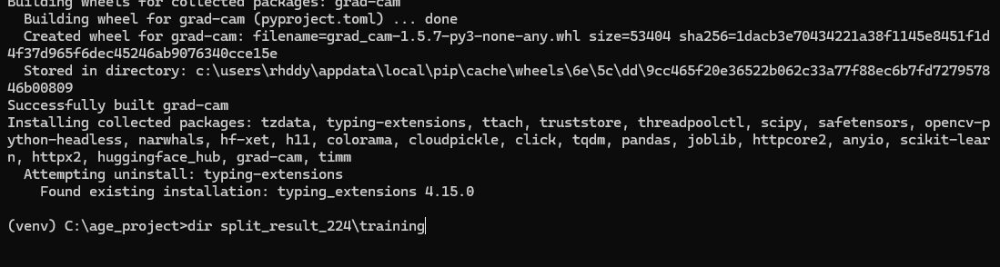

> **문제**: 설치 도중 `Found existing installation: typing_extensions`가 나온 뒤, 설치 완료 문구(`Successfully installed`) 없이 끝났습니다. 명령 프롬프트에서 Ctrl+C를 눌러 설치가 중단된 것이었습니다. 명령 프롬프트에서 Ctrl+C는 복사가 아니라 **실행 중지** 기능입니다.
>
> **해결**: 같은 설치 명령을 다시 실행했습니다.

### 2-2. 팀원이 나눈 데이터 확인

전처리 담당 팀원이 나눈 `split_result_224` 폴더(training / validation / testing)를 그대로 사용했습니다. 팀 전체가 같은 분리를 써야 실험 결과를 서로 비교할 수 있기 때문입니다.

```
dir split_result_224\training
```

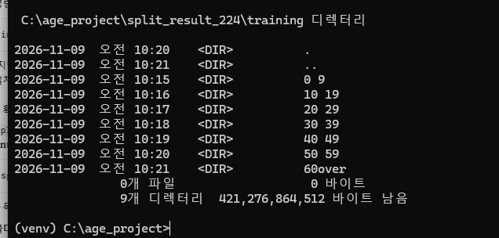

- 각 폴더 안에는 나이대별 폴더 7개(`0 9`, `10 19`, `20 29`, `30 39`, `40 49`, `50 59`, `60over`)가 있습니다.
- 학습 코드는 "사진 경로 + 나이대 번호"가 적힌 CSV 파일을 읽기 때문에, 폴더 구조를 CSV로 바꿔 주는 `make_split_csv.py`를 만들었습니다.
- 처음 버전은 `10 19`처럼 숫자 사이에 띄어쓰기가 있는 폴더 이름을 잘못 읽어서, 앞의 숫자만 읽도록 고쳤습니다.

### 2-3. 오류 1: pandas가 설치되지 않음

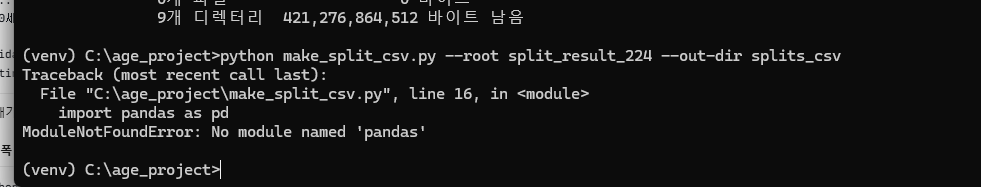

> **원인**: 2-1의 설치가 중간에 끊겨 pandas가 설치되지 않았습니다.
>
> **해결**: 라이브러리 설치 명령을 다시 실행했습니다.

### 2-4. 오류 2: GPU를 인식하지 못함

```
python -c "import pandas, timm, sklearn, torch; print('OK', torch.cuda.is_available())"
```

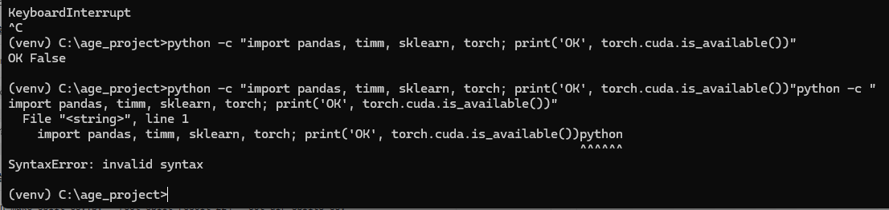

> **원인**: timm과 grad-cam을 설치할 때 **CPU 전용 PyTorch**가 함께 설치되었습니다. 이 상태에서는 그래픽카드를 사용할 수 없습니다.
>
> **해결**: CPU용 PyTorch를 지우고(`pip uninstall -y torch torchvision`), PyTorch 공식 홈페이지의 설치 명령으로 GPU용 PyTorch를 다시 설치했습니다.

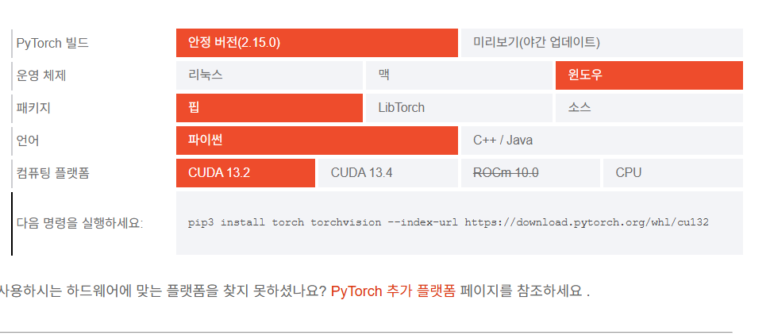

- `nvidia-smi`로 확인한 그래픽 드라이버의 지원 CUDA 버전은 **12.8**이었습니다.
- PyTorch 홈페이지의 기본 설치 버전은 **CUDA 13.2용**(안정 버전 2.15.0)이었습니다. 드라이버가 지원하는 버전보다 높아서 드라이버 업데이트가 필요할 수 있다고 판단했습니다.
- 실제로는 **PyTorch 2.15.0(CUDA 13.2용)을 그대로 설치**했는데도 GPU가 정상적으로 인식되었습니다(`True`). 설치된 드라이버가 이미 이 버전을 지원한 것으로 보입니다.

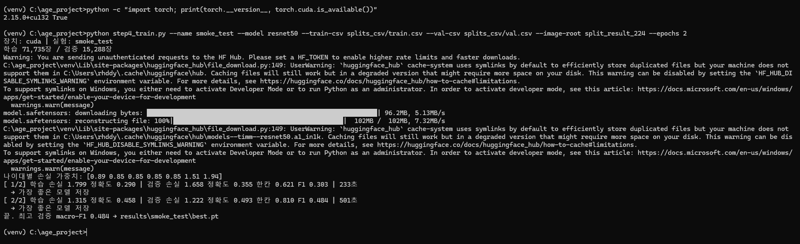

### 2-5. 오류 3: common.py를 찾지 못함

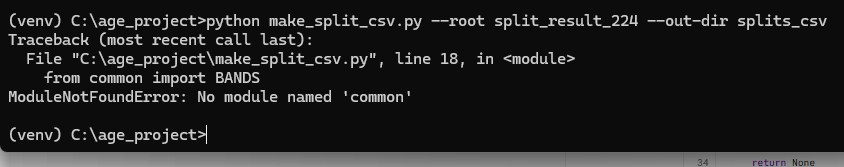

> **원인**: `make_split_csv.py`는 같은 폴더에 있는 `common.py`(나이대 이름 정의)를 불러오는데, 이 파일이 작업 폴더에 없었습니다.
>
> **해결**: `common.py`, `step4_train.py`, `step5_evaluate.py`를 작업 폴더(`C:\age_project`)에 넣었습니다.

### 2-6. CSV 변환 결과

```
python make_split_csv.py --root split_result_224 --out-dir splits_csv
```

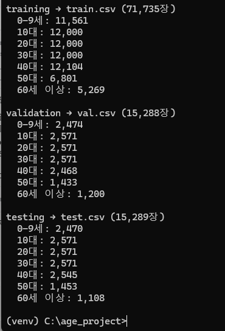

| 나이대 | 학습 | 검증 | 시험 |
|---|---:|---:|---:|
| 0~9세 | 11,561 | 2,474 | 2,470 |
| 10대 | 12,000 | 2,571 | 2,571 |
| 20대 | 12,000 | 2,571 | 2,571 |
| 30대 | 12,000 | 2,571 | 2,571 |
| 40대 | 12,104 | 2,468 | 2,545 |
| 50대 | 6,801 | 1,433 | 1,453 |
| 60세 이상 | 5,269 | 1,200 | 1,108 |
| **합계** | **71,735** | **15,288** | **15,289** |

- 전체 102,312장을 **70 : 15 : 15** 비율로 나누었습니다.
- 학습 데이터의 10대~30대는 각각 12,000장으로 장수가 제한되어 있습니다.
- **50대와 60세 이상은 다른 나이대의 절반 정도로 적습니다.** 그래서 학습할 때 사진이 적은 나이대에 손실 가중치를 더 주어 보정했습니다(2-7 참고).

### 2-7. 시험 학습 (2에폭)

본 학습 전에 전체 과정이 문제없이 돌아가는지 확인하려고 2에폭만 짧게 학습했습니다.

```
python step4_train.py --name smoke_test --model resnet50 --train-csv splits_csv/train.csv --val-csv splits_csv/val.csv --image-root split_result_224 --epochs 2
```

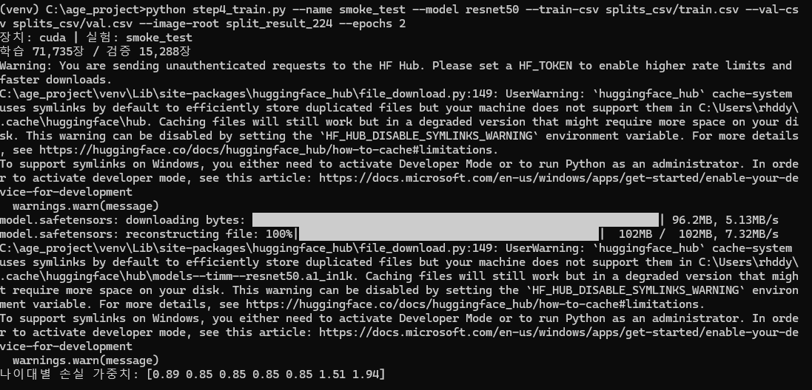

- `장치: cuda`가 출력되어 GPU로 학습하는 것을 확인했습니다.
- ResNet-50의 사전학습 가중치(`resnet50.a1_in1k`, 약 102MB)를 허깅페이스(Hugging Face)에서 자동으로 내려받았습니다.
- `HF_TOKEN`, `symlink` 관련 경고는 다운로드 방식에 대한 안내일 뿐, 학습에는 영향이 없습니다.
- **나이대별 손실 가중치**는 `[0.89 0.85 0.85 0.85 0.85 1.51 1.94]`로 계산되었습니다. 사진이 적은 50대(1.51)와 60세 이상(1.94)을 틀리면 벌점을 더 크게 줍니다.

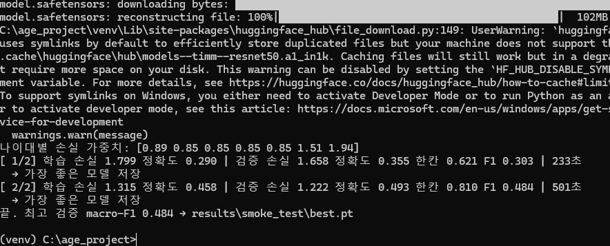

| 에폭 | 학습 손실 | 학습 정확도 | 검증 손실 | 검증 정확도 | 한 칸 차이 정확도 | macro-F1 | 걸린 시간 |
|---|---:|---:|---:|---:|---:|---:|---:|
| 1 | 1.799 | 0.290 | 1.658 | 0.355 | 0.621 | 0.303 | 233초 |
| 2 | 1.315 | 0.458 | 1.222 | 0.493 | 0.810 | 0.484 | 501초 |

- 1에폭에서는 모델의 몸통을 고정하고 마지막 층만 학습해서 빠르게 끝났습니다(233초). 2에폭부터는 전체를 학습해서 시간이 약 2배 걸렸습니다(501초).
- 학습 손실과 검증 손실이 함께 줄어들어, 아직 과적합은 보이지 않았습니다.

### 2-8. 본 학습

`run_models.bat`으로 ResNet-50과 ConvNeXt-Tiny를 차례로 최대 20에폭씩 학습하고, 끝난 뒤 검증 평가와 비교표 생성까지 자동으로 진행했습니다.

```
set CMN=--train-csv splits_csv/train.csv --val-csv splits_csv/val.csv --image-root split_result_224 --epochs 20
python step4_train.py --name base_resnet50 --model resnet50 %CMN%
python step4_train.py --name m_convnext --model convnext_tiny %CMN%
```

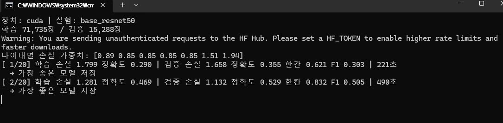

| 에폭 | 학습 손실 | 학습 정확도 | 검증 손실 | 검증 정확도 | 한 칸 차이 정확도 | macro-F1 | 걸린 시간 |
|---|---:|---:|---:|---:|---:|---:|---:|
| 1/20 | 1.799 | 0.290 | 1.658 | 0.355 | 0.621 | 0.303 | 221초 |
| 2/20 | 1.281 | 0.469 | 1.132 | 0.529 | 0.832 | 0.505 | 490초 |

- 2에폭 점수가 시험 학습 때보다 높게 나왔습니다. 본 학습은 20에폭에 맞춰 학습률을 천천히 줄이도록 설정되어 있어서, 2에폭 시점의 학습률이 시험 학습 때보다 높게 유지되었기 때문입니다.

### 2-9. 조기 종료

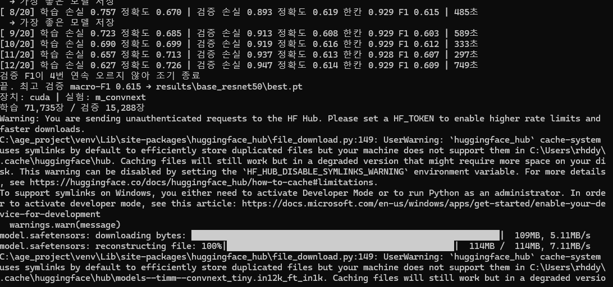

| 에폭 | 학습 손실 | 학습 정확도 | 검증 손실 | 검증 정확도 | 한 칸 차이 정확도 | macro-F1 | 걸린 시간 |
|---|---:|---:|---:|---:|---:|---:|---:|
| 8 (최고) | 0.757 | 0.670 | **0.893** | **0.619** | 0.929 | **0.615** | 485초 |
| 9 | 0.723 | 0.685 | 0.913 | 0.608 | 0.929 | 0.603 | 589초 |
| 10 | 0.690 | 0.699 | 0.919 | 0.616 | 0.929 | 0.612 | 333초 |
| 11 | 0.657 | 0.713 | 0.937 | 0.613 | 0.928 | 0.607 | 297초 |
| 12 | 0.627 | 0.726 | 0.947 | 0.614 | 0.929 | 0.609 | 749초 |

- 8에폭 이후 **학습 손실은 계속 줄었지만(0.757 → 0.627), 검증 손실은 오히려 늘었습니다(0.893 → 0.947).** 모델이 학습 사진을 외우기 시작했다는 신호(과적합)입니다.
- 검증 macro-F1이 4에폭 연속으로 오르지 않아 12에폭에서 학습이 자동으로 멈췄고, **8에폭의 모델**이 최종 모델로 저장되었습니다.
- 에폭마다 걸린 시간(297~749초)이 들쭉날쭉한 것은 학습 중 컴퓨터에서 다른 작업을 했거나 디스크 읽기 속도가 달라졌기 때문으로 보입니다. 결과에는 영향이 없습니다.

### 2-10. 검증 데이터 평가

```
python step5_evaluate.py --exp-dir results/base_resnet50 --split-csv splits_csv/val.csv --image-root split_result_224 --tag val
python step5_evaluate.py --summary results --tag val
```

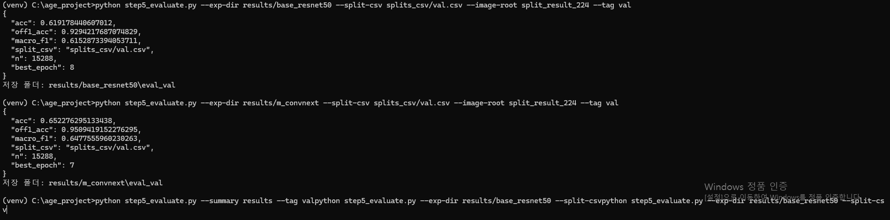

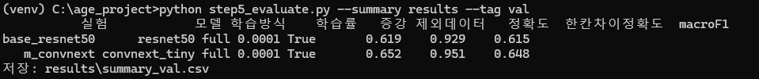

---

## 3. 결과 해석

### 3-1. 혼동 행렬: 어떤 나이대를 헷갈렸나

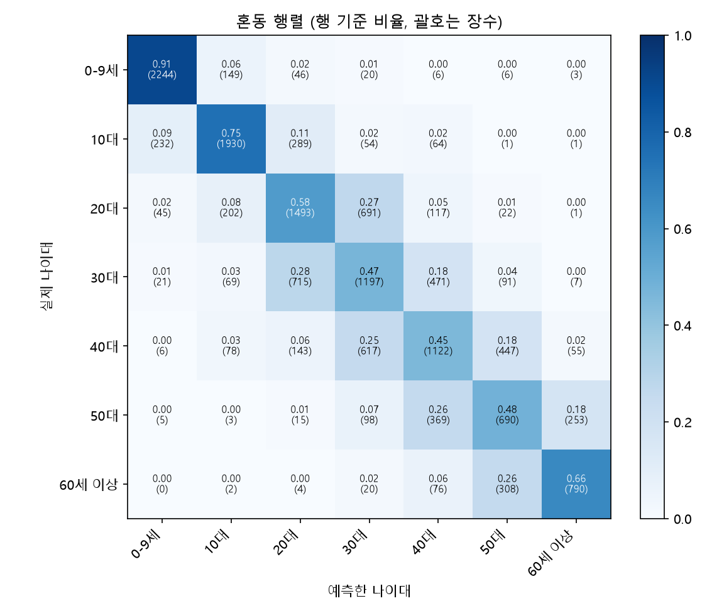

| 실제 나이대 | 맞힌 비율 | 가장 많이 헷갈린 나이대 |
|---|---:|---|
| 0~9세 | 91% | 10대 (6%) |
| 10대 | 75% | 20대 (11%), 0~9세 (9%) |
| 20대 | 58% | 30대 (27%) |
| 30대 | 47% | 20대 (28%), 40대 (18%) |
| 40대 | 45% | 30대 (25%), 50대 (18%) |
| 50대 | 48% | 40대 (26%), 60세 이상 (18%) |
| 60세 이상 | 66% | 50대 (26%) |

- **어린 나이와 많은 나이는 잘 맞히고, 중간 나이대는 어려워했습니다.** 0~9세(91%)와 60세 이상(66%)은 잘 맞혔지만, 30~50대는 45~48%에 그쳤습니다.
- **사진이 가장 많은 30대와 40대(각 12,000장)의 정확도가 가장 낮았습니다.** 반면 사진이 가장 적은 60세 이상(5,269장)은 66%를 맞혔습니다. 손실 가중치로 사진이 적은 나이대를 보정한 효과도 있지만, 성능은 데이터의 양보다 **이웃 나이대와 얼굴이 얼마나 비슷한지**에 더 크게 좌우된 것으로 보입니다.
- **틀린 경우는 대부분 바로 옆 나이대였습니다.** 두 칸 이상 떨어진 나이대로 틀린 비율은 대부분 0~2%이고, 그래서 한 칸 차이 정확도가 92.9%로 높게 나왔습니다.
- 20대는 10대(8%)보다 30대(27%)로 훨씬 많이 틀렸습니다. 데이터셋마다 나이를 매긴 기준(실제 나이와 겉보기 나이)이 다른 점 등이 원인일 수 있습니다.

### 3-2. 학습 곡선: 어떻게 학습했나

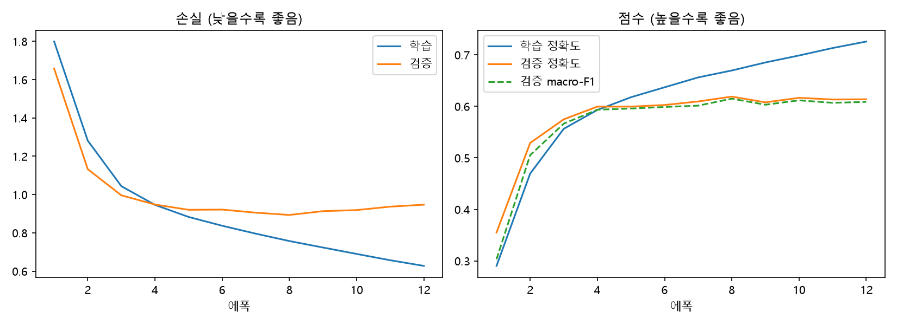

- 4에폭까지는 학습 손실과 검증 손실이 함께 빠르게 줄었습니다.
- 그 뒤로는 검증 손실이 0.9 근처에서 거의 그대로이고, 학습 손실만 계속 내려갔습니다. 검증 정확도도 4에폭 이후 60~62%에서 더 오르지 않았습니다.
- 과적합은 **완만한 편**입니다. 12에폭 기준 학습 정확도 72.6%, 검증 정확도 61.4%로 약 11%p 차이가 납니다.
- 1에폭에서 검증 정확도가 학습 정확도보다 높게 나온 것은, 학습 정확도가 에폭 동안 점점 나아지는 모델의 평균값이고 증강으로 일부러 어렵게 바꾼 사진으로 측정했기 때문입니다.

---

## 4. 학습 설정 (두 모델 공통)

| 항목 | 설정 |
|---|---|
| 입력 크기 | 224 × 224 |
| 출력 | 7개 나이대 |
| 사전학습 | ImageNet (timm 제공 가중치) |
| 배치 크기 | 64장 |
| 최적화 방법 | AdamW (가중치 감쇠 0.05) |
| 학습률 | 몸통 0.0001, 새로 붙인 출력층 0.001 |
| 학습률 조절 | 첫 1에폭 동안 서서히 올린 뒤, 코사인 곡선을 따라 줄임 |
| 2단계 학습 | 1에폭은 출력층만 학습하고, 이후 전체를 학습 |
| 최대 에폭 | 20 |
| 조기 종료 | 검증 macro-F1이 4에폭 연속으로 오르지 않으면 종료 |
| 손실 함수 | 교차 엔트로피 + 나이대별 손실 가중치 |
| 증강 (학습 데이터에만 적용) | 살짝 확대·자르기(90~100%), 좌우 반전, ±10° 회전, 밝기·대비 ±20% |
| 정규화 | ImageNet 평균·표준편차 기준 |
| 혼합 정밀도 | 사용 (학습 속도 향상, 메모리 절약) |

---

## 5. 해결한 문제 요약

| 문제 | 원인 | 해결 |
|---|---|---|
| 설치가 중간에 끝남 | 명령 프롬프트에서 Ctrl+C를 눌러 실행이 중지됨 | 설치 명령을 다시 실행. 명령 프롬프트에서는 Ctrl+C를 누르지 않음 |
| `No module named 'pandas'` | 설치가 중간에 중단됨 | 라이브러리 재설치 |
| GPU를 인식하지 못함 | CPU 전용 PyTorch가 설치됨 | GPU용 PyTorch로 다시 설치 |
| `No module named 'common'` | 작업 폴더에 `common.py`가 없음 | 코드 파일을 작업 폴더에 넣음 |
| `10 19` 폴더 이름을 잘못 읽음 | 띄어쓰기를 지우고 숫자를 붙여 읽음 | 앞의 숫자만 읽도록 `make_split_csv.py` 수정 |

---

## 6. 앞으로 할 일

- [x] ResNet-50 학습 (`results/base_resnet50/`)
- [x] ConvNeXt-Tiny 학습 (`results/m_convnext/`) → [ConvNeXt 폴더](../ConvNeXt)
- [x] 검증 데이터 평가: 학습 곡선, 혼동 행렬 (`eval_val/`)
- [x] 두 모델 비교표(`results/summary_val.csv`) 정리와 해석
- [ ] 비교 결과로 최종 모델을 정한 뒤, 시험 데이터로 **한 번만** 평가
- [ ] Grad-CAM으로 모델이 얼굴의 어느 부분을 보고 판단했는지 확인

## 참고 사항

- `split_result_224`에는 사진마다 어느 데이터셋(FairFace, AAF 등)에서 왔는지에 대한 정보가 없습니다. 그래서 데이터셋별 성능 비교(`per_group.csv`)는 `unknown` 하나로만 나옵니다.
- 시험 데이터(testing)는 최종 모델을 평가하기 전까지 사용하지 않습니다.
