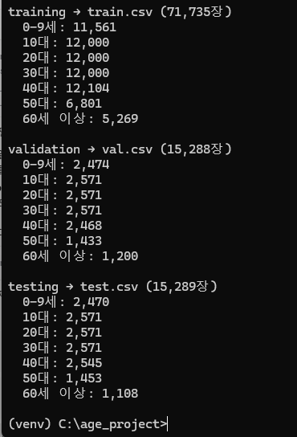
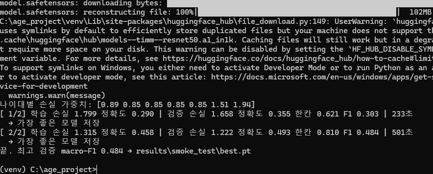
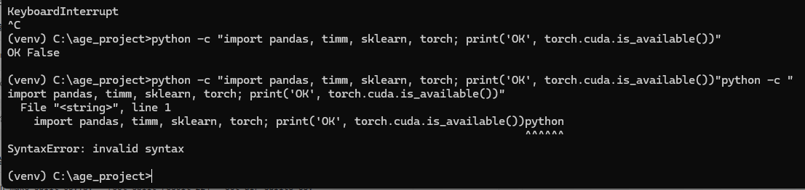
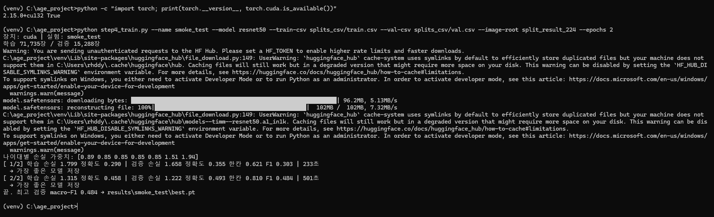

# 개발일지 01 — 학습 환경 구축과 시험 학습

- **날짜**: 2026-11-09
- **프로젝트**: 얼굴 이미지 기반 나이대 분류 (인공지능 4조)
- **담당**: ResNet-50, ConvNeXt-Tiny 학습 (사전학습 모델 미세조정)
- **상태**: ✅ 완료 (2에폭 시험 학습으로 전체 흐름 확인)
- **자세한 기록**: [`ResNet50/README.md`](../../ResNet50/README.md)

---

## 1. 한 일

1. 데스크탑(RTX 3070, Windows)에 학습 환경을 만들었다.
   - Python 3.11 가상환경(`venv`), GPU용 PyTorch, timm, pandas, scikit-learn, matplotlib, grad-cam 설치
2. 팀원이 나눈 `split_result_224`(training / validation / testing, 나이대별 폴더 7개)를 그대로 사용하기로 했다. 팀 전체가 같은 분리를 써야 실험끼리 비교할 수 있기 때문이다.
3. 학습 코드가 읽는 형식(사진 경로 + 나이대 번호 CSV)으로 바꾸는 `make_split_csv.py`를 만들어 실행했다.
4. ResNet-50을 2에폭만 학습해 전체 흐름(데이터 읽기 → 학습 → 검증 → 모델 저장)을 확인했다.

```
python make_split_csv.py --root split_result_224 --out-dir splits_csv
python step4_train.py --name smoke_test --model resnet50 --train-csv splits_csv/train.csv --val-csv splits_csv/val.csv --image-root split_result_224 --epochs 2
```

---

## 2. 결과

### 2-1. 데이터 분리 확인



| 나이대 | 학습 | 검증 | 시험 |
|---|---:|---:|---:|
| 0–9세 | 11,561 | 2,474 | 2,470 |
| 10대 | 12,000 | 2,571 | 2,571 |
| 20대 | 12,000 | 2,571 | 2,571 |
| 30대 | 12,000 | 2,571 | 2,571 |
| 40대 | 12,104 | 2,468 | 2,545 |
| 50대 | 6,801 | 1,433 | 1,453 |
| 60세 이상 | 5,269 | 1,200 | 1,108 |
| **합계** | **71,735** | **15,288** | **15,289** |

- 비율 70 : 15 : 15. 50대·60세 이상은 다른 나이대의 절반 정도라, 학습 때 손실 가중치로 보정한다.

### 2-2. 시험 학습 (ResNet-50, 2에폭)



| 에폭 | 학습 정확도 | 검증 정확도 | 한 칸 차이 정확도 | macro-F1 | 시간 |
|---|---:|---:|---:|---:|---:|
| 1 | 0.290 | 0.355 | 0.621 | 0.303 | 233초 |
| 2 | 0.458 | 0.493 | 0.810 | 0.484 | 501초 |

- `장치: cuda`로 GPU 학습 확인
- 나이대별 손실 가중치 `[0.89 0.85 0.85 0.85 0.85 1.51 1.94]` → 사진이 적은 50대·60세 이상에 더 큰 벌점
- 1에폭은 출력층만 학습해서 빠르고, 2에폭부터 전체를 학습해 약 2배 걸린다.

---

## 3. 문제와 해결

| 문제 | 원인 | 해결 |
|---|---|---|
| `cd C:\` 입력 시 `invalid syntax` | 명령 프롬프트가 아니라 파이썬 창(`>>>`)에 입력함 | 명령 프롬프트(cmd)를 열어 다시 입력 |
| 설치가 `Successfully installed` 없이 끝남 | cmd에서 Ctrl+C(= 실행 중지)를 누름 | 설치 명령 재실행. cmd에서는 Ctrl+C 사용 금지 |
| `No module named 'pandas'` | 위 설치 중단 | 라이브러리 재설치 |
| `torch.cuda.is_available()` → False | timm·grad-cam 설치 때 CPU용 PyTorch가 함께 설치됨 | CPU용 torch 삭제 후 GPU용 PyTorch(2.15.0, CUDA 13.2용) 설치 → True 확인 |
| `No module named 'common'` | 작업 폴더에 `common.py`가 없음 | 코드 파일을 작업 폴더에 배치 |
| 폴더 이름 `10 19`를 잘못 읽음 | 띄어쓰기를 지우고 숫자를 붙여 읽음(`1019`) | 앞 숫자만 읽도록 `make_split_csv.py` 수정 |

| CPU용 PyTorch (False) | GPU용 PyTorch 설치 후 (True) |
|---|---|
|  |  |

---

## 4. 다음 할 일

- [x] ResNet-50, ConvNeXt-Tiny 본 학습 (20에폭, 조기 종료) → [개발일지 02](2026-11-09_02_ResNet50_ConvNeXt_학습결과.md)
