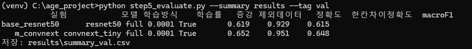
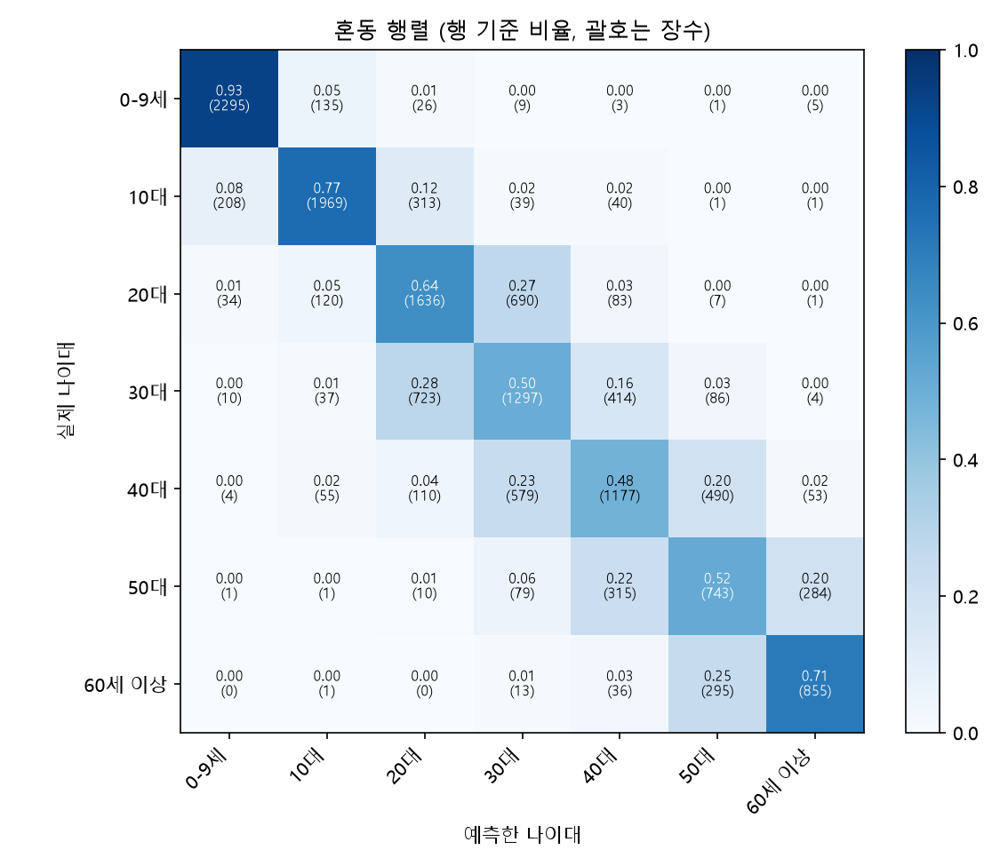
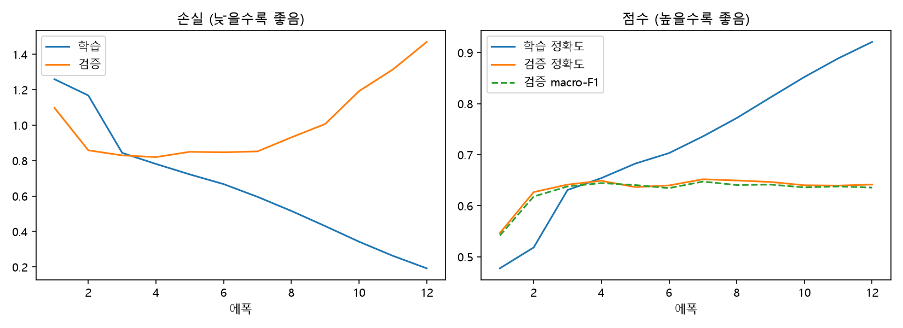
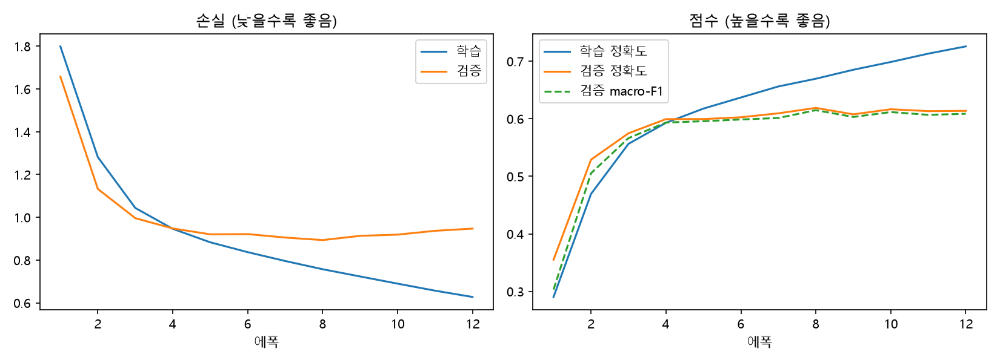
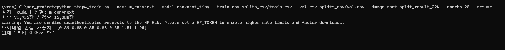
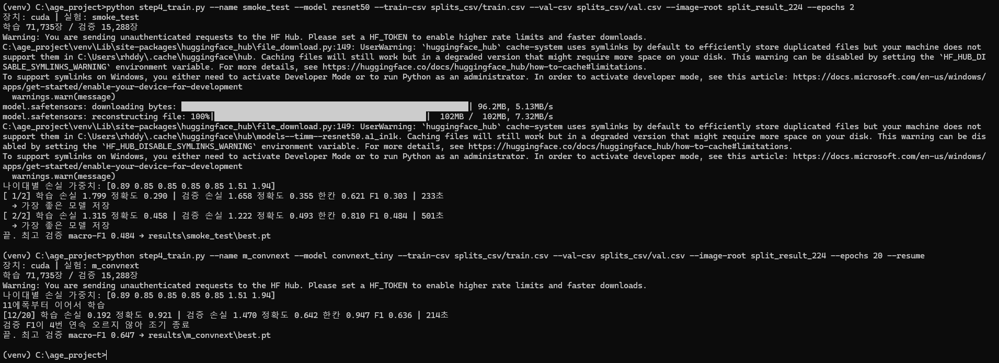

# 개발일지 02 — ResNet-50 · ConvNeXt-Tiny 학습과 결과 해석

- **날짜**: 2026-11-09
- **프로젝트**: 얼굴 이미지 기반 나이대 분류 (인공지능 4조)
- **담당**: ResNet-50, ConvNeXt-Tiny 학습 (사전학습 모델 미세조정)
- **상태**: ✅ 학습·검증 평가 완료 (시험 데이터 평가는 최종 모델 결정 후)
- **자세한 기록**: [`ResNet50/README.md`](../../ResNet50/README.md), [`ConvNeXt/README.md`](../../ConvNeXt/README.md)

---

## 1. 한 일

1. ResNet-50과 ConvNeXt-Tiny를 **같은 조건**으로 학습했다. 모델만 다르고 나머지 설정은 모두 같다.

| 항목 | 값 |
|---|---|
| 데이터 | `split_result_224` (학습 71,735 / 검증 15,288) |
| 사전학습 | ImageNet (timm) |
| 에폭 / 배치 | 최대 20 / 64 |
| 학습률 | 몸통 0.0001, 출력층 0.001 (1에폭 워밍업 → 코사인 감소) |
| 2단계 학습 | 1에폭은 출력층만 → 이후 전체 미세조정 |
| 증강 (학습 데이터만) | 살짝 확대·자르기, 좌우 반전, ±10° 회전, 밝기·대비 ±20% |
| 손실 | 교차 엔트로피 + 나이대별 손실 가중치 |
| 조기 종료 | 검증 macro-F1이 4에폭 연속 오르지 않으면 종료 |

2. 두 모델을 검증 데이터로 평가하고 비교표, 혼동 행렬, 학습 곡선을 만들었다.

```
python step4_train.py --name base_resnet50 --model resnet50 --train-csv splits_csv/train.csv --val-csv splits_csv/val.csv --image-root split_result_224 --epochs 20
python step4_train.py --name m_convnext --model convnext_tiny --train-csv splits_csv/train.csv --val-csv splits_csv/val.csv --image-root split_result_224 --epochs 20
python step5_evaluate.py --exp-dir results/<실험> --split-csv splits_csv/val.csv --image-root split_result_224 --tag val
python step5_evaluate.py --summary results --tag val
```

---

## 2. 결과

### 2-1. 성능 비교 (검증 데이터 15,288장)



| 모델 | 정확도 | 한 칸 차이 정확도 | macro-F1 | 가장 좋은 에폭 | 조기 종료 |
|---|---:|---:|---:|---:|---:|
| ResNet-50 | 61.9% | 92.9% | 0.615 | 8 | 12에폭 |
| **ConvNeXt-Tiny** | **65.2%** | **95.1%** | **0.648** | 7 | 12에폭 |

### 2-2. 나이대별 맞힌 비율 (혼동 행렬 대각선)

| ConvNeXt-Tiny | ResNet-50 |
|---|---|
|  |  |

| 실제 나이대 | ResNet-50 | ConvNeXt-Tiny |
|---|---:|---:|
| 0–9세 | 91% | 93% |
| 10대 | 75% | 77% |
| 20대 | 58% | 64% |
| 30대 | 47% | 50% |
| 40대 | 45% | 48% |
| 50대 | 48% | 52% |
| 60세 이상 | 66% | 71% |

### 2-3. 학습 곡선

| ConvNeXt-Tiny | ResNet-50 |
|---|---|
|  |  |

| 12에폭 기준 | 학습 정확도 | 검증 정확도 | 학습 손실 | 검증 손실 |
|---|---:|---:|---:|---:|
| ResNet-50 | 72.6% | 61.4% | 0.627 | 0.947 |
| ConvNeXt-Tiny | 92.1% | 64.2% | 0.192 | 1.470 |

### 2-4. 해석

- **ConvNeXt-Tiny가 세 지표와 7개 나이대 모두에서 더 높다.** 두 칸 이상 크게 틀린 비율도 7.1% → 4.9%로 줄었다.
- **양 끝은 쉽고 가운데는 어렵다.** 0–9세(91~93%), 60세 이상(66~71%)은 잘 맞히지만 30~50대는 45~52%다.
- **데이터 양보다 생김새 차이가 중요했다.** 사진이 가장 많은 30·40대(각 12,000장)가 가장 낮고, 가장 적은 60세 이상(5,269장)은 70% 안팎이다.
- **오답은 대부분 바로 옆 나이대다.** 그래서 한 칸 차이 정확도가 93~95%로 높다.
- **ConvNeXt는 과적합이 더 빠르고 크다.** 학습 정확도 92% 대 검증 64%. 검증 손실은 4에폭에서 가장 낮지만, macro-F1은 7에폭이 가장 좋다. 이후 모델이 틀릴 때 지나치게 확신해 손실(벌점)이 커졌다. 조기 종료 기준을 macro-F1로 둔 덕분에 목적에 맞는 7에폭 모델이 선택됐다.
- **한계:** ConvNeXt는 더 큰 데이터(ImageNet-12k)로 사전학습된 가중치(`convnext_tiny.in12k_ft_in1k`)를 사용했다. ResNet-50은 `resnet50.a1_in1k`(ImageNet-1k)이다. 그래서 성능 차이에는 구조와 사전학습 데이터 효과가 섞여 있다.

---

## 3. 문제와 해결

| 문제 | 원인 | 해결 |
|---|---|---|
| ResNet-50이 예상(20에폭)보다 일찍 끝남 | 8에폭 이후 검증 macro-F1이 오르지 않아 조기 종료 (정상) | 종료 메시지와 저장 모델(8에폭) 확인 |
| ConvNeXt 학습 창이 닫힘 | 학습 중 cmd에서 Ctrl+C를 누름 | 에폭마다 저장된 `last.pt`로 `--resume` 실행 → 12에폭부터 이어서 학습 |
| 이어하기 문구가 "11에폭부터"인데 다음 줄은 `[12/20]` | 코드가 에폭 번호를 0부터 세어 표시가 하나 어긋남 | 학습에는 영향 없음 (11에폭까지 완료 상태) |
| 평가 명령이 한 줄에 여러 개 붙어 입력됨 | 붙여넣기 중복 | Esc로 지우고 명령을 하나씩 실행 |

| 창이 닫힌 뒤 이어서 학습 | ConvNeXt 조기 종료 |
|---|---|
|  |  |

---

## 4. 다음 할 일

- [ ] 팀과 최종 모델 결정 (현재 검증 결과로는 ConvNeXt-Tiny)
- [ ] 최종 모델로 시험 데이터(testing) **한 번만** 평가
- [ ] Grad-CAM으로 30·40대를 틀린 사진에서 모델이 어디를 봤는지 확인
- [ ] (선택) ConvNeXt 과적합 줄이기: 학습률 0.00005 또는 더 강한 증강
- [ ] (선택) 비교 실험: 마지막 층만 학습, 증강 끄기, 학습률 0.001 / 0.00001
