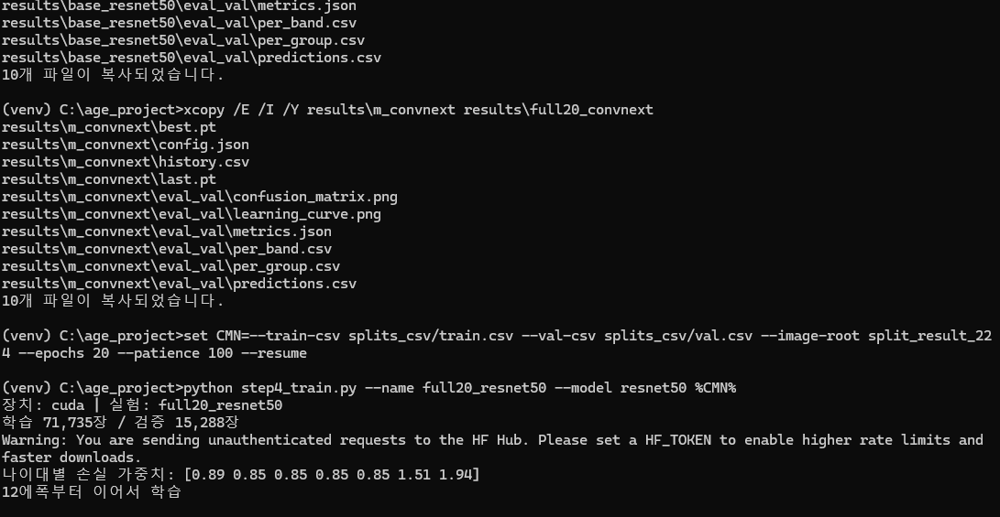
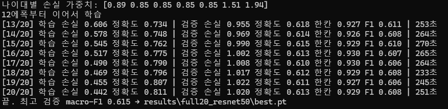
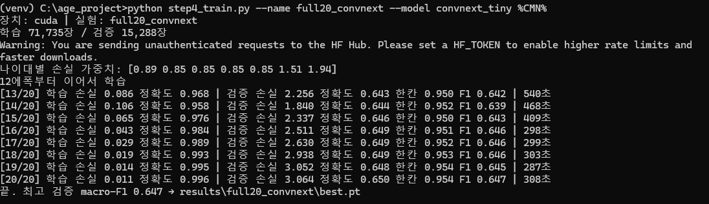
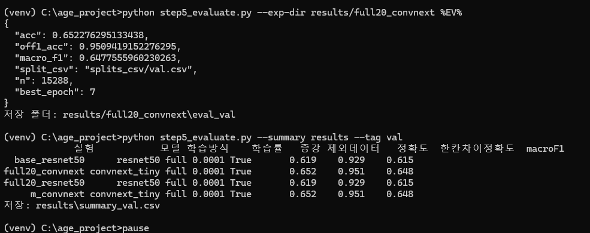

# 개발일지 03 — 20에폭 추가 학습과 이어하기 기록 정정

- **날짜**: 2026-11-15
- **프로젝트**: 얼굴 이미지 기반 나이대 분류 (인공지능 4조)
- **담당**: ResNet-50, ConvNeXt-Tiny 학습 (사전학습 모델 미세조정)
- **상태**: ✅ 완료
- **자세한 기록**: [`ResNet50/README.md`](../../ResNet50/README.md) 2-11·2-12, [`ConvNeXt/README.md`](../../ConvNeXt/README.md) 2-2·2-3·3-3

---

## 1. 한 일

1. **ConvNeXt 조기 종료 시점을 다시 확인하고 기록을 정정했다.**
   - 최고 에폭이 7이고 조기 종료 기준이 "4에폭 연속 정체"이므로, ConvNeXt는 8·9·10·11에폭이 정체된 **11에폭에서 정상적으로 조기 종료**된 것이다.
   - 11-09에는 학습이 끊긴 것으로 보고 이어하기(`--resume`)를 실행했는데, 그 때문에 필요 없는 12에폭이 한 번 더 학습됐다.
2. **이어하기 코드를 고쳤다.** 이어하기 때 이미 조기 종료 조건을 채웠으면 바로 멈추도록 `step4_train.py`(두 폴더)와 `train_convnext.py`를 수정했다. 이어하기 문구도 "N에폭까지 완료된 상태를 불러옴 → N+1에폭부터 이어서 학습"으로 바꿨다.
3. **조기 종료가 적절했는지 확인하려고 두 모델을 20에폭까지 추가 학습했다.**
   - 원래 결과를 보존하기 위해 결과 폴더를 복사(`full20_resnet50`, `full20_convnext`)했다.
   - 조기 종료가 걸리지 않게 `--patience 100`을 주고, 저장된 12에폭 상태에서 이어서 20에폭까지 학습했다. 학습률 조절은 처음부터 20에폭 기준이었으므로, 처음부터 20에폭을 학습한 것과 같은 흐름이다.

```
xcopy /E /I /Y results\base_resnet50 results\full20_resnet50
xcopy /E /I /Y results\m_convnext results\full20_convnext
set CMN=--train-csv splits_csv/train.csv --val-csv splits_csv/val.csv --image-root split_result_224 --epochs 20 --patience 100 --resume
python step4_train.py --name full20_resnet50 --model resnet50 %CMN%
python step4_train.py --name full20_convnext --model convnext_tiny %CMN%
```



---

## 2. 결과

### 2-1. 13~20에폭 학습 기록

| ResNet-50 | ConvNeXt-Tiny |
|---|---|
|  |  |

| 20에폭 기준 | 학습 정확도 | 검증 정확도 | 차이 | 검증 손실 | 검증 macro-F1 |
|---|---:|---:|---:|---:|---:|
| ResNet-50 | 81.1% | 61.3% | 약 20%p | 1.020 | 0.608 |
| ConvNeXt-Tiny | 99.6% | 65.0% | 약 35%p | 3.064 | 0.647 |

### 2-2. 최고 성능 비교



| 실험 | 정확도 | 한 칸 차이 정확도 | macro-F1 | 최종 모델 에폭 |
|---|---:|---:|---:|---:|
| ResNet-50 (조기 종료, 12에폭에서 멈춤) | 61.9% | 92.9% | 0.615 | 8 |
| ResNet-50 (20에폭까지) | 61.9% | 92.9% | 0.615 | 8 |
| ConvNeXt-Tiny (조기 종료, 11에폭에서 멈춤) | 65.2% | 95.1% | 0.648 | 7 |
| ConvNeXt-Tiny (20에폭까지) | 65.2% | 95.1% | 0.648 | 7 |

### 2-3. 해석

- **두 모델 모두 최고 성능이 바뀌지 않았다.** 13~20에폭 중 어느 것도 조기 종료 때 고른 에폭의 기록을 넘지 못했다.
- **더 학습해도 과적합만 커졌다.** ResNet-50은 학습 정확도가 81%까지, ConvNeXt는 99.6%까지 올랐지만 검증 정확도는 각각 61%대, 65% 안팎에 머물렀다.
- **ConvNeXt는 검증 손실이 1.47(12에폭) → 3.06(20에폭)으로 두 배 넘게 늘었는데 정확도는 그대로였다.** 틀린 답을 점점 더 강하게 확신하게 된 것이다. 손실이 아닌 macro-F1로 조기 종료한 것이 적절했다는 근거다.
- **조기 종료로 시간을 아끼고 성능 손해는 없었다.** 추가 학습에 ResNet-50 약 35분, ConvNeXt 약 50분이 들었지만 성능은 나아지지 않았다.

---

## 3. 문제와 해결

| 문제 | 원인 | 해결 |
|---|---|---|
| 11-09 기록에 ConvNeXt가 "12에폭에서 조기 종료"라고 잘못 적힘 | 실행 창이 닫힌 것을 학습 중단으로 오해함. 실제로는 11에폭에서 정상 조기 종료된 뒤였음 | ConvNeXt README와 개발일지 02 정정 |
| 이어하기로 필요 없는 12에폭이 학습됨 | 이어하기 때 이미 조기 종료 조건을 채웠는지 확인하지 않음 | 이어하기 직후 조건을 확인해 바로 멈추도록 코드 수정. 12에폭 성능은 최고 기록보다 낮아 최종 모델(7에폭)은 그대로 |
| 이어하기 문구가 헷갈림 ("11에폭부터"인데 다음 줄은 `[12/20]`) | 코드가 에폭 번호를 0부터 셈 | "11에폭까지 완료된 상태를 불러옴 → 12에폭부터 이어서 학습"으로 문구 수정 |

---

## 4. 다음 할 일

- [ ] 비교 실험: 학습률 0.001 / 0.00001, 마지막 층만 학습, 증강 끄기 (ResNet-50 기준)
- [ ] 작은 CNN 결과(팀원 LIM)와 함께 모델 구조 비교 정리
- [ ] 팀과 최종 모델 결정 후 시험 데이터로 **한 번만** 평가
- [ ] Grad-CAM, Gradio 시연 화면
