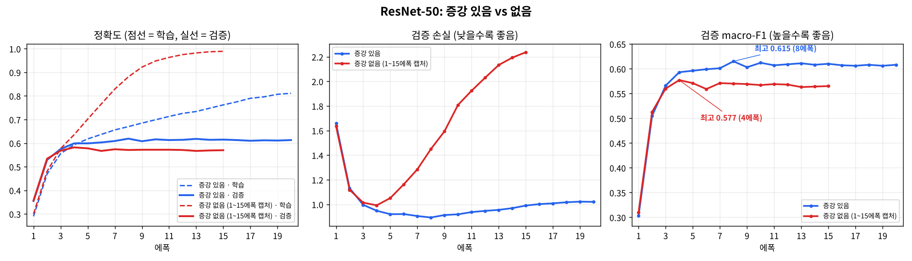
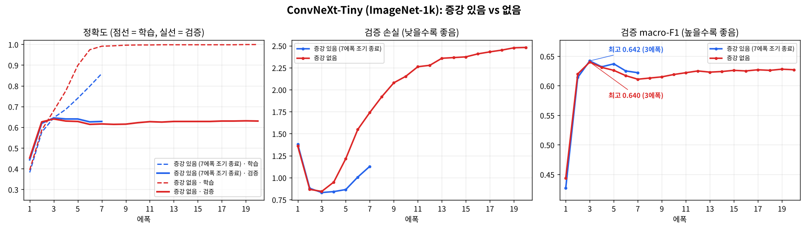

# 개발일지 04 — 사전학습 조건 통일과 증강 유무 비교

- **날짜**: 2026-11-16 ~ 2026-11-23
- **프로젝트**: 얼굴 이미지 기반 나이대 분류 (인공지능 4조)
- **담당**: ResNet-50, ConvNeXt-Tiny 학습 (사전학습 모델 미세조정)
- **상태**: ✅ 완료
- **자세한 기록**: [`ResNet50/README.md`](../../ResNet50/README.md) 2-13·3-3, [`ConvNeXt/README.md`](../../ConvNeXt/README.md) 2-5·2-6·3-4·3-6

---

## 1. 한 일

1. **ConvNeXt의 사전학습 조건을 ResNet-50과 맞췄다.**
   - timm에서 `convnext_tiny`의 기본 가중치가 ImageNet-12k로 먼저 학습한 버전(`in12k_ft_in1k`)이라, ImageNet-1k 가중치를 쓴 ResNet-50과 조건이 달랐다.
   - ImageNet-1k 공식 가중치 `convnext_tiny.fb_in1k`로 다시 학습했다(`m_convnext_in1k`). 코드는 그대로 두고 `--model` 값만 바꿨다.
   - 이후 ConvNeXt는 ImageNet-1k 결과를 기준으로 하고, 12k 결과는 참고용으로 남긴다.
2. **증강 유무를 비교했다.** ResNet-50과 ConvNeXt-Tiny(1k)를 증강만 끄고(`--no-augment`) 나머지 조건은 그대로 둔 채, 조기 종료 없이(`--patience 100`) 20에폭까지 학습했다.
3. **비교 그래프 코드와 실행 파일을 추가했다.** `plot_history_compare.py`(두 실험의 `history.csv` 비교 그래프), `run_augment_compare.bat`(학습 → 평가 → 그래프).

```
python step4_train.py --name m_convnext_in1k --model convnext_tiny.fb_in1k --train-csv splits_csv/train.csv --val-csv splits_csv/val.csv --image-root split_result_224 --epochs 20
python step4_train.py --name noaug_resnet50 --model resnet50 --no-augment --patience 100 --train-csv splits_csv/train.csv --val-csv splits_csv/val.csv --image-root split_result_224 --epochs 20
python step4_train.py --name noaug_convnext --model convnext_tiny.fb_in1k --no-augment --patience 100 --train-csv splits_csv/train.csv --val-csv splits_csv/val.csv --image-root split_result_224 --epochs 20
```

---

## 2. 결과 (검증 데이터 15,288장)

### 2-1. 사전학습 조건 통일

| 모델 | 사전학습 가중치 | 정확도 | 한 칸 차이 정확도 | macro-F1 | 가장 좋았던 에폭 |
|---|---|---:|---:|---:|---:|
| ResNet-50 | ImageNet-1k | 61.9% | 92.9% | 0.615 | 8 |
| ConvNeXt-Tiny | **ImageNet-1k** | **64.5%** | **94.6%** | **0.642** | 3 |
| ConvNeXt-Tiny (참고) | ImageNet-12k → 1k | 65.2% | 95.1% | 0.648 | 7 |

- 구조만 다를 때 +0.027, 사전학습 데이터만 다를 때 +0.006 → 성능 차이의 대부분은 **구조 차이**였다.

### 2-2. 증강 유무

| 모델 | 증강 | 정확도 | 한 칸 차이 정확도 | macro-F1 | 가장 좋았던 에폭 |
|---|---|---:|---:|---:|---:|
| ResNet-50 | 있음 | **61.9%** | **92.9%** | **0.615** | 8 |
| ResNet-50 | 없음 | 58.2% | 89.9% | 0.577 | 4 |
| ConvNeXt-Tiny (1k) | 있음 | **64.5%** | 94.6% | **0.642** | 3 |
| ConvNeXt-Tiny (1k) | 없음 | 64.0% | **94.8%** | 0.640 | 3 |

| ResNet-50 | ConvNeXt-Tiny (1k) |
|---|---|
|  |  |

### 2-3. 해석

- **증강은 두 모델 모두에서 과적합을 늦췄다.** 증강이 없으면 학습 정확도가 ResNet-50은 15에폭에 98.9%, ConvNeXt는 7에폭에 99.1%까지 올라 학습 사진을 거의 다 외웠고, 검증 손실도 훨씬 빨리 커졌다.
- **최고 성능에 미친 영향은 모델마다 달랐다.** 천천히 학습하는 ResNet-50은 증강이 없으면 성능을 다 끌어올리기 전에(4에폭) 외우기 시작해 macro-F1이 0.038 떨어졌다. 3에폭 만에 최고점에 도달하는 ConvNeXt는 외우기 전에 이미 최고점이라 증강 유무의 차이가 0.002로 거의 없었다.
- 증강 없는 ConvNeXt(0.640)도 증강 있는 ResNet-50(0.615)보다 높아, 구조 차이의 효과가 증강 효과보다 컸다.

---

## 3. 문제와 해결

| 문제 | 원인 | 해결 |
|---|---|---|
| 두 모델의 사전학습 데이터가 다름 | timm 기본 가중치가 모델마다 다름 (ConvNeXt만 ImageNet-12k) | `--model convnext_tiny.fb_in1k`로 가중치를 직접 지정해 다시 학습 |
| 새 cmd 창에서 `can't open file … step5_evaluate.py` | 새 창은 `C:\Users\rhddy`에서 시작함 | `cd C:\age_project`, `venv\Scripts\activate` 후 실행 |
| 증강 없는 ResNet 학습이 15에폭에서 멈춘 것처럼 보임 | 학습 도중 기록을 확인함 / 컴퓨터 재시작 | 같은 명령에 `--resume`을 붙여 실행 → 이미 20에폭까지 완료된 상태로 확인 |
| `--resume`만 입력해 오류 | `--resume`은 명령이 아니라 학습 명령 뒤에 붙이는 옵션 | 학습 명령 전체 뒤에 `--resume`을 붙여 실행 |

---

## 4. 다음 할 일

- [ ] 작은 CNN을 같은 학습 코드·조건으로 학습(`small_cnn_same`)해 세 모델 비교 완성
- [ ] 교수님 요청 실험 1: 소아청소년 / 성인 / 노인 3그룹 분류 (묶어서 채점, 3그룹 재학습)
- [ ] 교수님 요청 실험 2: 흐린 사진·여러 얼굴 사진의 정확도 분석과 개선 (흐림 증강, 작은 얼굴 가리기)
- [ ] 최종 모델(ConvNeXt-Tiny 1k)로 시험 데이터 **한 번만** 평가, Grad-CAM, 시연
