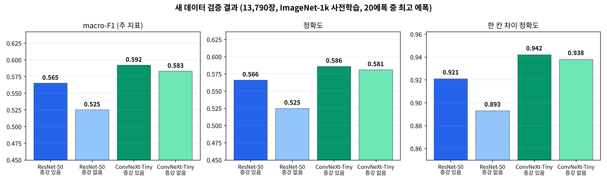
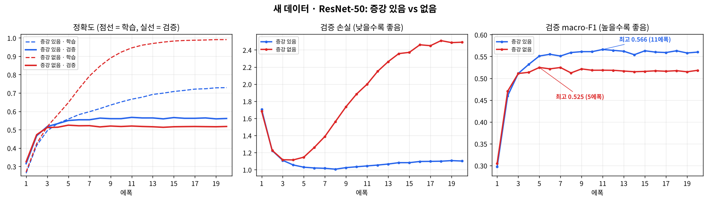
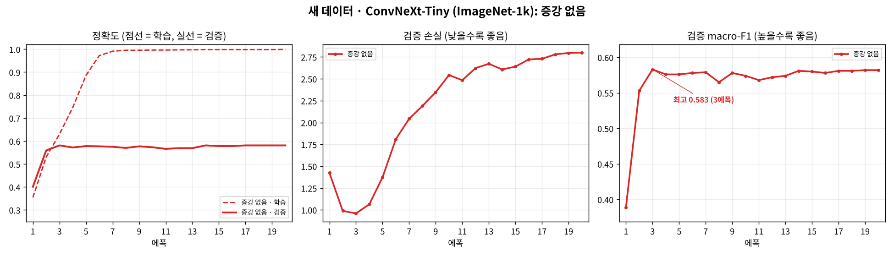
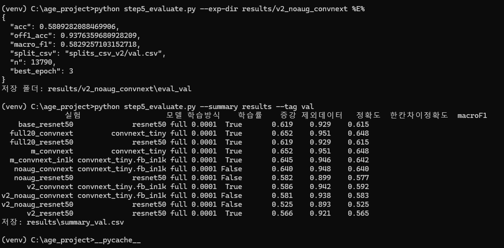

# 개발일지 05 — 새 데이터로 재학습: ResNet-50 · ConvNeXt-Tiny 증강 유무 비교와 고찰

- **날짜**: 2026-11-27
- **프로젝트**: 얼굴 이미지 기반 나이대 분류 (인공지능 4조)
- **담당**: ResNet-50, ConvNeXt-Tiny 학습 (사전학습 모델 미세조정)
- **상태**: ✅ 완료 (네 실험 학습·검증 평가)
- **자세한 기록**: [`ResNet50/README.md`](../../ResNet50/README.md) · [`ConvNeXt/README.md`](../../ConvNeXt/README.md)의 "새 데이터 결과" 장

---

## 1. 한 일

1. **데이터를 새 데이터로 바꿨다.** 이전 데이터 중 AFAD에서 온 일부 사진의 얼굴이 제대로 잘리지 않아, 팀에서 다시 구성한 `division_224AFAD-X`를 쓰기로 했다.
   - 프로젝트 폴더로 복사(`data_v2`)한 뒤 `make_split_csv.py`로 `splits_csv_v2`를 새로 만들었다. 폴더 이름(`0_9, 10s, …, 60plus`)이 이전과 달랐지만, 코드가 폴더 이름의 앞 숫자로 나이대를 정해서 그대로 읽혔다.
   - 기존 `splits_csv`, `split_result_224`, 결과 폴더는 지우지 않고 남겼다. 새 실험은 모두 `v2_`로 시작한다.
2. **네 실험을 새 데이터로 학습했다.** ResNet-50과 ConvNeXt-Tiny 각각 증강 있음/없음. 두 모델 모두 ImageNet-1k 사전학습 가중치이고, 모두 **조기 종료 없이 20에폭** 학습한 뒤 검증 macro-F1이 가장 높은 에폭을 최종 모델로 썼다.
3. **실행 파일을 추가했다.** 두 모델 폴더의 `code/run_v2.bat` (학습 → 평가 → 비교표).

```
xcopy /E /I /Y "C:\Users\rhddy\Downloads\division_224AFAD-X" data_v2
python make_split_csv.py --root data_v2 --out-dir splits_csv_v2
set D=--train-csv splits_csv_v2/train.csv --val-csv splits_csv_v2/val.csv --image-root data_v2 --epochs 20 --patience 100
python step4_train.py --name v2_resnet50 --model resnet50 %D%
python step4_train.py --name v2_noaug_resnet50 --model resnet50 --no-augment %D%
python step4_train.py --name v2_convnext --model convnext_tiny.fb_in1k %D%
python step4_train.py --name v2_noaug_convnext --model convnext_tiny.fb_in1k --no-augment %D%
```

### 1-1. 새 데이터 구성

| | 학습 | 검증 | 시험 | 합계 |
|---|---:|---:|---:|---:|
| 이전 (`split_result_224`) | 71,735 | 15,288 | 15,289 | 102,312 |
| **새 (`division_224AFAD-X`)** | **64,353** | **13,790** | **13,789** | **91,932** |

- 비율은 70 : 15 : 15로 같고, 학습 사진이 약 7천 장 줄었다. **10대가 12,000 → 8,310장으로 가장 많이 줄었다.**
- 나이대별 손실 가중치가 새 데이터로 다시 계산되어 `[0.81 1.11 0.84 0.84 0.87 1.36 1.73]`이 되었다.

### 1-2. 통일한 조건

| 항목 | 네 실험 공통 |
|---|---|
| 데이터 | `splits_csv_v2` (학습 64,353 / 검증 13,790) |
| 입력, 정규화 | 224×224, ImageNet 평균·표준편차 |
| 사전학습 | ImageNet-1k (`resnet50.a1_in1k`, `convnext_tiny.fb_in1k`) |
| 학습 방식 | 1에폭 출력층만 → 이후 전체 미세조정 |
| 학습률 | 몸통 0.0001, 출력층 0.001, 1에폭 워밍업 → 코사인 감소 |
| 옵티마이저, 손실 | AdamW (weight decay 0.05), 교차 엔트로피 + 손실 가중치 |
| 배치, 에폭, 시드 | 64, 20 (조기 종료 없음), 42 |
| **바꾼 것** | **모델 구조**, **증강 유무**(`--no-augment`) |

---

## 2. 결과 (검증 데이터 13,790장)



| 모델 | 증강 | 정확도 | 한 칸 차이 정확도 | macro-F1 | 최고 에폭 | 20에폭 학습 정확도 | 20에폭 검증 손실 |
|---|---|---:|---:|---:|---:|---:|---:|
| ResNet-50 | 있음 | 56.6% | 92.1% | 0.565 | 11 | 72.9% | 1.101 |
| ResNet-50 | 없음 | 52.5% | 89.3% | 0.525 | 5 | 99.0% | 2.490 |
| **ConvNeXt-Tiny** | **있음** | **58.6%** | **94.2%** | **0.592** | 4 | — | — |
| ConvNeXt-Tiny | 없음 | 58.1% | 93.8% | 0.583 | 3 | 99.9% | 2.800 |

(증강 있는 ConvNeXt의 에폭별 기록은 캡처가 없어 평가 결과만 적었다.)

| ResNet-50 증강 있음 vs 없음 | ConvNeXt-Tiny 증강 없음 |
|---|---|
|  |  |



---

## 3. 비교

### 3-1. 모델 비교 (둘 다 증강 있음)

| | ResNet-50 | ConvNeXt-Tiny | 차이 |
|---|---:|---:|---:|
| 정확도 | 56.6% | **58.6%** | +2.0%p |
| 한 칸 차이 정확도 | 92.1% | **94.2%** | +2.1%p |
| macro-F1 | 0.565 | **0.592** | **+0.027** |
| 최고 에폭 | 11 | 4 | 7에폭 빠름 |

### 3-2. 증강 효과

| 모델 | macro-F1 (있음 → 없음) | 증강 효과 | 최고 에폭 (있음 → 없음) |
|---|---|---:|---|
| ResNet-50 | 0.565 → 0.525 | **+0.040** | 11 → 5 |
| ConvNeXt-Tiny | 0.592 → 0.583 | +0.009 | 4 → 3 |

### 3-3. 이전 데이터와 비교 (재현성)

| 비교 | 이전 데이터 | 새 데이터 |
|---|---:|---:|
| 모델 차이 (ConvNeXt − ResNet, 증강 있음) | +0.027 | **+0.027** |
| ResNet-50 증강 효과 | +0.038 | **+0.040** |
| ConvNeXt-Tiny 증강 효과 | +0.002 | **+0.009** |
| ResNet-50 최고 에폭 (있음 → 없음) | 8 → 4 | 11 → 5 |
| ConvNeXt-Tiny 최고 에폭 (있음 → 없음) | 3 → 3 | 4 → 3 |

---

## 4. 고찰

### 4-1. ConvNeXt-Tiny가 더 좋은 이유: 구조 차이

- 사전학습 데이터(ImageNet-1k), 학습 코드, 하이퍼파라미터가 모두 같으므로, macro-F1 +0.027의 차이는 **모델 구조의 차이**로 볼 수 있다.
- ConvNeXt는 ResNet과 같은 잔차 연결 CNN이지만, 7×7 필터로 한 번에 더 넓은 영역을 보고 LayerNorm·GELU 같은 트랜스포머식 설계를 적용했다. 주름과 주변 피부, 눈가와 볼처럼 **부분 사이의 관계**를 잡는 데 유리했던 것으로 보인다.
- 한 칸 차이 정확도도 가장 높아(94.2%), 틀리더라도 대부분 바로 옆 나이대로 틀렸다. 즉 나이의 순서를 더 잘 학습했다.
- 증강이 없는 ConvNeXt(0.583)도 증강 있는 ResNet(0.565)보다 높아, 이번 실험에서는 **구조 효과가 증강 효과보다 컸다.**

### 4-2. 증강 효과가 모델마다 다른 이유: 최고점에 도달하는 속도

- **증강은 두 모델 모두 과적합을 늦췄다.** 증강이 없으면 ResNet은 20에폭에 학습 정확도 99.0%, ConvNeXt는 7에폭에 이미 99%가 되어 학습 사진을 거의 다 외웠고, 검증 손실도 각각 2.49, 2.80까지 커졌다.
- **그런데 최고 성능에 미친 영향은 달랐다.**
  - ResNet-50은 천천히 학습하는 모델이다. 증강이 있으면 11에폭까지 꾸준히 좋아졌지만, 없으면 5에폭부터 외우기 시작해 **실력을 다 끌어올리기 전에 과적합**이 와서 0.040 낮아졌다.
  - ConvNeXt는 빨리 학습하는 모델이다. 증강과 상관없이 3~4에폭에 바로 최고점에 도달해, **본격적으로 외우기 전에 이미 최고점**이었다. 그래서 증강이 끌어올릴 여지가 적었다(+0.009).
- 정리하면, 증강은 "과적합을 늦추는 장치"이고, 그것이 최고 성능 향상으로 이어지는 정도는 **모델이 최고점에 얼마나 빨리 도달하느냐**에 달려 있었다.

### 4-3. 결과의 신뢰성: 다른 데이터에서 재현됨

- 각 실험을 한 번씩만 학습했기 때문에, 작은 차이는 우연일 수 있다는 한계가 있었다.
- 그런데 데이터를 바꿔도 **모델 차이(+0.027)는 똑같았고**, 증강 효과의 크기와 방향(ResNet 큼, ConvNeXt 작음)도 같았다. 다른 데이터에서 같은 결론이 나왔다는 점에서, 이 결과들은 우연이라기보다 **모델의 특성**으로 볼 수 있다.
- 다만 ConvNeXt의 증강 효과(+0.002 → +0.009)처럼 0.01 이하의 차이는 여전히 우연의 범위일 수 있다.

### 4-4. 점수가 이전 데이터보다 낮은 이유

- 이전 데이터 ConvNeXt 0.642, 새 데이터 0.592처럼 점수가 낮아졌지만, **검증 사진 자체가 달라 직접 비교할 수 없다.**
- 새 데이터는 학습 사진이 약 7천 장 줄었고, 특히 10대가 30% 줄었다. 학습할 사진이 줄고 데이터 구성이 바뀌어, 더 어려운 문제가 되었을 가능성이 있다.
- 이전 데이터에는 얼굴이 제대로 잘리지 않은 AFAD 사진이 있었으므로, 점수가 낮아졌어도 **새 데이터의 결과가 실제 성능에 더 가깝다**고 볼 수 있다. 다만 어느 나이대에서 얼마나 낮아졌는지는 혼동 행렬로 따로 확인해야 한다.

### 4-5. 과적합과 학습 후반의 현상

- 증강이 없을 때 검증 손실이 계속 커지는데도 검증 정확도는 거의 그대로였다. 틀리는 사진의 수는 비슷하지만, **틀린 답을 점점 더 강하게 확신**하게 되었다는 뜻이다.
- 증강 없는 ConvNeXt는 14에폭 이후 macro-F1이 0.58대로 다시 올라왔지만 3에폭 기록을 넘지 못했다. 코사인 일정으로 학습률이 0에 가까워지며 결과가 안정된 영향으로 보인다.
- 그래서 **검증 macro-F1이 가장 높은 에폭을 최종 모델로 고르는 방식**이 중요했다. 마지막 에폭을 쓰면 과적합된 모델을 쓰게 된다.

### 4-6. 한계

- 각 실험을 한 번씩만 학습했다 (시드를 바꿔 여러 번 학습하면 더 확실하다).
- 하이퍼파라미터를 모델별로 최적화하지 않았다 (공정한 비교를 위해 통일).
- 증강 있는 ConvNeXt의 에폭별 기록 캡처가 없어 학습 곡선 비교를 못 했다.
- 사진에 인물 정보가 없어, 같은 사람이 학습과 검증에 나뉘어 들어갔는지 확인할 수 없다.

---

## 5. 문제와 해결

| 문제 | 원인 | 해결 |
|---|---|---|
| 새 데이터 폴더 이름이 이전과 다름 (`0_9`, `10s`, `60plus`) | 데이터를 새로 구성함 | `make_split_csv.py`가 앞 숫자로 나이대를 읽어 코드 수정 없이 처리. 장수와 70:15:15 비율로 확인 |
| 새 cmd 창에서 경로 오류 | 새 창은 `C:\Users\rhddy`에서 시작 | `cd C:\age_project`, `venv\Scripts\activate` 후 실행 |
| `--patience 100`이 100에폭 학습으로 헷갈림 | `--patience`는 "몇 번 연속 정체하면 멈출지" | 학습 길이는 `--epochs 20`이 정하고, `--patience 100`은 조기 종료를 끄는 용도임을 정리 |
| 이전 결과와 섞일 위험 | 같은 `results` 폴더 사용 | 새 실험 이름을 모두 `v2_`로 시작해 구분 |

---

## 6. 다음 할 일

- [ ] 작은 CNN도 새 데이터(`splits_csv_v2`), 학습률 0.001로 학습해 세 모델 비교 완성 (팀원 LIM)
- [ ] 새 데이터 혼동 행렬로 나이대별 성능 확인 (`results/v2_*/eval_val/confusion_matrix.png`)
- [ ] 교수님 요청 실험: 3그룹(소아청소년/성인/노인) 분류, 흐린 사진·여러 얼굴 사진 분석과 개선 (`v2_convnext` 기준)
- [ ] 최종 모델(`v2_convnext`, 4에폭)로 시험 데이터 **한 번만** 평가, Grad-CAM, 시연
