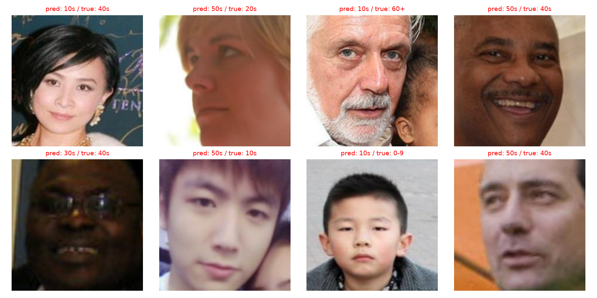
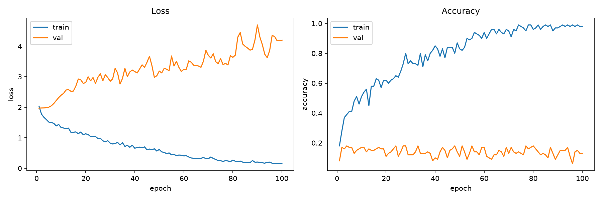
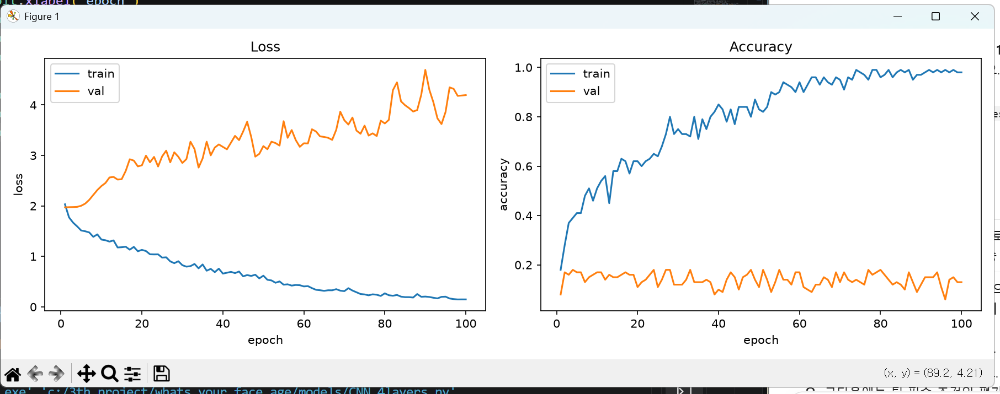
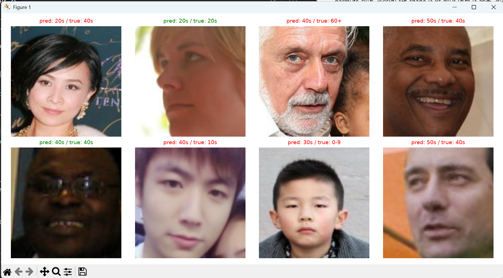
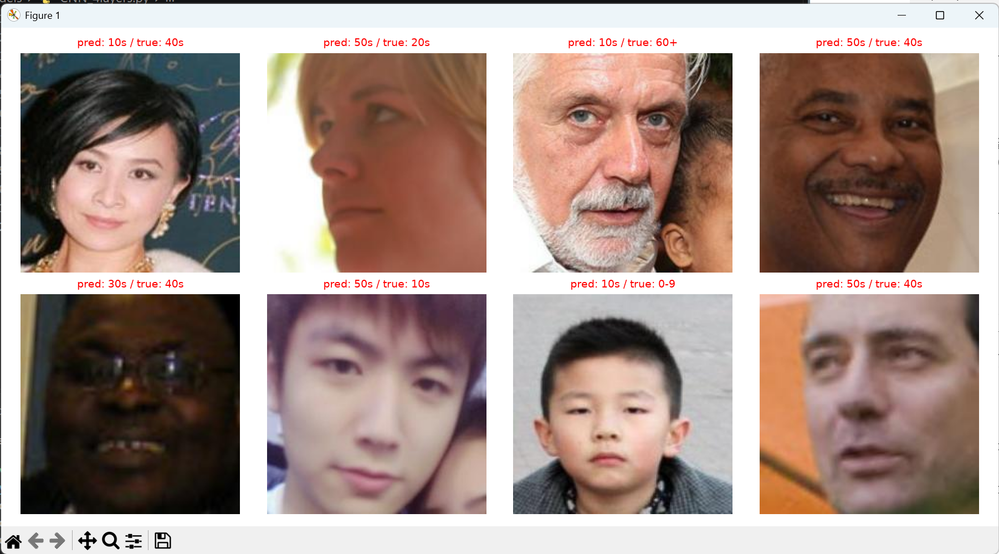

# 개발일지 04 — 학습 모델 시각화 (프로그램 4-5)

- **날짜**: 2026-11-12
- **프로젝트**: 얼굴 이미지 기반 나이대 분류 (인공지능 4조)
- **담당**: 임성빈 — 작은 CNN(4층) 처음부터 학습 (사전학습 없는 비교 기준 모델)
- **작업 범위**: 교재 프로그램 4-5(MNIST 예측 시각화)를 RGB 얼굴 이미지용으로 수정하고, 학습 곡선 그리기를 추가
- **상태**: ✅ 완료 — 이것으로 **교재 4-1 ~ 4-5 변형 완료**
- **실행 로그**: [`2026-11-12_04_시각화_실행로그.txt`](2026-11-12_04_시각화_실행로그.txt)

---

## 1. 목표

1. **예측 샘플 보기 (1부)**: 검증 사진 8장에 대해 모델의 예측과 정답을 함께 표시한다.
2. **학습 곡선 그리기 (2부)**: 4-4에서 모은 `history`로 에폭별 loss·정확도 변화를 그래프로 그린다.
3. 결과 그림을 파일로 저장해서 개발일지와 발표 자료에 쓴다.

> 이번 그림은 **100장 과적합 테스트 모델**(개발일지 03)로 그린 것이다. 시각화 코드가 제대로 동작하는지 확인하는 것이 목적이고, 예측 결과 자체에는 의미가 없다.

---

## 2. 교재 코드와 비교

| 교재 (MNIST) | 수정 | 이유 |
|---|---|---|
| `loader` (학습 데이터) | **`val_loader`** | 학습한 사진은 맞히는 게 당연하다. 처음 보는 사진으로 확인해야 한다 |
| 없음 | `model.load_state_dict(torch.load(SAVE_PATH))` | 학습이 끝난 `model`은 마지막 에폭 상태다. 저장해둔 **최고 에폭**의 가중치로 바꾼다 |
| `model(sample_images)` | `.to(device)`로 GPU에 보내고, 결과는 `.cpu()`로 되돌림 | 모델은 GPU에 있고, matplotlib은 CPU 데이터만 그릴 수 있다 |
| `squeeze()` + `cmap='gray'` | `permute(1, 2, 0)` + 정규화 되돌리기 | 흑백 1채널이 아니라 RGB 3채널이다 |
| `pred: 3` (숫자만) | 나이대 이름 + 정답 + 색깔 (맞으면 초록, 틀리면 빨강) | 오답 패턴을 한눈에 보기 위해 |
| `plt.show()`만 | `plt.savefig()` 추가 | 결과 그림 저장 |
| 없음 | **2부: 학습 곡선** | 과적합 여부를 그래프로 확인 |

---

## 3. 최종 코드 (프로그램 4-5)

```python
# 프로그램 4-5 학습 모델 시각화하기

import matplotlib.pyplot as plt

CLASS_NAMES = ["0-9", "10s", "20s", "30s", "40s", "50s", "60+"]   # 한글은 폰트 설정이 필요해서 영어로

# ---------- 1부: 예측 샘플 ----------
model.load_state_dict(torch.load(SAVE_PATH))   # 가장 좋았던 에폭의 가중치 불러오기
model.eval()

with torch.no_grad():
    sample_images, sample_labels = next(iter(val_loader))
    preds = model(sample_images.to(device)).argmax(dim=1).cpu()

plt.figure(figsize=(12, 6))
for i in range(8):
    plt.subplot(2, 4, i+1)

    img = sample_images[i].permute(1, 2, 0)       # (3, H, W) → (H, W, 3)
    img = img * torch.tensor(STD) + torch.tensor(MEAN)   # 정규화 되돌리기
    img = img.clamp(0, 1)
    plt.imshow(img)

    pred, true = preds[i].item(), sample_labels[i].item()
    color = "green" if pred == true else "red"
    plt.title(f"pred: {CLASS_NAMES[pred]} / true: {CLASS_NAMES[true]}", color=color, fontsize=9)
    plt.axis('off')

plt.tight_layout()
plt.savefig("pred_samples.png", dpi=150)
plt.show()

# ---------- 2부: 학습 곡선 ----------
epochs = range(1, len(history["train_loss"]) + 1)   # x축: 1, 2, ..., 100

plt.figure(figsize=(12, 4))

# 왼쪽: loss
plt.subplot(1, 2, 1)
plt.plot(epochs, history["train_loss"], label="train")
plt.plot(epochs, history["val_loss"], label="val")
plt.xlabel("epoch")
plt.ylabel("loss")
plt.title("Loss")
plt.legend()

# 오른쪽: 정확도
plt.subplot(1, 2, 2)
plt.plot(epochs, history["train_acc"], label="train")
plt.plot(epochs, history["val_acc"], label="val")
plt.xlabel("epoch")
plt.ylabel("accuracy")
plt.title("Accuracy")
plt.legend()

plt.tight_layout()
plt.savefig("learning_curve.png", dpi=150)
plt.show()
```

---

## 4. 실행 결과

### 4-1. 예측 샘플 (1부)



| 확인 항목 | 결과 | 판정 |
|---|---|---|
| 색깔 | 피부색·머리색·배경이 자연스럽게 나옴 | ✅ `permute`와 정규화 되돌리기가 정확함 |
| 제목 | `pred / true`가 표시되고 맞음/틀림 색이 구분됨 | ✅ |
| 정답 수 | 1차 실행 8장 중 2장, 2차 실행 0장 | 과적합 테스트 모델이라 정상 (best val acc 0.18~0.20) |

### 4-2. 학습 곡선 (2부)



<details>
<summary>실행 화면 캡처</summary>



</details>

| 그래프 | train | val | 해석 |
|---|---|---|---|
| Loss | 2.03 → **0.15** (하강) | 1.97 → **4.20** (상승) | 1 에폭에 둘 다 약 2.0(= ln 7, 아무것도 모르는 상태)에서 출발해 **처음부터 X자로 벌어짐** |
| Accuracy | 0.18 → 약 60 에폭부터 **0.95~1.0** | 100 에폭 내내 **0.1~0.2** | 100장은 외웠지만 처음 보는 사진은 찍는 수준(7개 중 1개 ≈ 0.14) |

→ **모델과 학습 코드는 정상(외울 수 있음)이고, 100장으로는 나이를 배울 수 없다(일반화 안 됨)**는 것을 그래프 하나로 보여주는 교과서적인 과적합 곡선이다.

---

## 5. 공부한 내용

### 5-1. GPU ↔ CPU 이동

```python
preds = model(sample_images.to(device)).argmax(dim=1).cpu()
```
- 모델이 GPU에 있으므로 입력도 `.to(device)`로 GPU에 보낸다.
- matplotlib은 GPU 텐서를 그릴 수 없어서 결과를 `.cpu()`로 되돌린다.
- `sample_images` 원본은 CPU에 그대로 남아 있으므로 그림은 원본으로 그린다.

### 5-2. `permute`: 차원 **번호**를 넣는다

```
원래 텐서:   (  3,   224,  224 )   → 번호 0=채널, 1=높이, 2=너비
matplotlib:  (224,  224,    3 )   → 높이, 너비, 채널 순서를 원함
→ permute(1, 2, 0)
```
- ❌ 처음에 `permute(IMG_SIZE, IMG_SIZE, 3)`처럼 **크기**를 넣었다 → 차원은 0, 1, 2 세 개뿐이라 에러.
- `view`·`reshape`는 괄호에 **크기**를, `permute`는 **차원 번호**를 넣는다. 둘 다 shape를 바꾸지만 넣는 값의 종류가 다르다.

### 5-3. 정규화 되돌리기

```
정규화 (4-1):   x_norm = (x − mean) / std
되돌리기 (4-5): x = x_norm × std + mean
코드:           img = img * torch.tensor(STD) + torch.tensor(MEAN)
```
- ❌ 처음에 공식 문장 자체(`x_norm = (x − mean) / std`)를 괄호에 넣었다 → 코드 줄 자체가 이미 공식의 모양이고, 빈칸에는 **값(상수 이름)**이 들어간다.
- `−`, `×` 같은 수학 기호는 파이썬이 읽지 못한다(`SyntaxError`). 코드에서는 `-`, `*`를 쓴다.
- 4-1에서 `MEAN`, `STD`를 상수로 빼둔 덕분에 여기서 그대로 재사용할 수 있었다.
- `permute`로 채널을 맨 뒤로 보낸 **다음에** 계산해야, 값 3개짜리 `STD`·`MEAN`이 마지막 차원(R, G, B)에 하나씩 자동으로 맞춰진다(브로드캐스팅).
- `clamp(0, 1)`: 계산 오차로 0~1을 살짝 벗어난 값을 잘라낸다.

### 5-4. `plt.subplot(행 수, 열 수, 칸 번호)`

- 칸 번호는 **1부터** 시작하고 왼쪽 위에서 오른쪽으로 센다.
- 1부: `subplot(2, 4, i+1)` → 반복문 안에서 `i`가 0~7로 바뀌며 1~8번 칸을 차례로 사용.
- 2부: `subplot(1, 2, 1)`, `subplot(1, 2, 2)` → 칸이 정해져 있으므로 숫자를 직접 쓴다.
- ❌ 처음에 2부에도 `i+1`을 썼다 → 반복문이 끝난 뒤에도 `i`는 마지막 값 7로 남아 있어서 `subplot(1, 2, 8)`이 되고 `ValueError` (칸은 2개뿐).

### 5-5. 그 밖에

- **첫 줄 `#` 누락**: `프로그램 4-5 학습 모델 시각화하기`처럼 주석 기호가 빠지면 `SyntaxError`. 문법 오류는 실행 전에 검사되므로 4-1부터 **아무것도 실행되지 않는다.**
- **`plt.show()`는 창을 닫을 때까지 멈춘다**: 1부 창을 닫아야 2부 창이 뜬다.
- **`epochs = range(1, ...)`**: 리스트 위치는 0부터지만 x축은 출력과 같게 1 에폭부터 보이도록.
- **`CLASS_NAMES`는 영어**: matplotlib 기본 폰트는 한글을 표시하지 못한다.

---

## 6. 결과에서 발견한 점

### 6-1. 검증 100장은 흔들림이 크다

| 실행 | best val acc | 예측 샘플 정답 |
|---|---|---|
| 1차 | 0.20 | 8장 중 2장 |
| 2차 | 0.18 | 8장 중 0장 |

**1차 실행 화면 캡처** (2장 정답: 20s, 40s)



**2차 실행 화면 캡처** (0장 정답)



- 같은 코드·같은 시드인데 차이가 난 이유: GPU(cuDNN) 연산의 아주 작은 차이 때문에 "가장 좋은 에폭"이 달라져 다른 시점의 모델이 저장됐다.
- 검증이 100장뿐이라 **사진 1장 = 정확도 1%**다. 0.18과 0.20은 사진 2장 차이일 뿐이다.
- 검증을 **15,288장 전체**로 하면 1장 = 약 0.007%라서 이런 흔들림이 거의 사라진다. → 팀원이 "검증 데이터는 반드시 같아야 한다"고 한 이유와 연결된다. **본 학습에서는 반드시 validation 전체를 쓴다.**

### 6-2. 사진 자체가 어려운 경우 (결과 해석·발표 "예상 문제"에 활용)

예측 샘플 8장에서 모델 성능과 별개로 데이터 특징이 보였다.

| 특징 | 예시 | 영향 |
|---|---|---|
| **한 사진에 얼굴이 두 개** | 3번째(60+), 6번째(10s) 사진 가장자리에 다른 사람 얼굴 | 모델이 엉뚱한 얼굴을 보고 판단할 수 있음 |
| **옆모습·가려진 얼굴** | 2번째 거의 옆모습, 5번째 안경과 어두운 조명 | 나이 단서(눈가, 주름)가 잘 안 보임 |
| **잘림 방식 차이** | 8번째는 얼굴이 한쪽으로 치우쳐 크게 잘림, 4번째는 얼굴이 꽉 참 | 개발일지 01에서 발견한 출처별 크롭 차이와 연결 |

→ 본 학습 후 오답 사진을 볼 때 **"모델이 못한 것"인지 "사진이 어려운 것"인지** 구분하는 근거로 쓴다.

---

## 7. 진행 상황

| 단계 | 상태 |
|---|---|
| 4-1 데이터 로딩 | ✅ |
| 4-2 모델 구성 (390,695 파라미터) | ✅ |
| 4-3 손실·최적화 | ✅ |
| 4-4 학습 루프 + 100장 과적합 테스트 | ✅ |
| **4-5 시각화 (예측 샘플, 학습 곡선)** | ✅ **이번 작업** |
| 평가 지표 (한 칸 차이 정확도, macro-F1) | ⬜ 다음 |
| 본 학습 설정 (증강 켜기, 에폭 20, 검증 전체) | ⬜ |
| 팀원과 조건 통일 (증강, 손실 가중치) | ⬜ |
| 본 학습 실행 → 결과 해석 | ⬜ |

→ 작은 CNN 담당 업무 전체 기준 **약 45%** 진행.

---

## 8. 다음 할 일

- [ ] **평가 지표 추가** (팀 필수): 검증 루프에서 예측·정답을 리스트에 모아 에폭 끝에 계산
  - 한 칸 차이 정확도: `abs(예측 − 정답) <= 1` 비율
  - macro-F1: 나이대별 F1의 단순 평균 (`sklearn.metrics.f1_score(..., average="macro")`)
  - 최고 모델 저장 기준을 val acc → **val macro-F1**로 변경 (팀원과 동일)
- [ ] **본 학습 설정** (팀 필수): `train_dataset.transform = val_transform` 주석 처리, `NUM_EPOCHS = 20`, **검증은 `val_dataset` 전체**
- [ ] 팀원과 조건 통일: 증강(확대·자르기 0.9~1.0, 대비 ±0.2), 손실 가중치
- [ ] 학습 기록을 `history.csv`로 저장 (팀원과 같은 열 이름)
- [ ] 학습 코드와 시각화 코드 분리 검토 (지금은 실행할 때마다 학습부터 다시 돎)
