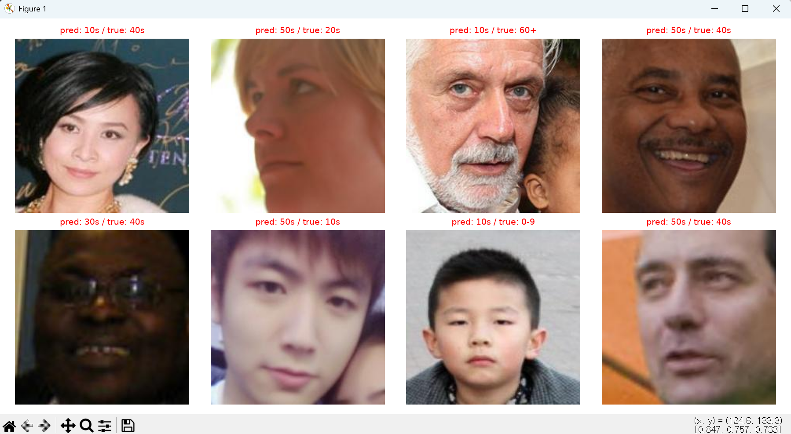
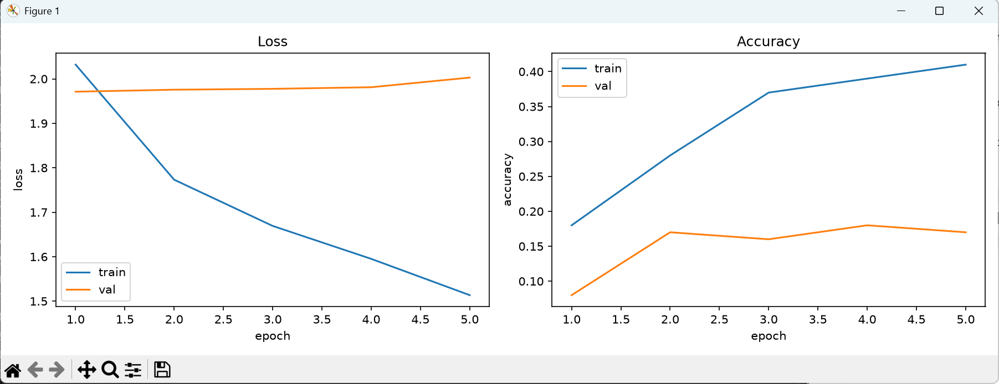

# 개발일지 05 — 평가 지표 추가: 한 칸 차이 정확도, macro-F1

- **날짜**: 2026-11-12
- **프로젝트**: 얼굴 이미지 기반 나이대 분류 (인공지능 4조)
- **담당**: 임성빈 — 작은 CNN(4층) 처음부터 학습 (사전학습 없는 비교 기준 모델)
- **작업 범위**: 4-4 검증 구간에 팀 공통 평가 지표 2개를 추가하고, 최고 모델 저장 기준을 macro-F1로 변경
- **상태**: ✅ 완료 (100장 테스트, 5 에폭으로 동작 확인)
- **실행 로그**: [`2026-11-12_05_평가지표_실행로그.txt`](2026-11-12_05_평가지표_실행로그.txt)

---

## 1. 배경: 팀 공통 조건

팀원(ResNet-50·ConvNeXt 담당)이 정리한 비교 조건이다.

| 항목 | 팀원 모델 | 내 작은 CNN (작업 전) | 맞출 필요 |
|---|---|---|---|
| 데이터 분리 | `split_result_224` | `split_result_224` | ✅ 같음 |
| **검증 평가 지표** | 정확도, 한 칸 차이 정확도, macro-F1 | 정확도만 | 🔴 **꼭 같게** |
| 나이대 순서 | 0~9세 → 60세 이상 | 폴더 이름 순서 (같은 순서) | ✅ 같음 |
| 증강 | 확대·자르기, 좌우 반전, ±10°, 밝기·대비 | 좌우 반전, ±10°, 밝기 | 🟡 가능하면 |
| 손실 가중치 | 사용 | 없음 | 🟡 가능하면 |
| 배치 크기 | 64 | 64 (개발일지 03에서 변경) | ✅ 같음 |

> 팀원: "특히 평가 지표(정확도, 한 칸 차이 정확도, macro-F1)와 검증 데이터만큼은 반드시 같아야 한다."

→ 이번 작업에서 **평가 지표**를 맞췄다. 검증 데이터(validation 전체)는 다음 작업(본 학습 설정)에서 맞춘다.

---

## 2. 추가한 지표

| 지표 | 계산 | 의미 |
|---|---|---|
| 정확도 (acc) | `예측 == 정답` 비율 | 기존 |
| **한 칸 차이 정확도 (off1)** | `|예측 − 정답| ≤ 1` 비율 | 바로 옆 나이대까지 정답으로 인정 (30대 → 40대 예측은 인정, 30대 → 60대는 불인정) |
| **macro-F1** | 나이대별 F1을 구해 **1/7씩 단순 평균** | 데이터가 적은 50대·60세 이상도 다른 나이대와 **똑같은 무게**로 평가 |

### macro-F1이 필요한 이유

모델이 사진이 많은 10~40대만 잘 맞히고 60세 이상을 전부 틀려도 정확도는 꽤 높게 나올 수 있다. macro-F1은 7개 나이대 점수를 똑같이 평균 내므로 **한 나이대라도 못하면 점수가 크게 떨어진다.** 그래서 팀원도 최고 모델 저장 기준을 macro-F1로 잡았다.

### F1의 평균 방식 (`average=`)

| 값 | 계산 방식 | 적은 나이대의 비중 |
|---|---|---|
| `"micro"` | 나이대 구분 없이 전체를 한꺼번에 계산 (사실상 정확도와 비슷) | 사진 수만큼 → 작음 |
| `"weighted"` | 나이대별 F1을 사진 수로 가중 평균 | 사진 수만큼 → 작음 |
| **`"macro"`** | 나이대별 F1을 **1/7씩 단순 평균** | **다른 나이대와 동일** ← 채택 |

> macro(크게) = 나이대 단위로 크게 나눠 각각 계산 후 평균 / micro(작게) = 사진 한 장 단위로 잘게 다 모아서 계산

---

## 3. 핵심 아이디어: 예측을 모았다가 마지막에 한 번에 계산

- 정확도는 배치마다 맞힌 개수를 더하면 되지만, **F1은 배치별 값을 평균 내면 틀린 값**이 나온다.
- 그래서 검증 배치를 돌면서 **예측과 정답을 리스트에 모아두고**, 검증이 끝난 뒤 전체를 한 번에 계산한다.

```
배치 1 예측 (64개) ─┐
배치 2 예측 (36개) ─┴→ torch.cat → 예측 100개 → off1, macro-F1 계산
```

---

## 4. 코드 변경 사항

### 4-1. import 추가 (4-4 상단)

```python
from sklearn.metrics import f1_score     # macro-F1 계산용
```
- scikit-learn은 이미 설치되어 있다 (`requirements.txt`). 팀원 코드도 같은 함수를 쓴다.

### 4-2. history와 최고 기록 변수

```python
history = {"train_loss": [], "train_acc": [], "val_loss": [], "val_acc": [],
           "val_off1": [], "val_f1": []}          # 지표 2개 추가
best_val_f1 = 0.0                                  # best_val_acc 대신
```

### 4-3. 검증 구간 (최종 코드)

```python
    # ---------- 검증 ----------
    model.eval()
    running_loss, correct, total = 0.0, 0, 0
    all_preds, all_labels = [], []                 # 이번 에폭의 예측·정답을 모을 빈 리스트

    with torch.no_grad():
        for images, labels in val_loader:
            images, labels = images.to(device), labels.to(device)
            outputs = model(images)
            loss = criterion(outputs, labels)
            preds = outputs.argmax(dim=1)          # 예측 나이대 번호 (한 번만 계산해서 재사용)

            all_preds.append(preds.cpu())          # sklearn은 GPU 텐서를 못 읽음
            all_labels.append(labels.cpu())

            running_loss += loss.item() * images.size(0)
            correct += (preds == labels).sum().item()
            total += labels.size(0)

    all_preds = torch.cat(all_preds)               # 배치별 텐서 리스트 → 텐서 하나로 이어붙이기
    all_labels = torch.cat(all_labels)

    val_loss = running_loss / total
    val_acc = correct / total
    val_off1 = ((all_preds - all_labels).abs() <= 1).float().mean().item()
    val_f1 = f1_score(all_labels.numpy(), all_preds.numpy(),
                      average="macro",
                      labels=list(range(NUM_CLASSES)), zero_division=0)
```

### 4-4. 기록·출력·저장

```python
    history["val_off1"].append(val_off1)
    history["val_f1"].append(val_f1)

    print(f"Epoch {epoch+1:2d}/{NUM_EPOCHS} | "
          f"train loss {train_loss:.4f} acc {train_acc:.3f} | "
          f"val loss {val_loss:.4f} acc {val_acc:.3f} off1 {val_off1:.3f} F1 {val_f1:.3f}")

    # ---------- 최고 모델 저장 (기준: macro-F1) ----------
    if val_f1 > best_val_f1:
        best_val_f1 = val_f1
        torch.save(model.state_dict(), SAVE_PATH)

print("best val macro-F1:", best_val_f1)
```

### 각 부분의 의미

| 코드 | 의미 |
|---|---|
| `preds.cpu()` | sklearn은 numpy 배열을 쓰는데, GPU 텐서는 numpy로 바꿀 수 없어서 CPU로 옮긴다 |
| `torch.cat(리스트)` | con**cat**enate(이어붙이기). `[텐서(64개), 텐서(36개)]` → `텐서(100개)` |
| `(all_preds - all_labels).abs()` | 차이는 음수일 수 있으므로(예: 20대로 예측, 정답 30대 → 2 − 3 = −1) **절댓값** |
| `<= 1` | 바로 옆 나이대까지 인정 |
| `.float().mean()` | True/False → 1.0/0.0으로 바꿔 평균 = **비율** |
| `.numpy()` | 텐서 → numpy 배열 (sklearn 입력 형식) |
| `labels=list(range(NUM_CLASSES))` | 0~6 일곱 개 나이대를 모두 계산에 포함. 검증이 100장뿐이라 어떤 나이대가 아예 없어도 7개 기준으로 평균 (팀원 코드와 동일) |
| `zero_division=0` | 어떤 나이대를 한 번도 예측하지 않으면 F1 계산 중 0으로 나누게 되는데, 에러 대신 0점 처리 |

---

## 5. 실행 결과 (100장 테스트, 5 에폭)

```
Epoch  1/5 | train loss 2.0320 acc 0.180 | val loss 1.9711 acc 0.080 off1 0.170 F1 0.021
Epoch  2/5 | train loss 1.7732 acc 0.280 | val loss 1.9756 acc 0.170 off1 0.420 F1 0.149
Epoch  3/5 | train loss 1.6693 acc 0.370 | val loss 1.9776 acc 0.160 off1 0.500 F1 0.124
Epoch  4/5 | train loss 1.5952 acc 0.390 | val loss 1.9812 acc 0.180 off1 0.520 F1 0.150
Epoch  5/5 | train loss 1.5135 acc 0.410 | val loss 2.0029 acc 0.170 off1 0.450 F1 0.112
best val macro-F1: 0.14976850994481278
```

| 확인 항목 | 결과 | 판정 |
|---|---|---|
| 에폭 줄에 `off1`, `F1` 출력 | 나옴 | ✅ |
| `off1 ≥ acc` | 모든 에폭에서 성립 | ✅ 계산식 정상 (정확히 맞힌 사진은 "한 칸 이내"에도 포함되므로 항상 성립해야 함) |
| F1 범위 | 0.021 ~ 0.150 | ✅ 100장 테스트 모델로는 정상 |
| 저장 기준 | `best val macro-F1: 0.1498` (4 에폭) | ✅ macro-F1 기준으로 저장됨 |
| 앞 4 에폭 수치 | 개발일지 03·04의 1~4 에폭과 동일 | ✅ 시드 고정 유지 |

### 5-1. macro-F1이 잡아낸 것: 1 에폭

| 에폭 | acc | off1 | **F1** |
|---|---|---|---|
| 1 | 0.080 | 0.170 | **0.021** |
| 4 | 0.180 | 0.520 | **0.150** |

- 1 에폭의 F1 0.021은 **모델이 거의 한 나이대만 계속 찍고 있다**는 신호다. 한 나이대만 예측하면 그 나이대만 약간의 F1을 받고 나머지 6개는 0점이라 평균이 0에 가깝다.
- off1이 무작위(약 0.39)보다 낮은 0.17인 것도 같은 이유다. 한쪽 끝 나이대만 찍으면 "옆 칸"으로 인정받을 기회도 적다.
- → 본 학습에서도 모델이 사진이 많은 나이대 쪽으로 쏠리면 **정확도보다 macro-F1이 먼저 잡아낸다.**

> **참고: 무작위로 찍을 때 off1 ≈ 0.39인 이유**
> 정답이 양 끝(0~9세, 60세 이상)이면 인정되는 예측이 2개, 가운데 5개 나이대면 3개다.
> → (2×2 + 5×3) / 49 = 19/49 ≈ 0.39

### 5-2. 그림

macro-F1 기준 최고 모델(4 에폭)로 그린 예측 샘플 (8장 모두 오답, 테스트 모델이라 정상):



5 에폭 학습 곡선 — 짧지만 train loss는 내려가고 val loss는 오르기 시작하는 모양이 그대로 보인다:



---

## 6. 오류 및 수정 기록

| # | 쓴 코드 | 문제 | 수정 |
|---|---|---|---|
| 1 | `torch.con(all_preds)` | `AttributeError: module 'torch' has no attribute 'con'` — 함수 이름은 con**cat**enate의 앞 세 글자 | `torch.cat` |
| 2 | `average="average"` | `ValueError` — 허용 값은 `None`, `'micro'`, `'macro'`, `'weighted'` 중 하나 | `average="macro"` |
| 3 | `average="?"` | 설명 표의 빈칸 표시(`?`)를 그대로 입력 | 〃 |
| 4 | `average="macro-F1	"` | "macro-F1"은 사람이 부르는 **지표 이름**이고, 옵션 값은 앞부분 `"macro"`뿐. 끝에 들어간 탭(보이지 않는 빈칸)도 다른 글자로 취급됨 | 〃 |

**배운 점**
- 함수 이름이 헷갈리면 VS Code에서 `torch.`까지 치고 자동완성 목록을 확인한다.
- 문자열 옵션 값(`average=`, `mode=` 등)은 라이브러리가 정해둔 단어와 **글자 하나, 빈칸 하나까지 똑같아야** 한다. 에러 메시지에 허용 값 목록이 나오므로 그걸 보고 고친다.

---

## 7. 진행 상황

| 단계 | 상태 |
|---|---|
| 4-1 ~ 4-5 (데이터, 모델, 손실·최적화, 학습 루프, 시각화) | ✅ |
| **평가 지표 (acc, off1, macro-F1) + macro-F1 기준 저장** | ✅ **이번 작업** |
| 본 학습 설정 (`USE_SUBSET` 스위치, 증강 켜기, 에폭 20, **검증 전체**) | ⬜ 다음 |
| 팀원과 조건 통일 (증강, 손실 가중치) | ⬜ |
| 본 학습 실행 → 결과 해석 | ⬜ |

→ 작은 CNN 담당 업무 전체 기준 **약 50%** 진행.

---

## 8. 다음 할 일

- [ ] **본 학습 설정** (팀 필수)
  - `USE_SUBSET` 스위치 하나로 100장 테스트 / 본 학습 전환
  - 본 학습: train 71,735장, **val 15,288장 전체** (팀원과 동일), 증강 켜기, `NUM_EPOCHS = 20`
  - 학습 데이터 양 확인: 팀원은 training 전체 사용 / 발표 자료에는 "비교 실험 약 3만 장" → 팀과 확인
- [ ] **팀원과 조건 통일** (본 학습 전에 넣어서 재학습을 피하기)
  - 증강: `RandomResizedCrop(scale=(0.9, 1.0))`, `ColorJitter(contrast=0.2)` 추가
  - 손실 가중치: `CrossEntropyLoss(weight=...)` — 50대 1.51, 60세 이상 1.94
- [ ] 학습 기록 `history.csv` 저장 (팀원과 같은 열 이름)
- [ ] 4-5 학습 곡선에 off1, macro-F1 추가 검토
- [ ] 예상 학습 시간: 에폭당 약 3~6분 × 20 = **1~2시간** (`num_workers` 없음 → 사진 읽기가 병목)
