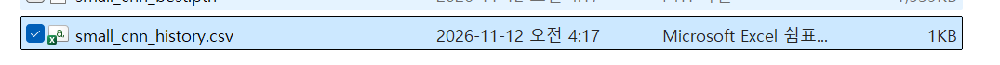
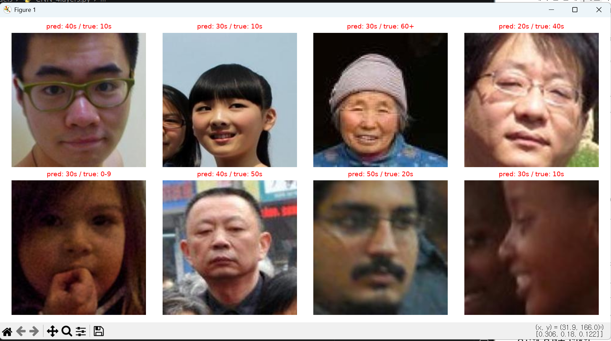
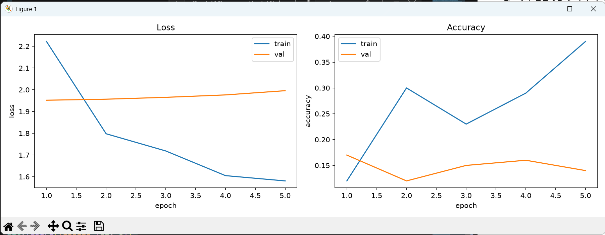

# 개발일지 06 — 본 학습 설정: 스위치, 팀원 조건 통일, 기록 저장

- **날짜**: 2026-11-12
- **프로젝트**: 얼굴 이미지 기반 나이대 분류 (인공지능 4조)
- **담당**: 임성빈 — 작은 CNN(4층) 처음부터 학습 (사전학습 없는 비교 기준 모델)
- **작업 범위**: 본 학습(전체 데이터, 20 에폭)을 돌리기 전에 필요한 코드 정비
- **상태**: ✅ 완료 (100장 테스트 모드로 동작 확인) → 다음은 **본 학습 실행**
- **실행 로그**: [`2026-11-12_06_본학습설정_실행로그.txt`](2026-11-12_06_본학습설정_실행로그.txt)
- **테스트 기록 CSV**: [`2026-11-12_06_테스트_small_cnn_history.csv`](2026-11-12_06_테스트_small_cnn_history.csv)

---

## 1. 이번에 한 일 요약

| # | 작업 | 왜 |
|---|---|---|
| 1 | `USE_SUBSET` 스위치 | 한 줄로 100장 테스트 ↔ 본 학습 전환. **검증은 validation 전체(15,288장)**로 팀원과 동일하게 |
| 2 | 증강을 팀원 코드와 똑같이 | 팀 공통 조건 ("가능하면 같게") |
| 3 | 검증 전처리를 팀원 코드와 똑같이 | 팀 공통 조건 ("반드시 같게") |
| 4 | 나이대별 손실 가중치 | 팀 공통 조건, 50대·60세 이상 불균형 보정 |
| 5 | 학습 기록을 매 에폭 CSV로 저장 | 1~2시간 학습 중 오류가 나도 기록 보존, 팀원 결과와 같은 형식으로 비교 |
| 6 | 예측 샘플을 검증 데이터 전체에서 무작위로 | 본 학습 모드에서 0~9세 사진만 나오는 문제 해결 |

> 본 학습은 1~2시간 걸리므로, 조건을 바꿀 일은 **본 학습 전에 전부** 넣었다. 끝나고 바꾸면 처음부터 다시 돌려야 한다.

---

## 2. `USE_SUBSET` 스위치

### 2-1. 왜 필요한가

본 학습 코드로 바꾼 뒤에도 코드를 고칠 일이 계속 생긴다. 그때마다 1~2시간짜리 본 학습으로 확인할 수는 없다. 스위치 한 줄로 **1~2분짜리 100장 점검**과 **본 학습**을 오갈 수 있게 했다.

### 2-2. 코드

```python
# 4-1 설정값
USE_SUBSET = True      # True: 100장 과적합 테스트 / False: 본 학습 (전체 데이터)

# 4-1 DataLoader
if USE_SUBSET:
    train_loader = DataLoader(train_subset, batch_size=BATCH_SIZE, shuffle=True)    # 100장
    val_loader   = DataLoader(val_subset, batch_size=BATCH_SIZE, shuffle=False)   # 100장
else:
    train_loader = DataLoader(train_dataset, batch_size=BATCH_SIZE, shuffle=True)    # 학습 71,735장
    val_loader   = DataLoader(val_dataset, batch_size=BATCH_SIZE, shuffle=False)   # 검증 15,288장 (팀원과 동일)

# 4-4 상단
if USE_SUBSET:
    train_dataset.transform = val_transform   # 과적합 테스트일 때만 증강 끄기

NUM_EPOCHS = 5 if USE_SUBSET else 20          # 테스트일 때 / 본 학습일 때 (팀원과 같은 20)
```

| 모드 | 학습 | 검증 | 증강 | 에폭 |
|---|---|---|---|---|
| `USE_SUBSET = True` | 100장 (`train_subset`) | 100장 (`val_subset`) | 끔 | 5 |
| `USE_SUBSET = False` | **71,735장** (`train_dataset`) | **15,288장** (`val_dataset`) | 켬 | **20** |

### 2-3. 처음에 틀린 부분

```python
if USE_SUBSET:
    train_loader = DataLoader(N_TRAIN, ...)        # ❌ 숫자 100 → TypeError
    val_loader   = DataLoader(N_VAL, ...)
else:
    train_loader = DataLoader(train_subset, ...)   # ❌ 본 학습인데 100장
    val_loader   = DataLoader(val_subset, ...)
```

| 변수 | 정체 | DataLoader에 넣을 수 있나 |
|---|---|---|
| `N_TRAIN`, `N_VAL` | 숫자 100 ("몇 장 자를지") | ❌ 사진이 없음 |
| `train_subset`, `val_subset` | 사진 100장이 든 **데이터셋** | ✅ 테스트용 |
| `train_dataset`, `val_dataset` | 전체 사진이 든 **데이터셋** | ✅ 본 학습용 |

- `DataLoader`의 첫 자리에는 "사진을 꺼낼 수 있는 데이터셋"이 들어간다.
- `else` 쪽이 subset이었으면 `USE_SUBSET = False`로 본 학습을 돌려도 **100장으로만** 학습·검증된다. 에러 없이 조용히 틀리는 버그라 특히 위험했다.

### 2-4. 확인

`USE_SUBSET = True`로 실행 → 스위치를 넣기 전과 **같은 결과**(1 에폭 train loss 2.0320, best F1 0.1498) → 스위치 정상.

---

## 3. 팀원 코드와 조건 통일

팀 저장소의 팀원 코드 `ResNet50/ResNet50/code/common.py`와 `ConvNeXt/ConvNeXt/code/train_convnext.py`는 같은 `build_transforms` 함수를 쓴다.

```python
# 팀원 코드 원문 (train_convnext.py)
def build_transforms(train: bool):
    if train:  # 증강은 학습 데이터에만
        steps = [
            T.RandomResizedCrop(IMG_SIZE, scale=(0.9, 1.0), ratio=(0.95, 1.05)),  # 살짝 확대·자르기
            T.RandomHorizontalFlip(),                                             # 좌우 반전
            T.RandomRotation(10),                                                 # ±10도 회전
            T.ColorJitter(brightness=0.2, contrast=0.2),                          # 밝기·대비 ±20%
        ]
    else:
        steps = [T.Resize((IMG_SIZE, IMG_SIZE))]
    steps += [T.ToTensor(), T.Normalize(IMAGENET_MEAN, IMAGENET_STD)]
    return T.Compose(steps)
```

### 3-1. 학습 증강

| 순서 | 팀원 | 내 코드 (전) | 내 코드 (후) |
|---|---|---|---|
| 1 | `RandomResizedCrop(224, scale=(0.9, 1.0), ratio=(0.95, 1.05))` | `Resize(224)` + `CenterCrop(224)` | **같음** ✅ |
| 2 | `RandomHorizontalFlip()` | `p=0.5` | 같음 ✅ |
| 3 | `RandomRotation(10)` | `degrees=10` | 같음 ✅ |
| 4 | `ColorJitter(brightness=0.2, contrast=0.2)` | 밝기만 | **같음** ✅ |
| 5 | `ToTensor` → `Normalize` | 같음 | 같음 ✅ |

```python
train_transform = transforms.Compose([
    transforms.RandomResizedCrop(IMG_SIZE, scale=(0.9, 1.0), ratio=(0.95, 1.05)),  # 살짝 확대·자르기
    transforms.RandomHorizontalFlip(p=0.5),
    transforms.RandomRotation(degrees=10),
    transforms.ColorJitter(brightness=0.2, contrast=0.2),
    transforms.ToTensor(),
    transforms.Normalize(MEAN, STD),
])
```

**`RandomResizedCrop(크기, scale=(최소, 최대), ratio=(최소, 최대))`**
- `scale`: 원본 면적의 몇 %를 잘라낼지 (0.9~1.0 → 90~100%), 매번 무작위
- `ratio`: 잘라낼 영역의 가로:세로 비율 범위 (0.95~1.05 → 거의 정사각형)
- 잘라낸 뒤 224로 다시 늘림 → 얼굴이 살짝 확대되거나 위치가 조금 이동한 효과
- 리사이즈까지 스스로 하므로 `Resize`, `CenterCrop`은 뺐다.

**`ColorJitter(contrast=0.2)`**: 대비를 0.8~1.2배 사이에서 무작위로 바꾼다.

### 3-2. 검증 전처리

```python
val_transform = transforms.Compose([
    transforms.Resize((IMG_SIZE, IMG_SIZE)),     # 팀원과 같은 방식 (이전: Resize(224) + CenterCrop(224))
    transforms.ToTensor(),
    transforms.Normalize(MEAN, STD),
])
```
- `Resize(224)`: 짧은 변만 224로 (비율 유지) / `Resize((224, 224))`: 가로·세로 모두 224로
- 지금 사진은 모두 224×224라서 **결과는 완전히 같다.** 그래도 "검증 조건은 반드시 같게"라는 팀 원칙에 맞춰 코드까지 통일했다. (Gradio 시연처럼 정사각형이 아닌 사진이 들어오면 두 방식의 결과가 달라진다.)

### 3-3. 나이대별 손실 가중치

```python
counts = torch.bincount(torch.tensor(train_dataset.targets), minlength=NUM_CLASSES).float()
class_weights = counts.sum() / (NUM_CLASSES * counts)

print("나이대별 사진 수:", counts.tolist())
print("나이대별 손실 가중치:", class_weights)

criterion = nn.CrossEntropyLoss(weight=class_weights.to(device))
```

| 코드 | 의미 |
|---|---|
| `train_dataset.targets` | ImageFolder가 미리 만들어 둔 **모든 사진의 라벨 목록** (71,735개). 사진을 열지 않아 빠름 |
| `torch.bincount(..., minlength=7)` | 0번이 몇 개, 1번이 몇 개, … 세기. `minlength=7`은 0개인 번호도 칸을 만들라는 뜻 |
| `.float()` | 다음 줄 나눗셈을 위해 실수로 |
| `counts.sum() / (NUM_CLASSES * counts)` | **가중치 = 전체 / (7 × 그 나이대 사진 수)** |
| `class_weights.to(device)` | 가중치도 모델·데이터와 같은 GPU에 있어야 계산 가능 |

| 나이대 | 0~9 | 10대 | 20대 | 30대 | 40대 | 50대 | 60+ |
|---|---:|---:|---:|---:|---:|---:|---:|
| 사진 수 | 11,561 | 12,000 | 12,000 | 12,000 | 12,104 | 6,801 | 5,269 |
| 가중치 | 0.886 | 0.854 | 0.854 | 0.854 | 0.847 | **1.507** | **1.945** |

- 사진이 많을수록 가중치가 작고(1 미만), 적을수록 크다(1 초과). 모든 나이대가 똑같이 있으면 전부 정확히 1.0이 된다.
- 60세 이상 사진을 틀리면 손실에 1.94배, 20대를 틀리면 0.85배 → 적은 나이대도 무시하지 않게 학습된다.
- 팀원 출력 `[0.89 0.85 0.85 0.85 0.85 1.51 1.94]`과 **같은 값** (팀원은 소수 둘째 자리까지 출력).
- 원래 있던 가중치 없는 `criterion = nn.CrossEntropyLoss()` 줄은 덮어써져서 의미가 없으므로 지웠다.

---

## 4. 학습 기록을 매 에폭 CSV로 저장

```python
import time
import pandas as pd

HISTORY_PATH = "small_cnn_history.csv"

history = {"train_loss": [], "train_acc": [], "val_loss": [], "val_acc": [],
           "val_off1": [], "val_f1": [], "sec": []}

for epoch in range(NUM_EPOCHS):
    t0 = time.time()                              # 에폭 시작 시각
    ...
    sec = time.time() - t0                        # 이번 에폭에 걸린 시간
    history["sec"].append(sec)

    # ---------- CSV 저장 (매 에폭) ----------
    df = pd.DataFrame(history)                    # 딕셔너리 → 표
    df.insert(0, "epoch", range(1, len(df) + 1))  # 맨 앞에 에폭 번호 열
    df = df.rename(columns={"val_off1": "val_off1_acc", "val_f1": "val_macro_f1"})   # 팀원과 같은 열 이름
    df.to_csv(HISTORY_PATH, index=False)
```

- **매 에폭 저장하는 이유**: 학습 중 에러가 나거나 그래프 창을 잘못 닫아도 그때까지의 기록이 남는다. 팀원 코드도 같은 방식이다.
- **에폭 시간(`sec`)**: 본 학습 중 "첫 에폭 시간 × 20 = 전체 예상 시간"을 알 수 있다.
- **`index=False`**: 행 번호(0, 1, 2…)를 따로 쓰지 않는다 (에폭 번호 열이 있으므로).
- `history["sec"]`는 CSV 저장 **전에** append해야 한다. pandas 표는 모든 열의 길이가 같아야 한다.

### 팀원 CSV와 열 이름 비교

| 팀원 (`train_convnext.py`) | 내 `small_cnn_history.csv` | |
|---|---|---|
| `epoch` | `epoch` | ✅ |
| `head_only` | 없음 | 사전학습 모델 전용 (첫 에폭 출력층만 학습). 작은 CNN에는 해당 없음 |
| `train_loss`, `train_acc` | 같음 | ✅ |
| `val_loss`, `val_acc` | 같음 | ✅ |
| `val_off1_acc`, `val_macro_f1` | 같음 | ✅ `rename`으로 맞춤 |
| `sec` | 같음 | ✅ |

→ 공통 열 이름이 모두 같아서, 나중에 세 모델의 CSV를 같은 코드로 읽어 한 그래프에 겹쳐 그릴 수 있다.



---

## 5. 예측 샘플을 무작위로 (4-5 1부)

**문제**: 기존 코드는 `val_loader`의 첫 배치에서 8장을 꺼냈다. 본 학습 모드의 `val_dataset`은 ImageFolder라 **폴더 순서대로 정렬**돼 있고 `shuffle=False`라서, 첫 배치 64장이 전부 `0 9` 폴더 사진이다.

**해결**: 검증 데이터 전체에서 고정 시드로 무작위 8장을 뽑는다.

```python
g_vis = torch.Generator().manual_seed(SEED)                     # 시각화용 난수 (매번 같은 8장)
vis_idx = torch.randperm(len(val_dataset), generator=g_vis)[:8].tolist()

sample_images = torch.stack([val_dataset[i][0] for i in vis_idx])   # 8장 → (8, 3, 224, 224)
sample_labels = torch.tensor([val_dataset[i][1] for i in vis_idx])

with torch.no_grad():
    preds = model(sample_images.to(device)).argmax(dim=1).cpu()
```

| 코드 | 의미 |
|---|---|
| `val_dataset[i]` | `(이미지 텐서, 라벨)` 한 쌍. `[0]` 이미지, `[1]` 라벨 |
| `[... for i in vis_idx]` | 8개 번호마다 꺼내서 리스트로 |
| `torch.stack(리스트)` | 텐서들을 **새 차원(배치)으로 쌓기**: `(3, 224, 224)` × 8 → `(8, 3, 224, 224)` |
| (비교) `torch.cat(리스트)` | **기존 차원으로 이어붙이기**: 같은 입력이면 `(24, 224, 224)`가 됨 → 여기서는 틀림 |

테스트 모드와 본 학습 모드에서 같은 방식으로 동작한다.

---

## 6. 테스트 모드 실행 결과 (`USE_SUBSET = True`, 5 에폭)

```
나이대별 사진 수: [11561.0, 12000.0, 12000.0, 12000.0, 12104.0, 6801.0, 5269.0]
나이대별 손실 가중치: tensor([0.8864, 0.8540, 0.8540, 0.8540, 0.8467, 1.5068, 1.9449])
Epoch  1/5 | train loss 2.2222 acc 0.120 | val loss 1.9519 acc 0.170 off1 0.360 F1 0.129 | 1초
Epoch  2/5 | train loss 1.7976 acc 0.300 | val loss 1.9566 acc 0.120 off1 0.380 F1 0.092 | 0초
Epoch  3/5 | train loss 1.7185 acc 0.230 | val loss 1.9652 acc 0.150 off1 0.470 F1 0.133 | 0초
Epoch  4/5 | train loss 1.6051 acc 0.290 | val loss 1.9763 acc 0.160 off1 0.520 F1 0.126 | 0초
Epoch  5/5 | train loss 1.5808 acc 0.390 | val loss 1.9957 acc 0.140 off1 0.520 F1 0.097 | 0초
best val macro-F1: 0.13285608271904223
```

| 확인 항목 | 결과 | 판정 |
|---|---|---|
| 사진 수·가중치 | 팀원 집계·가중치와 같음 | ✅ |
| 에폭 시간 출력 | `| 1초`, `| 0초` (100장) | ✅ |
| CSV 생성 | `small_cnn_history.csv`, 열 이름 팀원과 같음 | ✅ |
| 예측 샘플 | 10대·20대·40대·50대·60+·0~9세가 섞여 나옴 | ✅ |
| 재실행 시 수치 | 같은 결과 재현 (train loss 2.2222, best F1 0.1329) | ✅ |

### 6-1. 숫자가 이전(개발일지 05)과 달라진 이유

| | 개발일지 05 | 이번 |
|---|---|---|
| 1 에폭 train loss | 2.0320 | **2.2222** |
| 4-1 mean / std | −0.275 / 1.082 | **−0.160 / 1.118** |

1. **손실 가중치**: 가중치가 1보다 큰 50대(1.51)·60세 이상(1.94)을 틀리면 손실이 더 크게 잡힌다. 그래서 1 에폭 train loss가 ln 7(1.95)보다 높은 2.22에서 시작한다.
2. **모델 초기 가중치 변화**: 4-1 확인 코드(`next(iter(train_loader))`)가 바뀐 증강(`RandomResizedCrop`)으로 첫 배치를 만들면서 난수를 다른 개수만큼 쓴다. 그 직후에 모델이 만들어지므로 초기 가중치도 달라진다. 4-1 mean / std 값이 바뀐 것도 이 증강 변경 때문이다.

### 6-2. 그림

무작위 8장 예측 샘플 (여러 나이대가 섞여 나옴, 테스트 모델이라 모두 오답):



5 에폭 학습 곡선:



---

## 7. 지금까지 팀 공통 조건 정리

| 항목 | 팀원 | 작은 CNN | 상태 |
|---|---|---|---|
| 데이터 분리 | `split_result_224` | 같음 | ✅ |
| 나이대 순서 | 0~9세 → 60세 이상 | 같음 | ✅ |
| **검증 데이터** | validation 15,288장 | 본 학습 모드에서 전체 | ✅ |
| **검증 전처리** | `Resize((224, 224))` | 같음 | ✅ |
| **평가 지표** | acc, off1, macro-F1 | 같음 (개발일지 05) | ✅ |
| 최고 모델 기준 | val macro-F1 | 같음 | ✅ |
| 증강 | 확대·자르기, 반전, ±10°, 밝기·대비 | 같음 | ✅ |
| 손실 가중치 | 사용 | 같은 식 | ✅ |
| 배치 / 에폭 | 64 / 20 | 같음 | ✅ |
| 시드 | 42 | 42 | ✅ |
| 결과 기록 | `history.csv` | 같은 열 이름 | ✅ |
| 최적화 | AdamW(wd 0.05) + 워밍업·코사인, 몸통 lr 1e-4 | Adam, lr 1e-3 | 다름 (처음부터 학습하므로 의도적) |
| 조기 종료 | macro-F1 4번 연속 정체 시 | 없음 | 다름 (20 에폭 끝까지) |

→ 팀원이 "반드시 같게"라고 한 **검증 데이터와 평가 지표**를 포함해, 데이터·전처리·평가 조건은 모두 통일됐다. 남은 차이는 학습 방식(사전학습 미세조정 vs 처음부터 학습)에서 오는 것이다.

---

## 8. 진행 상황

| 단계 | 상태 |
|---|---|
| 4-1 ~ 4-5 | ✅ |
| 평가 지표 (acc, off1, macro-F1) | ✅ |
| **본 학습 설정 + 팀 조건 통일 + CSV 기록** | ✅ **이번 작업** |
| 본 학습 실행 (`USE_SUBSET = False`) | ⬜ 다음 |
| 결과 해석 (학습 곡선, 혼동 행렬, 나이대별 성능) | ⬜ |
| 팀원 결과와 비교표 | ⬜ |

→ 작은 CNN 담당 업무 전체 기준 **약 60%** 진행.

---

## 9. 다음 할 일: 본 학습

- [ ] 18번째 줄 `USE_SUBSET = False`로 변경 후 실행
- [ ] 실행 전: **절전 모드 끄기**(설정 → 시스템 → 전원 → 화면 및 절전 "안 함"), 터미널 창 닫지 않기
- [ ] 첫 에폭 줄의 `| ○○초` × 20 = 전체 예상 시간 확인 (`num_workers` 없음 → 에폭당 수 분 예상)
- [ ] 기대: train loss가 내려가면서 **val acc·val F1도 함께 상승** (100장 테스트와 달리 일반화)
- [ ] 비교 기준: 팀원 ResNet-50(사전학습) val acc 61.9%, off1 92.9%, macro-F1 0.615 → 처음부터 학습하는 작은 CNN은 이보다 낮은 것이 정상이며, 그 차이가 "사전학습 효과"
- [ ] (정리) 4-4 위쪽 옛 주석("현재는 100장 과적합 테스트 설정", "끝나면 이 줄을 지우거나 주석 처리") 수정
