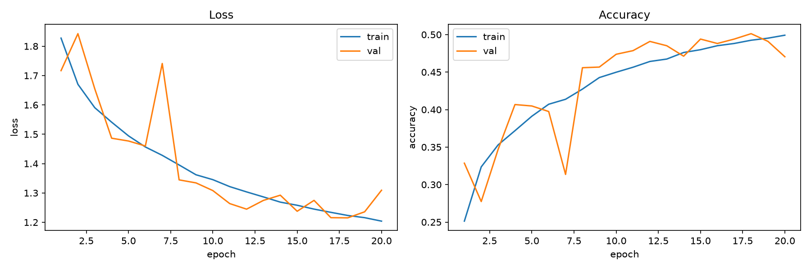
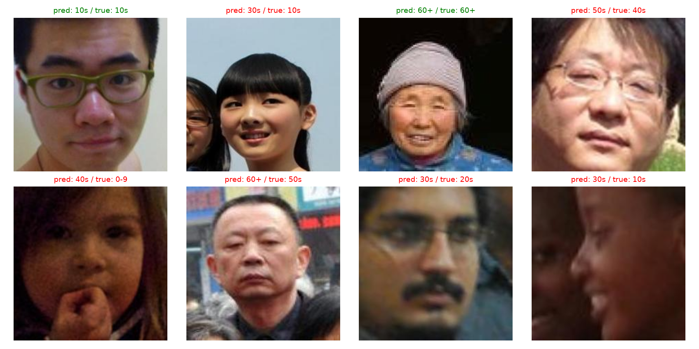

# 개발일지 07 — 본 학습 결과 (전체 데이터, 20 에폭)

- **날짜**: 2026-11-12
- **프로젝트**: 얼굴 이미지 기반 나이대 분류 (인공지능 4조)
- **담당**: 임성빈 — 작은 CNN(4층) 처음부터 학습 (사전학습 없는 비교 기준 모델)
- **작업 범위**: `USE_SUBSET = False`로 본 학습 실행, 결과 해석, 팀원 모델과 비교, 결과 백업
- **상태**: ✅ 완료 — **최고 검증 macro-F1 0.496 (18 에폭)**
- **실행 로그**: [`2026-11-12_07_본학습_실행로그.txt`](2026-11-12_07_본학습_실행로그.txt)
- **결과 파일**: 프로젝트 폴더 `results/small_cnn_main/` (팀 저장소 `작은CNN/results/small_cnn_main/`)

---

## 1. 학습 조건

| 항목 | 값 | 팀원과 같은가 |
|---|---|---|
| 학습 데이터 | training 71,735장 | ✅ |
| 검증 데이터 | validation 15,288장 | ✅ |
| 모델 | SmallCNN, Conv 블록 4개 (32→64→128→256), 파라미터 390,695개 | — (비교 대상) |
| 사전학습 | 없음 (처음부터 학습) | — (비교 대상) |
| 증강 | RandomResizedCrop(0.9~1.0), 좌우 반전, ±10°, 밝기·대비 ±0.2 | ✅ |
| 손실 | CrossEntropyLoss + 나이대별 가중치 | ✅ |
| 최적화 | Adam, lr 0.001 **고정** | ✖ (팀원: AdamW + 워밍업·코사인, 몸통 lr 1e-4) |
| 배치 / 에폭 / 시드 | 64 / 20 / 42 | ✅ |
| 최고 모델 기준 | 검증 macro-F1 | ✅ |
| 조기 종료 | 없음 (20 에폭 끝까지) | ✖ (팀원: 4번 연속 정체 시 종료) |

---

## 2. 실행 결과

```
Epoch  1/20 | train loss 1.8276 acc 0.251 | val loss 1.7167 acc 0.329 off1 0.573 F1 0.283 | 433초
Epoch  2/20 | train loss 1.6702 acc 0.324 | val loss 1.8427 acc 0.277 off1 0.540 F1 0.269 | 346초
Epoch  3/20 | train loss 1.5905 acc 0.353 | val loss 1.6547 acc 0.347 off1 0.606 F1 0.322 | 347초
Epoch  4/20 | train loss 1.5411 acc 0.372 | val loss 1.4865 acc 0.407 off1 0.708 F1 0.382 | 320초
Epoch  5/20 | train loss 1.4944 acc 0.391 | val loss 1.4769 acc 0.405 off1 0.701 F1 0.375 | 322초
Epoch  6/20 | train loss 1.4566 acc 0.407 | val loss 1.4600 acc 0.397 off1 0.703 F1 0.359 | 323초
Epoch  7/20 | train loss 1.4281 acc 0.414 | val loss 1.7411 acc 0.314 off1 0.616 F1 0.264 | 319초
Epoch  8/20 | train loss 1.3953 acc 0.427 | val loss 1.3445 acc 0.456 off1 0.775 F1 0.445 | 319초
Epoch  9/20 | train loss 1.3619 acc 0.443 | val loss 1.3342 acc 0.457 off1 0.778 F1 0.444 | 319초
Epoch 10/20 | train loss 1.3452 acc 0.450 | val loss 1.3080 acc 0.474 off1 0.771 F1 0.455 | 320초
Epoch 11/20 | train loss 1.3215 acc 0.456 | val loss 1.2637 acc 0.479 off1 0.803 F1 0.465 | 318초
Epoch 12/20 | train loss 1.3035 acc 0.464 | val loss 1.2447 acc 0.491 off1 0.789 F1 0.462 | 319초
Epoch 13/20 | train loss 1.2864 acc 0.467 | val loss 1.2746 acc 0.485 off1 0.798 F1 0.483 | 332초
Epoch 14/20 | train loss 1.2687 acc 0.476 | val loss 1.2923 acc 0.471 off1 0.792 F1 0.473 | 346초
Epoch 15/20 | train loss 1.2580 acc 0.480 | val loss 1.2376 acc 0.494 off1 0.787 F1 0.471 | 326초
Epoch 16/20 | train loss 1.2449 acc 0.485 | val loss 1.2747 acc 0.488 off1 0.768 F1 0.464 | 320초
Epoch 17/20 | train loss 1.2339 acc 0.488 | val loss 1.2157 acc 0.494 off1 0.800 F1 0.471 | 316초
Epoch 18/20 | train loss 1.2232 acc 0.492 | val loss 1.2151 acc 0.501 off1 0.829 F1 0.496 | 319초   ← 최고 (저장)
Epoch 19/20 | train loss 1.2157 acc 0.495 | val loss 1.2357 acc 0.491 off1 0.778 F1 0.465 | 318초
Epoch 20/20 | train loss 1.2039 acc 0.499 | val loss 1.3091 acc 0.470 off1 0.790 F1 0.480 | 322초
best val macro-F1: 0.4962069012723938
```

- **학습 시간**: 6,603초 (**약 1시간 50분**), 에폭당 약 320초 (1 에폭은 첫 실행 준비로 433초)
- **저장된 모델**: 18 에폭 (검증 macro-F1 0.496)

### 2-1. 학습 곡선



### 2-2. 예측 샘플 (18 에폭 모델, 검증 무작위 8장)



| # | 예측 | 정답 | 차이 |
|---|---|---|---|
| 1 | 10대 | 10대 | ✅ 정답 |
| 2 | 30대 | 10대 | 2칸 |
| 3 | 60+ | 60+ | ✅ 정답 |
| 4 | 50대 | 40대 | 1칸 (옆 나이대) |
| 5 | 40대 | 0~9세 | **4칸** (손으로 얼굴 일부를 가리고 어두운 사진) |
| 6 | 60+ | 50대 | 1칸 (옆 나이대) |
| 7 | 30대 | 20대 | 1칸 (옆 나이대) |
| 8 | 30대 | 10대 | 2칸 (옆모습, 어두운 사진) |

→ 8장 중 2장 정답, 틀린 6장 중 3장이 바로 옆 나이대. 한 칸 차이 정확도 83%와 맞아떨어진다.
→ 100장 과적합 테스트 때(개발일지 06)는 **같은 8장**에서 모두 오답이었는데, 이번에는 2장 정답에 옆 나이대 오답이 늘었다.

---

## 3. 팀원 모델과 비교 (검증 15,288장)

팀원 수치는 팀 저장소 `ConvNeXt/ConvNeXt/README.md`의 검증 데이터 결과.

| 지표 | **작은 CNN** | ResNet-50 | ConvNeXt-Tiny |
|---|---:|---:|---:|
| 검증 정확도 | **50.1%** | 61.9% | 65.2% |
| 한 칸 차이 정확도 | **82.9%** | 92.9% | 95.1% |
| macro-F1 | **0.496** | 0.615 | 0.648 |
| 파라미터 수 | **39만** | 약 2,500만 | 약 2,800만 |
| 사전학습 | 없음 | ImageNet | 더 큰 데이터 |
| 최고 에폭 | 18 | — | 7 |
| 에폭당 시간 | 약 320초 | — | 약 214초 |

### 해석

- **무작위로 찍으면 정확도 14%(1/7)인데 50%를 맞혔다.** 한 칸 차이까지 인정하면 83%. 처음부터 학습한 39만 파라미터 모델로 의미 있는 성능이다.
- **ResNet-50과의 차이: 정확도 약 12%p, macro-F1 약 0.12.** 이것이 **"사전학습 + 모델 크기"의 효과**다. 작은 CNN이 비교 기준(baseline)으로서 역할을 했다.
- 모델 크기는 약 1/65이지만 정확도는 ResNet-50의 약 81% 수준이다.

---

## 4. 학습 곡선 해석

### 4-1. 과적합이 거의 없다 (팀원 모델과 반대)

| | 학습 정확도 | 검증 정확도 | 차이 |
|---|---:|---:|---:|
| 작은 CNN (20 에폭) | 49.9% | 47.0% (최고 50.1%) | 약 3%p |
| ConvNeXt-Tiny (12 에폭) | 92.1% | 64.2% | **약 28%p** |

- ConvNeXt는 학습 사진을 빠르게 외워 학습·검증이 크게 벌어졌다(뚜렷한 과적합).
- 작은 CNN은 학습·검증 곡선이 **거의 붙어서** 같이 올라갔다. 모델이 작아 외울 여력이 없고, 대신 일반적인 특징을 배웠다.
- 학습 정확도가 검증보다 낮은 에폭이 많은 이유: 학습 정확도는 **증강과 Dropout이 켜진 상태**에서, 그리고 에폭 동안 점점 나아지는 모델의 **평균**으로 재기 때문이다. (팀원 README에도 같은 설명)

### 4-2. 아직 수렴하지 않았다

- 학습 손실이 1.83 → 1.20으로 **20 에폭까지 계속 내려가고** 있다. 에폭을 늘리면 성능이 더 오를 여지가 있다.
- 팀원 모델은 4~7 에폭에 이미 최고점을 찍었다. 사전학습 모델은 출발점이 이미 좋은 특징이라 빨리 수렴하고, 처음부터 학습하는 모델은 오래 걸린다.

### 4-3. 검증 곡선이 들쭉날쭉하다

| 에폭 | 검증 손실 | 검증 정확도 | |
|---|---:|---:|---|
| 1 → 2 | 1.717 → **1.843** | 0.329 → **0.277** | 일시 하락 |
| 6 → 7 → 8 | 1.460 → **1.741** → 1.345 | 0.397 → **0.314** → 0.456 | 크게 튐 |
| 18 → 20 | 1.215 → **1.309** | 0.501 → **0.470** | 마지막 하락 |

- **원인 추정: 학습률 0.001을 끝까지 고정했다.** 후반에도 큰 보폭으로 움직여 좋은 지점 근처를 오락가락한다. BatchNorm의 누적 통계도 큰 보폭에 따라 흔들릴 수 있다.
- 팀원은 코사인 스케줄로 학습률을 점점 줄여 후반이 안정적이다.
- 다행히 **macro-F1 기준으로 18 에폭 모델을 저장**해서, 마지막 에폭이 흔들린 영향은 받지 않았다.

---

## 5. 학습 시간과 병목

- 모델은 ConvNeXt보다 약 70배 작은데 에폭당 시간은 더 길다 (320초 vs 214초).
- **병목: 데이터 로딩.** `DataLoader`에 `num_workers`를 지정하지 않아 사진 읽기 + 증강을 CPU 한 줄로 처리한다. 팀원은 `num_workers=4`(4개 프로세스로 병렬 로딩) + AMP(혼합 정밀도)를 쓴다.
- 윈도우에서 `num_workers > 0`을 쓰려면 코드 전체를 `if __name__ == "__main__":` 안에 넣어야 한다 → 개선 실험 때 검토.

---

## 6. 결과 백업

다음 실행(테스트 모드 포함) 때 `small_cnn_best.pth`, `small_cnn_history.csv`가 **덮어써지므로**, 본 학습 결과를 별도 폴더에 백업했다.

```
results/small_cnn_main/
├── README.md               ← 학습 조건, 최고 성적, 모델 불러오는 방법
├── small_cnn_best.pth      ← 18 에폭 모델 가중치 (1.5MB)
├── small_cnn_history.csv   ← 20 에폭 학습 기록 (팀원과 같은 열 이름)
├── learning_curve.png
├── pred_samples.png
└── CNN_4layers_used.py     ← 이 결과를 만든 코드 그대로 (USE_SUBSET = False)
```

- 결과와 **그 결과를 만든 코드**를 같이 남겨서, 나중에 코드를 고쳐도 이 결과를 재현할 수 있게 했다.

---

## 7. 진행 상황

| 단계 | 상태 |
|---|---|
| 4-1 ~ 4-5, 평가 지표, 본 학습 설정 | ✅ |
| **본 학습 실행 + 결과 백업** | ✅ **이번 작업** |
| 나이대별 성능 분석 (혼동 행렬, 나이대별 정확도) | ⬜ 다음 |
| 팀 비교표 반영 | ⬜ |
| (선택) 개선 실험 | ⬜ |

→ 작은 CNN 담당 업무 전체 기준 **약 75%** 진행.

---

## 8. 다음 할 일

- [ ] **나이대별 성능 분석**: 18 에폭 모델로 검증 데이터 혼동 행렬, 나이대별 정확도
  - 팀원 분석("0–9세와 60세 이상은 잘 맞히지만 30~50대는 50% 안팎으로 가장 어렵다", "오답 대부분은 바로 옆 나이대")과 같은 형식으로 비교
- [ ] 학습 코드와 평가 코드 분리 (지금은 실행하면 학습부터 다시 돎 → 저장된 모델만 불러와서 평가하는 코드)
- [ ] (선택) 개선 실험 후보
  - 학습률 스케줄 (코사인 감소) → 검증 곡선 안정화
  - 에폭 늘리기 → 아직 수렴 전
  - `num_workers` → 학습 시간 단축
- [ ] 팀 논의: 결과표에 들어갈 작은 CNN 정의 (내 버전 블록당 conv 1개 vs `common.py` 블록당 conv 2개)
