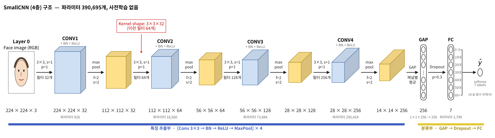
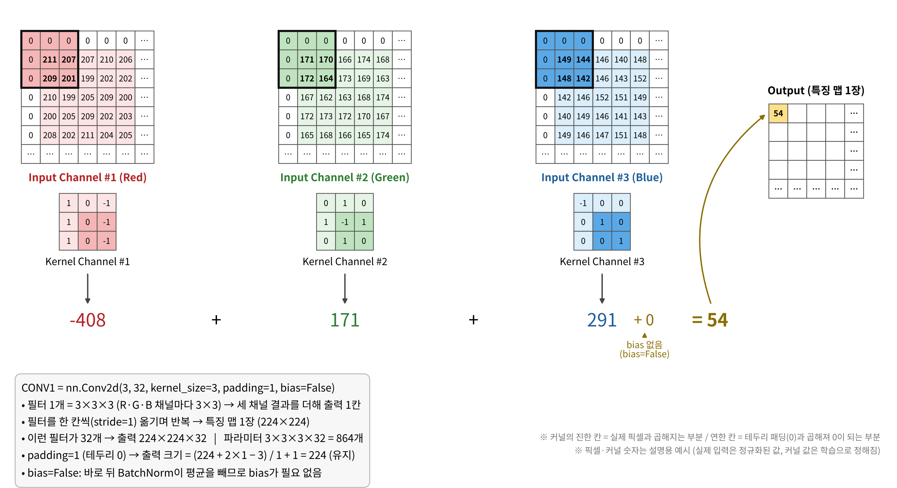
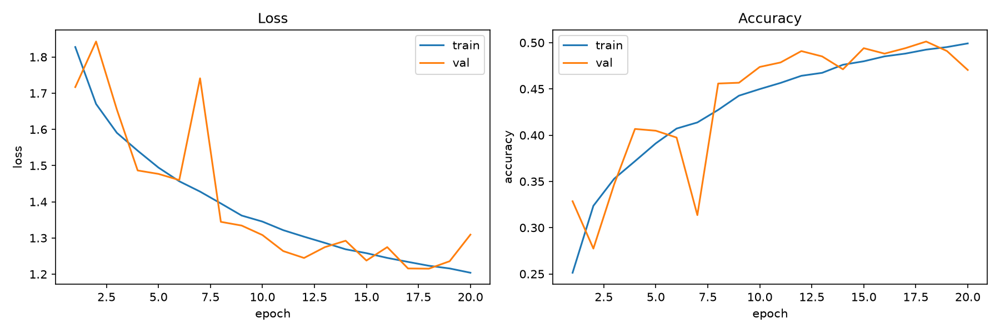

# 개발일지 08 — 작은 CNN 모듈별 코드 정리 (최종 코드 해설)

- **날짜**: 2026-11-15
- **프로젝트**: 얼굴 이미지 기반 나이대 분류 (인공지능 4조)
- **담당**: 임성빈 — 작은 CNN(4층) 처음부터 학습 (사전학습 없는 비교 기준 모델)
- **대상 코드**: `models/CNN_4layers_latest.py` (532줄, 줄마다 주석) = 본 학습에 쓴 코드 `results/small_cnn_main/CNN_4layers_used.py`와 실행 내용 동일
- **목적**: 지금까지 만든 코드를 모듈(4-1 ~ 4-5)별로, **코드와 함께 처음 보는 사람도 이해할 수 있게** 정리

---

## 목차

1. [전체 구성](#1-전체-구성)
2. [프로그램 4-1 데이터 구성 (학습용·검증용)](#2-프로그램-4-1-데이터-구성-학습용검증용)
3. [프로그램 4-2 4층 CNN 모델 구성과 해석](#3-프로그램-4-2-4층-cnn-모델-구성과-해석)
4. [프로그램 4-3 손실 함수와 최적화 알고리즘](#4-프로그램-4-3-손실-함수와-최적화-알고리즘)
5. [프로그램 4-4 학습 루프](#5-프로그램-4-4-학습-루프)
6. [프로그램 4-5 시각화](#6-프로그램-4-5-시각화)
7. [최종 결과 요약](#7-최종-결과-요약)

---

## 1. 전체 구성

| 모듈 | 하는 일 | 핵심 코드 |
|---|---|---|
| **4-1** 데이터 구성 | 얼굴 사진 → 전처리·증강 → 텐서 배치 | `ImageFolder`, `transforms`, `DataLoader` |
| **4-2** 모델 구성 | 사진 → 7개 나이대 점수 | `SmallCNN` (Conv 블록 4개 + GAP + FC) |
| **4-3** 손실·최적화 | 얼마나 틀렸는지 계산 → 가중치를 고치는 방법 | `CrossEntropyLoss(weight=...)`, `Adam` |
| **4-4** 학습 루프 | 학습 → 검증 → 기록 → 저장을 20 에폭 반복 | `train()` / `eval()`, `backward()`, `step()` |
| **4-5** 시각화 | 예측 샘플, 학습 곡선 | `matplotlib` |

```
[사진 파일] ─4-1→ [텐서 배치 (64, 3, 224, 224)] ─4-2→ [점수 (64, 7)]
                                                      │
                     4-3 손실 계산 ←──────────────────┘
                          │
                     4-4 역전파 → 가중치 수정 → (반복)
```

**모드 스위치** (4-1 상단): 한 줄로 점검용·본 학습용을 바꾼다.

```python
USE_SUBSET = False      # True: 100장 과적합 테스트 (1~2분) / False: 본 학습 (약 1시간 50분)
```

---

## 2. 프로그램 4-1 데이터 구성 (학습용·검증용)

### 2-1. 데이터 출처와 분할

팀원이 4개 공개 데이터셋(FairFace, UTKFace, AAF, AFAD)을 7개 나이대로 분류하고 70 : 15 : 15로 나눈 `split_result_224`를 쓴다. **팀 전체가 같은 분할을 쓴다** (ResNet-50·ConvNeXt와 같은 사진으로 학습·채점).

| 나이대 | 라벨 | training (학습) | validation (검증) | testing (최종 평가) |
|---|:---:|---:|---:|---:|
| 0~9세 | 0 | 11,561 | 2,474 | 2,470 |
| 10대 | 1 | 12,000 | 2,571 | 2,571 |
| 20대 | 2 | 12,000 | 2,571 | 2,571 |
| 30대 | 3 | 12,000 | 2,571 | 2,571 |
| 40대 | 4 | 12,104 | 2,468 | 2,545 |
| 50대 | 5 | 6,801 | 1,433 | 1,453 |
| 60세 이상 | 6 | 5,269 | 1,200 | 1,108 |
| **합계** | | **71,735** | **15,288** | 15,289 |

| 폴더 | 용도 | 사용 시점 |
|---|---|---|
| `training` | 모델이 **학습**하는 데이터 | 매 에폭 |
| `validation` | 학습 중 **성능 확인**, 최고 모델 선택 | 매 에폭 |
| `testing` | **최종 평가** | 프로젝트 마지막에 **딱 한 번** (지금 코드에서는 불러오지 않음) |

> 50대·60세 이상이 다른 나이대의 절반 정도 → **클래스 불균형** → 4-3에서 손실 가중치로 보정

### 2-2. 설정값

```python
DATA_DIR = "data"          # 상대 경로 → 프로젝트 폴더에서 실행. 팀원 PC(Mac)에서도 동작
IMG_SIZE = 224             # 224×224 픽셀 (팀원과 동일)
BATCH_SIZE = 64            # 한 번에 64장 (팀원과 동일)
SEED = 42                  # 난수 시드 (팀원과 동일)
torch.manual_seed(SEED)    # 모델 생성(4-2) "전에" 고정해야 초기 가중치까지 재현됨

MEAN = (0.485,0.456,0.406 )    # ImageNet R, G, B 평균
STD = ( 0.229, 0.224, 0.225)   # ImageNet R, G, B 표준편차

device = torch.device("cuda" if torch.cuda.is_available() else "cpu")   # GPU 선택
```

- `MEAN`, `STD`를 상수로 한 곳에서 관리 → 4-1 정규화와 4-5 되돌리기에 같은 값을 쓴다.
- `device`는 "어떤 장치를 쓸지" 이름표일 뿐이다. 실제로는 모델과 데이터를 각각 `.to(device)`로 옮긴다.

### 2-3. 전처리 (transform): 학습용과 검증용을 다르게

**학습용** — 증강(무작위 변형)으로 같은 사진도 에폭마다 다르게 보이게 해서 과적합을 막는다.

```python
train_transform = transforms.Compose([
    transforms.RandomResizedCrop(IMG_SIZE, scale=(0.9, 1.0), ratio=(0.95, 1.05)),  # 면적 90~100%를 잘라 224로 → 살짝 확대·이동
    transforms.RandomHorizontalFlip(p=0.5),             # 50% 확률 좌우 반전
    transforms.RandomRotation(degrees=10),              # ±10° 회전
    transforms.ColorJitter(brightness=0.2, contrast=0.2),  # 밝기·대비 0.8~1.2배
    transforms.ToTensor(),                              # (H, W, 3, 0~255) → (3, H, W, 0.0~1.0)
    transforms.Normalize(MEAN, STD),                    # (값 − 평균) / 표준편차 → 대략 평균 0, 표준편차 1
    ])
```

**검증용** — 매번 같은 조건으로 채점해야 하므로 증강 없음.

```python
val_transform = transforms.Compose([
    transforms.Resize((IMG_SIZE, IMG_SIZE)),            # 가로·세로 224
    transforms.ToTensor(),
    transforms.Normalize(MEAN, STD),
])
```

| 단계 | 학습용 | 검증용 | 팀원과 같은가 |
|---|---|---|:---:|
| 크기 맞추기 | `RandomResizedCrop` (무작위) | `Resize((224, 224))` | ✅ |
| 좌우 반전 | 50% | 없음 | ✅ |
| 회전 | ±10° | 없음 | ✅ |
| 밝기·대비 | ±20% | 없음 | ✅ |
| 텐서·정규화 | 같음 | 같음 | ✅ |

**정규화 예시** (R 채널 픽셀 값 211)
```
211 / 255 = 0.8275  →  (0.8275 − 0.485) / 0.229 = 1.495
```
→ 모델에 실제로 들어가는 값은 0~255가 아니라 대략 −2 ~ +2 사이의 숫자다.

### 2-4. 데이터셋: `ImageFolder`

```python
train_dataset = datasets.ImageFolder(root=os.path.join(DATA_DIR, "training"),   transform=train_transform)
val_dataset   = datasets.ImageFolder(root=os.path.join(DATA_DIR, "validation"), transform=val_transform)
```

- **하위 폴더 이름이 곧 라벨**이다. 폴더 이름을 문자열 순서로 정렬해 번호를 붙인다.
  `'0 9'→0, '10 19'→1, …, '60over'→6` (우연히 나이 순서와 같음)
- 사진을 미리 다 읽지 않고 **꺼낼 때마다** 읽어서 변환한다 → 메모리 절약, 증강이 매번 달라짐.
  (7만 장을 미리 텐서로 바꾸면 224 × 224 × 3 × 4바이트 × 71,735장 ≈ 43GB가 필요하다.)
- 확인 출력: `class_to_idx`로 라벨 순서, `len()`으로 `71735 15288` → 경로 실수는 에러 없이 다른 폴더를 읽을 수 있어서 개수로 꼭 확인한다.

### 2-5. 부분집합과 DataLoader

```python
g = torch.Generator().manual_seed(SEED)
train_idx = torch.randperm(len(train_dataset), generator=g)[:N_TRAIN].tolist()   # 무작위 100개 번호
train_subset = Subset(train_dataset, train_idx)                                   # 100장짜리 데이터셋

if USE_SUBSET:     # 점검 모드
    train_loader = DataLoader(train_subset, batch_size=BATCH_SIZE, shuffle=True)
    val_loader   = DataLoader(val_subset,   batch_size=BATCH_SIZE, shuffle=False)
else:              # 본 학습 모드
    train_loader = DataLoader(train_dataset, batch_size=BATCH_SIZE, shuffle=True)   # 1,121 배치
    val_loader   = DataLoader(val_dataset,   batch_size=BATCH_SIZE, shuffle=False)  # 239 배치
```

| | 점검 모드 (`True`) | 본 학습 모드 (`False`) |
|---|---|---|
| 학습 | 100장 → 2배치 (64 + 36) | 71,735장 → **1,121배치** (71,735 ÷ 64 = 1,120.9 → 올림) |
| 검증 | 100장 | 15,288장 → **239배치** |
| 증강 | 끔 (4-4에서) | 켬 |
| 에폭 | 5 | 20 |

- `randperm`으로 섞어서 뽑는 이유: `ImageFolder`는 폴더 순서로 정렬돼 있어서 앞에서 100장을 자르면 0~9세만 나온다.
- `shuffle=True`(학습): 에폭마다 순서를 섞는다. `shuffle=False`(검증): 항상 같은 순서.
- `DataLoader`가 꺼내주는 배치 하나: `images (64, 3, 224, 224)`, `labels (64,)`

---

## 3. 프로그램 4-2 4층 CNN 모델 구성과 해석

### 3-1. 전체 구조



```python
class SmallCNN(nn.Module):
    def __init__(self, num_classes=7):
        super().__init__()
        self.conv1 = nn.Conv2d(3, 32, kernel_size=3, padding=1, bias=False);   self.bn1 = nn.BatchNorm2d(32)
        self.conv2 = nn.Conv2d(32, 64, kernel_size=3, padding=1, bias=False);  self.bn2 = nn.BatchNorm2d(64)
        self.conv3 = nn.Conv2d(64, 128, kernel_size=3, padding=1, bias=False); self.bn3 = nn.BatchNorm2d(128)
        self.conv4 = nn.Conv2d(128, 256, kernel_size=3, padding=1, bias=False); self.bn4 = nn.BatchNorm2d(256)
        self.pool    = nn.MaxPool2d(2, 2)
        self.gap     = nn.AdaptiveAvgPool2d((1,1))
        self.dropout = nn.Dropout(p=0.3)
        self.fc      = nn.Linear(256, num_classes)

    def forward(self, x):                                     # (B, 3, 224, 224)
        x = self.pool(torch.relu(self.bn1(self.conv1(x))))   # (B, 32, 112, 112)
        x = self.pool(torch.relu(self.bn2(self.conv2(x))))   # (B, 64, 56, 56)
        x = self.pool(torch.relu(self.bn3(self.conv3(x))))   # (B, 128, 28, 28)
        x = self.pool(torch.relu(self.bn4(self.conv4(x))))   # (B, 256, 14, 14)
        x = self.gap(x)                                       # (B, 256, 1, 1)
        x = x.view(x.size(0), -1)                             # (B, 256)
        x = self.dropout(x)
        x = self.fc(x)                                        # (B, 7)
        return x
```

- `__init__`: 쓸 층을 미리 만든다 (학습되는 가중치가 여기서 생김).
- `forward`: 데이터가 지나가는 순서. `model(images)`라고 쓰면 자동 호출된다.
- 한 줄은 **안쪽부터** 실행: ① conv → ② bn → ③ relu → ④ pool
- **블록 하나 = 교재의 `conv → relu → pool` + BatchNorm**, 이것을 4번 반복한 뒤 GAP·Dropout·FC를 붙였다.

### 3-2. 모양(shape) 읽는 법

PyTorch 이미지 텐서는 `(B, C, H, W)` 순서다.

```
torch.Size([64, 3, 224, 224])
            B   C   H    W
          배치 채널 높이 너비
```

구조도에서 상자의 **앞면 = H × W (공간 크기)**, **두께 = C (채널 수)**.

### 3-3. 한 블록 안에서 일어나는 일

| 순서 | 층 | 하는 일 | H × W | 채널 | 파라미터 |
|---|---|---|---|---|---|
| ① | `Conv2d` 3×3, padding=1 | 필터로 특징 추출 | **유지** | **바뀜** | 있음 |
| ② | `BatchNorm2d` | 채널별 정규화 | 유지 | 유지 | 2 × 채널 |
| ③ | `ReLU` | 음수 → 0 | 유지 | 유지 | 0 |
| ④ | `MaxPool2d(2, 2)` | 2×2 중 최댓값 | **절반** | 유지 | 0 |

→ **Conv는 두께를 바꾸고, Pool은 크기를 줄인다.** 역할이 나뉘어 있어서 shape를 예측하기 쉽다.

### 3-4. ① 합성곱(Conv): 숫자가 어떻게 계산되나

**CONV1** `nn.Conv2d(3, 32, kernel_size=3, padding=1, bias=False)`의 계산 과정:



**공식**

```
              2     2     2
Y[k, i, j] =  Σ     Σ     Σ   W[k, c, m, n] · X_pad[c, i+m, j+n]  +  b[k]
             c=0   m=0   n=0
             └채널┘ └──── 3×3 칸 ────┘
```

| 기호 | 뜻 |
|---|---|
| `X_pad` | 테두리에 0을 한 줄 덧댄 입력 (padding=1 → 224×224가 226×226) |
| `W[k, c, m, n]` | k번 필터의 c번 채널 커널, m행 n열 값 |
| `b[k]` | bias → `bias=False`라 0 |
| `Y[k, i, j]` | 출력 k번 특징 맵의 (i, j) 칸 |

**대입: 출력 왼쪽 위 칸 `Y[0, 0, 0]`** (그림의 예시 값)

```
R 채널: (0·1 + 0·0 + 0·(−1)) + (0·1 + 211·0 + 207·(−1)) + (0·1 + 209·0 + 201·(−1)) = −408
G 채널: (0 + 0 + 0) + (0·1 + 171·(−1) + 170·1) + (0·0 + 172·1 + 164·0)            =  171
B 채널: (0 + 0 + 0) + (0·0 + 149·1 + 144·0) + (0·0 + 148·0 + 142·1)               =  291

Y[0, 0, 0] = −408 + 171 + 291 + 0(bias 없음) = 54
```

- R·G·B를 **따로 계산한 뒤 더한다** → 입력은 3채널이어도 **필터 1개의 출력은 1장**.
- 출력 한 칸에 곱셈 3 × 3 × 3 = **27번**.
- 필터를 한 칸씩(stride=1) 옮기며 반복 → **224×224 특징 맵 1장**.
- 필터가 **32개** → 32장을 쌓아서 **(32, 224, 224)**.
- 그림의 숫자는 설명용 예시다. 실제 입력은 정규화된 값이고, 필터 숫자는 **처음엔 무작위 → 학습으로 정해진다.**
- 예: R 커널 `[1, 0, −1]`은 "왼쪽은 밝고 오른쪽은 어두운 곳"에서 큰 값 → **세로 경계(엣지)를 찾는 필터**. 특징 맵은 "사진의 어디에 이 패턴이 얼마나 강하게 있는가"를 나타내는 지도다.

### 3-5. 필터 개수 = 출력 두께

| | 정해지는 방식 | CONV1 | CONV2 | CONV3 | CONV4 |
|---|---|---|---|---|---|
| **필터 하나의 두께** | 입력 두께를 따라감 (자동) | 3 | 32 | 64 | 128 |
| **필터 개수 = 출력 두께** | 우리가 정함 | 32 | 64 | 128 | 256 |
| 필터 모양 | | 3×3×3 | 3×3×32 | 3×3×64 | 3×3×128 |

```
CONV1:  입력 두께 3   →  필터 3×3×3   × 32개  →  출력 두께 32
CONV2:  입력 두께 32  →  필터 3×3×32  × 64개  →  출력 두께 64
                             ↑               ↑
                      앞 층 출력 두께    이 층 출력 두께
```

→ **한 층의 출력 두께(필터 개수)가 다음 층 필터의 두께가 된다.** (구조도의 빨간 콜아웃 "Kernel shape: 3×3×32, 이런 필터 64개")

### 3-6. 블록마다 숫자가 변하는 과정 (공식 대입)

```
H_out = ⌊ (H + 2P − K) / S ⌋ + 1
```

| 연산 | K (창문) | S (이동) | P (패딩) | 결과 |
|---|---|---|---|---|
| Conv 3×3 | 3 | 1 | 1 | `H + 2 − 3 + 1 = H` → **항상 유지** |
| MaxPool 2×2 | 2 | 2 | 0 | `(H − 2) / 2 + 1 = H / 2` → **항상 절반** |

| 단계 | 공식 대입 | 출력 (H × W × C) | 파라미터 |
|---|---|---|---:|
| 입력 | | 224 × 224 × 3 | |
| CONV1 | (224 + 2 − 3) / 1 + 1 = **224** | 224 × 224 × **32** | 864 + BN 64 |
| Pool 1 | (224 − 2) / 2 + 1 = **112** | **112 × 112** × 32 | 0 |
| CONV2 | (112 + 2 − 3) / 1 + 1 = **112** | 112 × 112 × **64** | 18,432 + BN 128 |
| Pool 2 | (112 − 2) / 2 + 1 = **56** | **56 × 56** × 64 | 0 |
| CONV3 | (56 + 2 − 3) / 1 + 1 = **56** | 56 × 56 × **128** | 73,728 + BN 256 |
| Pool 3 | (56 − 2) / 2 + 1 = **28** | **28 × 28** × 128 | 0 |
| CONV4 | (28 + 2 − 3) / 1 + 1 = **28** | 28 × 28 × **256** | 294,912 + BN 512 |
| Pool 4 | (28 − 2) / 2 + 1 = **14** | **14 × 14** × 256 | 0 |
| GAP | (14 − 14) / 14 + 1 = **1** | 1 × 1 × 256 | 0 |
| view | | 256 | 0 |
| FC | | **7** | 1,799 |
| **합계** | | | **390,695** |

- Conv 파라미터 = 입력 채널 × 출력 채널 × 3 × 3 (예: CONV2 = 32 × 64 × 9 = 18,432)
- 224 = 14 × 16이라 2로 네 번 나눠떨어져서 소수점 버림 없이 14까지 내려간다.
- 파라미터의 **약 75%가 CONV4**에 있다 (채널이 큰 뒤쪽 층일수록 커짐).

**padding=1을 쓰는 이유**: padding=0이면 Conv마다 2칸씩 줄어 224 → 222 → 111 → 109 → 54 → 52 → 26 → 24 → **12**가 된다. 홀수에서 소수점이 버려지고 가장자리(이마 끝, 턱선) 정보를 덜 본다.

### 3-7. ② BatchNorm: 값의 범위를 일정하게

Conv 출력은 채널마다 값의 범위가 제각각이고, 학습 중 앞 층 가중치가 바뀌면서 범위가 계속 흔들린다. BN은 **채널마다** 평균 0, 분산 1로 맞춘 뒤 학습되는 배율·이동을 적용한다 (시험 점수를 반별 표준점수로 바꾸는 것과 비슷하다).

```
μ_k  = 평균(Y_k),  σ²_k = 분산(Y_k)          ← 배치 64장 × 모든 위치의 k번 채널 값
Ŷ    = (Y − μ_k) / √(σ²_k + ε)               ← 평균 0, 분산 1
Z    = γ_k · Ŷ + β_k                         ← γ(배율), β(이동)는 학습되는 값
```

- 파라미터 = 2 × 채널 (bn1 64, bn2 128, bn3 256, bn4 512)
- `model.train()`: 현재 배치의 평균·분산 사용 / `model.eval()`: 학습 중 누적한 평균·분산 사용
- **`bias=False`인 이유**: Conv에 bias를 더해도 `(Y + b) − (μ + b) = Y − μ`로 BN에서 사라진다. 이동은 β가 대신한다.

### 3-8. ③ ReLU와 ④ MaxPool

```
ReLU:     A = max(0, Z)                        예) 54 → 54,  −120 → 0
MaxPool:  P[k, i, j] = max(2×2 창문의 4칸)     예) {54, 0, 21, 8} → 54
```

- **ReLU**: "이 패턴이 있다(양수)"는 신호만 남긴다. 이 비선형성이 있어야 층을 쌓아 복잡한 패턴을 표현할 수 있다.
- **MaxPool**: 크기를 절반으로 줄여 ① 계산량 감소 ② 다음 층이 원본 기준 더 넓은 영역을 봄 ③ 얼굴이 조금 이동해도 결과가 비슷 ④ 가장 강한 신호만 보존.

### 3-9. 층이 깊어질수록 보는 범위

| 위치 | 원본 사진에서 한 칸이 보는 범위 | 주로 잡는 특징 (일반적 경향) |
|---|---|---|
| 블록 1 후 | 4 × 4 픽셀 | 엣지, 색 |
| 블록 2 후 | 10 × 10 | 질감, 잔주름 |
| 블록 3 후 | 22 × 22 | 눈가·입가 같은 부위 |
| 블록 4 후 | **46 × 46** | 부위들의 조합 |

→ 마지막 층의 한 칸도 224×224 중 약 46×46만 본다. 얼굴 전체 윤곽은 GAP로 부분 특징들을 평균 내서 판단한다. (ResNet-50처럼 깊은 모델은 마지막 층이 사진 전체를 본다 → 성능 차이의 한 원인)

### 3-10. 분류부: GAP → Dropout → FC

```python
self.gap     = nn.AdaptiveAvgPool2d((1,1))   # 채널마다 14×14 = 196칸의 평균 → (B, 256, 1, 1)
x = x.view(x.size(0), -1)                    # (B, 256)
self.dropout = nn.Dropout(p=0.3)             # 학습 중에만 30%를 0으로
self.fc      = nn.Linear(256, 7)             # 256개 → 나이대 7개 점수
```

- **GAP**: 괄호 안은 창문 크기가 아니라 **원하는 출력 크기**. 그냥 펼치면 FC 입력이 256 × 14 × 14 = 50,176개(FC만 약 35만 파라미터) → GAP로 256개(FC 1,799개).
- **Dropout**: 특정 특징 몇 개에만 의존하지 않게 해서 과적합을 막는다. `eval()`에서는 꺼진다.
- **FC 출력 7개**는 확률이 아니라 **점수(logit)**. softmax는 4-3의 `CrossEntropyLoss`가 내부에서 처리하므로 모델에 넣지 않는다.
- ResNet-50, ConvNeXt도 같은 GAP 방식의 분류부를 쓴다.

### 3-11. 설계 근거 요약

| 선택 | 근거 |
|---|---|
| 3×3 conv, padding=1 | 크기 유지, 줄이는 건 pool에만 → 224 → 14로 깔끔하게 |
| 채널 32 → 256, 블록마다 2배 | VGG·ResNet 관례. 크기 ½ × 채널 ×2 → 층별 계산량 일정 (`H×W×C_in×C_out` 유지) |
| 시작 채널 32 | 처음부터 학습하는 기준 모델 → 과적합을 줄이려고 약 39만 개로 제한 (16이면 약 9.9만, 64면 약 156만) |
| BatchNorm + bias=False | 학습 안정화, 불필요한 파라미터 제거 |
| GAP + Dropout 0.3 | FC 크기 축소, 과적합 방지 |

---

## 4. 프로그램 4-3 손실 함수와 최적화 알고리즘

- **손실 함수**: 모델이 얼마나 틀렸는지 숫자로 계산 (작을수록 좋음)
- **최적화 알고리즘**: 그 숫자가 줄어드는 방향으로 가중치를 바꾸는 방법

### 4-1. 코드

```python
LR = 0.001
optimizer = torch.optim.Adam(model.parameters(), lr=LR)

counts = torch.bincount(torch.tensor(train_dataset.targets), minlength=NUM_CLASSES).float()
class_weights = counts.sum() / (NUM_CLASSES * counts)
criterion = nn.CrossEntropyLoss(weight=class_weights.to(device))
```

### 4-2. 교차 엔트로피 손실 (`CrossEntropyLoss`)

모델이 낸 점수 7개를 **확률로 바꾼 뒤, 정답 나이대의 확률이 얼마나 높은지**로 손실을 매긴다.

```
① softmax:  p_k = e^(z_k) / Σ e^(z_j)        ← 점수 → 확률 (합이 1)
② 손실:     L = −log(p_정답)                  ← 정답 확률이 높을수록 작음
```

**예시**: 정답이 20대(라벨 2)인 사진

| 나이대 | 0~9 | 10대 | **20대** | 30대 | 40대 | 50대 | 60+ |
|---|---:|---:|---:|---:|---:|---:|---:|
| 점수 z (FC 출력) | 0.2 | 1.5 | **2.1** | 0.3 | −0.5 | −1.0 | −1.2 |
| e^z | 1.221 | 4.482 | **8.166** | 1.350 | 0.607 | 0.368 | 0.301 |
| 확률 p = e^z / 16.495 | 0.074 | 0.272 | **0.495** | 0.082 | 0.037 | 0.022 | 0.018 |

```
L = −log(0.495) = 0.703
```

| 정답 확률 | 손실 | 의미 |
|---:|---:|---|
| 1.0 | 0 | 완벽 |
| 0.495 | 0.70 | 위 예시 |
| 1/7 ≈ 0.143 | **1.95** (= ln 7) | 아무것도 모르는 상태 (7개 균등) → 학습 시작 직후 손실이 약 1.95인 이유 |
| 0.01 | 4.6 | 확신을 갖고 틀림 → 크게 벌받음 |

- 그래서 모델 마지막에 softmax를 넣지 않는다 (넣으면 두 번 적용됨). 라벨은 정수(0~6) 그대로 넣는다.

### 4-3. 나이대별 손실 가중치

```
가중치_k = 전체 사진 수 / (나이대 수 × k번 나이대 사진 수)
```

| | 0~9 | 10대 | 20대 | 30대 | 40대 | 50대 | 60+ |
|---|---:|---:|---:|---:|---:|---:|---:|
| 학습 사진 수 | 11,561 | 12,000 | 12,000 | 12,000 | 12,104 | 6,801 | 5,269 |
| 가중치 | 0.886 | 0.854 | 0.854 | 0.854 | 0.847 | **1.507** | **1.945** |

| 코드 | 의미 |
|---|---|
| `train_dataset.targets` | 모든 학습 사진의 라벨 목록 (사진을 열지 않아 빠름) |
| `torch.bincount(..., minlength=7)` | 0번이 몇 개, …, 6번이 몇 개인지 세기 |
| `counts.sum() / (NUM_CLASSES * counts)` | 위 공식. 모든 나이대가 같은 수면 전부 1.0 |
| `.to(device)` | 가중치도 GPU에 있어야 계산 가능 |

- 60세 이상을 틀리면 손실에 **1.94배**, 20대를 틀리면 **0.85배** → 사진이 적은 나이대도 무시하지 않게 학습한다.
- 배치 손실은 `Σ(가중치 × 손실) / Σ(가중치)`로 계산된다 (가중 평균).
- 팀원 ResNet-50·ConvNeXt와 **같은 식, 같은 값**이다.

### 4-4. 최적화 알고리즘 Adam

**기본 아이디어 (경사 하강법)**: 손실을 산의 높이로 보면, 기울기(`.grad`)는 "어느 쪽이 오르막인가"를 알려준다. 그 반대 방향(내리막)으로 한 걸음씩 내려간다.

```
기본:  θ ← θ − lr × 기울기
```

**Adam**은 여기에 두 가지를 더한다.

```
m ← 0.9 · m + 0.1 · g          ← 기울기의 "평균 방향" (관성: 들쭉날쭉한 배치마다의 흔들림을 줄임)
v ← 0.999 · v + 0.001 · g²     ← 기울기 "크기"의 평균
θ ← θ − lr × m / (√v + ε)      ← 가중치마다 보폭을 자동 조절
```

- 기울기가 늘 크게 흔들리는 가중치는 보폭을 줄이고, 꾸준히 작은 가중치는 상대적으로 크게 움직인다.
- 출력의 `betas: (0.9, 0.999)`가 위 식의 0.9와 0.999다.
- `model.parameters()`: 학습할 가중치 390,695개를 넘긴다 → 반드시 `model.to(device)` **다음에** 만든다.

**학습률 `LR = 0.001`**
- 발표 자료 실험 조건(0.001 / 0.0001 / 0.00001) 중 하나, 교재 값과 같다.
- 팀원 사전학습 모델은 이미 잘 학습된 몸통을 조금만 고치므로 1e-4, **작은 CNN은 모든 가중치가 무작위에서 시작하므로 1e-3**을 쓴다. → 다른 건 공정성 문제가 아니라 학습 방식에 맞춘 설정이다.

---

## 5. 프로그램 4-4 학습 루프

### 5-1. 전체 흐름

```
for epoch in 1 ~ 20:
    ① 학습: 학습 데이터 1,121배치를 돌며 가중치 수정
    ② 검증: 검증 데이터 239배치로 acc·off1·macro-F1 계산 (가중치 수정 없음)
    ③ 기록: history에 추가 → CSV 저장
    ④ 저장: macro-F1이 최고면 모델 가중치 저장
```

- **에폭(epoch)**: 학습 데이터 전체를 한 번 다 보는 것
- 20 에폭 × 1,121배치 = **가중치 업데이트 22,420번**

### 5-2. ① 학습: 배치마다 5단계

```python
model.train()                                   # Dropout 켜짐, BN은 현재 배치 통계
for images, labels in train_loader:
    images, labels = images.to(device), labels.to(device)

    optimizer.zero_grad()                       # 1. 이전 기울기 지우기
    outputs = model(images)                     # 2. 순전파: (64, 7) 점수
    loss = criterion(outputs, labels)           # 3. 손실 계산 (가중치 적용)
    loss.backward()                             # 4. 역전파: 가중치마다 기울기 계산 → .grad
    optimizer.step()                            # 5. Adam으로 가중치 수정

    running_loss += loss.item() * images.size(0)
    correct += (outputs.argmax(dim=1) == labels).sum().item()
    total += labels.size(0)
```

| 단계 | 코드 | 하는 일 | 비유 |
|---|---|---|---|
| 1 | `zero_grad()` | 지난 배치 기울기 지우기 | 지도를 새로 펴기 |
| 2 | `model(images)` | 사진 → 점수 | |
| 3 | `criterion(...)` | 얼마나 틀렸나 | 현재 높이 재기 |
| 4 | `backward()` | 가중치 390,695개 각각의 기울기 계산 (연쇄 법칙으로 FC → CONV1 거꾸로) | 경사 측정 |
| 5 | `step()` | 기울기 반대 방향으로 이동 (실제로 "배우는" 순간) | 한 걸음 걷기 |

- **`zero_grad`가 필요한 이유**: PyTorch는 `backward()` 때 기울기를 **덮어쓰지 않고 더한다**. 안 지우면 지난 배치들의 기울기가 쌓인다.
- **`model.train()`을 매 에폭 호출하는 이유**: 검증에서 `eval()`로 바꿨기 때문. 안 바꾸면 Dropout이 꺼진 채 학습하는데, 에러가 나지 않아 알아채기 어렵다.
- **`loss.item() * images.size(0)`**: `loss`는 배치 평균이다. 배치 크기를 곱해 합계로 바꿔 더하고, 마지막에 전체 개수로 나눈다 → 마지막 배치가 작아도 정확한 평균.
- **`argmax(dim=1)`**: `(64, 7)`에서 1번 차원(나이대 7개) 중 가장 큰 점수의 위치 = 예측 나이대.

### 5-3. ② 검증: 가중치를 바꾸지 않고 채점

```python
model.eval()                                    # Dropout 꺼짐, BN은 누적 통계
all_preds, all_labels = [], []
with torch.no_grad():                           # 기울기 기록 안 함 → 메모리·속도 절약
    for images, labels in val_loader:
        images, labels = images.to(device), labels.to(device)
        outputs = model(images)
        loss = criterion(outputs, labels)
        preds = outputs.argmax(dim=1)
        all_preds.append(preds.cpu())           # sklearn은 GPU 텐서를 못 읽음
        all_labels.append(labels.cpu())
        ...
all_preds = torch.cat(all_preds)                # 배치별 텐서 → 15,288개 하나로 이어붙이기
all_labels = torch.cat(all_labels)
```

- `zero_grad`, `backward`, `step`이 **없다** (가중치를 바꾸면 안 됨).
- `model.eval()`은 **층의 동작 방식**, `torch.no_grad()`는 **기울기 기록**을 바꾼다 → 역할이 달라 둘 다 필요.
- F1은 배치별 값을 평균 내면 틀리므로, 예측을 **모았다가 마지막에 한 번에** 계산한다.

### 5-4. 평가 지표 3가지 (팀 공통)

```python
val_acc  = correct / total
val_off1 = ((all_preds - all_labels).abs() <= 1).float().mean().item()
val_f1   = f1_score(all_labels.numpy(), all_preds.numpy(),
                    average="macro", labels=list(range(NUM_CLASSES)), zero_division=0)
```

| 지표 | 공식 | 의미 |
|---|---|---|
| **정확도** (acc) | 맞힌 수 / 전체 | 기본 |
| **한 칸 차이 정확도** (off1) | `|예측 − 정답| ≤ 1`인 비율 | 바로 옆 나이대까지 인정. 항상 off1 ≥ acc |
| **macro-F1** | 나이대별 F1을 **1/7씩 평균** | 적은 나이대도 같은 무게. **최고 모델 선택 기준** |

**F1 계산** (나이대 k마다)
```
정밀도 P_k = (k라고 예측해서 맞은 수) / (k라고 예측한 수)
재현율 R_k = (k라고 예측해서 맞은 수) / (실제 k인 수)
F1_k     = 2 × P_k × R_k / (P_k + R_k)
macro-F1 = (F1_0 + F1_1 + … + F1_6) / 7
```

- 모델이 사진 많은 나이대만 잘 맞히고 60세 이상을 전부 틀려도 정확도는 꽤 높을 수 있다. macro-F1은 한 나이대라도 못하면 크게 떨어진다.
- 무작위로 찍으면: acc ≈ 0.14 (1/7), off1 ≈ 0.39 (양 끝 2칸·가운데 3칸 → 19/49)

### 5-5. ③ 기록과 ④ 저장

```python
history["val_f1"].append(val_f1)                 # 에폭마다 7개 항목 추가
df = pd.DataFrame(history)
df.insert(0, "epoch", range(1, len(df) + 1))
df = df.rename(columns={"val_off1": "val_off1_acc", "val_f1": "val_macro_f1"})   # 팀원과 같은 열 이름
df.to_csv(HISTORY_PATH, index=False)             # 매 에폭 저장 → 중간에 멈춰도 기록 보존

if val_f1 > best_val_f1:                         # macro-F1 최고 갱신 시
    best_val_f1 = val_f1
    torch.save(model.state_dict(), SAVE_PATH)    # 가중치만 저장 → 마지막이 아니라 "가장 좋았던" 에폭이 남음
```

- `state_dict()`: 모델 객체가 아니라 가중치만 `{층 이름: 값}`으로 저장 → `SmallCNN()`을 새로 만들고 `load_state_dict`로 불러온다.

### 5-6. 실제 학습 진행 (본 학습, 2026-11-12)



| 에폭 | train loss | train acc | val acc | off1 | macro-F1 | |
|---:|---:|---:|---:|---:|---:|---|
| 1 | 1.828 | 0.251 | 0.329 | 0.573 | 0.283 | |
| 5 | 1.494 | 0.391 | 0.405 | 0.701 | 0.375 | |
| 10 | 1.345 | 0.450 | 0.474 | 0.771 | 0.455 | |
| 15 | 1.258 | 0.480 | 0.494 | 0.787 | 0.471 | |
| **18** | 1.223 | 0.492 | **0.501** | **0.829** | **0.496** | ← 저장 |
| 20 | 1.204 | 0.499 | 0.470 | 0.790 | 0.480 | |

- 에폭당 약 320초, 전체 약 1시간 50분 (데이터 로딩을 CPU 한 줄로 처리 → 병목)
- **과적합이 거의 없다**: train과 val이 붙어서 같이 올라감 (ConvNeXt는 train 92% vs val 64%로 크게 벌어짐) → 작은 모델이라 외울 여력이 없고 일반적인 특징을 배움
- **아직 수렴 전**: train loss가 20 에폭까지 계속 감소
- **검증 곡선이 들쭉날쭉**: 학습률 0.001 고정이 원인으로 추정 (팀원은 코사인 스케줄) → macro-F1 기준 저장 덕분에 18 에폭 모델이 남음

---

## 6. 프로그램 4-5 시각화

```python
model.load_state_dict(torch.load(SAVE_PATH))        # 최고 에폭 가중치로 교체
vis_idx = torch.randperm(len(val_dataset), generator=g_vis)[:8].tolist()   # 검증 무작위 8장
sample_images = torch.stack([val_dataset[i][0] for i in vis_idx])          # (8, 3, 224, 224)

img = sample_images[i].permute(1, 2, 0)              # (3, H, W) → (H, W, 3)
img = img * torch.tensor(STD) + torch.tensor(MEAN)   # 정규화 되돌리기: x = x_norm × std + mean
img = img.clamp(0, 1)
```

| 코드 | 의미 |
|---|---|
| `torch.stack` | 텐서들을 **새 차원**으로 쌓기 (`cat`은 기존 차원으로 이어붙이기) |
| `permute(1, 2, 0)` | 괄호에 **차원 번호**를 넣음 (`view`는 크기를 넣음) |
| `* STD + MEAN` | 4-1 정규화의 역계산 |
| `plt.subplot(행, 열, 칸)` | 칸 번호는 1부터 |

- 무작위 8장을 쓰는 이유: 본 학습 모드의 `val_dataset`은 폴더 순서로 정렬돼 있어서 첫 배치가 전부 0~9세다.

---

## 7. 최종 결과 요약

| 지표 (검증 15,288장) | **작은 CNN** | ResNet-50 | ConvNeXt-Tiny |
|---|---:|---:|---:|
| 정확도 | **50.1%** | 61.9% | 65.2% |
| 한 칸 차이 정확도 | **82.9%** | 92.9% | 95.1% |
| macro-F1 | **0.496** | 0.615 | 0.648 |
| 파라미터 | **39만** | 약 2,500만 | 약 2,800만 |
| 사전학습 | 없음 | ImageNet | 더 큰 데이터 |

- 무작위(14%)보다 훨씬 높은 50%, 한 칸 차이까지 83% → 처음부터 학습한 39만 파라미터 모델로 의미 있는 성능
- ResNet-50과의 차이(정확도 약 12%p, F1 약 0.12) = **사전학습 + 모델 크기의 효과** → 작은 CNN이 비교 기준(baseline) 역할을 함

### 발표용 한 줄 요약

> "3×3 합성곱–배치정규화–ReLU–최대풀링 블록 4개(채널 32→64→128→256)로 224×224 얼굴에서 특징을 추출하고, 전역 평균 풀링과 드롭아웃을 거쳐 7개 나이대로 분류하는 약 39만 파라미터의 작은 CNN입니다. 나이대별 가중치를 준 교차 엔트로피 손실과 Adam(학습률 0.001)으로 20 에폭 학습했고, 검증 macro-F1 0.496(정확도 50.1%, 한 칸 차이 82.9%)을 얻었습니다."

---

## 다음 할 일

- [ ] `models/CNN_4layers.py`(옛 버전)를 최신본(`CNN_4layers_latest.py`)으로 교체
- [ ] 나이대별 성능 분석: 혼동 행렬, 나이대별 정확도
- [ ] (선택) 2차 학습: 코사인 학습률 스케줄
