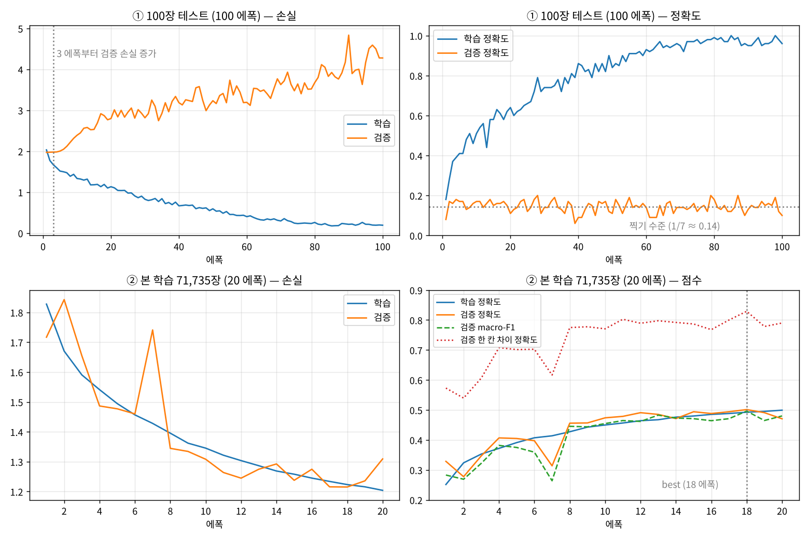

# 개발일지 09 — SmallCNN 20 에폭 / 100 에폭 실행 결과 정리 (팀 공유용)

- **작성자**: LIM (임성빈)
- **작성일**: 2026-11-15
- **대상 모델**: 작은 CNN 4층 (`작은CNN/CNN_4layers.py`, 파라미터 390,695개, 사전학습 없이 처음부터 학습)
- **목적**: SmallCNN을 돌린 두 번의 실행(100 에폭, 20 에폭)이 각각 무엇이었고, 결과와 과적합 여부가 어땠는지 팀원이 한 번에 이해할 수 있게 정리한다.

> **용어 정리 먼저!**
> SmallCNN은 ResNet-50·ConvNeXt처럼 ImageNet으로 **사전학습(pretraining)된 모델이 아니다.** 가중치를 무작위로 초기화하고 우리 데이터로만 학습했다.
> 이 문서의 "20 에폭"과 "100 에폭"은 사전학습이 아니라 **우리 데이터로 직접 학습한 횟수**를 뜻한다.

---

## 0. 한눈에 보기

| | ① 100 에폭 실행 | ② 20 에폭 실행 |
|---|---|---|
| 정체 | **100장 과적합 테스트** (코드 점검용) | **본 학습** (실제 성능 측정용) |
| 날짜 | 2026-11-10 | 2026-11-12 |
| 학습 / 검증 데이터 | 100장 / 100장 | **71,735장 / 15,288장** (팀원과 동일 분할) |
| 데이터 증강 | 끔 | 켬 (팀원과 동일) |
| 클래스 가중치 | 없음 | 있음 `[0.89 0.85 0.85 0.85 0.85 1.51 1.94]` |
| 최종 train acc | 0.96 (최고 **1.000**) | 0.499 |
| 최고 val acc | 0.20 | **0.501** (18 에폭) |
| 과적합? | **심한 과적합** (일부러 만든 것) | **과적합 아님** → 오히려 **과소적합** |
| 결론 | 코드에 버그 없음 확인 ✅ | SmallCNN의 실제 성능 = acc 50.1%, F1 0.496 |

*위: ① 100장 테스트 (100 에폭) / 아래: ② 본 학습 (20 에폭). 왼쪽은 손실, 오른쪽은 정확도·점수.*

---

## 1. 과적합을 어떻게 판단하나? (공통 기준)

| 신호 | 의미 |
|---|---|
| train acc ↑ 인데 val acc는 정체·하락 | 학습 데이터만 잘 맞히고 새 데이터는 못 맞힘 |
| train loss ↓ 인데 val loss ↑ | 가장 확실한 과적합 신호 |
| train acc − val acc **격차가 계속 커짐** | 외우는 양이 늘고 있음 |

반대로 **train acc 자체가 낮고 val과 거의 같으면** 과적합이 아니라 **과소적합(underfitting)**, 즉 아직 덜 배운 상태다.

---

## 2. ① 100 에폭 실행 — 100장 과적합 테스트

### 2-1. 왜 했나?

본 학습은 1시간 50분이 걸리므로, 돌리기 전에 **코드가 정상인지 몇 분 만에 확인**하려고 했다.

- 코드가 정상이면 모델은 100장 정도는 **100% 외울 수 있어야** 한다.
- 못 외우면 데이터 로딩, 모델, 역전파, 업데이트 중 어딘가에 버그가 있다는 뜻이다.
- 즉 **과적합이 나와야 성공**인 테스트다.

### 2-2. 조건

| 항목 | 값 |
|---|---|
| 데이터 | train 100장, val 100장 (`Subset`으로 추출) |
| 증강 | 끔 (외우기 쉽게) |
| 손실 / 최적화 | CrossEntropyLoss (가중치 없음) / Adam lr 0.001 |
| 배치 / 시드 | 64 / 42 |
| 에폭 | 100 (처음엔 20으로 했다가 늘림, 2-3 참고) |

### 2-3. 1차 시도: 20 에폭 → 실패 (버그 아님)

| 에폭 | train loss | train acc | val loss | val acc |
|---:|---:|---:|---:|---:|
| 1 | 2.032 | 0.18 | 1.971 | 0.08 |
| 10 | 1.333 | 0.49 | 2.390 | 0.17 |
| 20 | 1.136 | 0.61 | 2.811 | 0.11 |

- train acc가 0.61에서 끝나 기준(0.9)에 못 미쳤다.
- **원인은 업데이트 횟수 부족**이었다. 100장 ÷ 배치 64 = 에폭당 업데이트 2번이고, 20 에폭이면 겨우 **40번**이다.
- 버그였다면 train loss가 ln 7 ≈ 1.95(아무것도 모르는 상태)에 머물렀을 텐데, 계속 내려가고 있었다. 그래서 **에폭을 100으로 늘렸다.**

### 2-4. 2차 시도: 100 에폭 → 성공

| 에폭 | train loss | train acc | val loss | val acc |
|---:|---:|---:|---:|---:|
| 1 | 2.032 | 0.18 | 1.971 | 0.08 |
| 3 | 1.669 | 0.37 | **1.978 ← 여기서부터 계속 증가** | 0.16 |
| 20 | 1.132 | 0.64 | 2.798 | 0.11 |
| 40 | 0.665 | 0.86 | 3.186 | 0.09 |
| **49** | 0.549 | **0.90 ← 기준 통과** | 3.127 | 0.12 |
| 70 | 0.296 | 0.95 | 3.627 | 0.14 |
| **85** | 0.175 | **1.000 ← 100장 전부 맞힘** | 3.923 | 0.12 |
| 100 | 0.192 | 0.96 | 4.277 | 0.10 |

- 최고 val acc: **0.20** (28 에폭)
- 전체 로그: [`2026-11-10_03_과적합테스트_로그.txt`](2026-11-10_03_과적합테스트_로그.txt)

### 2-5. 과적합 판정: **심한 과적합 (의도한 결과)**

| 관찰 | 해석 |
|---|---|
| train acc 0.18 → **1.00** | 100장을 완전히 외웠다 → 코드 정상 ✅ |
| train loss 2.03 → 0.19 | 학습 자체는 제대로 진행됨 |
| val loss 1.97 → **4.28** (3 에폭부터 증가, 약 2.2배) | 외운 100장 밖의 사진에는 전혀 통하지 않음 → **전형적인 과적합** |
| val acc 0.06~0.20 | 7개 중 찍는 수준(1/7 ≈ 0.14). 100장으로 나이를 배우는 건 불가능하므로 정상 |
| train acc가 0.99 → 0.95처럼 출렁임 | Dropout이 매번 다른 30%의 뉴런을 꺼서 생기는 정상적인 흔들림 |

> ⚠️ **이 결과를 "SmallCNN은 과적합이 심한 모델"로 해석하면 안 된다.**
> 100장은 파라미터 39만 개짜리 모델에게 너무 적은 데이터라서, 어떤 모델이든 외워 버린다. 이 테스트는 **코드 점검용**일 뿐 모델 성능과는 무관하다.

---

## 3. ② 20 에폭 실행 — 본 학습

### 3-1. 조건 (팀원 ResNet-50·ConvNeXt와 맞춤)

| 항목 | 값 |
|---|---|
| 데이터 | train 71,735장 / val 15,288장 (팀원 CSV 분할과 동일) |
| 증강 | RandomResizedCrop(0.9~1.0), 좌우반전, ±10° 회전, ColorJitter 0.2 |
| 손실 | 가중 CrossEntropyLoss `[0.89 0.85 0.85 0.85 0.85 1.51 1.94]` |
| 최적화 | Adam lr 0.001 (고정, 스케줄러 없음) |
| 배치 / 에폭 / 시드 | 64 / 20 / 42 |
| 평가 지표 | 정확도, 한 칸 차이 정확도(off1), macro-F1 → **macro-F1 최고일 때 모델 저장** |
| 소요 시간 | 총 약 **110분** (에폭당 약 320초) |

### 3-2. 에폭별 결과

| 에폭 | train loss | train acc | val loss | val acc | val off1 | val F1 | train−val 격차 |
|---:|---:|---:|---:|---:|---:|---:|---:|
| 1 | 1.828 | 0.251 | 1.717 | 0.329 | 0.573 | 0.283 | −7.7%p |
| 2 | 1.670 | 0.324 | 1.843 | 0.277 | 0.540 | 0.269 | +4.6%p |
| 4 | 1.541 | 0.372 | 1.486 | 0.407 | 0.708 | 0.382 | −3.5%p |
| 7 | 1.428 | 0.414 | 1.741 | **0.314** ← 일시 급락 | 0.616 | 0.264 | +10.0%p |
| 8 | 1.395 | 0.427 | 1.345 | 0.456 | 0.775 | 0.445 | −2.9%p |
| 10 | 1.345 | 0.450 | 1.308 | 0.474 | 0.771 | 0.455 | −2.4%p |
| 12 | 1.304 | 0.464 | 1.245 | 0.491 | 0.789 | 0.462 | −2.7%p |
| 15 | 1.258 | 0.480 | 1.238 | 0.494 | 0.787 | 0.471 | −1.4%p |
| **18 (best)** | 1.223 | 0.492 | **1.215** | **0.501** | **0.829** | **0.496** | −0.9%p |
| 19 | 1.216 | 0.495 | 1.236 | 0.491 | 0.778 | 0.465 | +0.4%p |
| 20 | 1.204 | 0.499 | 1.309 | 0.470 | 0.790 | 0.480 | +2.9%p |

*격차가 마이너스(−)면 검증 정확도가 학습 정확도보다 높다는 뜻.*

- 전체 기록: `작은CNN/results/small_cnn_main/small_cnn_history.csv`
- 최고 모델: `작은CNN/results/small_cnn_main/small_cnn_best.pth` (18 에폭)

### 3-3. 과적합 판정: **과적합 아님 → 과소적합 (아직 덜 배움)**

근거 4가지:

1. **train acc 자체가 49.9%로 낮다.**
   100장 테스트에서는 같은 모델이 100%를 찍었지만, 7만 장 + 증강에서는 절반밖에 못 맞힌다. 외울 능력(용량)이 데이터 양에 비해 부족하다는 뜻이다.
2. **train−val 격차가 거의 없다.**
   20 에폭 동안 격차가 대부분 −3 ~ +3%p 사이였고, **8~18 에폭은 오히려 val이 train보다 높았다.**
   (train 정확도는 증강된 사진 + Dropout 켠 상태로 계산하고, val은 원본 사진 + Dropout 끈 상태로 계산하기 때문에 val이 더 높게 나올 수 있다.)
3. **train loss가 끝까지 꾸준히 내려가고 있다** (1.828 → 1.204). 수렴하지 않았으니 더 학습할 여지가 있다.
4. **val loss도 18 에폭(1.215)까지 대체로 함께 내려갔다.** 과적합이라면 val loss가 일찍부터 계속 올라갔어야 한다.

> **19~20 에폭의 val 하락(0.501 → 0.470)은 과적합인가?**
> 한 에폭만 보고 판단하기 어렵다. 2 에폭, 7 에폭에도 비슷한 급락이 있었다가 바로 회복했다. 학습률을 0.001로 **고정**해 두어서 가중치가 매 에폭 크게 움직이기 때문에 생기는 **출렁임**으로 보는 게 맞다. (팀원 모델은 cosine 스케줄로 학습률을 점점 줄여서 곡선이 매끈하다.)
> 다만 20 에폭에서 격차가 +2.9%p로 처음 플러스가 된 만큼, 에폭을 더 늘린다면 과적합 시작점인지 지켜볼 필요는 있다.

---

## 4. 두 실행 비교 — 같은 모델인데 왜 결과가 정반대인가?

| | ① 100장 × 100 에폭 | ② 71,735장 × 20 에폭 |
|---|---|---|
| 총 업데이트 횟수 | 2 × 100 = **200번** | 1,121 × 20 = **약 22,400번** |
| 데이터 1장당 본 횟수 | 100번 (매번 같은 사진) | 20번 (매번 증강돼서 조금씩 다른 사진) |
| 파라미터 ÷ 학습 사진 수 | 390,695 ÷ 100 ≈ **3,900** | 390,695 ÷ 71,735 ≈ **5.4** |
| train acc | 1.00 | 0.50 |
| val acc | 0.10~0.20 | 0.50 |
| 상태 | **과적합** (외움) | **과소적합** (덜 배움) |

핵심은 **"모델 용량 대비 데이터 양"**이다.

- 사진 1장당 파라미터가 3,900개면 모델은 사진마다 따로 외울 여유가 있다 → 과적합
- 사진 1장당 파라미터가 5.4개면 외울 여유가 없어 공통 패턴만 배우게 된다 → 일반화는 되지만 아직 성능이 낮음
- 증강도 매 에폭 사진을 조금씩 바꿔서 외우기를 더 어렵게 만든다.

---

## 5. 팀원 모델과 나란히 보기

| 모델 | 파라미터 | best 에폭 | val Acc | val Off1 | val F1 | 20 에폭 시점 train−val 격차 | 상태 |
|---|---|---|---|---|---|---|---|
| **SmallCNN (본 학습)** | 0.39M | 18 | 50.1% | 82.9% | 0.496 | **약 +3%p** | 과소적합 |
| ResNet-50 | 약 25M | 8 | 61.9% | 92.9% | 0.615 | 약 +20%p | 약한 과적합 (8 에폭 이후) |
| ConvNeXt-Tiny | 약 28M | 7 | 65.2% | 95.1% | 0.648 | 약 +35%p | 강한 과적합 (5 에폭 이후) |

- 사전학습 모델들은 용량이 SmallCNN의 60~70배라서 7만 장도 외울 수 있고, 그래서 5~8 에폭 이후 과적합이 나타난다.
- SmallCNN은 같은 20 에폭 동안 과적합 신호가 거의 없다. **성능 격차의 원인은 과적합이 아니라 "사전학습 유무 + 모델 용량"**이다.
- 그래도 off1 82.9% → 틀린 예측의 상당수는 바로 옆 나이대로, 기준선(baseline)으로서는 의미 있는 결과다.

---

## 6. 결론과 다음에 해볼 것

### 결론

1. **100 에폭 실행(100장 테스트)**: 의도한 대로 심한 과적합이 나왔고, 이것으로 **코드에 버그가 없음을 확인**했다. 성능 지표로 쓰면 안 된다.
2. **20 에폭 실행(본 학습)**: **과적합 없음**. train과 val이 함께 오르는 중이며 아직 수렴 전이다. SmallCNN의 공식 성능은 **acc 50.1% / off1 82.9% / macro-F1 0.496 (18 에폭)**이다.

### SmallCNN 성능을 더 올리려면 (과소적합 대응)

| 방법 | 기대 효과 |
|---|---|
| 에폭 늘리기 (예: 40~50) + 조기종료 | train loss가 아직 내려가는 중이므로 성능 상승 여지 있음 |
| cosine 학습률 스케줄 추가 | 7·20 에폭 같은 val 출렁임 감소, 후반에 미세 조정 |
| 채널 늘리기 (32/64/128/256 → 64/128/256/512) | 모델 용량 증가 → 더 많은 패턴 학습 |
| Dropout 0.3 → 0.1 | 지금은 규제가 불필요하게 강할 수 있음 |

> 반대로 ResNet-50·ConvNeXt는 과적합 쪽이라 **규제를 늘리는 방향**(lr 낮추기, label smoothing, drop_path 등)이 맞다. 모델마다 처방이 반대라는 점이 이번 비교의 핵심이다.

---

## 참고 파일

| 파일 | 내용 |
|---|---|
| `개발일지/LIM/2026-11-10_03_손실함수_학습루프.md` | 100장 과적합 테스트 상세 (1차 20 에폭 / 2차 100 에폭) |
| `개발일지/LIM/2026-11-10_03_과적합테스트_로그.txt` | 100 에폭 테스트 전체 실행 로그 |
| `개발일지/LIM/2026-11-12_07_본학습_결과.md` | 본 학습 상세 결과 |
| `작은CNN/results/small_cnn_main/` | 본 학습 history.csv, best 모델, 학습 곡선, 실행 코드 |
| `ResNet50/README.md`, `ConvNeXt/README.md` | 팀원 모델 결과 |
