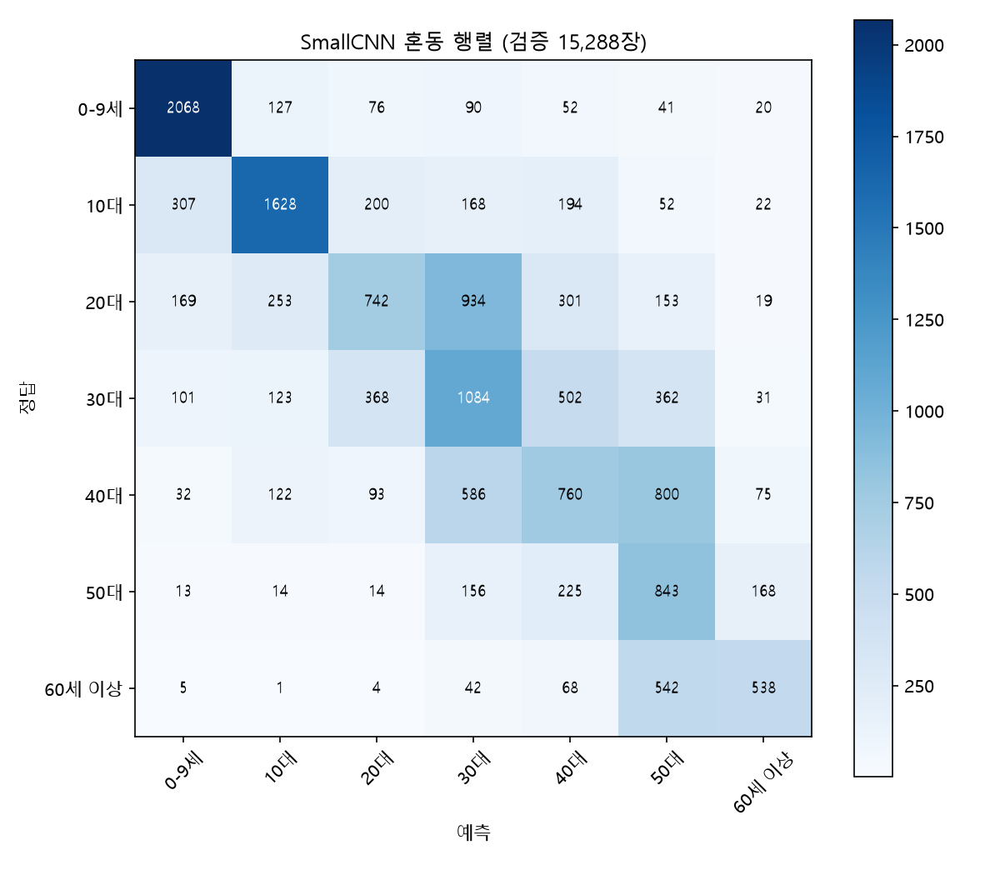

# 개발일지 10 — 평가 전용 코드와 나이대별 성능 분석

- **날짜**: 2026-11-23
- **프로젝트**: 얼굴 이미지 기반 나이대 분류 (인공지능 4조)
- **담당**: 임성빈 — 작은 CNN(4층) 처음부터 학습 (사전학습 없는 비교 기준 모델)
- **작업 범위**: 저장된 최고 모델만 불러오는 평가 코드 작성, 검증 데이터 전체 평가, 나이대별 성능 분석, 팀원 모델과 비교
- **상태**: ✅ 완료 — 학습 기록과 지표 완전 일치, 혼동 행렬·나이대별 지표 확보
- **결과 파일**: `작은CNN/results/small_cnn_main/eval_val/`
  (`metrics.json`, `per_band.csv`, `confusion_matrix.png`, `predictions.csv`)

---

## 1. 한 일

### 1-1. 평가 전용 코드 `eval_small_cnn.py` 작성

개발일지 07의 "다음 할 일"이었던 **학습 코드와 평가 코드 분리**를 했다.
지금 `CNN_4layers.py`는 실행하면 학습부터 다시 돌기 때문에(약 1시간 50분), 저장된 모델만 불러와 평가하는 코드를 따로 만들었다.

| 항목 | 내용 |
|---|---|
| 불러오는 모델 | `small_cnn_best.pth` (18 에폭, 검증 macro-F1 최고) |
| 평가 데이터 | `data/validation` 15,288장, 증강 없음 |
| 모델·전처리 | `CNN_4layers_used.py`에서 `SmallCNN` 클래스와 검증용 transform을 그대로 옮겨 옴 |
| 출력 형식 | 팀원 `step5_evaluate.py`와 같은 파일 이름·열 이름 |
| 실행 | 프로젝트 폴더에서 `python eval_small_cnn.py` (옵션: `--workers 4`) |

- `CNN_4layers.py`를 `import`하지 않은 이유: 파이썬은 `import`할 때 파일 전체를 실행하므로 학습이 다시 시작된다.
- 경로는 `argparse`로 받고(`--weights`, `--data-dir`, `--out-dir`, `--workers`), 윈도우에서 `num_workers > 0`을 쓸 수 있도록 실행부 전체를 `if __name__ == "__main__":` 안에 넣었다.

### 1-2. 출력 파일

| 파일 | 내용 |
|---|---|
| `metrics.json` | acc, off1_acc, macro_f1, n, best_epoch |
| `per_band.csv` | 나이대, 정밀도, 재현율, F1, 장수 (팀원과 같은 한국어 열 이름) |
| `confusion_matrix.png` | 7×7 혼동 행렬 (행 = 정답, 열 = 예측) |
| `predictions.csv` | 사진마다 path, band(정답), pred(예측), correct, off1, diff(예측 − 정답) |

---

## 2. 검증: 학습 기록과 같은 값이 나오는가?

평가 코드가 맞는지 확인하려고, 학습 때 18 에폭에서 기록한 값과 비교했다.

| 지표 | 이번 평가 | 학습 기록 (18 에폭) | |
|---|---:|---:|---|
| 정확도 | 0.5012428… | 0.5012428… | ✅ |
| 한 칸 차이 정확도 | 0.8290816… | 0.8290816… | ✅ |
| macro-F1 | 0.4962069… | 0.4962069… | ✅ |

- 소수점 끝자리까지 **완전히 같다** → 모델 불러오기, 전처리, 클래스 순서가 모두 학습 때와 같다는 뜻이다.
- 클래스 순서(`class_to_idx`): `{'0 9': 0, '10 19': 1, …, '60over': 6}` → 나이대 라벨 0~6과 일치.

---

## 3. 결과

### 3-1. 나이대별 지표 (`per_band.csv`)

| 나이대 | 정밀도 | 재현율(= 그 나이대 정확도) | F1 | 장수 |
|---|---:|---:|---:|---:|
| 0~9세 | 0.767 | **0.836** | **0.800** | 2,474 |
| 10대 | 0.718 | 0.633 | 0.673 | 2,571 |
| 20대 | 0.496 | **0.289** ← 최저 | 0.365 | 2,571 |
| 30대 | 0.354 | 0.422 | 0.385 | 2,571 |
| 40대 | 0.362 | 0.308 | **0.333** ← 최저 | 2,468 |
| 50대 | **0.302** ← 최저 | 0.588 | 0.399 | 1,433 |
| 60세 이상 | 0.616 | 0.448 | 0.519 | 1,200 |

> - **정밀도**: "이 나이대"라고 예측한 사진 중 실제로 그 나이대인 비율
> - **재현율**: 실제 그 나이대 사진 중 맞힌 비율 (팀원 README의 "나이대별 정확도"와 같은 값)

### 3-2. 혼동 행렬

행(정답)별 비율로 바꾸면 다음과 같다. **굵은 칸**은 그 행에서 가장 많이 예측된 나이대다.

| 정답 \ 예측 | 0~9 | 10대 | 20대 | 30대 | 40대 | 50대 | 60+ |
|---|---:|---:|---:|---:|---:|---:|---:|
| 0~9세 | **83.6%** | 5.1% | 3.1% | 3.6% | 2.1% | 1.7% | 0.8% |
| 10대 | 11.9% | **63.3%** | 7.8% | 6.5% | 7.5% | 2.0% | 0.9% |
| 20대 | 6.6% | 9.8% | 28.9% | **36.3%** | 11.7% | 6.0% | 0.7% |
| 30대 | 3.9% | 4.8% | 14.3% | **42.2%** | 19.5% | 14.1% | 1.2% |
| 40대 | 1.3% | 4.9% | 3.8% | 23.7% | 30.8% | **32.4%** | 3.0% |
| 50대 | 0.9% | 1.0% | 1.0% | 10.9% | 15.7% | **58.8%** | 11.7% |
| 60세 이상 | 0.4% | 0.1% | 0.3% | 3.5% | 5.7% | **45.2%** | 44.8% |

→ **20대, 40대, 60세 이상은 정답보다 다른 나이대로 더 많이 예측됐다.** (20대 → 30대, 40대 → 50대, 60세 이상 → 50대)

### 3-3. 오답의 성격 (`predictions.csv` 15,288장 전체 분석)

| 항목 | 값 |
|---|---:|
| 오답 수 | 7,625장 (49.9%) |
| 그중 바로 옆 나이대(1칸) 오답 | 5,012장 → **오답의 65.7%** |
| 두 칸 이상 크게 틀림 | 2,613장 → **전체의 17.1%** |
| 세 칸 이상 크게 틀림 | 전체의 6.7% |
| 실제보다 **많게** 예측 (diff > 0) | 28.7% |
| 실제보다 **적게** 예측 (diff < 0) | 21.2% |

### 3-4. 나이대별 예측 개수 (실제 장수와 비교)

| 나이대 | 실제 장수 | 예측된 장수 | 예측 / 실제 |
|---|---:|---:|---:|
| 0~9세 | 2,474 | 2,695 | 1.09 |
| 10대 | 2,571 | 2,268 | 0.88 |
| 20대 | 2,571 | 1,497 | **0.58** ← 너무 적게 예측 |
| 30대 | 2,571 | 3,060 | 1.19 |
| 40대 | 2,468 | 2,102 | 0.85 |
| 50대 | 1,433 | 2,793 | **1.95** ← 너무 많이 예측 |
| 60세 이상 | 1,200 | 873 | 0.73 |

---

## 4. 팀원 모델과 비교 (검증 15,288장)

팀원 수치는 팀 저장소 `ConvNeXt/README.md` 3-1절.

### 4-1. 나이대별 정확도(재현율)

| 나이대 | **작은 CNN** | ResNet-50 | ConvNeXt-Tiny |
|---|---:|---:|---:|
| 0~9세 | **84%** | 91% | 93% |
| 10대 | **63%** | 75% | 77% |
| 20대 | **29%** | 58% | 64% |
| 30대 | **42%** | 47% | 50% |
| 40대 | **31%** | 45% | 48% |
| 50대 | **59%** | 48% | 52% |
| 60세 이상 | **45%** | 66% | 71% |

### 4-2. 크게 틀리는 비율

| | 작은 CNN | ResNet-50 | ConvNeXt-Tiny |
|---|---:|---:|---:|
| 두 칸 이상 틀림 | **17.1%** | 7.1% | 4.9% |

---

## 5. 해석

### ① 공통점: 어린 나이는 쉽고, 틀릴 때는 대부분 옆 나이대

- 세 모델 모두 **0~9세가 가장 쉽다.** 작은 CNN도 사전학습 없이 84%를 맞혔다. 아이 얼굴은 비율(큰 눈, 둥근 얼굴)이 뚜렷해서 작은 모델로도 구분된다.
- 오답의 65.7%가 바로 옆 나이대다. 나이는 연속적인 값인데 10년 단위로 잘랐기 때문에, 경계(29세 ↔ 31세)에 있는 얼굴은 어느 모델이든 헷갈린다.

### ② 차이점 1: 20대가 가장 약하다 (팀원 모델과 다름)

- 팀원 모델은 "30~50대가 가장 어렵다"였는데, 작은 CNN은 **20대(29%)가 가장 낮다.** ResNet-50(58%)의 절반이다.
- 20대 사진의 36.3%가 30대로 갔고, "20대" 예측은 실제의 0.58배밖에 나오지 않았다.
- 추정: 20대와 30대를 가르는 단서(피부 결, 잔주름 초기)는 미세한 질감이라, 사전학습 없이 39만 파라미터로 처음부터 배우기 어렵다. 사전학습 모델은 ImageNet에서 이미 질감 특징을 배워 와서 이 차이가 크게 난다.

### ③ 차이점 2: 50대로 몰아서 예측한다

- 50대만 작은 CNN이 팀원보다 정확도가 높다(59% vs 48~52%). 하지만 **"50대" 예측이 실제의 1.95배**라서 정밀도는 0.302로 가장 낮다.
- 40대의 32.4%, 60세 이상의 45.2%가 50대로 갔다. 즉 50대 정확도는 "50대를 잘 구분해서"가 아니라 **40대 이후 얼굴을 50대로 넓게 몰아서** 얻은 점수다.
- 손실 가중치(50대 1.51, 60세 이상 1.94)의 영향을 의심했지만, 가중치가 더 큰 60세 이상은 오히려 적게 예측됐다(0.73배). 그래서 **가중치만으로는 설명되지 않는다.** "중년 이후 얼굴을 하나로 뭉뚱그려 본다"는 쪽이 더 맞아 보인다. 확인하려면 가중치를 빼고 다시 학습해 비교해야 한다.

### ④ 차이점 3: 크게 틀리는 경우가 많다

- 두 칸 이상 틀린 비율이 17.1%로 ResNet-50의 약 2.4배, ConvNeXt의 약 3.5배다.
- 20대(25.0%)와 30대(24.0%)에서 크게 틀린 비율이 특히 높다.
- **사전학습의 효과가 가장 잘 드러나는 지표**다. 정확도 차이(12~15%p)보다, "엉뚱하게 틀리는 정도"의 차이가 더 크다.

### ⑤ 전체적으로 나이를 많게 보는 경향

- 실제보다 많게 예측 28.7%, 적게 예측 21.2%. 20대 → 30대, 40대 → 50대처럼 **위쪽 나이대로 밀리는 오답**이 많다.

---

## 6. 문제와 해결

| 문제 | 원인 | 해결 |
|---|---|---|
| 평가만 하고 싶은데 실행하면 학습부터 다시 돎 | `CNN_4layers.py`가 함수 없이 위에서 아래로 실행되는 구조 | 평가 전용 파일을 따로 만들고, 필요한 클래스·transform만 옮겨 옴 |
| 다른 파일에서 `import`하면 학습이 실행됨 | `import`할 때 파일 전체가 실행됨 | `import`하지 않고 `CNN_4layers_used.py`에서 복사 + 출처 주석 |
| 혼동 행렬의 한글 라벨이 깨질 수 있음 | matplotlib 기본 폰트에 한글 없음 | Malgun Gothic 폰트 설정 → 정상 표시 확인 |
| 개인 프로젝트 폴더에서 커밋이 안 됨 | 작업 폴더(`C:\3th_project\whats_your_face_age`)가 git 저장소가 아님 | 팀 저장소의 `작은CNN/`으로 파일을 옮겨서 커밋 |

---

## 7. 진행 상황

| 단계 | 상태 |
|---|---|
| 4-1 ~ 4-5, 평가 지표, 본 학습 설정, 본 학습 | ✅ |
| **평가 코드 분리 + 나이대별 성능 분석** | ✅ **이번 작업** |
| 팀 비교표 반영 | ⬜ 다음 |
| (선택) 개선 실험 | ⬜ |

---

## 8. 다음 할 일

- [ ] 팀 비교표에 작은 CNN의 나이대별 정확도, 두 칸 이상 오답 비율 반영
- [ ] 팀 논의: 결과표에 들어갈 작은 CNN 정의 (내 버전 블록당 conv 1개 vs `common.py` 블록당 conv 2개)
- [ ] (선택) 개선 실험
  - 코사인 학습률 + 40~50 에폭 + 조기 종료 → 검증 곡선 안정화, 과소적합 대응
  - 손실 가중치 끄고 비교 → 50대 몰림 현상이 가중치 때문인지 확인
  - `num_workers` 적용 → 학습 시간 단축
- [ ] 시험 데이터 평가는 팀이 최종 모델을 정한 뒤 **한 번만**
