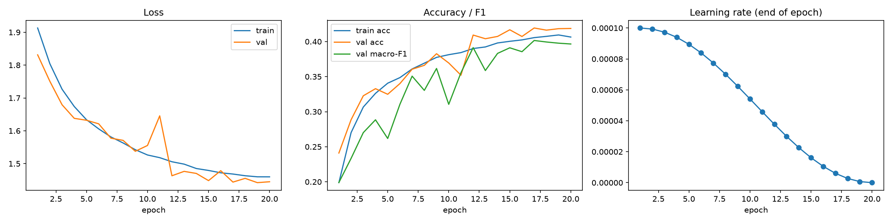
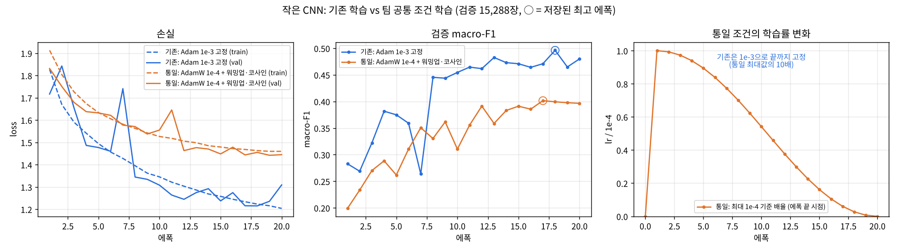
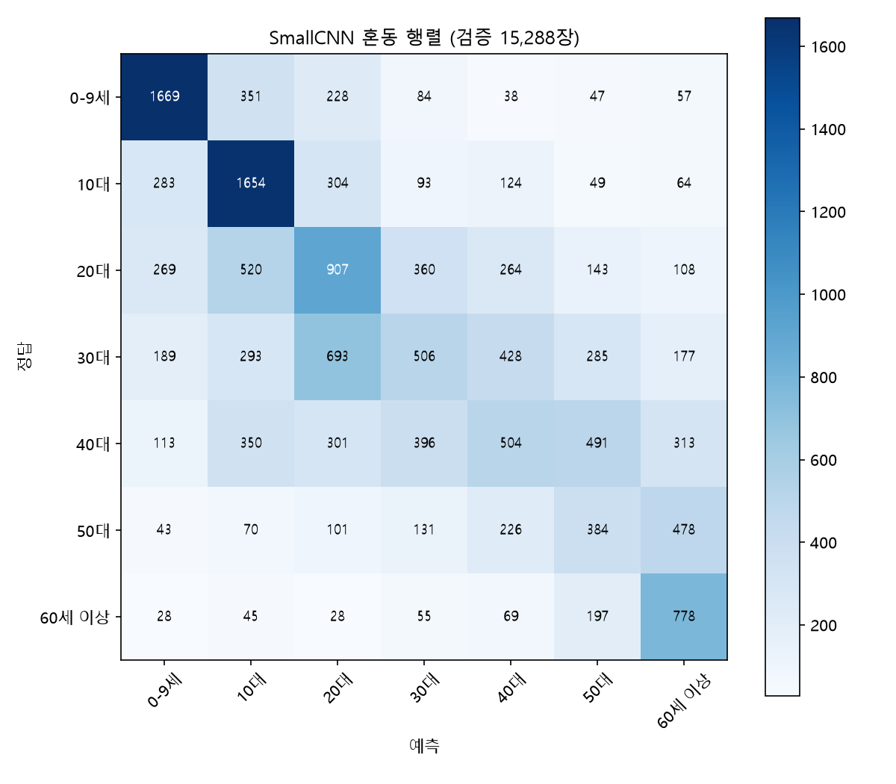

# 개발일지 11 — 팀 공통 학습 조건으로 작은 CNN 다시 학습하기

- **날짜**: 2026-11-23
- **프로젝트**: 얼굴 이미지 기반 나이대 분류 (인공지능 4조)
- **담당**: 임성빈 — 작은 CNN(4층) 처음부터 학습 (사전학습 없는 비교 기준 모델)
- **작업 범위**: 팀이 정한 공통 조건에 맞춰 학습 코드 새 버전 작성, splits_csv 생성·검증, 점검 실행, 20 에폭 본 학습, 평가, 기존 학습과 비교
- **상태**: ✅ 완료 — **최고 검증 macro-F1 0.402 (17 에폭)**
- **실행 로그**: [`2026-11-23_11_팀공통조건_재학습_실행로그.txt`](2026-11-23_11_팀공통조건_재학습_실행로그.txt)
- **결과 파일**: `작은CNN/results/small_cnn_unified/` (평가는 `eval_val/`)

---

## 1. 배경: 왜 다시 학습했나?

팀 회의에서 **작은 CNN 정의는 내 코드(블록당 conv 1개)로 하기로** 했고, 세 모델(작은 CNN, ResNet-50, ConvNeXt-Tiny)을 공정하게 비교하려고 **학습 조건을 하나로 통일**하기로 했다.

기존 작은 CNN(개발일지 07)은 데이터·증강·손실은 팀원과 같았지만 **최적화 방법이 달랐다** (Adam, lr 0.001 고정). 그래서 통일 조건으로 한 번 더 학습했다.

- 기존 결과(`results/small_cnn_main`)는 **그대로 보존**했다. 코드도 `CNN_4layers.py`는 건드리지 않고 `CNN_4layers_unified.py`를 새로 만들었다.
- 덕분에 "기존 vs 통일" 비교가 그대로 **학습 방법(하이퍼파라미터) 비교 실험** 하나가 된다.

### 1-1. 팀 공통 조건

| 항목 | 팀 공통 조건 | 기존 작은 CNN | 바뀌었나 |
|---|---|---|---|
| 데이터 | splits_csv (학습 71,735 / 검증 15,288 / 시험 15,289) | 같은 사진 (ImageFolder) | 읽는 방식만 CSV로 |
| 클래스 | 7개 나이대, 같은 순서 | 같음 | — |
| 입력·정규화 | 224×224 RGB, ImageNet 평균·표준편차 | 같음 | — |
| 증강 (학습만) | 확대·자르기 90~100%, 좌우 반전, ±10°, 밝기·대비 ±20% | 같음 | — |
| 손실 | 교차 엔트로피 + 가중치 `[0.89 0.85 0.85 0.85 0.85 1.51 1.94]` | 같음 | — |
| 옵티마이저 | **AdamW, weight decay 0.05** | Adam | ✏️ |
| 학습률 | **최대 1e-4, 1 에폭 워밍업 → 코사인 감소** (배치마다 갱신) | 1e-3 고정 | ✏️ |
| 혼합 정밀도 | **AMP 사용** | 없음 | ✏️ |
| 배치 / 에폭 / 시드 | 64 / 20 / 42 | 같음 | — |
| 최고 모델 | 조기 종료 없이 20 에폭, 검증 macro-F1 최고 에폭 저장 | 같음 | — |

- 최대 학습률은 처음부터 학습하는 모델에는 작은 값이지만, **팀원과 통일하기 위해 1e-4로 정했다.**
- 손실 가중치는 처음 받은 목록에 6개만 적혀 있어서, 나이대 수에 맞춰 **7개**로 확정했다.

---

## 2. 한 일

### 2-1. splits_csv 만들기 (`make_splits_csv.py`)

`data/training`, `validation`, `testing` 폴더의 사진 목록을 팀원 형식의 CSV로 저장했다.

- 열: `path`(data 폴더 기준 상대 경로), `band`(나이대 번호), `source`, `race_group`(정보가 없어 `unknown`)
- `band`는 폴더 이름 앞 숫자 ÷ 10 (최대 6) → `'0 9'`=0, …, `'60over'`=6

| | 장수 | 나이대별 (0~6) | ImageFolder와 비교 |
|---|---:|---|---|
| train | 71,735 ✅ | 11,561 / 12,000 / 12,000 / 12,000 / 12,104 / 6,801 / 5,269 | 완전히 같음 |
| val | 15,288 ✅ | 2,474 / 2,571 / 2,571 / 2,571 / 2,468 / 1,433 / 1,200 | 완전히 같음 |
| test | 15,289 ✅ | 2,470 / 2,571 / 2,571 / 2,571 / 2,545 / 1,453 / 1,108 | 완전히 같음 |

→ 기존 학습과 **사진·라벨이 완전히 같다**는 것을 확인했다. 결과 차이는 데이터가 아니라 학습 방법 때문이다.

학습 데이터로 계산한 손실 가중치 `[0.8864, 0.854, 0.854, 0.854, 0.8467, 1.5068, 1.9449]`도 팀 값과 소수 둘째 자리까지 같았다.

### 2-2. 학습 코드 새 버전 (`CNN_4layers_unified.py`)

| 바뀐 부분 | 내용 |
|---|---|
| 데이터 | ImageFolder → CSV를 읽는 Dataset 클래스 |
| 옵티마이저 | `AdamW(lr=1e-4, weight_decay=0.05)` — 가중치를 매 스텝 조금씩 0 쪽으로 당겨 과적합을 막음 |
| 학습률 | `LambdaLR` + 팀원과 같은 식. 첫 1,120 스텝(1 에폭)은 0 → 1e-4로 선형 증가, 이후 코사인으로 0까지 감소. `optimizer.step()` 다음에 `scheduler.step()` |
| AMP | `torch.autocast` + `GradScaler` — conv·linear를 float16으로 계산해 빠르게 하고, 기울기가 너무 작아져 0이 되지 않도록 손실을 키웠다가 되돌림 |
| DataLoader | 학습용 `drop_last=True`(64장이 안 되는 마지막 배치 버림, 팀원과 같음), `num_workers=4`, `pin_memory=True` |
| 실행부 | 윈도우에서 `num_workers`를 쓰려고 전체를 `if __name__ == "__main__":` 안에 넣음 |
| 옵션 | `--epochs`, `--lr`, `--workers`, `--out-dir`, `--subset N`(점검용), `--stop-after K`(점검용) |
| 기록 | history에 `lr` 열 추가, 사용한 조건 전부를 `config.json`으로 저장 |

모델(`SmallCNN`)은 기존과 **완전히 같다** (파라미터 390,695개).

### 2-3. 점검 실행 (본 학습 전)

| 점검 | 조건 | 결과 |
|---|---|---|
| 100장 과적합 테스트 | `--subset 100 --epochs 100 --lr 1e-3` | train acc 10 에폭 0.44 → 50 에폭 **0.90** → 80 에폭 0.99 → 코드 정상 ✅ |
| 전체 데이터 2 에폭 | `--stop-after 2` | lr이 1 에폭 동안 8.9e-08 → 1.0e-04, 2 에폭에 9.9e-05로 감소 (계산값 9.93e-05와 일치) ✅ / NaN 없음 ✅ / 에폭당 약 115초 (기존 약 320초의 약 1/2.8) ✅ |

- 과적합 테스트만 lr 1e-3을 썼다. 1e-4로는 100장을 외우는 데 너무 오래 걸려서, 코드 점검 목적으로만 키웠다.
- 점검 결과: `작은CNN/results/check_subset100/`, `작은CNN/results/check_full2/`

---

## 3. 본 학습 결과 (20 에폭)

```
Epoch   1/20 | lr 8.9e-08→1.0e-04 | train loss 1.9130 acc 0.199 | val loss 1.8313 acc 0.241 off1 0.553 F1 0.199 | 145초 ★ best
Epoch   2/20 | lr 1.0e-04→9.9e-05 | train loss 1.8043 acc 0.270 | val loss 1.7508 acc 0.289 off1 0.580 F1 0.233 | 117초 ★ best
Epoch   3/20 | lr 9.9e-05→9.7e-05 | train loss 1.7266 acc 0.307 | val loss 1.6793 acc 0.323 off1 0.575 F1 0.270 | 165초 ★ best
Epoch   4/20 | lr 9.7e-05→9.4e-05 | train loss 1.6739 acc 0.326 | val loss 1.6379 acc 0.333 off1 0.633 F1 0.288 | 187초 ★ best
Epoch   5/20 | lr 9.4e-05→8.9e-05 | train loss 1.6337 acc 0.341 | val loss 1.6321 acc 0.325 off1 0.631 F1 0.262 | 183초
Epoch   6/20 | lr 8.9e-05→8.4e-05 | train loss 1.6058 acc 0.349 | val loss 1.6212 acc 0.340 off1 0.650 F1 0.311 | 172초 ★ best
Epoch   7/20 | lr 8.4e-05→7.7e-05 | train loss 1.5813 acc 0.361 | val loss 1.5775 acc 0.361 off1 0.677 F1 0.351 | 175초 ★ best
Epoch   8/20 | lr 7.7e-05→7.0e-05 | train loss 1.5629 acc 0.369 | val loss 1.5708 acc 0.366 off1 0.640 F1 0.330 | 179초
Epoch   9/20 | lr 7.0e-05→6.2e-05 | train loss 1.5425 acc 0.377 | val loss 1.5376 acc 0.383 off1 0.679 F1 0.362 | 191초 ★ best
Epoch  10/20 | lr 6.2e-05→5.4e-05 | train loss 1.5263 acc 0.381 | val loss 1.5553 acc 0.369 off1 0.605 F1 0.310 | 190초
Epoch  11/20 | lr 5.4e-05→4.6e-05 | train loss 1.5182 acc 0.384 | val loss 1.6455 acc 0.352 off1 0.660 F1 0.356 | 295초
Epoch  12/20 | lr 4.6e-05→3.8e-05 | train loss 1.5057 acc 0.390 | val loss 1.4631 acc 0.409 off1 0.724 F1 0.391 | 313초 ★ best
Epoch  13/20 | lr 3.8e-05→3.0e-05 | train loss 1.4985 acc 0.392 | val loss 1.4764 acc 0.404 off1 0.673 F1 0.359 | 309초
Epoch  14/20 | lr 3.0e-05→2.3e-05 | train loss 1.4851 acc 0.398 | val loss 1.4701 acc 0.407 off1 0.708 F1 0.383 | 281초
Epoch  15/20 | lr 2.3e-05→1.6e-05 | train loss 1.4792 acc 0.400 | val loss 1.4483 acc 0.417 off1 0.720 F1 0.391 | 262초
Epoch  16/20 | lr 1.6e-05→1.1e-05 | train loss 1.4721 acc 0.402 | val loss 1.4785 acc 0.407 off1 0.706 F1 0.386 | 221초
Epoch  17/20 | lr 1.1e-05→6.0e-06 | train loss 1.4683 acc 0.406 | val loss 1.4438 acc 0.419 off1 0.728 F1 0.402 | 263초 ★ best
Epoch  18/20 | lr 6.0e-06→2.7e-06 | train loss 1.4631 acc 0.407 | val loss 1.4551 acc 0.416 off1 0.721 F1 0.399 | 245초
Epoch  19/20 | lr 2.7e-06→6.8e-07 | train loss 1.4599 acc 0.409 | val loss 1.4421 acc 0.418 off1 0.724 F1 0.398 | 237초
Epoch  20/20 | lr 6.8e-07→5.4e-13 | train loss 1.4598 acc 0.406 | val loss 1.4448 acc 0.419 off1 0.719 F1 0.397 | 210초
best val macro-F1 0.4015 (epoch 17) → results/small_cnn_unified
```

- **학습 시간**: 약 1시간 12분 (4,339초). 11 에폭부터 에폭당 시간이 약 300초로 늘었는데, 코드는 그대로이므로 그 시간대의 PC 사용·발열 영향으로 보인다. 결과에는 영향이 없다.
- **저장된 모델**: 17 에폭 (검증 macro-F1 0.4015)

### 3-1. 학습 곡선



### 3-2. 기존 학습과 나란히 비교



---

## 4. 평가 결과 (`eval_small_cnn.py`, 검증 15,288장)

```
python eval_small_cnn.py --weights results/small_cnn_unified/small_cnn_best.pth --out-dir results/small_cnn_unified/eval_val
```

### 4-1. 전체 지표

| 지표 | **기존** (Adam 1e-3 고정) | **통일** (AdamW 1e-4 + 코사인) | 차이 |
|---|---:|---:|---:|
| 정확도 | 50.1% | 41.9% | −8.2%p |
| 한 칸 차이 정확도 | 82.9% | 72.8% | −10.1%p |
| macro-F1 | 0.496 | 0.401 | −0.095 |
| 최고 에폭 | 18 | 17 | |
| 마지막 train loss / acc | 1.20 / 49.9% | 1.46 / 40.6% | |
| 에폭당 시간 | 약 320초 | 약 115초 (점검 기준) | 약 2.8배 빠름 |

> **평가 코드의 "불일치" 표시에 대해**
> - `eval_small_cnn.py`는 **기존 모델의 기록값**(0.5012 / 0.4962)과 비교하도록 만들어져 있어서, 이번에는 "불일치"가 뜨는 것이 정상이다.
> - 같은 이유로 `metrics.json`의 `best_epoch`가 18로 적혀서, **17로 직접 고쳤다.** 다음에 쓸 때는 `--best-epoch`, 기록값을 옵션으로 받도록 고치면 좋다.
> - 학습 로그의 macro-F1(0.4015)과 평가 결과(0.4009)가 아주 조금 다르다. 학습 중 검증은 **AMP(float16)로**, 평가 코드는 **float32로** 계산해서 경계에 있는 사진 몇 장의 예측이 바뀐 것이다. 정확도는 0.419로 같다.

### 4-2. 나이대별 성능 (재현율 = 나이대별 정확도)

| 나이대 | 기존 재현율 | **통일 재현율** | 통일 정밀도 | 통일 F1 | 예측 / 실제 장수 (통일) |
|---|---:|---:|---:|---:|---:|
| 0~9세 | 83.6% | **67.5%** | 0.643 | 0.659 | 1.05 |
| 10대 | 63.3% | **64.3%** | 0.504 | 0.565 | 1.28 |
| 20대 | 28.9% | **35.3%** | 0.354 | 0.353 | 1.00 |
| 30대 | 42.2% | **19.7%** | 0.311 | 0.241 | 0.63 |
| 40대 | 30.8% | **20.4%** | 0.305 | 0.245 | 0.67 |
| 50대 | 58.8% | **26.8%** | 0.241 | 0.254 | 1.11 |
| 60세 이상 | 44.8% | **64.8%** | 0.394 | 0.490 | **1.65** |

### 4-3. 혼동 행렬



행(정답)별 비율:

| 정답 \ 예측 | 0~9 | 10대 | 20대 | 30대 | 40대 | 50대 | 60+ |
|---|---:|---:|---:|---:|---:|---:|---:|
| 0~9세 | **67.5%** | 14.2% | 9.2% | 3.4% | 1.5% | 1.9% | 2.3% |
| 10대 | 11.0% | **64.3%** | 11.8% | 3.6% | 4.8% | 1.9% | 2.5% |
| 20대 | 10.5% | 20.2% | **35.3%** | 14.0% | 10.3% | 5.6% | 4.2% |
| 30대 | 7.4% | 11.4% | **27.0%** | 19.7% | 16.6% | 11.1% | 6.9% |
| 40대 | 4.6% | 14.2% | 12.2% | 16.0% | **20.4%** | 19.9% | 12.7% |
| 50대 | 3.0% | 4.9% | 7.0% | 9.1% | 15.8% | 26.8% | **33.4%** |
| 60세 이상 | 2.3% | 3.8% | 2.3% | 4.6% | 5.8% | 16.4% | **64.8%** |

### 4-4. 오답의 성격

| 항목 | 기존 | 통일 |
|---|---:|---:|
| 오답 중 바로 옆 나이대 비율 | 65.7% | **53.2%** |
| 두 칸 이상 크게 틀림 (전체 대비) | 17.1% | **27.2%** |
| 실제보다 많게 예측 / 적게 예측 | 28.7% / 21.2% | 29.3% / 28.8% |

---

## 5. 해석

### ① 성능이 내려간 이유: 학습률이 작아서 다 배우지 못했다 (과소적합)

- 마지막 train acc가 40.6%로 검증(41.9%)과 거의 같다. **외운 것(과적합)이 아니라 덜 배운 것(과소적합)**이다.
- 학습률 1e-4는 **사전학습 모델을 조금만 고칠 때** 쓰는 값이다. 처음부터 배우는 작은 CNN에는 보폭이 기존(1e-3)의 1/10이라 너무 작았고, 다 배우기 전에 코사인 감소로 학습률이 0이 되었다.
- weight decay 0.05도 가중치를 계속 0 쪽으로 당겨서 학습을 조금 더 억제했을 것이다.
- 검증 macro-F1이 15~20 에폭에 0.39~0.40에서 평평해진 것도, 학습률이 거의 0이 되어 더 움직이지 못한 결과다.

### ② 좋아진 점: 후반 출렁임이 사라졌다

- 기존 학습은 7 에폭(F1 0.36 → 0.26)과 20 에폭(val loss 1.22 → 1.31)에서 크게 튀었다.
- 통일 조건은 학습률이 큰 초중반(10~11 에폭)에는 여전히 튀지만, **15 에폭 이후에는 F1 0.386~0.402로 안정적**이다.
- 개발일지 07에서 "val이 튀는 원인은 고정 학습률"이라고 추정했는데, **학습률을 줄이면 출렁임이 사라진다는 것을 실제로 확인**했다.
- AMP와 `num_workers` 덕분에 에폭당 시간도 약 2.8배 빨라졌다.

### ③ 덜 배운 모델은 손실 가중치에 더 끌려간다

- 통일 모델은 **60세 이상을 실제의 1.65배나 예측**하고(가중치 1.94로 가장 큼), 50대의 33.4%를 60세 이상으로 보냈다.
- 기존 모델은 반대로 50대를 1.95배 예측하고 60세 이상은 적게 예측했다. 그때는 "가중치만으로는 설명되지 않는다"고 했는데(개발일지 10), 이번 결과까지 보면 **특징을 충분히 못 배운 모델일수록 가중치가 큰 나이대로 예측이 쏠리는** 것으로 보인다. (가중치를 끄고 비교해야 확정할 수 있다.)
- 그래서 60세 이상(+20%p)과 20대(+6%p)는 오히려 기존보다 올랐지만, **30·40·50대는 20% 안팎으로 크게 떨어졌다.** 중년 얼굴의 미세한 차이는 덜 배운 모델이 가장 먼저 놓치는 부분이다.

### ④ 크게 틀리는 비율이 늘었다

- 두 칸 이상 틀린 비율이 17.1% → 27.2%로 늘었다. 30대를 20대(27.0%)·10대(11.4%)로, 40대를 10대(14.2%)로 보내는 등 **나이의 순서 감각**이 기존보다 약하다.

### ⑤ 팀 비교에서의 의미: 사전학습 효과가 더 분명해졌다

| 같은 학습 조건 (팀 공통) | macro-F1 | 정확도 | 한 칸 차이 정확도 |
|---|---:|---:|---:|
| **작은 CNN** (사전학습 없음) | **0.401** | **41.9%** | **72.8%** |
| ResNet-50 (ImageNet 사전학습) | 0.615 | 61.9% | 92.9% |
| ConvNeXt-Tiny (사전학습) | 0.648 | 65.2% | 95.1% |

- 이제 세 모델의 **학습 조건이 완전히 같으므로**, 차이는 **모델 구조·크기와 사전학습 여부**에서만 온다. 사전학습 모델과의 차이는 macro-F1 약 0.21~0.25로, 기존 비교(약 0.12~0.15)보다 크게 드러난다.
- 동시에 내 두 실험은 **"같은 학습률이 모든 모델에 맞지는 않는다"**는 것을 보여 준다. 미세조정용 학습률(1e-4)은 처음부터 학습하는 모델에는 너무 작고, 1e-3에서 macro-F1이 0.095 더 높았다.
- 발표 정리: "공정 비교(통일 조건)" 결과로 세 모델을 비교하고, "작은 CNN에 맞는 학습률(1e-3)이면 0.496까지 오른다"를 하이퍼파라미터 비교 실험으로 함께 보여 주면 된다.

---

## 6. 문제와 해결

| 문제 | 원인 | 해결 |
|---|---|---|
| 처음 받은 손실 가중치 목록이 6개 | 0.85 하나가 빠진 표기 실수 | 나이대 수(7개)에 맞춰 확정, 학습 데이터로 계산한 값과 비교해 확인 |
| 팀원은 CSV, 나는 ImageFolder로 데이터를 읽음 | 데이터 읽는 방식이 달랐음 | `make_splits_csv.py`로 CSV 생성 후, ImageFolder와 사진·라벨이 완전히 같은지 검증 |
| 100장 과적합 테스트가 lr 1e-4로는 너무 느림 | 작은 학습률 | 점검에서만 `--lr 1e-3` 사용 (본 학습은 1e-4) |
| 평가 코드가 "불일치"를 출력, `best_epoch` 18로 기록 | 기존 모델 기록값·에폭이 코드에 고정 | 이번 결과는 정상으로 판단, `metrics.json`의 `best_epoch`를 17로 수정. 코드 옵션화는 다음 할 일 |
| 학습 로그 F1 0.4015 vs 평가 0.4009 | 학습 중 검증은 AMP(float16), 평가는 float32 | 차이가 0.0006으로 작아 그대로 기록 |
| 실행 로그가 UTF-16으로 저장됨 | PowerShell `Tee-Object` 기본 인코딩 | 저장소에는 UTF-8로 변환해 올림 |

---

## 7. 진행 상황

| 단계 | 상태 |
|---|---|
| 기존 본 학습, 평가 코드 분리, 나이대별 분석 | ✅ |
| **팀 공통 조건 재학습 + 평가 + 비교** | ✅ **이번 작업** |
| 팀 비교표 반영 (통일 조건 결과) | ⬜ 다음 |
| 시험 데이터 평가 (최종 모델 결정 후 한 번만) | ⬜ 팀 |

---

## 8. 다음 할 일

- [ ] 팀 비교표에 **통일 조건 결과(macro-F1 0.401)**를 공식 값으로 넣고, 기존 결과(0.496)는 학습률 비교 실험으로 함께 정리
- [ ] `eval_small_cnn.py`에 `--best-epoch`, 기록값 옵션 추가 (모델마다 고정값 수정하지 않도록)
- [ ] (선택) 통일 조건에서 최대 학습률만 1e-3으로 바꿔 학습 → "작은 CNN에 맞는 학습률" 효과를 같은 조건에서 확인
- [ ] (선택) 손실 가중치 끄고 학습 → 예측 쏠림이 가중치 때문인지 확인
