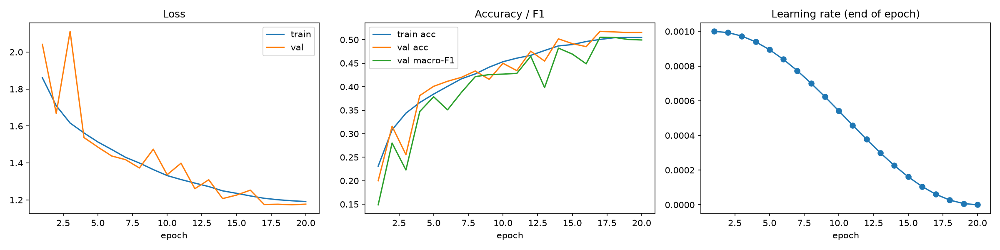
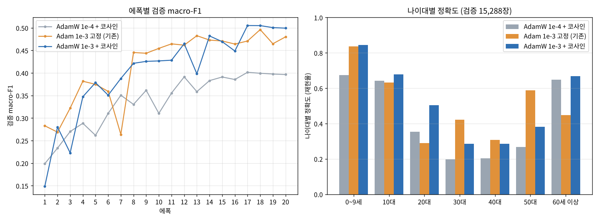
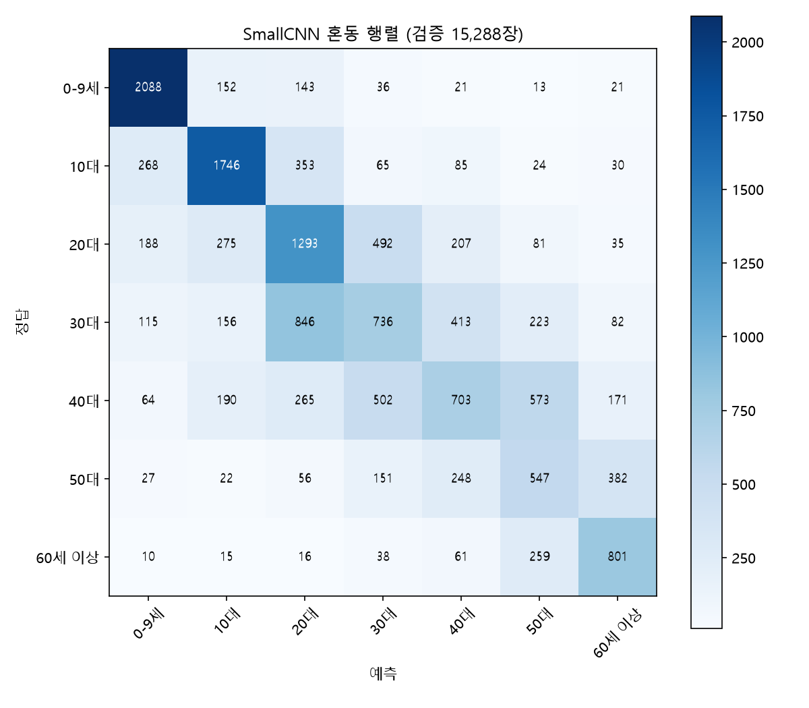

# 개발일지 12 — 팀 공통 조건에서 학습률만 1e-3으로 다시 학습하기

- **날짜**: 2026-11-23
- **프로젝트**: 얼굴 이미지 기반 나이대 분류 (인공지능 4조)
- **담당**: 임성빈 — 작은 CNN(4층) 처음부터 학습 (사전학습 없는 비교 기준 모델)
- **작업 범위**: 팀 공통 조건 코드(`CNN_4layers_unified.py`)를 그대로 두고 최대 학습률만 1e-4 → 1e-3으로 바꿔 20 에폭 학습, 평가, 세 가지 학습 조건 비교
- **상태**: ✅ 완료 — **최고 검증 macro-F1 0.505 (17 에폭)**
- **결과 파일**: `작은CNN/results/small_cnn_unified_lr1e-3/` (평가는 `eval_val/`)

---

## 1. 배경: 왜 다시 학습했나?

개발일지 11에서 팀 공통 조건(AdamW, 최대 학습률 1e-4, 워밍업·코사인, AMP)으로 학습했더니 macro-F1이 0.401로, 기존 조건(Adam 1e-3 고정, 0.496)보다 낮았다.

학습 기록을 보면 원인은 **학습률이 너무 작아서 덜 배운 것(과소적합)**이었다.

- 마지막 학습 정확도 40.6% < 검증 정확도 41.9% → 외울 만큼도 배우지 못함
- 기존 조건(1e-3)은 **4 에폭 만에** 검증 F1 0.382 → 1e-4의 20 에폭 최고치(0.401)와 비슷
- 1e-4 학습의 후반 학습 손실은 1.47 → 1.46으로 평평 → 코사인으로 학습률이 1e-5 아래로 내려가며 사실상 멈춤

1e-4는 **사전학습 모델 미세조정용** 값이다. 이미 배운 가중치를 망가뜨리지 않으려고 작게 잡는다. 작은 CNN은 처음부터 배우므로 더 큰 학습률이 필요하다.
그래서 **다른 조건은 전부 팀 공통 조건 그대로 두고, 최대 학습률만 1e-3으로** 바꿔 다시 학습했다.

| 항목 | 개발일지 11 | **이번** |
|---|---|---|
| 최대 학습률 | 1e-4 | **1e-3** |
| 그 외 (데이터·증강·손실·AdamW wd 0.05·워밍업 1 에폭 + 코사인·AMP·배치 64·20 에폭·시드 42) | 팀 공통 조건 | 같음 |
| 코드 | `CNN_4layers_unified.py` | 같은 파일 (저장소 코드와 동일함을 확인) |

---

## 2. 실행

프로젝트 폴더(`data/`, `splits_csv/`가 있는 위치)에서 실행했다.

```
python models\CNN_4layers_unified.py --lr 1e-3 --out-dir results/small_cnn_unified_lr1e-3
python eval_small_cnn.py --weights results/small_cnn_unified_lr1e-3/small_cnn_best.pth --out-dir results/small_cnn_unified_lr1e-3/eval_val --workers 4
```

### 문제와 해결

| 문제 | 원인 | 해결 |
|---|---|---|
| `can't open file '...\CNN_4layers_unified.py'` | 내 PC에서는 학습 코드가 `models\` 폴더에 있음 | `python models\CNN_4layers_unified.py`로 실행 (데이터 경로가 현재 폴더 기준이라 `cd` 하지 않음) |
| 평가 코드 경로를 쓰지 않고 실행했더니 VS Code가 열림 | `.py` 파일 이름만 입력하면 윈도우가 기본 프로그램(VS Code)으로 엶 | 앞에 `python`을 붙여 실행 |
| 평가 출력의 `기록값 비교: ... → 불일치` | `eval_small_cnn.py`의 비교 기준값이 기존 조건 결과(0.5012 / 0.4962)로 고정돼 있음 | 이번 결과는 학습 로그 17 에폭 값(0.518 / 0.505)과 일치 → 정상. `metrics.json`의 `best_epoch`(18)도 같은 이유로 고정값이며 실제 저장 에폭은 **17** |

---

## 3. 학습 결과 (20 에폭)

```
Epoch   1/20 | lr 8.9e-07→1.0e-03 | train loss 1.8609 acc 0.231 | val loss 2.0417 acc 0.200 off1 0.365 F1 0.149 | 158초 ★ best
Epoch   2/20 | lr 1.0e-03→9.9e-04 | train loss 1.7098 acc 0.308 | val loss 1.6681 acc 0.316 off1 0.636 F1 0.280 |  98초 ★ best
Epoch   3/20 | lr 9.9e-04→9.7e-04 | train loss 1.6160 acc 0.344 | val loss 2.1119 acc 0.255 off1 0.454 F1 0.223 | 118초
Epoch   4/20 | lr 9.7e-04→9.4e-04 | train loss 1.5625 acc 0.366 | val loss 1.5376 acc 0.381 off1 0.662 F1 0.347 | 123초 ★ best
Epoch   5/20 | lr 9.4e-04→8.9e-04 | train loss 1.5138 acc 0.384 | val loss 1.4860 acc 0.401 off1 0.715 F1 0.379 | 126초 ★ best
Epoch   6/20 | lr 8.9e-04→8.4e-04 | train loss 1.4729 acc 0.401 | val loss 1.4378 acc 0.412 off1 0.688 F1 0.351 | 124초
Epoch   7/20 | lr 8.4e-04→7.7e-04 | train loss 1.4306 acc 0.417 | val loss 1.4179 acc 0.420 off1 0.722 F1 0.388 | 126초 ★ best
Epoch   8/20 | lr 7.7e-04→7.0e-04 | train loss 1.3997 acc 0.427 | val loss 1.3728 acc 0.433 off1 0.783 F1 0.421 | 129초 ★ best
Epoch   9/20 | lr 7.0e-04→6.2e-04 | train loss 1.3642 acc 0.442 | val loss 1.4747 acc 0.416 off1 0.727 F1 0.426 | 131초 ★ best
Epoch  10/20 | lr 6.2e-04→5.4e-04 | train loss 1.3318 acc 0.453 | val loss 1.3364 acc 0.450 off1 0.767 F1 0.427 | 129초 ★ best
Epoch  11/20 | lr 5.4e-04→4.6e-04 | train loss 1.3103 acc 0.461 | val loss 1.3986 acc 0.434 off1 0.733 F1 0.428 | 130초 ★ best
Epoch  12/20 | lr 4.6e-04→3.8e-04 | train loss 1.2911 acc 0.467 | val loss 1.2608 acc 0.476 off1 0.811 F1 0.465 | 128초 ★ best
Epoch  13/20 | lr 3.8e-04→3.0e-04 | train loss 1.2723 acc 0.477 | val loss 1.3091 acc 0.455 off1 0.743 F1 0.398 | 127초
Epoch  14/20 | lr 3.0e-04→2.3e-04 | train loss 1.2492 acc 0.487 | val loss 1.2073 acc 0.502 off1 0.813 F1 0.482 | 124초 ★ best
Epoch  15/20 | lr 2.3e-04→1.6e-04 | train loss 1.2359 acc 0.490 | val loss 1.2261 acc 0.492 off1 0.796 F1 0.469 | 124초
Epoch  16/20 | lr 1.6e-04→1.1e-04 | train loss 1.2217 acc 0.496 | val loss 1.2529 acc 0.485 off1 0.773 F1 0.449 | 124초
Epoch  17/20 | lr 1.1e-04→6.0e-05 | train loss 1.2089 acc 0.501 | val loss 1.1755 acc 0.518 off1 0.829 F1 0.505 | 124초 ★ best
Epoch  18/20 | lr 6.0e-05→2.7e-05 | train loss 1.2010 acc 0.504 | val loss 1.1768 acc 0.517 off1 0.831 F1 0.505 | 123초
Epoch  19/20 | lr 2.7e-05→6.8e-06 | train loss 1.1955 acc 0.505 | val loss 1.1739 acc 0.515 off1 0.827 F1 0.501 | 124초
Epoch  20/20 | lr 6.8e-06→5.4e-12 | train loss 1.1912 acc 0.505 | val loss 1.1772 acc 0.516 off1 0.823 F1 0.499 | 123초
best val macro-F1 0.5052 (epoch 17) → results/small_cnn_unified_lr1e-3
```

- **학습 시간**: 약 42분 (2,515초), 에폭당 약 126초 (기존 조건 약 320초의 약 1/2.5)
- **저장된 모델**: 17 에폭 (검증 macro-F1 0.5052)

### 3-1. 학습 곡선



- **앞부분(1~13 에폭)**: 학습률이 커서 검증 F1이 3·13 에폭에 크게 떨어지는 등 출렁인다.
- **뒷부분(14~20 에폭)**: 코사인으로 학습률이 줄면서 F1이 0.482~0.505 사이로 안정된다. 기존 조건은 마지막 에폭에 0.480으로 떨어졌지만, 이번에는 끝까지 0.499를 유지했다.
- **과적합 없음**: 마지막 학습 정확도 50.5%, 검증 정확도 51.6%로 거의 붙어 있다. 아직 덜 배운 상태라 에폭을 늘리면 더 오를 여지가 있다.

---

## 4. 평가 결과 (`eval_small_cnn.py`, 검증 15,288장)

### 4-1. 세 가지 학습 조건 비교

| 학습 조건 | 정확도 | 한 칸 차이 정확도 | macro-F1 | 두 칸 이상 틀림 | 최고 에폭 | 에폭당 시간 |
|---|---:|---:|---:|---:|---:|---:|
| AdamW 1e-4 + 워밍업·코사인 (개발일지 11) | 41.9% | 72.8% | 0.401 | 27.2% | 17 | 약 220초 |
| Adam 1e-3 고정 (기존, 개발일지 07) | 50.1% | 82.9% | 0.496 | 17.1% | 18 | 약 320초 |
| **AdamW 1e-3 + 워밍업·코사인 (이번)** | **51.8%** | **82.9%** | **0.505** | **17.1%** | 17 | **약 126초** |



- **1e-4 → 1e-3**: macro-F1이 0.401 → 0.505로 **0.10 넘게** 올랐다. 1e-4가 작은 CNN에는 너무 작았다는 것이 확인됐다.
- **기존 조건과 비교**: macro-F1 +0.009, 정확도 +1.7%p. 시드 하나로 한 번 돌린 결과라 "확실히 더 좋다"보다는 **"같거나 약간 낫다"**로 본다.
- **진짜 차이는 안정성과 속도**: 후반 F1이 출렁이지 않고, 에폭당 시간이 약 2.5배 빨라졌다.

### 4-2. 나이대별 성능



| 나이대 | 정밀도 | 재현율 (나이대별 정확도) | F1 | 기존 조건 정확도 | 1e-4 정확도 |
|---|---:|---:|---:|---:|---:|
| 0~9세 | 0.757 | **0.844** | **0.798** | 83.6% | 67.5% |
| 10대 | 0.683 | 0.679 | 0.681 | 63.3% | 64.3% |
| 20대 | 0.435 | 0.503 | 0.467 | 28.9% | 35.3% |
| 30대 | 0.364 | **0.286** | **0.321** | 42.2% | 19.7% |
| 40대 | 0.404 | 0.285 | 0.334 | 30.8% | 20.4% |
| 50대 | 0.318 | 0.382 | 0.347 | 58.8% | 26.8% |
| 60세 이상 | 0.526 | 0.668 | 0.589 | 44.8% | 64.8% |

- **20대 약점이 크게 줄었다.** 기존 모델의 가장 큰 약점이던 20대가 28.9% → 50.3%로 올랐다.
- **50대 쏠림이 사라졌다.** 기존 모델은 "50대" 예측이 실제 50대 장수의 1.95배였는데 이번에는 1.20배다. 그래서 50대 정확도는 내려가고(58.8% → 38.2%) 60세 이상은 올랐다(44.8% → 66.7%).
- **이제 30~40대가 가장 어렵다(약 28%).** 30대 사진은 30대(736장)보다 20대(846장)로 더 많이 예측됐고, 40대 사진의 23%(573장)는 50대로 예측됐다. 팀원 모델들도 30~50대를 가장 어려워했으니 같은 경향이 됐다.
- **틀린 사진의 64.6%는 바로 옆 나이대**다 (기존 65.7%와 비슷).
- **나이를 많게/적게 예측한 비율이 비슷해졌다**: 많게 23.6%, 적게 24.7% (기존은 많게 28.7%, 적게 21.2%).

### 4-3. 나이대별 예측 쏠림 (예측 장수 ÷ 실제 장수)

| 나이대 | 0~9세 | 10대 | 20대 | 30대 | 40대 | 50대 | 60세 이상 |
|---|---:|---:|---:|---:|---:|---:|---:|
| 기존 (Adam 1e-3 고정) | 1.09 | 0.88 | 0.58 | 1.19 | 0.85 | **1.95** | 0.73 |
| 1e-4 + 코사인 | 1.05 | 1.28 | 1.00 | 0.63 | 0.67 | 1.11 | **1.65** |
| **1e-3 + 코사인** | 1.12 | 0.99 | 1.16 | 0.79 | 0.70 | 1.20 | 1.27 |

→ 1에 가까울수록 실제 분포대로 예측한 것이다. 이번 모델이 가장 고르다. 다만 30·40대는 여전히 덜 예측된다(0.79, 0.70).

---

## 5. 정리

- 팀 공통 조건에서 **학습률만 모델 성격에 맞게 1e-3으로** 바꾸면, 작은 CNN의 macro-F1은 **0.505**다.
- 사전학습 모델(ResNet-50 0.615, ConvNeXt-Tiny 0.648)과의 차이(약 0.11~0.14)가 **"사전학습 + 모델 크기"의 효과**다.
- 모델마다 학습률을 다르게 주는 것은 일반적인 방법이다. 사전학습 모델은 작은 학습률로 미세조정하고, 처음부터 배우는 모델은 큰 학습률을 쓴다. 나머지 조건은 모두 같다.

## 6. 다음 할 일

- [ ] 팀 비교표에 넣을 작은 CNN 값(1e-4의 0.401 / 1e-3의 0.505) 팀과 결정
- [ ] `eval_small_cnn.py`의 기록값 비교·`best_epoch`를 옵션으로 바꾸기 (`--best-epoch`, `--ref-acc`, `--ref-f1`)
- [ ] (선택) 에폭을 30~40으로 늘려 학습 (아직 과소적합)
- [ ] (선택) 학습률 3e-4도 학습해 1e-4 / 3e-4 / 1e-3 세 점 비교
- [ ] 시험 데이터 평가는 팀이 최종 모델을 정한 뒤 **한 번만**
