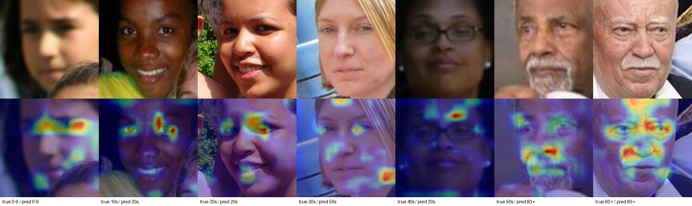

# 개발일지 13 — Gradio 시연 화면 + Grad-CAM 모듈

- **날짜**: 2026-11-27
- **프로젝트**: 얼굴 이미지 기반 나이대 분류 (인공지능 4조)
- **담당**: 임성빈 — 작은 CNN(4층), 시연 화면·Grad-CAM
- **작업 범위**: 얼굴 사진(업로드·웹캠) → 얼굴 검출 → 나이대 상위 3개 + Grad-CAM을 보여 주는 Gradio 시연 화면, 다른 분석에도 쓸 Grad-CAM 모듈
- **상태**: ✅ 완료 — 지금은 작은 CNN 가중치(학습률 1e-3, macro-F1 0.505)로 동작. 재학습 후 가중치 파일만 바꿔 끼우면 됨
- **결과 파일**: `시연/` (`app.py`, `gradcam.py`, `README.md`, `requirements.txt`)

---

## 1. 한 일

새 데이터셋으로 재학습하기 전에 **시연 화면을 먼저 완성**했다. 가중치는 `시연/weights/`에 두고 코드에서 경로만 가리키게 해서, 재학습 후에는 파일만 덮어쓰면 된다. 단계마다 실행해서 확인한 뒤 다음 단계로 넘어갔다.

| 단계 | 내용 | 확인 방법 |
|---|---|---|
| 1 | 모델 불러오기 + 전처리 + 예측 (`load_model`, `predict`) | `--image` 로 사진 한 장 상위 3개 출력, GPU·CPU 결과 같음 |
| 2 | Gradio 기본 화면 (업로드 + 웹캠 → 상위 3개) | 브라우저 |
| 3 | 얼굴 검출·자르기 (`detect_and_crop`, OpenCV Haar cascade 임시) | 얼굴 1개 / 2개 / 없음 사진, 테스트 사진 500장 검출률 |
| 4 | Grad-CAM 모듈 (`gradcam.py`) → 화면에 붙이기 | 히트맵 저장, 기울기 이론값 비교 |
| 5 | 모델 드롭다운 + ResNet-50·ConvNeXt 연결 (코드만) | 무작위 가중치 가짜 파일로 드롭다운·예측·Grad-CAM 동작 확인 |
| 6 | README·requirements 정리 | `pip install --dry-run` |

### 1-1. 설계에서 정한 것

- **SmallCNN은 복사하지 않고 import**: `작은CNN/CNN_4layers_unified.py`의 `SmallCNN`과 `val_transform`을 그대로 가져온다. 학습 코드가 `if __name__ == "__main__":` 안에 있어서 import해도 학습이 시작되지 않음을 먼저 확인했다. 전처리도 import라서 학습 때와 어긋날 수 없다.
- **팀원 모델 가중치 형식**: `step4_train.py`가 `{"model": state_dict, "model_name", "epoch"}`로 저장 → `"model"` 키가 있으면 그 안의 값을, 없으면(SmallCNN) 통째로 `load_state_dict`.
- **얼굴 검출은 함수 하나**(`detect_and_crop`)로 분리하고 `# TODO: 팀 전처리와 같은 검출·정렬 방법으로 교체` 주석을 남겼다.
- **얼굴 여백 0.15**: 학습 사진(224×224)에서 Haar 상자 너비가 사진 너비의 약 79%(중앙값, 200장) → 상자 + 양쪽 15%로 자르면 약 77%로 비슷해진다.
- **개인정보**: 사진은 메모리(PIL)로만 다룸, `delete_cache=(600, 600)`으로 Gradio 임시 파일 자동 삭제, `127.0.0.1`에서만 접속, `share=False`, Gradio 사용 통계 전송 끔.

### 1-2. Grad-CAM 대상 층

| 모델 | 대상 층 | 특징 맵 모양 |
|---|---|---|
| 작은 CNN | 4번째 블록 최종 출력 (`gap`의 입력) | (1, 256, 14, 14) |
| ResNet-50 | `layer4` 출력 | (1, 2048, 7, 7) |
| ConvNeXt-Tiny | `stages[-1]` 출력 | (1, 768, 7, 7) |

외부 라이브러리 없이 `register_forward_hook`(특징 맵)과 `register_full_backward_hook`(기울기)으로 직접 구현했다.

**검증**: 작은 CNN은 `gap → fc` 구조라서 대상 층 기울기가 이론적으로 모든 위치에서 `fc.weight[c] / 196`(196 = 14×14)이어야 한다. hook으로 잡은 기울기가 이 값과 정확히 일치했다.

---

## 2. 결과

- 시연 화면 캡처: `images/13_capture_gradio.png` (직접 캡처해서 추가)
- Grad-CAM 예시 (테스트 사진, 나이대마다 1장, 위 = 잘라낸 얼굴, 아래 = 히트맵): `images/13_gradcam_samples.png`

- **어린 나이대(0~9세, 10대)**: 주로 **눈 주변**을 본다.
- **50대·60세 이상**: **코 옆 팔자주름, 입 주변, 수염, 이마 주름**을 본다. 나이 판단에 쓸 만한 곳이다.
- **30대 → 50대로 틀린 사진**: 히트맵이 얼굴이 아니라 **오른쪽 아래 배경**에 몰려 있다. 얼굴과 상관없는 곳을 보고 틀리는 경우가 있다는 뜻 → 판단 근거 분석에서 더 살펴볼 것.

**얼굴 검출률** (테스트 사진 500장, 모두 얼굴로 꽉 찬 224×224):

| 방법 | 검출 |
|---|---:|
| Haar 기본 그대로 | 292장 (58%) |
| + 사진 둘레 테두리(긴 변의 25%) | 415장 (83%) |
| **+ alt2 → 옆얼굴 → 옆얼굴(좌우 반전) 순서로 다시 시도 (최종)** | **448장 (90%)** |

빈 사진·노이즈 사진은 세 cascade 모두 얼굴로 잡지 않았다.

---

## 3. 문제와 해결

| 문제 | 원인 | 해결 |
|---|---|---|
| 작업 폴더가 git 저장소가 아니고 구조도 다름 (`작은CNN/` 대신 `models/`) | 내 PC 작업 폴더는 저장소 정리 전 구조 | 저장소를 새로 클론해서 `시연/` 작성, 가중치는 `시연/weights/`로 복사 |
| `cv2.CascadeClassifier`가 없다는 에러 | 설치된 OpenCV 5.1에서 Haar cascade가 기본 패키지에서 빠짐 | `opencv-python` 4.14.0.94로 설치 (requirements에 이유 주석) |
| 얼굴로 꽉 찬 사진(데이터셋 사진)에서 검출률 58% | Haar는 얼굴 주변에 여유 공간이 있어야 잘 찾음 | 검출 전에 검은 테두리를 붙이고, 보조 cascade를 차례로 시도 → 90% |
| 요청한 대상 층 "conv4 ReLU 출력(14×14)"이 실제와 다름 | `forward`가 `pool(relu(bn4(conv4(x))))`라 ReLU 출력은 28×28, 14×14는 MaxPool 다음. `self.pool`은 4개 블록이 같이 써서 hook이 4번 불림 | 한 번만 불리는 `gap`의 **입력**(4번째 블록 최종 출력, 14×14)에 hook |
| `requirements.txt`의 `opencv-python==4.14.0` 설치 실패 | opencv-python 버전 번호는 4자리 (`4.14.0.94`) | `opencv-python==4.14.0.94` |
| ResNet-50 무작위 가중치로 Grad-CAM이 전부 0 | 학습 안 된 모델이라 점수를 올리는 위치가 없음 (ReLU 후 0) | 오류 아님. 모양 확인용으로만 사용, 실제 확인은 팀원 가중치로 |

---

## 4. 다음 할 일

- [ ] 팀원이 전처리 때 쓴 얼굴 검출·정렬 방법 확인 → `detect_and_crop` 교체 (남은 10%: 선글라스, 많이 돌아간 얼굴, 아주 어두운 사진)
- [ ] 새 데이터셋으로 작은 CNN 재학습 → `시연/weights/small_cnn_best.pth` 교체
- [ ] 팀원 `best.pt` 받아서 `resnet50_best.pt`, `convnext_tiny_best.pt`로 넣고 드롭다운·Grad-CAM 확인
- [ ] `gradcam.py`를 import해서 판단근거 분석 스크립트 작성 (나이대별 평균 히트맵, 얼굴 밖을 보고 틀린 사진 찾기)
- [ ] 시연 화면 캡처 `images/13_capture_gradio.png` 추가
