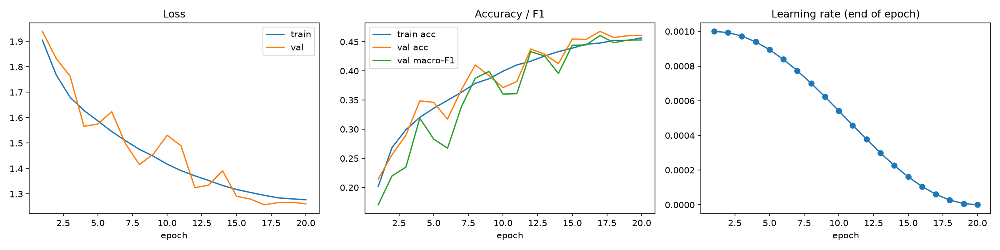
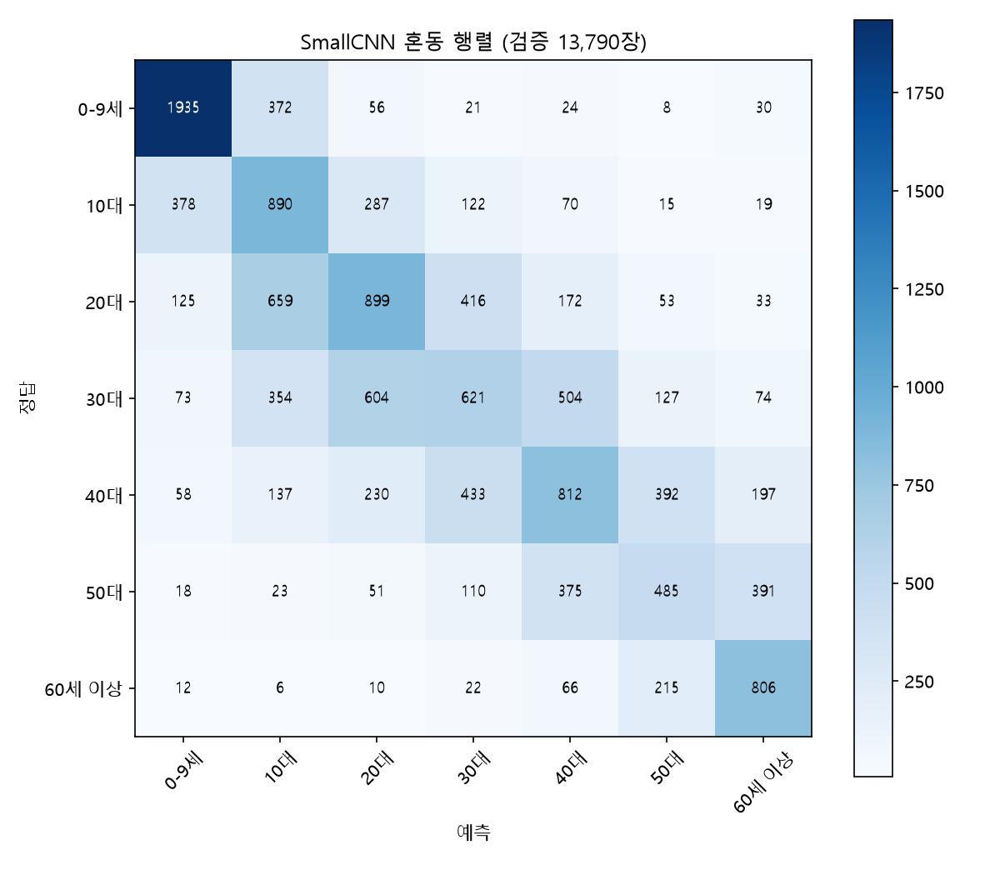

# 개발일지 14 — 새 데이터(splits_csv_v2)로 작은 CNN 다시 학습하기

- **날짜**: 2026-11-28
- **프로젝트**: 얼굴 이미지 기반 나이대 분류 (인공지능 4조)
- **담당**: 임성빈 — 작은 CNN(4층) 처음부터 학습 (사전학습 없는 비교 기준 모델)
- **작업 범위**: 새 분할 데이터(`splits_csv_v2`)에 맞게 학습·평가 코드 수정, 점검 실행, 20 에폭 본 학습, 검증 평가
- **상태**: ✅ 완료 — **최고 검증 macro-F1 0.461 (17 에폭)**
- **결과 파일**: 내 PC `results/small_cnn_v2_lr1e-3/` (평가는 `eval_val/`). results 폴더는 저장소에 올리지 않음
- **시험 데이터(test.csv)는 사용하지 않음**

---

## 1. 한 일

### 1-1. 새 데이터 구성

| 항목 | 내용 |
|---|---|
| 사진 폴더 | `division_224AFAD-X/` (training / validation / testing, 나이대 폴더 `0_9, 10s, 20s, 30s, 40s, 50s, 60plus`) — 저장소에는 올리지 않음 |
| 분할 CSV | **저장소 최상위 `splits_csv_v2/`** (train / val / test.csv). 모든 모델이 같이 쓰도록 최상위에 둠 |
| 만든 코드 | `ResNet50/code/make_split_csv.py` |
| CSV 열 | `path, band, source, race_group` (`source`, `race_group`은 현재 모두 `unknown`) |
| `path` 기준 | **사진 폴더 최상위 기준** (예: `training/0_9/00000A02.jpg`) — 예전 `splits_csv`는 분할 폴더 기준(`0 9/xxx.jpg`)이라 다름 |

| 분할 | 전체 | 0-9세 | 10대 | 20대 | 30대 | 40대 | 50대 | 60세 이상 |
|---|---:|---:|---:|---:|---:|---:|---:|---:|
| train | 64,353 | 11,416 | **8,310** | 11,000 | 11,000 | 10,542 | 6,781 | 5,304 |
| val | 13,790 | 2,446 | 1,781 | 2,357 | 2,357 | 2,259 | 1,453 | 1,137 |
| test | 13,789 | 2,447 | 1,780 | 2,357 | 2,357 | 2,259 | 1,453 | 1,136 |
| (참고) 예전 train | 71,735 | 11,561 | 12,000 | 12,000 | 12,000 | 12,104 | 6,801 | 5,269 |

- 파일 누락 0장, 분할 사이 중복 0장 (같은 경로·같은 파일 이름 모두 확인)
- **10대가 12,000장 → 8,310장으로 크게 줄었다.** 그래서 나이대별 손실 가중치도 바뀐다.

| 손실 가중치 | 0-9세 | 10대 | 20대 | 30대 | 40대 | 50대 | 60세 이상 |
|---|---:|---:|---:|---:|---:|---:|---:|
| 예전 `splits_csv` | 0.89 | 0.85 | 0.85 | 0.85 | 0.85 | 1.51 | 1.94 |
| **v2** | 0.81 | **1.11** | 0.84 | 0.84 | 0.87 | 1.36 | 1.73 |

### 1-2. 코드 수정 (`작은CNN/CNN_4layers_unified.py`, `작은CNN/eval_small_cnn.py`)

| 파일 | 바뀐 것 |
|---|---|
| `CNN_4layers_unified.py` | `--csv-dir` (기본 `splits_csv`), `--image-root` (주면 train/val 모두 이 폴더 기준, 안 주면 예전 `data/training` 방식), `--no-augment` 추가 |
| | `--lr` 기본값 1e-4 → **1e-3** (작은 CNN만 다른 조건, 개발일지 12) |
| | 시작할 때 CSV 경로·사진 폴더·증강 여부·나이대별 장수·가중치 출력, `config.json`에도 저장 |
| | 팀 가중치 기준값을 **CSV 폴더 이름별**로 둠 (`splits_csv` = 예전 값, `splits_csv_v2` = 새 값). 다르면 학습 전에 멈춤, 기준값이 없는 폴더는 비교만 생략 |
| `eval_small_cnn.py` | `--csv-dir`, `--image-root` 추가 (주면 `val.csv`로 평가, 안 주면 예전 폴더(ImageFolder) 방식 그대로) |
| | CSV 모드에서는 `best_epoch`을 가중치 옆 `config.json`에서 읽고, 예전 모델 기록값 비교는 생략 |
| | 혼동 행렬 제목의 장수를 고정값(15,288) 대신 실제 장수로 |

### 1-3. 실행 (저장소 기준, `작은CNN/` 폴더에서)

```
python CNN_4layers_unified.py --csv-dir ..\splits_csv_v2 --image-root <사진 폴더>\division_224AFAD-X --out-dir results\small_cnn_v2_lr1e-3
python eval_small_cnn.py --csv-dir ..\splits_csv_v2 --image-root <사진 폴더>\division_224AFAD-X --weights results\small_cnn_v2_lr1e-3\small_cnn_best.pth --out-dir results\small_cnn_v2_lr1e-3\eval_val --workers 4
```

나머지 조건은 팀 공통 조건 그대로다: 224×224, ImageNet 정규화, 증강(확대·자르기, 좌우 반전, 회전 ±10°, 밝기·대비 ±20%), 가중 교차 엔트로피, AdamW(wd 0.05), 1 에폭 워밍업 + 코사인, AMP, 배치 64, 20 에폭, 시드 42, 검증 macro-F1 최고 에폭 선택.

---

## 2. 결과

### 2-1. 점검 실행

| 점검 | 결과 |
|---|---|
| 100장 과적합 (`--subset 100 --epochs 100`) | 학습 손실 2.07 → **0.249**, 학습 정확도 0.96. 예전 데이터 같은 점검(0.275, 0.98)과 비슷 → 데이터 읽기 정상 |
| 1 에폭 (`--stop-after 1`) | 에러 없음, 275초, GPU 메모리 최대 약 3.8GB / 8GB, 60세 이상 가중치가 가장 큼(1.73) |

### 2-2. 본 학습 (20 에폭, 67분)



| 에폭 | train loss | train acc | val loss | val acc | off1 | **val F1** |
|---:|---:|---:|---:|---:|---:|---:|
| 1 | 1.905 | 0.202 | 1.940 | 0.215 | 0.506 | 0.170 |
| 4 | 1.628 | 0.320 | 1.566 | 0.349 | 0.673 | 0.319 |
| 8 | 1.476 | 0.379 | 1.416 | 0.410 | 0.762 | 0.387 |
| 12 | 1.371 | 0.417 | 1.325 | 0.438 | 0.807 | 0.433 |
| 15 | 1.318 | 0.439 | 1.291 | 0.455 | 0.820 | 0.444 |
| **17** | 1.295 | 0.448 | 1.257 | 0.468 | 0.832 | **0.461 ★** |
| 20 | 1.277 | 0.457 | 1.261 | 0.461 | 0.825 | 0.453 |

- 학습 정확도(0.457)가 검증 정확도(0.461)와 거의 같다 → 과적합은 없고, 예전처럼 **아직 덜 배운 상태(과소적합)**다.
- 3·4 에폭이 494초·348초로 느렸던 것은 새 사진 폴더를 처음 읽는 동안의 디스크 속도 때문으로 보인다 (7 에폭부터 약 145~172초).
- 전체 로그: `2026-11-28_14_새데이터v2_재학습_실행로그.txt`

### 2-3. 검증 평가 (`eval_small_cnn.py`, 13,790장)

| 지표 | 값 |
|---|---:|
| 정확도 | **0.468** |
| 한 칸 차이 정확도 | **0.832** |
| macro-F1 | **0.461** |

학습 로그의 0.4608과 평가 결과의 0.4605가 조금 다른 이유: 학습 중 검증은 혼합 정밀도(AMP), 평가 코드는 float32로 계산한다.

| 나이대 | 정밀도 | 재현율 | F1 | 실제 장수 | 예측 장수 | 쏠림 (예측 ÷ 실제) |
|---|---:|---:|---:|---:|---:|---:|
| 0-9세 | 0.745 | 0.791 | 0.767 | 2,446 | 2,599 | 1.06 |
| 10대 | 0.365 | 0.500 | 0.422 | 1,781 | 2,441 | **1.37** |
| 20대 | 0.421 | 0.381 | 0.400 | 2,357 | 2,137 | 0.91 |
| 30대 | 0.356 | 0.263 | 0.303 | 2,357 | 1,745 | **0.74** |
| 40대 | 0.401 | 0.359 | 0.379 | 2,259 | 2,023 | 0.90 |
| 50대 | 0.375 | 0.334 | 0.353 | 1,453 | 1,295 | 0.89 |
| 60세 이상 | 0.520 | 0.709 | 0.600 | 1,137 | 1,550 | **1.36** |



- 틀린 7,342장 중 **68.5%가 바로 옆 나이대**다.
- 나이를 많게 예측한 비율 24.5%, 적게 예측한 비율 28.7%.
- **10대로 너무 많이 예측한다(1.37배).** 20대 사진 659장, 30대 사진 354장이 10대로 예측됐다 (예전 모델은 20대 → 10대가 275장).
- 30대는 여전히 가장 어렵다 (재현율 0.263). 30대 사진은 20대(604)·40대(504)로 많이 흩어졌다.

### 2-4. 예전 데이터 결과와 나란히 보기

> ⚠ **데이터가 달라 직접 비교할 수 없다. 참고용이다.** 사진 구성·장수·검증 세트가 모두 다르다. 같은 코드·같은 조건(1e-3 + 코사인)으로 학습했다는 점만 같다.

| | 예전 데이터 (개발일지 12) | v2 |
|---|---:|---:|
| 검증 장수 | 15,288 | 13,790 |
| 정확도 | 0.518 | 0.468 |
| 한 칸 차이 정확도 | 0.829 | 0.832 |
| macro-F1 | 0.505 | 0.461 |

| 나이대 | 예전 F1 | v2 F1 | 예전 재현율 | v2 재현율 | 예전 정밀도 | v2 정밀도 | 예전 쏠림 | v2 쏠림 |
|---|---:|---:|---:|---:|---:|---:|---:|---:|
| 0-9세 | 0.798 | 0.767 | 0.844 | 0.791 | 0.757 | 0.745 | 1.12 | 1.06 |
| 10대 | **0.681** | **0.422** | 0.679 | 0.500 | 0.683 | 0.365 | 0.99 | 1.37 |
| 20대 | 0.467 | 0.400 | 0.503 | 0.381 | 0.435 | 0.421 | 1.16 | 0.91 |
| 30대 | 0.321 | 0.303 | 0.286 | 0.263 | 0.364 | 0.356 | 0.79 | 0.74 |
| 40대 | 0.334 | 0.379 | 0.285 | 0.359 | 0.404 | 0.401 | 0.70 | 0.90 |
| 50대 | 0.347 | 0.353 | 0.382 | 0.334 | 0.318 | 0.375 | 1.20 | 0.89 |
| 60세 이상 | 0.589 | 0.600 | 0.668 | 0.709 | 0.526 | 0.520 | 1.27 | 1.36 |

- macro-F1 차이(0.505 → 0.461)는 대부분 **10대 F1(0.681 → 0.422)**에서 나온다. 나머지 나이대는 ±0.07 안이다.
- 한 칸 차이 정확도는 거의 같다(0.829 / 0.832).
- 10대가 떨어진 이유는 아직 확인하지 않았다. 추정 두 가지: ① 10대 학습 사진이 12,000 → 8,310장으로 줄었다. ② 그 대신 가중치가 0.85 → 1.11로 커져 10대 예측이 많아졌다(정밀도 하락). 예전 데이터의 10대 사진 구성(출처)이 v2와 다를 가능성도 있다.

---

## 3. 문제와 해결

| 문제 | 원인 | 해결 |
|---|---|---|
| v2 CSV의 `path`를 예전 방식으로 읽으면 경로가 틀림 | v2 `path`는 사진 폴더 최상위 기준(`training/0_9/...`), 예전은 분할 폴더 기준(`0 9/...`) | `--image-root`를 주면 train/val 모두 그 폴더를 기준으로 읽게 함 |
| 기존 코드는 가중치가 팀 값과 다르면 학습을 멈춤 | 팀 값은 예전 데이터 장수로 계산한 값 | 기준값을 CSV 폴더 이름별로 둠 (`splits_csv` / `splits_csv_v2`) |
| 본 학습 로그에 `팀 가중치 비교: 불일치`가 찍혀 있음 | 학습할 때는 기준값이 아직 예전 값 하나뿐이었음 (비교만 하고 계속 학습하던 중간 버전) | 학습 후 위처럼 고침. 두 데이터 모두 **일치**로 나오는 것을 확인함. 학습에 쓴 가중치 자체는 같음 |
| 100장 점검의 학습 손실이 0까지 안 내려감(0.249) | 학습률이 코사인으로 0까지 줄고 weight decay·Dropout이 있음 (추정) | 예전 데이터 같은 점검(0.275)과 비슷해 정상으로 판단 |
| cmd에는 `tee`가 없어 화면 출력과 로그 파일 저장을 동시에 못 함 | 윈도우 cmd 기본 명령에 없음 | Git에 들어 있는 `C:\Program Files\Git\usr\bin\tee.exe` 사용, `chcp 65001` + `PYTHONIOENCODING=utf-8`로 한글·기호 안 깨지게 |

---

## 4. 다음 할 일

- [ ] 팀 비교표에 v2 기준 작은 CNN 값(macro-F1 0.461) 넣기 — 팀원 모델도 v2로 다시 학습했는지 확인
- [ ] 10대 성능 하락 원인 확인: 예전 데이터와 v2의 10대 사진 구성 비교, 20대 → 10대 오답 사진 살펴보기
- [ ] (선택) 에폭을 30~40으로 늘려 학습 (아직 과소적합)
- [ ] `eval_small_cnn.py` 폴더 모드의 기록값 비교·`best_epoch` 고정값을 옵션으로 바꾸기 (개발일지 12에서 이어짐, CSV 모드는 해결)
- [ ] 시험 데이터 평가는 팀이 최종 모델을 정한 뒤 **한 번만**
