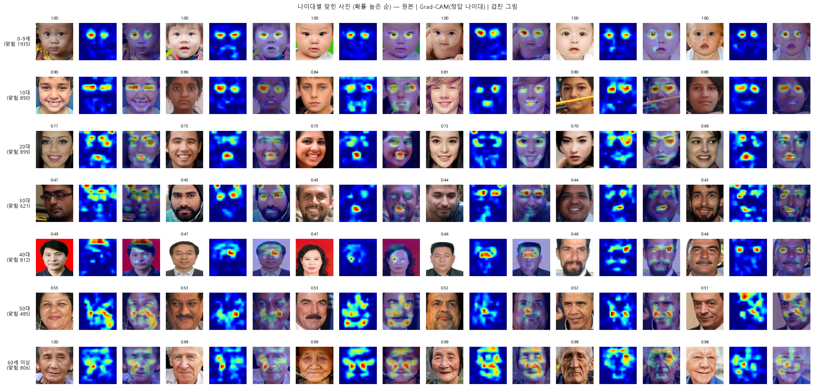
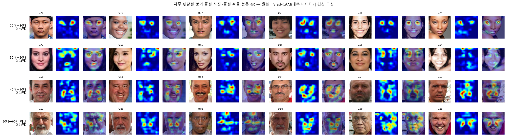
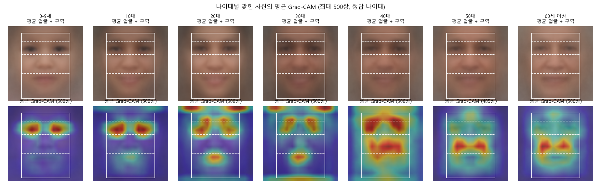
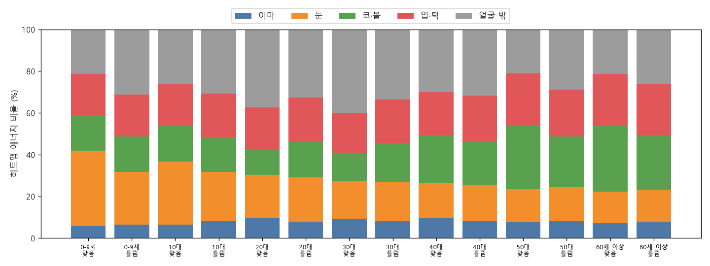

# 개발일지 15 — Grad-CAM으로 작은 CNN의 판단 근거 보기 (v2 가중치)

- **날짜**: 2026-11-28
- **프로젝트**: 얼굴 이미지 기반 나이대 분류 (인공지능 4조)
- **담당**: 임성빈 — 작은 CNN(4층)
- **작업 범위**: v2 가중치(17 에폭, 검증 macro-F1 0.461)의 Grad-CAM 분석 — 나이대별 맞힌 사진, 자주 헷갈린 쌍, 평균 히트맵, 얼굴 구역별 비율
- **상태**: ✅ 완료
- **결과 파일**: 내 PC `results/small_cnn_v2_lr1e-3/gradcam/` (correct_by_band.png, confusion_pairs.png, mean_cam_by_band.png, region_ratio.csv, region_ratio.png). results 폴더는 저장소에 올리지 않음
- **시험 데이터(test.csv)는 사용하지 않음** — 코드에서도 `--csv` 파일 이름에 `test`가 있으면 멈춤

---

## 1. 한 일

### 1-1. 코드: `작은CNN/gradcam_analysis.py` (새 파일)

| 항목 | 내용 |
|---|---|
| Grad-CAM | `시연/gradcam.py`의 `GradCAM`, `target_layer`, `overlay`를 **import해서 그대로 사용** (복사 안 함) |
| 대상 층 | `target_layer(model, "small_cnn")` = `gap`의 입력 = **conv4 블록 최종 출력(ReLU → MaxPool 후), 256×14×14**. `pool` 모듈은 4개 블록이 같이 써서 hook을 걸면 4번 불리기 때문 (개발일지 13) |
| 모델·데이터 | `CNN_4layers_unified.py`의 `SmallCNN`, `FaceCSVDataset`, `val_transform` (학습 때와 같은 전처리) |
| 얼굴 검출 | 안 씀 — v2 사진은 이미 얼굴 정렬·224×224 |
| 순서 점검 | `predictions.csv`와 `val.csv`의 장수·경로 순서·정답 번호가 같은지 assert |
| 옵션 | `--weights --csv --image-root --pred-csv --out-dir --per-band(6) --seed(42) --device --parts(1234)` |

| 번호 | 결과 | 사진 고르는 법 | Grad-CAM 나이대 |
|---|---|---|---|
| 1 | `correct_by_band.png` | 나이대별 맞힌 사진 중 정답 확률 높은 순 6장 | 정답(=예측) |
| 2 | `confusion_pairs.png` | 20대→10대, 30대→20대, 40대→50대, 50대→60세 이상의 틀린 사진, 틀린 나이대 확률 높은 순 6장 | 예측(틀린 나이대) |
| 3 | `mean_cam_by_band.png` | 나이대별 맞힌 사진 최대 500장 (시드 42 무작위) 히트맵 평균 + 평균 얼굴 위 구역선 | 정답(=예측) |
| 4 | `region_ratio.csv/png` | 나이대 × 맞음/틀림, 각 최대 500장 | 예측 |

- 4번 구역 비율 = 구역 안 히트맵 값의 합 ÷ 전체 합 (사진마다 계산 후 평균).
- **틀린 사진의 히트맵은 "틀린 나이대를 고른 근거"**다 (정답 나이대 근거가 아님).

### 1-2. 얼굴 구역 경계 (코드 상단 상수, 224×224 픽셀)

| 구역 | 범위 | 면적 비율 |
|---|---|---:|
| 이마 | x 40~184, y 20~44 | 6.9% |
| 눈 (눈썹 포함) | x 40~184, y 44~84 | 11.5% |
| 코·볼 | x 40~184, y 84~140 | 16.1% |
| 입·턱 | x 40~184, y 140~214 | 21.2% |
| 얼굴 밖 (배경·머리카락) | 위 상자 밖 전부 | **44.3%** |

- 경계 근거: 검증 사진 2,000장 평균 얼굴의 줄별 밝기. 눈썹·눈의 어두운 띠 y≈44~84 (눈 중심 ≈64), 콧구멍 ≈124, 입 ≈152.
- **면적 비율 = 히트맵이 사진 전체에 고르게 퍼졌을 때 나오는 값.** 표의 값은 이것과 비교해서 읽어야 한다 (예: 얼굴 밖 44.3%보다 낮으면 얼굴 밖을 면적보다 덜 봄).

### 1-3. 실행 (CPU, 사진·results가 있는 프로젝트 폴더에서)

```
python <저장소>\작은CNN\gradcam_analysis.py --weights results\small_cnn_v2_lr1e-3\small_cnn_best.pth ^
  --csv splits_csv_v2\val.csv --image-root division_224AFAD-X ^
  --pred-csv results\small_cnn_v2_lr1e-3\eval_val\predictions.csv ^
  --out-dir results\small_cnn_v2_lr1e-3\gradcam --device cpu --parts 1     (이후 --parts 234)
```

- 측정: Grad-CAM 1장 CPU 26ms / GPU 4ms. 3·4번(약 6,800장) CPU로 약 3.5분. 차이가 몇 분뿐이라 CPU 사용 (3. 문제와 해결 참고).
- 전체 로그: `2026-11-28_15_GradCAM_판단근거분석_실행로그.txt`

---

## 2. 결과 그림

### 2-1. 나이대별 맞힌 사진 (확률 높은 순)



### 2-2. 자주 헷갈린 쌍의 틀린 사진



혼동 행렬에서 자동으로 뽑은 상위 4쌍은 미리 정한 목록과 **다르다**.

| 순위 | 자동 상위 쌍 | 장수 | 미리 정한 목록에 있음 |
|---:|---|---:|:---:|
| 1 | 20대 → 10대 | 659 | ✅ |
| 2 | 30대 → 20대 | 604 | ✅ |
| 3 | 30대 → 40대 | 504 | ❌ |
| 4 | 40대 → 30대 | 433 | ❌ |
| – | 40대 → 50대 (미리 정한 쌍) | 392 | |
| – | 50대 → 60세 이상 (미리 정한 쌍) | 391 | |

그림은 미리 정한 4쌍으로 그렸다.

### 2-3. 나이대별 평균 Grad-CAM (맞힌 사진, 최대 500장)



### 2-4. 얼굴 구역별 히트맵 비율



| 나이대 | 결과 | 장수 | 이마 | 눈 | 코·볼 | 입·턱 | 얼굴 밖 |
|---|---|---:|---:|---:|---:|---:|---:|
| (면적 비율) | | | 6.9 | 11.5 | 16.1 | 21.2 | 44.3 |
| 0-9세 | 맞음 | 500 | 5.8 | **36.1** | 17.1 | 19.6 | 21.4 |
| 0-9세 | 틀림 | 500 | 6.4 | 25.3 | 17.1 | 19.9 | 31.3 |
| 10대 | 맞음 | 500 | 6.4 | **30.3** | 16.9 | 20.3 | 26.0 |
| 10대 | 틀림 | 500 | 8.1 | 23.5 | 16.6 | 21.0 | 30.6 |
| 20대 | 맞음 | 500 | 9.5 | 20.8 | 12.6 | 19.7 | 37.5 |
| 20대 | 틀림 | 500 | 7.9 | 21.3 | 16.9 | 21.2 | 32.7 |
| 30대 | 맞음 | 500 | 9.4 | 17.8 | 13.7 | 19.1 | **40.0** |
| 30대 | 틀림 | 500 | 8.2 | 18.8 | 18.4 | 21.1 | 33.4 |
| 40대 | 맞음 | 500 | 9.6 | 16.9 | 22.8 | 20.6 | 30.1 |
| 40대 | 틀림 | 500 | 8.1 | 17.5 | 20.5 | 22.1 | 31.8 |
| 50대 | 맞음 | 485 | 7.7 | 15.8 | **30.7** | 24.6 | 21.2 |
| 50대 | 틀림 | 500 | 8.1 | 16.3 | 24.4 | 22.2 | 28.9 |
| 60세 이상 | 맞음 | 500 | 7.1 | 15.1 | **31.6** | 24.9 | 21.3 |
| 60세 이상 | 틀림 | 331 | 7.8 | 15.5 | 26.1 | 24.6 | 26.1 |

(단위 %. 50대 맞음은 전체가 485장, 60세 이상 틀림은 331장이라 500장보다 적음)

---

## 3. 관찰

> 그림·표에서 보이는 **사실**과 **추측**을 나눠 적는다. 추측은 따로 확인하지 않았다.

### 3-1. 사실

**나이대가 올라갈수록 보는 곳이 눈 → 코·볼로 옮겨 간다**
- 평균 히트맵: 0-9세·10대는 **두 눈**에 뜨거운 점 2개가 뚜렷하다. 20대·30대는 눈(눈썹 쪽)과 **입 가운데**에 점이 있다. 40대는 눈썹·눈과 코·볼에 넓게 퍼진다. 50대·60세 이상은 **코 양옆·볼(입 경계선 바로 위)**이 가장 뜨겁고 눈은 약하다.
- 표(맞음): 눈 비율 36.1 → 30.3 → 20.8 → 17.8 → 16.9 → 15.8 → 15.1% (나이대 순으로 계속 줄어듦). 코·볼 비율은 17.1%(0-9세)에서 31.6%(60세 이상)로 늘어남.
- 0-9세 맞힌 사진 상위 6장은 모두 확률 1.00이고, 6장 모두 히트맵이 두 눈에 몰려 있다.

**20대·30대 맞힌 사진은 얼굴 밖 비율이 가장 높다**
- 얼굴 밖(맞음): 20대 37.5%, 30대 40.0% — 다른 나이대(21.2~30.1%)보다 높다. 그래도 면적 비율(44.3%)보다는 낮다.
- 평균 히트맵에서 20대는 **사진 위쪽 두 모서리**, 30대는 **사진 아래 가장자리**에 뜨거운 띠가 있다.
- 30대·40대는 가장 자신 있게 맞힌 사진도 확률이 0.43~0.49이다 (0-9세 1.00, 60세 이상 0.98~1.00).
- 40대 맞힌 상위 6장 중 3장은 단색(빨강·흰색) 배경의 증명사진 형태이고, 그중 첫 장은 머리카락·배경 경계에 히트맵이 가장 강하다.

**맞음 vs 틀림의 얼굴 밖 비율은 나이대마다 방향이 다르다**
- 틀림이 더 높음: 0-9세(31.3 vs 21.4), 10대(30.6 vs 26.0), 50대(28.9 vs 21.2), 60세 이상(26.1 vs 21.3).
- 틀림이 더 낮음: 20대(32.7 vs 37.5), **30대(33.4 vs 40.0)**.
- 40대는 거의 같음(31.8 vs 30.1).
- 0-9세·10대는 틀린 사진의 눈 비율이 맞힌 사진보다 낮다 (25.3 vs 36.1, 23.5 vs 30.3).

**헷갈린 쌍의 틀린 사진**
- 20대 → 10대 (10대 근거): 6장 모두 히트맵이 **두 눈**에 몰려 있다. 평균 히트맵의 0-9세·10대 모양과 같다.
- 30대 → 20대 (20대 근거): 눈·눈썹과 입술에 점이 있다. 20대 평균 히트맵 모양과 비슷하다.
- 40대 → 50대 (50대 근거): 볼·코 옆·콧수염 쪽으로 여러 점이 흩어져 있다.
- 50대 → 60세 이상 (60세 이상 근거): 확률 0.86~0.90으로 자신 있게 틀렸다. 6장 중 3장은 흰 수염·흰머리가 보이는 사진이다. 히트맵은 코 양옆·볼에 있다.

### 3-2. 추측 (확인 안 함)

- 추측: 모델은 어린 나이대를 **눈의 비율·모양**으로, 많은 나이대를 **팔자주름·볼 주변의 주름이나 처짐**으로 구분하는 것 같다. 20대 → 10대 오답이 많은 것(659장)도 눈이 큰(또는 눈에 띄는) 20대 얼굴을 10대 근거로 본 결과일 수 있다.
- 추측: 20대 평균 히트맵의 위쪽 모서리, 30대의 아래 가장자리 띠는 사진 테두리(여백·패딩)나 특정 출처 사진의 공통 형식일 수 있다. 이 경우 모델이 얼굴이 아닌 **사진 형식**을 나이 단서로 쓰고 있는 것이다. 40대 증명사진도 같은 경우일 수 있다.
- 추측: 50대 → 60세 이상 오답은 흰 수염·흰머리처럼 실제 나이보다 늙어 보이는 특징 때문일 수 있다 (6장만 본 것이라 일반화 못 함).
- 30대 오답의 얼굴 밖 비율이 맞힌 사진보다 **낮으므로**, "30대는 배경 때문에 틀린다"는 이 표로는 뒷받침되지 않는다.

---

## 4. 문제와 해결

| 문제 | 원인 | 해결 |
|---|---|---|
| 작업 중 화면이 나가 강제 재부팅함 (03:07 무렵 시스템 멈춤) | 확인 못 함. 그래픽 드라이버 리셋 기록(TDR)은 없음. GPU로 학습·평가를 이어서 돌리던 중이었음 | Grad-CAM은 사진 몇천 장뿐이라 `--device cpu`로 실행 (GPU 대비 약 3분 더 걸림) |
| 처음 구역 경계(이마|눈 75, 눈|코 115, 코|입 155)로는 눈이 '이마' 구역에 들어감 → 0-9세 '이마' 34% | 경계를 눈대중으로 정함. 평균 얼굴 그림의 구역선으로 확인해 보니 눈이 첫 선에 걸침 | 평균 얼굴 2,000장의 줄별 밝기로 눈·코·입 위치를 재서 44 / 84 / 140으로 고치고 3·4번 다시 실행 |
| 지시서에는 대상 층이 "conv4", `시연/gradcam.py`는 `gap` 입력을 봄 | `pool`을 4개 블록이 같이 써서 hook이 4번 불리는 문제를 피하려고 gap 입력(=conv4 블록 최종 출력)을 씀 | `gradcam.py`를 그대로 import (conv4 블록 출력이라 같은 블록, 크기만 28×28 → 14×14) |
| 자동 상위 혼동 쌍이 미리 정한 목록과 다름 | 30대↔40대 오답(504, 433)이 40대→50대(392), 50대→60세 이상(391)보다 많음 | 그림은 미리 정한 쌍으로 그리고, 실행할 때 경고를 출력하고 일지에 기록 |

---

## 5. 다음 할 일

- [ ] 20대 평균 히트맵 위쪽 모서리, 30대 아래 가장자리에 무엇이 있는지 확인 — 해당 사진들을 출처별로 모아 보기 (테두리·패딩인지)
- [ ] 30대 ↔ 40대 헷갈린 쌍(504, 433장)도 2번 그림에 추가할지 팀과 정하기
- [ ] 구역 비율을 면적 비율로 나눈 값(면적 대비 몇 배를 보는지)도 표에 넣을지 검토
- [ ] 팀원 모델(ResNet50, ConvNeXt)도 같은 코드로 비교 — `target_layer`에 이미 있음
- [ ] 시험 데이터 평가는 팀이 최종 모델을 정한 뒤 **한 번만**
