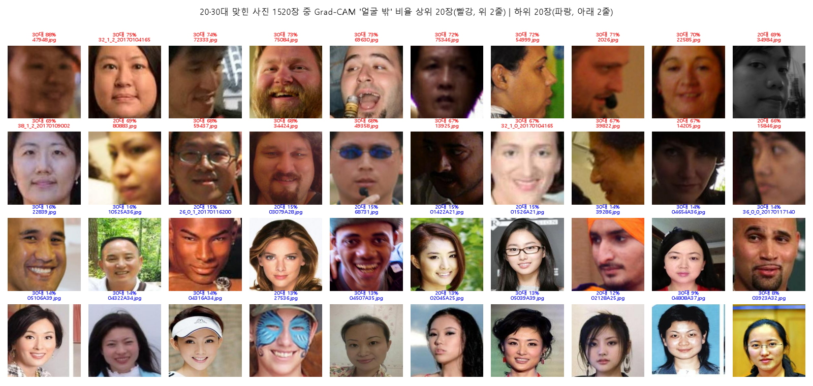

# 개발일지 16 — 20·30대 가장자리 Grad-CAM 원인 확인

- **날짜**: 2026-11-28
- **프로젝트**: 얼굴 이미지 기반 나이대 분류 (인공지능 4조)
- **담당**: 임성빈 — 작은 CNN(4층)
- **작업 범위**: 개발일지 15의 다음 할 일 — 20·30대 평균 Grad-CAM의 가장자리 열점이 무엇 때문인지 확인, 가장자리를 가렸을 때 예측 변화
- **상태**: ✅ 완료 — **검은 테두리·여백은 없었다. '얼굴 밖' 비율이 높은 사진은 얼굴이 화면을 꽉 채운(크게 잘린) 사진이었다**
- **결과 파일**: 내 PC `results/small_cnn_v2_lr1e-3/gradcam/edge/` (edge_per_image.csv, edge_groups.csv, edge_quartile_source.csv, edge_top_bottom.png, mask_recall.csv)
- **시험 데이터(test.csv)는 사용하지 않음. 학습은 다시 하지 않음**

---

## 1. 한 일

### 1-1. 코드: `작은CNN/edge_check.py` (새 파일)

| 번호 | 하는 일 |
|---|---|
| 1 | 20·30대 **맞힌 사진 전체 1,520장**(20대 899, 30대 621)의 사진별 Grad-CAM '얼굴 밖' 비율 (정답 나이대 기준, 구역은 개발일지 15와 같음) |
| 2 | 얼굴 밖 비율 상위 20장 / 하위 20장 원본 격자 |
| 3 | 두 그룹의 사진 특징 비교: 가장자리 8픽셀 띠의 밝기·표준편차, 검은 테두리(가장자리 절반 이상이 밝기 15 미만), OpenCV Haar 얼굴 폭, 파일 이름 형식 |
| 4 | 검증 사진 13,790장 전체의 **가장자리 10%(각 변 22픽셀)를 회색(128)으로 가리고** 다시 예측 → 나이대별 재현율 전후 비교 |

- Grad-CAM은 `시연/gradcam.py`, 데이터·모델 읽기와 구역 마스크는 `gradcam_analysis.py`를 import해서 그대로 사용.
- 파일 이름 형식은 4가지로 나눴다. 출처 데이터셋은 이름만으로 단정하지 않는다.

| 형식 | 예 | val 전체 장수 |
|---|---|---:|
| 숫자5자리 | `34984.jpg` | 8,566 |
| UTKFace형식 (나이_성별_인종_날짜) | `32_1_2_20170104165….jpg.chip.jpg` | 2,628 |
| 숫자A나이형식 (사람번호 A 나이) | `04808A37.jpg` | 1,540 |
| 숫자4자리이하 | `2026.jpg` | 1,056 |

> 숫자A나이형식은 FG-NET과 같은 이름 규칙이지만, FG-NET은 1,002장뿐이고 이 형식은 val에만 1,540장이라 FG-NET이라고 단정하지 않았다.
>
> **[개발일지 17에서 정정]** 사람번호는 "05106까지"가 아니라 **최대 13,320**이다 (격자에 보인 사진만 보고 잘못 적음). 팀 전처리 코드(`AAF.py`)로 확인한 결과 숫자A나이형식 = **AAF(All-Age-Faces)**, 숫자 이름(숫자5자리·숫자4자리이하) = **FairFace**, `.chip.jpg` = **UTKFace**이다.

### 1-2. 실행 (CPU, 프로젝트 폴더에서)

```
python <저장소>\작은CNN\edge_check.py --weights results\small_cnn_v2_lr1e-3\small_cnn_best.pth ^
  --csv splits_csv_v2\val.csv --image-root division_224AFAD-X ^
  --pred-csv results\small_cnn_v2_lr1e-3\eval_val\predictions.csv ^
  --out-dir results\small_cnn_v2_lr1e-3\gradcam\edge --device cpu
```

전체 로그: `2026-11-28_16_가장자리_GradCAM_원인확인_실행로그.txt`

---

## 2. 결과

### 2-1. 얼굴 밖 비율 상위 20장 / 하위 20장



위 2줄(빨강) = 얼굴 밖 비율 상위 20장 (66~88%), 아래 2줄(파랑) = 하위 20장 (8~16%).

### 2-2. 두 그룹 비교 (`edge_groups.csv`)

| | 상위 20 | 하위 20 | 20·30대 맞힘 전체 1,520 |
|---|---:|---:|---:|
| 얼굴 밖 비율 평균 (%) | 70.6 | 13.6 | 38.5 |
| 가장자리 밝기 (0~255) | **70.2** | **133.2** | 89.5 |
| 가장자리 밝기 표준편차 | 47.0 | 52.5 | 52.5 |
| 검은 테두리 장수 | **0** | **0** | 53 |
| Haar 얼굴 검출 장수 | **8 / 20** | **16 / 20** | 922 |
| 검출된 얼굴 폭 평균 (px, 224 기준) | 167.6 | 139.5 | 169.7 |
| 20대 / 30대 | 4 / 16 | 8 / 12 | 899 / 621 |
| 숫자5자리 | **16** | 4 | 980 |
| UTKFace형식 | 3 | 2 | 314 |
| 숫자A나이형식 | **0** | **14** | 109 |
| 숫자4자리이하 | 1 | 0 | 117 |

얼굴 밖 비율을 4등분했을 때 출처 형식 비율 (`edge_quartile_source.csv`, 각 380장, %):

| 사분위 | 숫자5자리 | UTKFace형식 | 숫자A나이형식 | 숫자4자리이하 |
|---|---:|---:|---:|---:|
| Q1 (얼굴 밖 낮음) | 57.4 | 16.8 | **18.9** | 6.8 |
| Q2 | 58.7 | 25.5 | 5.5 | 10.3 |
| Q3 | 67.9 | 22.6 | 2.6 | 6.8 |
| Q4 (얼굴 밖 높음) | **73.9** | 17.6 | **1.6** | 6.8 |

### 2-3. 가장자리 10% 회색으로 가리고 다시 예측 (`mask_recall.csv`, 13,790장)

| 나이대 | 장수 | 재현율 원본 | 재현율 가림 | 차이 | 예측 장수 원본 → 가림 |
|---|---:|---:|---:|---:|---|
| 0-9세 | 2,446 | 0.791 | 0.623 | **−0.168** | 2,599 → 1,776 |
| 10대 | 1,781 | 0.500 | 0.526 | +0.026 | 2,441 → 2,583 |
| **20대** | 2,357 | 0.382 | 0.205 | **−0.177** | 2,138 → 1,009 |
| **30대** | 2,357 | 0.264 | 0.256 | **−0.007** | 1,744 → 1,861 |
| 40대 | 2,259 | 0.360 | 0.461 | +0.102 | 2,023 → **3,357** |
| 50대 | 1,453 | 0.334 | 0.420 | +0.086 | 1,295 → 1,896 |
| 60세 이상 | 1,137 | 0.709 | 0.632 | −0.077 | 1,550 → 1,308 |
| **전체 정확도** | 13,790 | 0.468 | 0.429 | −0.039 | |

예측이 바뀐 사진: 5,194장 / 13,790장 (37.7%)

---

## 3. 관찰

### 3-1. 사실

**테두리·여백**
- 상위 20장, 하위 20장 모두 **검은 테두리가 있는 사진은 0장**이다. 격자에서도 흰 여백이나 패딩이 보이는 사진은 없다.

**얼굴 크기**
- 상위 20장은 얼굴이 화면을 꽉 채운다. 이마 윗부분이나 턱이 잘린 사진이 많고, 옆얼굴(첫 줄 7·8번째 등)과 흐리거나 어두운 사진이 섞여 있다.
- 하위 20장은 얼굴이 화면 가운데에 더 작게 있고, 머리 윗선과 어깨까지 보이는 사진이 많다.
- Haar 얼굴 검출 성공은 상위 8/20, 하위 16/20이다. 검출된 얼굴 폭 평균은 상위 167.6px, 하위 139.5px이다.

**배경·머리카락**
- 상위 20장은 배경이 거의 보이지 않는다. 가장자리 밝기 평균은 70.2로 어둡다 (피부·머리카락·어두운 배경).
- 하위 20장은 흰 벽, 나무, 하늘, 단색 배경이 보인다. 가장자리 밝기 평균은 133.2이다. 머리카락과 머리 윗선이 대부분 보인다.

**파일 이름 형식**
- 상위 20장 중 16장이 숫자5자리 형식이다. 숫자A나이형식은 0장이다.
- 하위 20장 중 14장이 숫자A나이형식이다.
- 4등분으로 보면 얼굴 밖 비율이 높아질수록 숫자A나이형식 비율이 18.9% → 1.6%로 줄고, 숫자5자리 비율이 57.4% → 73.9%로 는다.
- → 파일 이름 형식으로 사진 출처(자르는 방식)를 어느 정도 구분할 수 있다.

**가장자리를 가렸을 때**
- 20대 재현율은 0.382 → 0.205로 크게 줄었다 (−17.7%p).
- 30대 재현율은 0.264 → 0.256으로 거의 그대로다 (−0.7%p). 30대 맞힌 사진의 얼굴 밖 비율(개발일지 15: 40.0%)이 가장 높았는데도 그렇다.
- 20대만 줄어든 것이 아니다. 0-9세도 −16.8%p, 60세 이상도 −7.7%p 줄었다. 반대로 40대(+10.2%p), 50대(+8.6%p)는 늘었다. 40대 예측 장수가 2,023 → 3,357로 늘었다.
- 전체 사진의 37.7%가 예측이 바뀌었다.

### 3-2. 추측 (확인 안 함)

- 추측: 20·30대 평균 히트맵의 가장자리 열점은 테두리가 아니라 **크게 잘린 얼굴의 볼·이마·턱**이 고정된 구역 상자(개발일지 15) 밖으로 나간 것이다. 즉 '얼굴 밖' 값의 상당 부분은 실제 배경이 아니라 얼굴일 수 있다.
- 추측: 가렸을 때 예측이 40·50대 쪽으로 쏠린 것은, 모델이 학습 때 한 번도 본 적 없는 회색 테두리를 받은 영향(분포 변화)일 수 있다. 그래서 이 실험만으로는 "가장자리 정보를 쓴다"와 "낯선 입력이라 흔들린다"를 구분할 수 없다.
- 추측: 20대 재현율 하락은 20대 사진의 가장자리(머리카락 등) 정보를 실제로 쓰고 있을 가능성을 보여 주지만, 0-9세도 비슷하게 떨어져서 20·30대만의 문제라고 보기 어렵다.
- 추측: 숫자A나이형식 사진은 동아시아인 얼굴이 많아 보이고 얼굴을 작게(머리 전체가 보이게) 자른다. 다른 데이터셋(AAF 등)일 수 있지만 확인하지 않았다. → 개발일지 17에서 AAF로 확인함.

---

## 4. 문제와 해결

| 문제 | 원인 | 해결 |
|---|---|---|
| 상위·하위 격자의 아래 절반이 비어 있음 | 40장인데 8×10 칸으로 그림 | 4×10 칸으로 고침 |
| 처음에 `00001A02.jpg` 형식을 "FG-NET형식"이라고 이름 붙임 | 이름 규칙만 보고 판단 | FG-NET은 1,002장뿐인데 val에만 이 형식이 1,540장이라 "숫자A나이형식"으로 바꾸고 다시 실행 |
| 가장자리 가림 실험만으로는 원인을 하나로 정할 수 없음 | 회색 테두리 자체가 학습에 없던 입력 | 결과는 사실만 적고, 비교 실험은 다음 할 일로 남김 |

---

## 5. 다음 할 일

- [x] (개발일지 17에서 함) 대조 실험: 같은 면적의 **얼굴 안쪽**을 가렸을 때와 비교 (가린 위치 효과와 낯선 입력 효과를 나누기)
- [ ] 구역 비율을 "고정 상자" 대신 사진마다 얼굴 위치(검출 또는 랜드마크) 기준으로 다시 계산할지 검토
- [x] (개발일지 17에서 함) 출처 형식별(숫자5자리 / UTKFace / 숫자A나이) 재현율 비교 — 자르는 방식에 따라 성능이 다른지 확인
- [ ] 학습 때 증강으로 확대·축소 범위를 넓히면 자르는 방식 차이에 덜 민감해지는지 (재학습 필요, 팀과 상의)
