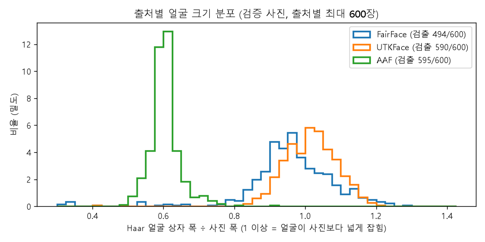

# 개발일지 17 — 출처(데이터셋)별 자르기 차이가 지름길 학습인지 확인

- **날짜**: 2026-11-28
- **프로젝트**: 얼굴 이미지 기반 나이대 분류 (인공지능 4조)
- **담당**: 임성빈 — 작은 CNN(4층)
- **작업 범위**: 파일 이름으로 출처 구분 규칙 만들기, 나이대 × 출처 구성, 출처별 성능, 출처별 얼굴 크기, 가장자리 가림 vs 중앙 가림 대조 실험
- **상태**: ✅ 완료 — **AAF는 얼굴 크기만으로 다른 출처와 완전히 구분되고, 나이가 많을수록 AAF·UTKFace 비율이 높다 → 지름길이 생길 조건은 있다.** 다만 이 실험들로는 모델이 실제로 지름길을 쓰는지 단정할 수 없다 (3-2 참고)
- **결과 파일**: 내 PC `results/small_cnn_v2_lr1e-3/source/`
- **시험 데이터(test.csv)는 사용하지 않음. 재학습 없음**
- 개발일지 01(2-4)에서 남긴 "출처별 정확도를 따로 확인한다"를 이번에 함

---

## 1. 한 일

### 1-1. 출처 구분 규칙 (팀 전처리 코드로 확인)

| 파일 이름 | 출처 | 근거 (팀 코드·설명) |
|---|---|---|
| `00001A02.jpg` (숫자A나이) | **AAF** (All-Age-Faces) | `AAF.py`: 원본 폴더 `All-Age-Faces Dataset/original images`, `name.split("A")[1]`을 나이로 읽음. 설명: "이미지 이름이 xxxxxAxx … Axx가 나이, 앞은 고유 번호" |
| `32_1_2_2017….jpg.chip.jpg` | **UTKFace** | `UTK.py`: `filename.split("_")[0]`을 나이로 읽음. 설명: "x_x_x_xxxxx … 가장 앞의 x가 나이" |
| `34984.jpg` (숫자) | **FairFace** | `fairface_train.py`·`fairface_val.py`: 라벨 CSV의 `file` 열(`train/숫자.jpg`)로 파일을 옮김 |
| 그 외 | 기타 | — |

- 설명 문서(`설명 & python 코드/데이터 코드 설명.txt`)의 원래 데이터셋은 FairFace, UTKFace, AAF, **AFAD** 4개다. AFAD는 원래 나이별 폴더로 라벨링돼 있어 분류 코드가 없다.
- 규칙 점검 결과 (`source_rule.csv`):

| 분할 | FairFace | UTKFace | AAF | 기타 |
|---|---:|---:|---:|---:|
| train | 44,983 (번호 1~86,743) | 12,324 (나이 1~116) | 7,046 (사람번호 0~13,317) | **0** |
| val | 9,622 (번호 40~86,741) | 2,628 (나이 1~110) | 1,540 (사람번호 1~13,320) | **0** |

- FairFace 번호는 FairFace train 범위(1~86,744) 안, AAF 사람번호는 AAF 전체(13,322장) 범위 안이다. 같은 파일 이름 중복은 0장.
- 개발일지 16의 "숫자5자리 / 숫자4자리이하"는 둘 다 FairFace이므로 이번에 하나로 합쳤다.
- **AFAD 형식으로 보이는 파일은 0장**이다.

### 1-2. 코드: `작은CNN/source_check.py` (새 파일)

| 번호 | 결과 | 내용 |
|---|---|---|
| 1 | `source_rule.csv` | 규칙별 장수와 이름 앞 숫자 범위 |
| 2 | `band_source_count.csv` | train·val 나이대 × 출처 장수·비율 |
| 3 | `source_metrics.csv`, `band_source_recall.csv` | val 출처별 정확도·한 칸 정확도·macro-F1, 나이대 × 출처 재현율·평균 예측 차 |
| 4 | `face_width.csv`, `face_width.png` | 출처별 600장(시드 0)의 Haar 얼굴 상자 폭 ÷ 사진 폭 — 시연 `app.detect_face`와 같은 검출 |
| 5 | `mask_compare.csv` | 가장자리 10% 가림(개발일지 16 `mask_edge` 그대로) vs **같은 면적의 가운데 정사각형 가림**(133×133 = 17,689px, 가장자리 17,776px와 0.5% 차이) |

- 가림 색은 둘 다 회색(128). 예측은 v2 가중치(17 에폭), CPU.
- 전체 로그: `2026-11-28_17_출처별_자르기차이_지름길확인_실행로그.txt` (같은 명령을 두 번 실행해 결과가 같은 것 확인)

---

## 2. 결과

### 2-1. 나이대 × 출처 구성 (`band_source_count.csv`)

| 나이대 | train FairFace | UTKFace | AAF | val FairFace | UTKFace | AAF |
|---|---:|---:|---:|---:|---:|---:|
| 0-9세 | 75.1% | 18.7% | **6.2%** | 74.9% | 18.5% | **6.6%** |
| 10대 | 76.7% | 12.8% | 10.5% | 75.8% | 13.7% | 10.5% |
| 20대 | 70.7% | 20.6% | 8.7% | 72.4% | 19.2% | 8.4% |
| 30대 | 71.1% | 16.4% | 12.5% | 69.9% | 16.8% | 13.3% |
| 40대 | 71.5% | 14.8% | 13.7% | 72.1% | 14.3% | 13.5% |
| 50대 | 64.0% | 23.8% | 12.1% | 65.5% | 22.7% | 11.8% |
| 60세 이상 | **48.3%** | **35.4%** | **16.3%** | **44.5%** | **37.7%** | **17.8%** |
| 전체 (장수) | 44,983 | 12,324 | 7,046 | 9,622 | 2,628 | 1,540 |

### 2-2. 출처별 성능 (val, `source_metrics.csv`)

| 출처 | 장수 | 정확도 | 한 칸 정확도 | macro-F1 |
|---|---:|---:|---:|---:|
| FairFace | 9,622 | 0.458 | 0.829 | 0.446 |
| UTKFace | 2,628 | **0.537** | **0.878** | **0.504** |
| AAF | 1,540 | **0.406** | **0.771** | **0.406** |
| 전체 | 13,790 | 0.468 | 0.832 | 0.461 |

(세 출처 모두 7개 나이대가 다 있어 macro-F1은 7개 평균)

### 2-3. 나이대 × 출처 재현율 (`band_source_recall.csv`)

| 나이대 | FairFace 재현율 | UTKFace | AAF | FairFace 평균예측차 | UTKFace | AAF |
|---|---:|---:|---:|---:|---:|---:|
| 0-9세 | 0.767 | **0.921** | 0.702 | +0.39 | +0.11 | **+0.68** |
| 10대 | 0.507 | 0.500 | 0.449 | +0.26 | +0.19 | **+0.67** |
| 20대 | 0.370 | 0.501 | **0.202** | 0.00 | +0.23 | +0.20 |
| 30대 | 0.282 | 0.220 | 0.220 | −0.31 | −0.04 | −0.05 |
| 40대 | 0.359 | 0.309 | 0.415 | −0.43 | −0.04 | −0.11 |
| 50대 | 0.339 | 0.373 | 0.233 | −0.46 | −0.12 | −0.37 |
| 60세 이상 | 0.628 | **0.783** | 0.752 | −0.63 | −0.33 | −0.46 |

평균예측차 = (예측 번호 − 정답 번호)의 평균. +면 나이를 많게, −면 적게 예측. AAF는 나이대마다 161~314장이라 재현율 오차가 크다.

### 2-4. 출처별 얼굴 크기 (`face_width.csv`)

| 출처 | 표본 | Haar 검출률 | 폭비 10% | 25% | **50%** | 75% | 90% | 상자 중심 y (중앙값) |
|---|---:|---:|---:|---:|---:|---:|---:|---:|
| FairFace | 600 | **82.3%** | 0.832 | 0.906 | **0.962** | 1.027 | 1.098 | 0.415 |
| UTKFace | 600 | 98.3% | 0.924 | 0.964 | **1.018** | 1.067 | 1.112 | 0.415 |
| AAF | 600 | 99.2% | 0.558 | 0.585 | **0.603** | 0.621 | 0.650 | **0.603** |

폭비 = Haar 얼굴 상자 폭 ÷ 사진 폭 (1 이상 = 상자가 사진보다 넓게 잡힘, 얼굴이 사진을 꽉 채움).

### 2-5. 가장자리 가림 vs 같은 면적 중앙 가림 (`mask_compare.csv`, val 13,790장)

| 묶음 | 장수 | 원본 | 가장자리 가림 | 중앙 가림 | 바뀐 비율 가장자리 | 바뀐 비율 중앙 | 평균예측차 가장자리 | 평균예측차 중앙 |
|---|---:|---:|---:|---:|---:|---:|---:|---:|
| 0-9세 | 2,446 | 0.791 | 0.623 | **0.130** | 22.7% | **77.4%** | +0.35 | **+1.34** |
| 10대 | 1,781 | 0.500 | 0.526 | 0.390 | 36.1% | 61.6% | +0.43 | +0.86 |
| 20대 | 2,357 | 0.382 | 0.204 | 0.220 | 47.3% | 59.2% | +0.51 | +0.49 |
| 30대 | 2,357 | 0.263 | 0.256 | 0.384 | 50.1% | 57.7% | +0.54 | +0.20 |
| 40대 | 2,259 | 0.359 | 0.461 | 0.416 | 42.6% | 61.0% | +0.39 | −0.31 |
| 50대 | 1,453 | 0.334 | 0.420 | **0.110** | 33.6% | 64.5% | +0.12 | −0.72 |
| 60세 이상 | 1,137 | 0.709 | 0.632 | 0.380 | 21.9% | 56.3% | −0.02 | **−0.87** |
| [출처] FairFace | 9,622 | 0.459 | 0.416 | 0.281 | **40.5%** | 63.3% | +0.43 | +0.31 |
| [출처] UTKFace | 2,628 | 0.537 | 0.502 | 0.347 | 30.4% | 60.0% | +0.23 | +0.10 |
| [출처] AAF | 1,540 | 0.406 | 0.384 | 0.232 | **32.1%** | 67.4% | +0.26 | +0.31 |
| **전체** | 13,790 | 0.468 | **0.429** | **0.288** | **37.7%** | **63.1%** | +0.37 | +0.27 |

- 나이대 행의 숫자는 재현율, 출처·전체 행은 정확도.
- 평균예측차 = 가림 후 예측 번호 − 원본 예측 번호 (+면 나이 많게 바뀜).
- 원본 정확도가 2-2(0.458)와 2-5(0.459)에서 조금 다른 것은 배치 크기가 달라(64 / 128) 부동소수점 계산 순서가 다르기 때문이다 (1장 차이 수준).

---

## 3. 관찰

### 3-1. 사실

**출처는 얼굴 크기로 구분된다**
- AAF는 얼굴 상자 폭이 사진의 0.56~0.65배(10~90%)이고, FairFace(0.83~1.10)·UTKFace(0.92~1.11)와 **겹치지 않는다**. AAF 상자 중심은 사진 세로 0.60 지점(아래쪽)이고, 다른 두 출처는 0.415이다.
- FairFace와 UTKFace는 분포가 크게 겹친다 (중앙값 0.96 / 1.02).
- Haar 검출률은 FairFace만 82.3%로 낮다 (UTKFace 98.3%, AAF 99.2%).

**나이대마다 출처 비율이 다르다**
- AAF 비율은 0-9세 6.2%(train), 60세 이상 16.3%로 나이 많은 쪽이 높다 (단, 50대 12.1%로 계속 늘지는 않음). UTKFace도 60세 이상에서 35.4%로 가장 크다.
- FairFace는 60세 이상에서만 48.3%이고, 나머지 나이대는 64~77%이다.
- train과 val의 출처 비율은 나이대마다 ±4%p 안으로 비슷하다.

**출처마다 성능이 다르다**
- 정확도: UTKFace 0.537 > FairFace 0.458 > AAF 0.406. macro-F1도 같은 순서다.
- AAF의 0-9세·10대 사진은 평균 +0.68·+0.67칸 나이를 **많게** 예측한다 (FairFace +0.39·+0.26, UTKFace +0.11·+0.19).
- AAF 20대 재현율은 0.202로, UTKFace(0.501)·FairFace(0.370)보다 낮다.
- UTKFace는 0-9세(0.921)와 60세 이상(0.783) 재현율이 세 출처 중 가장 높다.

**중앙 가림이 가장자리 가림보다 예측을 훨씬 많이 바꾼다**
- 같은 면적인데 예측이 바뀐 비율은 중앙 63.1%, 가장자리 37.7%이다. 정확도는 중앙 0.288, 가장자리 0.429이다.
- 중앙을 가리면 어린 나이대는 나이를 많게(0-9세 +1.34칸), 많은 나이대는 적게(60세 이상 −0.87칸) 바뀐다. 즉 예측이 가운데 나이대 쪽으로 몰린다. 30대 재현율이 0.263 → 0.384로 오른 것도 이렇게 몰린 결과다.
- 가장자리를 가리면 대부분의 나이대에서 나이를 많게 바뀐다 (+0.12 ~ +0.54칸, 60세 이상만 −0.02).
- 20대는 두 가림 모두 재현율이 비슷하게 떨어진다 (가장자리 −0.178, 중앙 −0.162).
- 가장자리 가림으로 예측이 바뀐 비율은 AAF(32.1%)가 FairFace(40.5%)보다 **낮다**. 가장자리에 배경이 가장 많이 보이는 출처가 AAF인데도 그렇다.

### 3-2. 추측 (확인 안 함)

- 추측: **지름길이 생길 조건은 갖춰져 있다.** 얼굴 크기만 보면 AAF를 거의 완벽하게 구분할 수 있고(사실), AAF 비율은 나이가 많을수록 높다(사실). 그래서 모델이 "얼굴이 작게 찍힌 사진 = 나이가 많다"를 배울 수 있다. AAF 어린이 사진을 나이 많게 예측하는 경향(+0.68칸)은 이 지름길과 들어맞는다.
- 추측: 같은 결과를 **다른 이유로도 설명할 수 있다.** ① AAF는 얼굴이 사진 폭의 60%라 224×224에서 얼굴 픽셀이 FairFace의 약 40%(0.6² ÷ 0.96²)뿐이어서 주름 같은 세부를 보기 어렵다. ② AAF는 동아시아인 얼굴 데이터셋이라 출처와 인종이 겹친다. 이 실험들로는 세 가지 이유를 나눌 수 없다.
- 추측: 중앙 가림이 예측을 훨씬 많이 바꾸므로, 모델은 **주로 얼굴 가운데**를 보고 판단한다. 가장자리(배경·머리카락)는 보조 정보로 보인다. 가장자리 가림에서 AAF의 예측이 FairFace보다 덜 바뀐 것도 "AAF 배경을 단서로 쓴다"는 설명과 맞지 않는다. 다만 가림 자체가 학습에 없던 입력이라 두 가림 모두 분포 변화 효과가 섞여 있다 (개발일지 16과 같은 한계).
- 추측: 시연 앱의 자르기 여백(시연 README 5-1)은 FairFace·UTKFace가 대부분(89%)인 학습 사진의 중앙값이라 **FairFace·UTKFace처럼 꽉 찬 얼굴**에 맞춰져 있다. 시연 사진을 AAF처럼 넓게 자르면 나이를 많게 예측할 수 있다.

---

## 4. 문제와 해결

| 문제 | 원인 | 해결 |
|---|---|---|
| 개발일지 16에 AAF 사람번호를 "05106까지"라고 잘못 적음 | 격자에 보인 사진만 보고 적음 | 전체를 세어 보니 최대 13,320 → 개발일지 16에 정정 표시를 넣음 |
| 개발일지 16에서 `숫자5자리`와 `숫자4자리이하`를 다른 형식으로 나눔 | 출처를 확인하기 전이라 자릿수로 나눔 | 팀 코드로 확인해 보니 둘 다 FairFace(`train/숫자.jpg`) → 이번부터 FairFace 하나로 셈 |
| 출처별 macro-F1을 어떻게 셀지 | 어떤 출처에 없는 나이대가 있으면 F1이 0으로 들어가 낮아짐 | 그 출처에 있는 나이대만 평균하게 함 (v2는 세 출처 모두 7개 나이대가 다 있어 결과는 7개 평균과 같음) |
| 첫 실행이 실패로 끝남 | 로그 저장(`tee`) 경로를 잘못 씀. 분석 자체는 끝까지 실행됨 | 로그 경로를 고쳐 다시 실행 → 첫 실행과 결과가 같음 |

---

## 5. 다음 할 일

- [ ] **직접 확인 실험 (재학습 없음)**: AAF 검증 사진을 Haar 상자 기준으로 FairFace처럼 꽉 차게 다시 잘라 예측하기. 나이를 적게 예측하는 쪽으로 바뀌면 "얼굴 크기 = 나이 단서"를 쓴다는 근거가 된다 (해상도 효과는 남음)
- [ ] 반대 방향: FairFace 사진을 회색 바탕 가운데에 작게 놓아 AAF처럼 만든 뒤 예측 → 나이를 많게 예측하는지 확인
- [ ] (재학습 필요, 팀과 상의) 학습 증강에 확대·축소 범위를 넓히거나, 모든 출처를 같은 기준(얼굴 검출 + 같은 여백)으로 다시 자르기
- [ ] 팀원 모델(ResNet50, ConvNeXt)도 출처별 정확도 확인 — `source_of` 규칙을 그대로 쓰면 됨
- [ ] 팀에 공유: 출처 구분 규칙, AAF 얼굴 크기 차이, 60세 이상의 출처 구성 차이 (개발일지 01의 "팀에 공유" 항목에서 이어짐)
