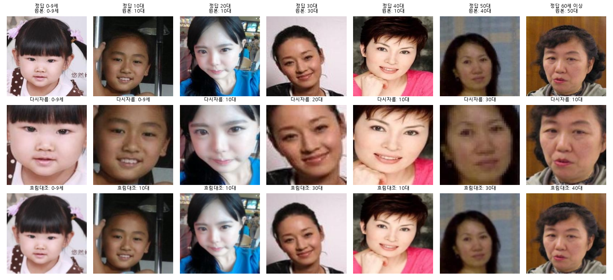

# 개발일지 18 — AAF 다시 자르기 실험: "얼굴 크기 = 나이 단서"를 직접 확인

- **날짜**: 2026-11-28
- **프로젝트**: 얼굴 이미지 기반 나이대 분류 (인공지능 4조)
- **담당**: 임성빈 — 작은 CNN(4층)
- **작업 범위**: 개발일지 17의 다음 할 일 첫 번째 — AAF 검증 사진을 FairFace처럼 얼굴이 꽉 차게 다시 잘라 예측하고, 해상도 효과를 뺀 대조군과 비교
- **상태**: ✅ 완료 — **AAF 사진을 꽉 차게 자르면 해상도를 맞춘 상태에서도 평균 0.55칸 어리게 예측한다. FairFace·UTKFace는 같은 처리에 거의 변하지 않는다(0.00 / +0.01칸).** 모델이 얼굴이 화면에서 차지하는 크기(또는 그와 함께 바뀌는 주변 정보)를 나이 단서로 쓰고 있다
- **결과 파일**: 내 PC `results/small_cnn_v2_lr1e-3/recrop/` (recrop_compare.csv, recrop_per_image.csv, recrop_samples.png)
- **시험 데이터(test.csv)는 사용하지 않음. 재학습 없음** — 코드에서도 `--csv` 이름에 `test`가 있으면 멈춤

---

## 1. 한 일

### 1-1. 세 가지 입력

검증 사진 13,790장마다 같은 v2 가중치(17 에폭, CPU)로 세 번 예측했다.

| 입력 | 만드는 방법 | 바뀌는 것 |
|---|---|---|
| **원본** | 학습 때와 같은 224×224 사진 | — |
| **다시자름** | 시연 `app.detect_and_crop` (Haar 상자 + 여백 왼 0.02, 위 −0.065, 오른 0.02, 아래 0.105) → 224로 확대 | 얼굴이 화면을 채우는 정도 **+** 해상도(확대로 흐려짐) |
| **흐림대조** | 자르지 않고, 다시자름과 **같은 픽셀 수로 줄였다가** 224로 확대 | 해상도만 |

- **자르기 효과 = 다시자름 예측 − 흐림대조 예측** (칸). 두 입력은 해상도가 같으므로, 이 값은 프레이밍만 바꾼 효과다.
- FairFace·UTKFace에도 똑같이 처리했다. 이 두 출처는 원래 얼굴이 꽉 차 있어(개발일지 17 2-4) 자르기 변화가 거의 없으므로 **대조군**이 된다.
- 여백은 시연 앱과 같은 값이다. 이 값은 v2 학습 사진(대부분 FairFace·UTKFace)의 중앙값이라, 다시 자른 AAF는 "FairFace·UTKFace처럼 찍힌 사진"이 된다.

### 1-2. 코드: `작은CNN/aaf_recrop.py` (새 파일)

- 출처 규칙은 `source_check.source_of`, 검증 데이터·모델은 `gradcam_analysis.load_data/load_model`, 자르기는 `시연/app.detect_and_crop`을 그대로 가져다 씀
- Haar가 얼굴을 못 찾은 사진은 세 입력 모두에서 뺐다 (같은 사진끼리만 비교)
- 원본 예측이 `predictions.csv`와 **100% 일치**하는 것을 확인 (검출된 11,994장)
- 전체 로그: `2026-11-28_18_AAF_다시자르기_실험_실행로그.txt`

```
python <저장소>\작은CNN\aaf_recrop.py --weights results\small_cnn_v2_lr1e-3\small_cnn_best.pth
       --csv splits_csv_v2\val.csv --image-root division_224AFAD-X
       --pred-csv results\small_cnn_v2_lr1e-3\eval_val\predictions.csv
       --out-dir results\small_cnn_v2_lr1e-3\recrop --device cpu
```

---

## 2. 결과

### 2-1. 출처별 (`recrop_compare.csv`)

| 출처 | 검출 / 전체 | 자른 폭 ÷ 사진 폭 (중앙값) | 정확도 원본 → 다시자름 / 흐림대조 | 예측차 원본 → 다시자름 / 흐림대조 | 바뀐 비율 다시자름 / 흐림대조 | **자르기 효과** |
|---|---:|---:|---|---|---|---:|
| FairFace | 7,876 / 9,622 | 0.978 | 0.474 → 0.467 / 0.482 | −0.09 → −0.07 / −0.07 | 14.1% / 7.5% | **0.00** |
| UTKFace | 2,592 / 2,628 | 1.000 | 0.538 → 0.546 / 0.538 | −0.01 → −0.01 / −0.01 | 5.5% / 3.0% | **+0.01** |
| AAF | 1,526 / 1,540 | **0.621** | 0.403 → **0.368** / 0.417 | +0.05 → **−0.65** / −0.11 | **52.7%** / 33.2% | **−0.55** |

- 예측차 = 예측 번호 − 정답 번호의 평균 (+면 나이를 많게, −면 적게).
- AAF 다시자름 입력은 사진 폭의 0.62배(중간 50%: 0.60~0.64)를 잘라 224로 키운 것이다 → 해상도가 약 0.62배.
- AAF에서 예측이 **어린 쪽으로** 바뀐 비율: 다시자름 43.9%, 흐림대조 22.9%. **많은 쪽으로** 바뀐 비율: 8.8%, 10.2%.

### 2-2. AAF 나이대별

| 나이대 | 장수(검출) | 재현율 원본 → 다시자름 / 흐림대조 | 예측차 원본 → 다시자름 / 흐림대조 | **자르기 효과** |
|---|---:|---|---|---:|
| 0-9세 | 159 | 0.698 → **0.887** / 0.610 | +0.69 → +0.30 / +0.71 | −0.41 |
| 10대 | 185 | 0.443 → 0.470 / 0.416 | +0.68 → −0.03 / +0.81 | −0.83 |
| 20대 | 195 | 0.200 → 0.303 / 0.379 | +0.22 → −0.51 / +0.23 | −0.73 |
| 30대 | 314 | 0.220 → **0.124** / 0.354 | −0.05 → −0.95 / −0.19 | −0.76 |
| 40대 | 305 | 0.416 → **0.216** / 0.403 | −0.11 → −0.98 / −0.42 | −0.55 |
| 50대 | 171 | 0.234 → 0.187 / 0.222 | −0.38 → −1.13 / −0.76 | −0.37 |
| 60세 이상 | 197 | 0.746 → 0.695 / 0.589 | −0.47 → −0.75 / −0.75 | 0.00 |

AAF는 나이대마다 159~314장이라 재현율 오차가 크다 (±0.03~0.04 정도).

### 2-3. 예시 (나이대별 AAF 1장씩)



위: 원본 / 가운데: 다시자름 / 아래: 흐림대조. 각 칸 제목이 그 입력의 예측이다. 40대 사진이 10대로, 60세 이상 사진이 10대로 바뀌었다 (흐림대조에서는 10대 / 40대).

---

## 3. 관찰

### 3-1. 사실

- 해상도를 맞춘 상태에서 **AAF 예측이 평균 0.55칸 어려졌다.** 60세 이상(0.00)만 빼고 모든 나이대에서 −0.37 ~ −0.83칸이다.
- 같은 처리를 한 **FairFace(0.00)·UTKFace(+0.01)는 거의 변하지 않았다.** 이 두 출처는 자른 폭이 사진의 0.98·1.00배라 입력이 거의 같기 때문이다.
- 해상도만 낮춘 흐림대조는 AAF 정확도를 거의 바꾸지 않았다 (0.403 → 0.417). 예측차도 +0.05 → −0.11로, 다시자름(−0.65)보다 훨씬 작다.
- AAF 어린 나이대는 원래 나이를 많게 예측하던 경향(+0.69칸)이 줄어 **0-9세 재현율이 0.70 → 0.89**로 올랐다. 반대로 30·40대는 너무 어리게 예측해 재현율이 0.22 → 0.12, 0.42 → 0.22로 떨어졌다. 전체 정확도는 0.403 → 0.368.
- 개발일지 17의 "AAF 어린이를 나이 많게 예측한다(+0.68칸)"는, 꽉 차게 자르면 +0.30칸으로 줄어든다.

### 3-2. 추측 (확인 안 함)

- 추측: 모델은 **"얼굴이 작게(배경이 많이) 찍힌 사진 = 나이가 많다"** 는 단서를 쓴다. 학습 데이터에서 얼굴이 작게 찍힌 AAF 비율이 나이가 많을수록 높기 때문에(개발일지 17 2-1) 생긴 지름길로 보인다. 원본 AAF 사진은 이 단서 때문에 실제보다 나이가 많은 쪽으로 밀려 있었고, 다시 자르면 그 밀림이 빠지면서 반대로 너무 어리게 나온다.
- 추측: 다시 자르면 얼굴 크기뿐 아니라 **머리카락·목·옷·배경도 함께 빠진다.** 그래서 "얼굴 크기" 자체가 단서인지, 잘려 나간 주변 정보(예: 머리 모양, 옷)가 단서인지는 이 실험으로 나눌 수 없다. 개발일지 17의 다음 할 일 두 번째(FairFace를 회색 바탕에 작게 놓기)는 주변 정보 없이 크기만 바꾸므로 이것을 나눌 수 있다.
- 추측: 인종은 이 실험에서 고정되어 있다 (같은 AAF 사진끼리 비교). 그래서 개발일지 17에서 남겨 둔 "AAF = 동아시아인이라서" 설명만으로는 이번 결과를 설명할 수 없다.
- 추측: **시연 앱 영향** — 시연 앱은 얼굴을 꽉 차게 자른다. 그래서 학습 때 AAF처럼 찍혔던 종류의 얼굴(동아시아 성인)은 시연에서 실제보다 어리게 나올 수 있다. 시연에서 결과를 설명할 때 참고한다.
- 추측: 60세 이상만 자르기 효과가 0인 것은, 60세 이상은 원래 가장 높은 번호라 더 위로 밀릴 수 없고, 주름 같은 얼굴 자체의 단서가 강해 크기 단서의 영향이 상대적으로 작기 때문일 수 있다.

---

## 4. 문제와 해결

| 문제 | 원인 | 해결 |
|---|---|---|
| 첫 실행이 마지막 점검(`원본 예측 = predictions.csv`)에서 멈춤 | 얼굴을 못 찾은 사진은 바로 표에 넣고, 찾은 사진은 128장씩 모아서 넣어 **표 순서가 CSV 순서와 달라짐**. 모델 문제 아님 | 사진 번호(`i`)를 함께 저장하고 마지막에 번호순으로 정렬. 결과 CSV를 점검보다 먼저 저장하도록 바꿈 → 다시 실행, 일치율 1.0000 |
| 두 번째 실행이 예시 그림에서 멈춤 (표·CSV는 저장됨) | 검출 실패 행의 빈칸(NaN) 때문에 예측 열이 실수형이 되어 `BAND_NAMES[2.0]` 오류 | `int()`로 바꿔 고치고, 저장된 `recrop_per_image.csv`로 그림만 다시 만듦. 표 숫자는 두 번째 실행 그대로 |
| 첫 실행에서 진행률이 안 보임 | `tee`로 넘길 때 파이썬 출력이 버퍼에 쌓임 | `PYTHONUNBUFFERED=1`로 실행 |

---

## 5. 다음 할 일

- [ ] 반대 방향: FairFace 사진을 회색 바탕 가운데에 작게(폭 0.62배) 놓아 AAF처럼 만든 뒤 예측 → 나이를 많게 예측하면 "주변 정보 없이 **크기만으로도**" 단서가 된다는 근거 (개발일지 17 다음 할 일 두 번째)
- [ ] (재학습 필요, 팀과 상의) 학습 증강에 확대·축소 범위를 넓히거나, 모든 출처를 같은 기준(얼굴 검출 + 같은 여백)으로 다시 자르기
- [ ] 팀에 공유: 출처마다 얼굴 크기가 다르고 모델이 그것을 나이 단서로 쓴다는 것 — 팀원 모델(ResNet50, ConvNeXt)도 `aaf_recrop.py`의 `load_model`만 바꾸면 같은 실험 가능
- [ ] 시험 데이터 평가는 팀이 최종 모델을 정한 뒤 **한 번만**
