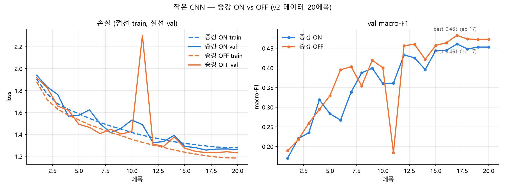
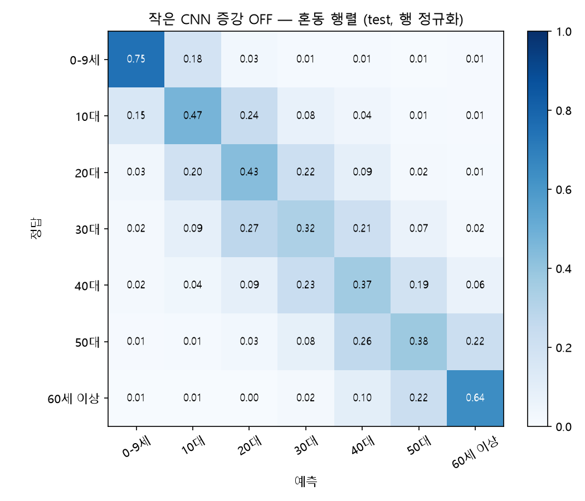
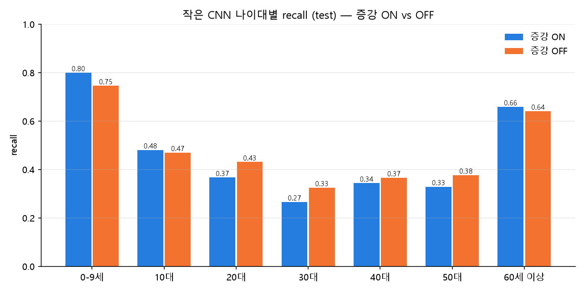

# 개발일지 19 — 작은 CNN 증강 끔(no-aug) 본학습 + 팀원 결과와 비교 (비교 실험 3)

- **날짜**: 2026-11-28
- **담당**: LIM — 작은 CNN(4층)
- **상태**: ✅ 완료 (학습 20에폭 → val·test 평가 → 비교표·그림)
- **결과 폴더**: `작은CNN/results/no_aug/` (가중치 `.pth`는 `.gitignore`로 제외, 내 PC에만 있음)

---

## 1. 목적

비교 실험 3번(증강 적용 vs 미적용). 팀원은 ResNet-50·ConvNeXt-Tiny로 증강 ON/OFF를 이미 비교했다 (개발일지 KIMDONGHWI/05).
작은 CNN도 **증강만 끄고** 다시 학습해서, 처음부터 배우는 작은 모델에서는 증강이 어떤 영향을 주는지 본다.

## 2. 조건

| 항목 | 값 |
|---|---|
| 데이터 | `splits_csv_v2` (학습 64,353 / 검증 13,790 / 시험 13,789) |
| 입력·정규화 | 224×224, ImageNet 평균·표준편차 |
| 손실 | 가중 교차 엔트로피 `[0.81 1.11 0.84 0.84 0.87 1.36 1.73]` |
| 최적화 | AdamW (wd 0.05), 학습률 1e-3, 1에폭 워밍업 + 코사인, AMP |
| 배치·에폭·시드 | 64, 20, 42 |
| best 기준 | 검증 macro-F1 최고 에폭 |
| **바꾼 것** | **학습 증강 끔** (학습 transform = 검증 transform) |

학습 직전에 출력한 학습 transform (`results/no_aug/train_log.txt`):

```
증강: 끔
학습 transform: Compose(
    Resize(size=(224, 224), interpolation=bilinear, max_size=None, antialias=True)
    ToTensor()
    Normalize(mean=(0.485, 0.456, 0.406), std=(0.229, 0.224, 0.225))
)
```

실행 명령 (로컬 프로젝트 폴더에서):

```
python models\CNN_4layers_unified.py --csv-dir splits_csv_v2 --image-root division_224AFAD-X --no-augment --out-dir results\no_aug
python eval_small_cnn.py --weights results\no_aug\small_cnn_best.pth --csv-dir splits_csv_v2 --image-root division_224AFAD-X --split test --out-dir results\no_aug\eval_test
python 작은CNN\augment_compare.py --repo <저장소> --out results\no_aug\compare
```

## 3. 바꾼 코드

| 파일 | 변경 |
|---|---|
| `작은CNN/CNN_4layers_unified.py` | 학습 시작 때 실제 학습 transform을 출력 (1줄). 증강 끄기 플래그 `--no-augment`는 원래 있었고, 기본값은 증강 ON 그대로 |
| `작은CNN/eval_small_cnn.py` | `--split val/test` 옵션 추가 (기본 val). 지금까지는 val.csv만 읽었음 |
| `작은CNN/augment_compare.py` | 새 파일. 비교표(md·csv)와 그림 3장 생성 |
| `.gitignore` | `작은CNN/results/no_aug/*.pth` 제외 (`!작은CNN/results/**/*.pth` 예외 때문에 그대로 두면 커밋될 수 있음) |

## 4. 결과

### 4-1. 비교표 (`작은CNN/results/no_aug/compare/compare_table.md`, `.csv`)

| 모델 | 증강 | val 정확도 | val 한 칸 차이 | val macro-F1 | best 에폭 | 마지막 에폭 val−train loss | test 정확도 | test 한 칸 차이 | test macro-F1 |
|---|---|---:|---:|---:|---:|---:|---:|---:|---:|
| **작은 CNN** | **OFF** | 0.481 | 0.852 | **0.483** | 17 | 0.048 | 0.475 | 0.851 | **0.475** |
| 작은 CNN | ON | 0.468 | 0.832 | 0.461 | 17 | −0.016 | 0.457 | 0.830 | 0.449 |
| ResNet-50 | OFF | 0.525 | 0.893 | 0.525 | 5 | 2.450 | — | — | — |
| ResNet-50 | ON | 0.567 | 0.920 | 0.566 | 11 | 0.472 | — | — | — |
| ConvNeXt-Tiny | OFF | 0.581 | 0.937 | 0.583 | 3 | 2.798 | — | — | — |
| ConvNeXt-Tiny | ON | 0.586 | 0.942 | 0.591 | 4 | 2.206 | — | — | — |

**조건이 다른 부분**
- 학습률: 작은 CNN 1e-3, 팀원 모델 1e-4 (출력층 1e-3). 팀원 모델은 ImageNet-1k 사전학습 + 첫 1에폭은 출력층만 학습했다.
- 팀원 값은 `ResNet50/results`, `ConvNeXt/results`의 `v2_*_history.csv`에서 val macro-F1이 가장 높은 에폭 행을 그대로 썼다. 팀원 `summary_val.csv`와는 0.001 정도 다르다 (ResNet ON 0.565, ConvNeXt ON 0.592). 학습 중 검증과 따로 돌린 평가 사이의 반올림·AMP 차이로 보인다.
- **test는 작은 CNN 두 개만 1회 평가했다.** 팀 규칙상 test는 최종 모델을 정한 뒤 한 번만 쓰기로 했으므로, 팀원 모델은 평가하지 않았다. **모델 사이 비교는 val 열로만 해야 한다.**
- "val−train loss"의 train loss는 증강 ON일 때 **증강된 사진**에 대한 손실이다. 그래서 ON의 차이가 작게(음수로) 나올 수 있다.
- 시드 42로 한 번씩만 학습했다.

### 4-2. 그림

| 그림 | 경로 |
|---|---|
| 증강 ON/OFF 학습 곡선 (손실, val macro-F1) | `작은CNN/results/no_aug/compare/curves_on_off.png` |
| 증강 OFF 혼동 행렬 (test, 행 정규화) | `작은CNN/results/no_aug/compare/confusion_noaug_test.png` |
| 나이대별 recall ON vs OFF (test) | `작은CNN/results/no_aug/compare/recall_on_off_test.png` (+ `.csv`) |





### 4-3. 나이대별 (test)

| 나이대 | recall ON → OFF | F1 ON → OFF | 예측한 장수 ON → OFF (실제) |
|---|---|---|---|
| 0-9세 | 0.800 → 0.746 | 0.769 → 0.772 | 2,644 → 2,282 (2,447) |
| 10대 | 0.481 → 0.470 | 0.407 → 0.435 | **2,427 → 2,064 (1,780)** |
| 20대 | 0.367 → 0.431 | 0.387 → 0.426 | 2,108 → 2,410 (2,357) |
| 30대 | 0.266 → 0.325 | 0.304 → 0.342 | 1,765 → 2,119 (2,357) |
| 40대 | 0.344 → 0.366 | 0.362 → 0.376 | 2,030 → 2,138 (2,259) |
| 50대 | 0.329 → 0.377 | 0.344 → 0.374 | 1,326 → 1,476 (1,453) |
| 60세 이상 | 0.659 → 0.641 | 0.571 → 0.598 | **1,489 → 1,300 (1,136)** |

## 5. 해석

1. **과적합은 거의 없었다.** 증강을 꺼도 20에폭 동안 val loss는 train loss를 크게 넘지 않았다. 10에폭부터 val이 조금 위로 올라가기 시작해 마지막 차이는 0.05였다. 팀원의 사전학습 모델은 증강을 끄면 3~5에폭에 최고점을 찍고 차이가 2.4~2.8까지 벌어졌다. 작은 CNN(파라미터 39만 개)은 20에폭 동안 학습 사진을 외울 만큼 크지 않고, 아직 **덜 배운 상태**에 가깝다.
2. **작은 CNN은 증강을 끈 쪽이 조금 더 좋았다.** val F1은 0.461 → 0.483(+0.022), test F1은 0.449 → 0.475(+0.026)다. 팀원 결과(ResNet은 증강이 +0.041)와 방향이 반대다. 덜 배운 모델에 증강까지 주면 문제가 더 어려워져서, 20에폭 안에 배울 수 있는 양이 줄어든 것으로 보인다. 다만 시드 1번에 0.02대 차이이고, OFF는 11에폭에 F1이 0.18까지 한 번 튀었다. 그래서 "증강이 해롭다"기보다 "**이 조건(20에폭)에서는 증강의 이득이 없다**"로 보는 것이 맞다.
3. **10대·60세 이상:** recall은 OFF에서 약간 내려갔다 (10대 0.48 → 0.47, 60+ 0.66 → 0.64). 하지만 ON은 두 나이대를 실제보다 30% 넘게 많이 예측했고, OFF는 이 과다 예측이 14~16%로 줄었다. 그래서 정밀도가 올라 **F1은 둘 다 좋아졌다** (10대 0.407 → 0.435, 60+ 0.571 → 0.598). 끝 나이대로 쏠리던 예측이 20~50대로 돌아오면서 가운데 나이대 recall이 0.02~0.06 올랐다.

## 6. 다음 할 일

- [ ] 에폭을 늘리거나(예: 40) 시드를 바꿔 다시 학습해, 증강 ON/OFF 차이가 그대로 유지되는지 확인
- [ ] 팀 최종 모델이 정해지면 그 모델만 test 1회 평가 (팀원 모델 test는 이번에 하지 않음)
