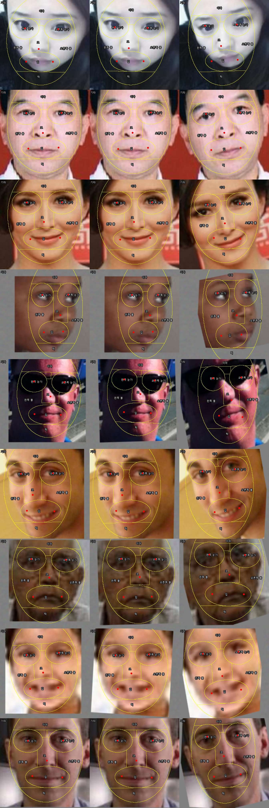

# 개발일지 20 — 시연 앱 Grad-CAM 글 설명 (얼굴 영역별 주목 비중 + 가림 실험)

- **날짜**: 2026-11-28
- **담당**: LIM — 작은 CNN(4층)
- **상태**: ✅ 완료. 시연 사진(val 9장)으로 영역 그림·좌표·비중 합 확인, 앱을 실제로 띄워 API로 3장 예측 후 Ctrl+C 정상 종료 확인
- **시험 데이터(test.csv)는 사용하지 않음** — 확인은 모두 val
- **실행 로그**: [2026-11-28_20_GradCAM_글설명_실행로그.txt](2026-11-28_20_GradCAM_글설명_실행로그.txt)

---

## 1. 무엇을 했나

시연 앱(`작은CNN/app_gradio.py`)의 Grad-CAM 그림 아래에 **글 설명**을 붙였다. 기존 화면과 실행 명령은 그대로다.

```
주목 비중 — 오른쪽 볼 29% · 기타(머리·배경) 28% · 입 12% · 오른쪽 눈가 11% · 나머지 20%
```

"가림 실험" 체크박스(기본 꺼짐)를 켜면 영역마다 그 부분만 블러한 사진으로 다시 예측한 표가 붙는다.

| 가린 영역 | 확률 | 차이 |
|---|---|---|
| 오른쪽 볼 | 93% → 0% | -92%p |
| 입 | 93% → 23% | -70%p |
| … | | |

화면 아래에 "영역 구분은 설명용이며 예측에는 쓰이지 않습니다", 가림 표 아래에 "가린 사진은 학습 때 없던 형태라 수치가 과장될 수 있음"을 넣었다.

## 2. 바뀐 파일

| 파일 | 내용 |
|---|---|
| `작은CNN/face_regions.py` (새 파일) | 영역 정의 · 주목 비중 · 가림 실험 · 영역 경계 그림 + 점검/비교표 |
| `작은CNN/face_align.py` | `locate`가 YuNet 5점(`lm`)도 돌려줌. `crop_face(..., return_landmarks=True)`면 5점을 224 좌표로 옮겨 함께 반환 (기본값은 예전과 같은 반환) |
| `작은CNN/app_gradio.py` | 모델 칸마다 글 설명(Markdown), "가림 실험" 체크박스, 안내 문구, 시작 때 가림 배치·YuNet 미리 실행, `--selftest`에 가림 켬/끔 시간 |
| `작은CNN/gradcam_utils.py` | 기울기 hook을 `requires_grad`일 때만 등록 (가림 실험은 `no_grad`로 예측하는데, 이때 hook 등록이 에러 나던 것 방지) |

## 3. 방법

### 3-1. 5점 → 224 좌표

`crop_face`가 하는 변환을 그대로 적용한다: 테두리(긴 변 × 0.25) → (정렬 켬이면) 회전 → 자르기 → 224로 늘림.

- 정렬 끔: 검출 5점 그대로 (캔버스 좌표)
- 정렬 켬: 회전한 캔버스에서 **다시 검출한 얼굴의 5점** (상자와 같은 검출). 다시 검출에 실패하면 원래 5점을 회전 행렬 M으로 옮김
- 자르기: `(점 − (왼, 위)) × (224 ÷ 자른 폭, 224 ÷ 자른 높이)`

**5점은 설명(영역 나누기)에만 쓴다. 모델 입력은 예전과 똑같은 224 얼굴 사진이다** (`--selftest` ①에서 앱 확률 = 직접 계산, 차이 4e-7 이하로 그대로).

### 3-2. 영역 정의 (`face_regions.face_regions` 한 함수)

두 눈 가운데를 원점으로, 눈→눈 방향을 가로(a, 눈 사이 거리 d 단위), 그와 수직을 세로(b, 눈→입 높이 h 단위)로 잡는다. 눈 = b 0, 입꼬리 가운데 = b 1. 얼굴이 기울거나 크기가 달라도 같은 기준이 된다. 픽셀마다 아래 순서로 **처음 맞는 영역 하나**에 넣는다.

| 순서 | 영역 | 기준 |
|---|---|---|
| ① | 기타(머리·배경) | 얼굴 타원 밖. 타원 중심 (0, 0.35), 반지름 가로 1.05d · 세로 1.35h |
| ② | 왼쪽/오른쪽 눈가 | 각 눈 중심 타원, 반지름 0.42d · 0.32h |
| ③ | 입 | 입꼬리 가운데 중심 타원, 반지름 (입 폭/2 + 0.2d) · 0.3h |
| ④ | 코 | 코끝 세로줄 ±0.28d, 눈 높이(b −0.1) ~ 코끝 + 0.2h |
| ⑤ | 이마 | b < −0.3 |
| ⑥ | 턱 | b > 1.3 |
| ⑦ | 왼쪽/오른쪽 볼 | 나머지, 코끝 세로줄 기준 |

왼쪽/오른쪽은 **화면 기준**(사진을 보는 사람 기준)이다. 히트맵을 보면서 읽기 쉬워서다.

### 3-3. 주목 비중

지금 화면에 보이는 Grad-CAM(예측 1위 나이대 기준, 224×224로 키운 값)에서 **영역별 합 ÷ 전체 합**. 영역이 사진을 빈틈없이 나누므로 합은 100%다. 상위 4개 + 나머지를 보여 준다. ("기타"는 머리·배경 영역 이름이라 헷갈리지 않게 남은 합은 "나머지"로 표시)

라벨은 "영향력"이 아니라 **"주목 비중"**이다. Grad-CAM은 모델이 어디를 봤는지를 보여 줄 뿐, 그 부분이 예측을 바꾼다는 증거는 아니다. 그걸 따로 보려고 가림 실험을 넣었다.

### 3-4. 가림 실험

- 영역 하나만 강한 가우시안 블러(반지름 16, 224 기준)로 바꾼 사진 9장을 **한 배치**로 예측
- 예측 1위 나이대 확률의 변화(원래 → 가린 뒤, 차이 %p)를 하락 큰 순으로 표시
- 가린 사진은 학습 때 없던 형태라 블러 자체 때문에 확률이 흔들릴 수 있다 → 안내 문구

## 4. 확인

시연 사진 = val 사진 9장(AAF·FairFace·UTKFace 각 3장, 시드 7)을 1280×960 회색 잡음 배경에 300×300으로 붙인 합성 사진.

### 4-1. 영역 그림



줄마다 사진 1장: 정렬 끔 | 정렬 켬 | 15° 기울임 + 정렬 켬. 빨간 점 = 224로 옮긴 5점. 9장 모두 눈가 타원이 두 눈, 입 타원이 입, 코 영역이 콧등~코끝에 맞았다. 기울인 사진도 정렬 후 영역이 얼굴을 따라간다.

### 4-2. 5점 좌표 (정렬 끔/켬)

반환한 5점을 원본 사진 좌표로 되돌린 자리에 색 점을 찍고 다시 잘라서, 224 사진 속 색 점 위치와 비교했다. 색 점이 검출을 흔들지 않게 색 점 사진에서는 원래 검출 결과를 그대로 다시 썼다 (= 좌표 변환만 검사).

| 정렬 | 기울임 | 평균 오차 | 최대 |
|---|---|---|---|
| 끔 | 0° | 0.82 px | 1.39 px |
| 켬 | 0° | 0.75 px | 1.30 px |
| 켬 | 15° | 0.74 px | 1.54 px |

1~1.5px는 점(반지름 4)이 축소·보간되며 생기는 차이다. 변환은 맞다.

- **처음에 시도한 방법과 왜 바꿨나**: 224로 자른 사진을 YuNet으로 다시 검출해 비교하면 평균 20px까지 차이가 났다. 원인 둘: (1) 같은 얼굴을 크게 흐려 만든 배경을 썼더니 YuNet이 **배경의 큰 흐린 얼굴**을 잡았다 → 배경을 회색 잡음으로 바꿈. (2) YuNet 5점은 검출 해상도마다 5~10px 흔들린다(이 앱은 1/3로 줄여 검출) → 변환 오류와 구분이 안 돼서 색 점 방식으로 바꿈.

### 4-3. 비중 합

9장 × 3모델 모두 비중 합 100% (부동소수 오차 1e-6 이하, float64로 합산). 영역 면적 비율 평균은 다음과 같다. 히트맵이 고르게 퍼져 있으면 비중 = 면적이 되므로, **비중은 이 값과 비교해서 읽어야 한다**.

이마 9% · 왼쪽 눈가 6% · 오른쪽 눈가 6% · 코 5% · 입 8% · 왼쪽 볼 10% · 오른쪽 볼 10% · 턱 6% · **기타(머리·배경) 40%**

### 4-4. 주목 비중 1위 vs 가림 실험 하락 1위 (정렬 끔 = 앱 기본)

| 사진 | 작은 CNN 비중 1위 | 작은 CNN 가림 1위 | ConvNeXt 비중 1위 | ConvNeXt 가림 1위 | ResNet 비중 1위 | ResNet 가림 1위 |
|---|---|---|---|---|---|---|
| 1 AAF | 오른쪽 눈가 28% | 이마 −9 | 기타 31% | 이마 −53 | 오른쪽 볼 29% | 이마 −45 |
| 2 AAF | 기타 19% | 오른쪽 볼 −17 | **입 34%** | **입 −31** | 입 35% | 코 −35 |
| 3 AAF | 기타 26% | 입 −12 | 왼쪽 눈가 32% | 기타 −21 | 오른쪽 눈가 20% | 입 −18 |
| 4 FairFace | 기타 25% | 왼쪽 눈가 −10 | 왼쪽 볼 45% | 왼쪽 눈가 −50 | 왼쪽 볼 32% | 오른쪽 눈가 −53 |
| 5 FairFace | 기타 44% | 오른쪽 볼 −6 | 입 34% | 오른쪽 볼 −37 | 입 29% | 턱 −24 |
| 6 FairFace | 기타 34% | 이마 −7 | **기타 21%** | **기타 −22** | 입 27% | 기타 −16 |
| 7 UTKFace | **입 25%** | **입 −31** | 입 42% | 왼쪽 볼 −8 | **입 22%** | **입 −75** |
| 8 UTKFace | 왼쪽 눈가 21% | 오른쪽 눈가 −6 | 오른쪽 눈가 21% | 왼쪽 볼 −40 | 오른쪽 눈가 32% | 이마 −21 |
| 9 UTKFace | 오른쪽 눈가 23% | 왼쪽 볼 −14 | 입 26% | 왼쪽 볼 −17 | 입 32% | 왼쪽 볼 −25 |
| **일치** | | **1/9** | | **2/9** | | **1/9** |
| 입 비중 평균 | 10.7% | | 20.6% | | 21.4% | |

(가림 숫자 = 예측 1위 확률 변화 %p. 전체 값은 `작은CNN/results/face_regions/compare.csv`)

**읽은 것**

- **작은 CNN은 입에 몰리지 않는다.** 입 비중 평균 10.7%로 입 면적(8%)과 거의 같다. 비중 1위가 "기타(머리·배경)"인 사진이 5/9인데, 기타 면적이 40%라서 그 비중(19~44%)은 오히려 면적 이하다. 즉 작은 CNN 히트맵은 **특정 부위에 모이지 않고 넓게 퍼져 있다** (개발일지 15·GradCAM 3모델비교에서 본 "가운데 에너지 52%, 가장자리 띠"와 같은 방향).
- **입에 모이는 건 사전학습 모델 쪽이다.** ConvNeXt·ResNet 입 비중 평균 21%로 면적(8%)의 약 2.6배, 비중 1위가 입인 사진이 각각 4/9, 5/9.
- **비중 1위와 가림 1위는 거의 안 맞는다** (세 모델 1~2/9). Grad-CAM이 많이 본 곳 ≠ 가렸을 때 확률이 가장 떨어지는 곳. 그래서 글 설명을 "영향력"이 아니라 "주목 비중"으로 붙인 게 맞았다. 다만 가림은 블러라는 학습 때 없던 변화가 섞여 있어서 둘 중 어느 쪽이 "진짜 근거"라고 할 수는 없다.
- 작은 CNN은 가림 하락 폭 자체가 작다 (1위가 −6~−31%p, 대부분 −10%p 안팎). 원래 1위 확률이 21~62%로 낮고 분포가 퍼져 있어서다. 사전학습 모델은 −35%p 이상 떨어지는 사진이 9장 중 4장씩이다(최대 −75%p).
- 사진 9장이라 경향만 본 것이다. 결론을 내리려면 val 전체로 돌려야 한다.

### 4-5. 처리 시간 (`--selftest`, GPU, 1280×960 사진 1장, 검출 포함, 5번 평균)

| | 가림 끔 | 가림 켬 |
|---|---|---|
| 작은 CNN 단일 | 0.041초 | 0.056초 |
| ConvNeXt-Tiny 단일 | 0.075초 | 0.114초 |
| ResNet-50 단일 | 0.064초 | 0.110초 |
| 세 모델 비교 | 0.123초 | 0.225초 |

가림 실험은 모델당 9장 배치 1번이라 비교 모드에서도 0.1초 정도 늘어난다. (같은 측정을 한 번 더 돌렸을 때는 비교 0.088 → 0.152초. GPU 상태에 따라 ±30% 흔들림)

### 4-6. 실제 실행 + 종료

앱을 띄워(`--port 7861`) `gradio_client`로 시연 사진 3장 × 가림 끔/켬 × 세 모델 비교를 보냈다. 글 설명·가림 표가 세 칸 모두 나왔다. 앱 안 처리 시간은 비교 모드에서 가림 끔 0.06~0.07초, 켬 0.14~0.15초.

- **첫 요청만 약 2초** 걸렸다(가림 끔/켬 상관없음). 모델·YuNet·가림 배치는 시작 때 미리 돌려 두는데도 그렇다. 같은 코드를 Gradio 밖에서 바로 부르면 첫 예측도 0.01~0.03초라서, Gradio 작업 스레드에서의 첫 실행 때문으로 보인다 (원인 미확인, 다음 할 일).
- **종료**: 앱 콘솔에 Ctrl+C 이벤트를 보냈다 → `Keyboard interruption in main thread... closing server.`, 종료 코드 0, 앱 임시 폴더 삭제 확인.
  - Claude Code 도구에서 띄운 프로세스는 Windows의 "Ctrl+C 무시" 설정을 물려받아서 처음엔 신호가 안 먹었다. 실행할 때만 그 설정을 풀어(일반 터미널과 같은 상태) 확인했다. 앱 코드는 바꾸지 않았다.

## 5. 실행

```
# 앱 (저장소 최상위에서)
.venv\Scripts\python 작은CNN\app_gradio.py                  → http://127.0.0.1:7860
# 점검 (전처리 일치, 합성 사진, 처리 시간 — 가림 켬/끔 포함)
.venv\Scripts\python 작은CNN\app_gradio.py --selftest --image-root <division_224AFAD-X 폴더>
# 영역 그림 · 5점 좌표 · 비중 합 · 비교표
.venv\Scripts\python 작은CNN\face_regions.py --image-root <division_224AFAD-X 폴더>
```

## 6. 다음 할 일

- 비중 1위 vs 가림 1위 비교를 val 전체로 (9장은 경향만)
- 첫 요청 2초 원인 확인 (Gradio 작업 스레드 첫 CUDA 실행으로 추정)
- `--selftest` ② 합성 사진은 같은 얼굴을 크게 흐린 배경을 쓴다. 4-2에서 본 것처럼 YuNet이 배경의 흐린 얼굴을 잡을 수 있어서, "1위가 원본과 같음" 숫자가 그만큼 낮게 나왔을 수 있다 → 얼굴 없는 배경으로 바꿔 다시 재기
