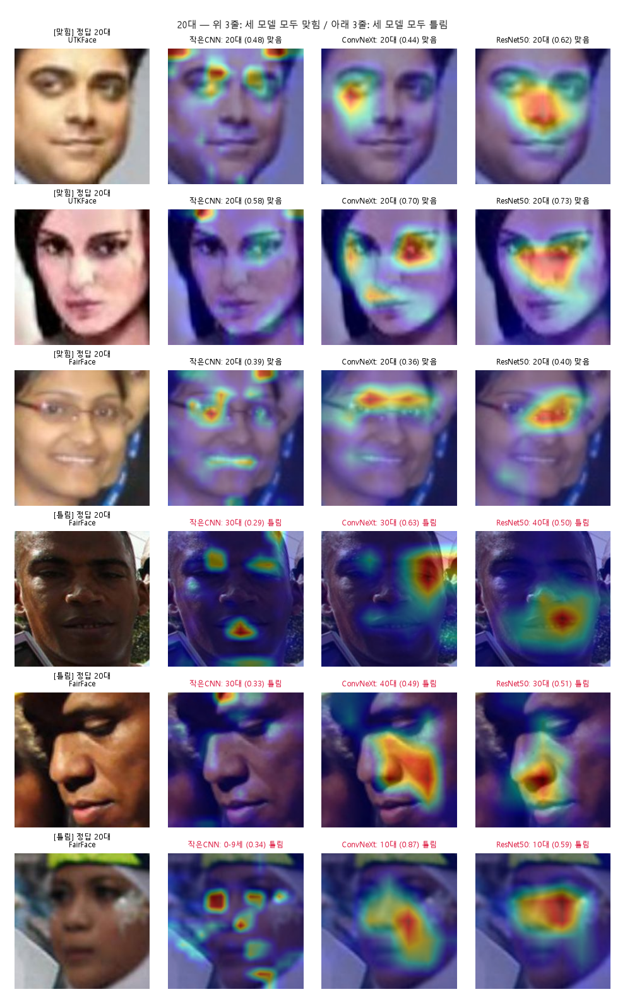
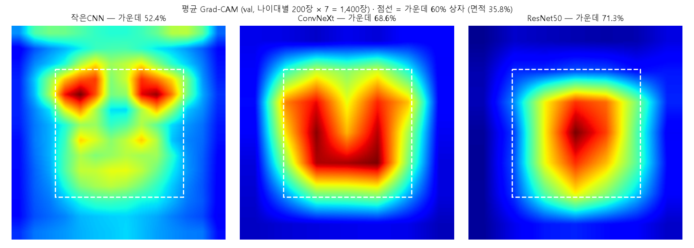

# Grad-CAM 3모델 비교 — 작은 CNN · ConvNeXt-Tiny · ResNet-50

- **날짜**: 2026-11-28
- **프로젝트**: 얼굴 이미지 기반 나이대 분류 (인공지능 4조)
- **담당**: 임성빈 — 작은 CNN(4층)
- **작업 범위**: 같은 검증 사진에서 세 모델이 어디를 보고 나이대를 고르는지 비교. 개발일지 15에서 본 "작은 CNN 히트맵이 사진 가장자리에 몰린다"는 현상이 작은 CNN만의 문제인지, 출처(데이터셋)별 사진 테두리 차이와 관련 있는지 확인
- **상태**: ✅ 완료 — **작은 CNN은 히트맵의 48%가 가운데 60% 상자 밖에 있고(사전학습 모델은 29~31%), 평균 히트맵에서 사진 맨 위 가장자리 띠가 뚜렷하다.** 사전학습 두 모델은 얼굴 가운데(눈·코·입)에 모인다. 작은 CNN의 지름길 학습 의심은 더 강해졌고, 사전학습 모델은 Grad-CAM으로는 그런 징후가 약하다
- **시험 데이터(test.csv)는 사용하지 않음** — 코드에서도 `--csv` 이름에 `test`가 있으면 멈춤
- **결과 파일**: `작은CNN/results/gradcam_compare/` — 그림 8장(저장소), CSV 7개(내 PC에만)

---

## 1. 한 일

### 1-1. 코드

| 파일 | 역할 |
|---|---|
| `작은CNN/gradcam_utils.py` (새 파일) | 세 모델 공용 Grad-CAM. `load_model`(가중치 읽기, strict), `preprocess`(팀 `common.py` 검증 전처리), `target_layer`, `GradCAM`(배치 계산), `overlay`, `center_ratio`. Gradio에서 이 파일 하나만 import하면 됨 |
| `작은CNN/gradcam_compare.py` (새 파일) | 이번 분석 전체: P1 세 모델 val 예측 → P2 샘플 격자 → P3 영역 에너지 → P4 출처별 테두리 |

- `시연/gradcam.py`는 사진 1장씩 계산한다. 세 모델 × 1,400장을 돌리려고 같은 알고리즘을 **배치 버전**으로 정리했다. `gradcam_utils.py`를 실행하면 점검이 돈다: 세 모델 모두 특징 맵 크기가 맞는지, 배치로 낸 히트맵이 1장씩 낸 히트맵과 같은지 확인하고 통과했다.
- 기울기는 층 hook이 아니라 **텐서 hook**으로 받는다. ResNet 안의 `ReLU(inplace=True)` 때문에 층 backward hook은 오류가 날 수 있어서다.
- 히트맵 정규화는 "사진마다 최댓값으로 나누기"만 한다(최솟값을 빼지 않음). 그래야 "0 = 안 본 곳"이 유지되고, 영역별 비율(합 ÷ 합)이 원래 히트맵과 같게 나온다.

### 1-2. 실행 (CPU, 저장소 최상위에서)

```
.venv\Scripts\python 작은CNN\gradcam_utils.py                      # 점검
.venv\Scripts\python 작은CNN\gradcam_compare.py --image-root C:\3th_project\whats_your_face_age\division_224AFAD-X
```

CPU로 실행했다. 지난번 GPU 작업 중 PC가 멈춘 적이 있어 CPU 코어 2개를 비워 두고 돌렸다.

### 1-3. 가중치와 전처리가 맞게 읽혔는지 확인 (val 13,790장)

| 모델 | 이번 예측 macro-F1 | 학습 기록 macro-F1 | 정확도 |
|---|---:|---:|---:|
| 작은 CNN (`작은CNN/results/small_cnn_v2_lr1e-3/best.pt`) | 0.4606 | 0.4608 | 46.8% |
| ConvNeXt-Tiny (`weights/convnext_tiny/best.pt`) | 0.5917 | 0.5914 | 58.6% |
| ResNet-50 (`weights/resnet50/best.pt`) | 0.5652 | 0.5656 | 56.6% |

차이는 0.0004 이하다. 학습 때는 AMP(16비트), 이번에는 32비트로 계산해서 생기는 정도의 차이다.

---

## 2. 대상 층 — 각 모델의 마지막 합성곱 블록

| 모델 | 대상 층 | 특징 맵 크기 | 고른 이유 |
|---|---|---|---|
| 작은 CNN | `gap`의 **입력** = 4번째 블록(Conv → BN → ReLU → MaxPool)의 최종 출력 | 256 × 14 × 14 | `self.pool`은 4개 블록이 같이 쓰는 모듈이라 hook을 걸면 4번 불린다. 바로 뒤의 `gap`은 한 번만 불리므로 그 입력을 본다 |
| ConvNeXt-Tiny | `stages[-1]` 출력 = 마지막 stage(ConvNeXt 블록 3개) | 768 × 7 × 7 | 이 뒤는 평균 풀링 → LayerNorm → 출력층뿐이라 위치 정보가 남은 마지막 지점이다 |
| ResNet-50 | `layer4` 출력 = 마지막 Bottleneck 블록의 잔차 더하기 + ReLU 뒤 | 2048 × 7 × 7 | 같은 이유. 팀원 `common.py`의 `gradcam_target_layer`(`layer4[-1]`, `stages[-1]`)와 같은 위치 |

**마지막 블록을 고르는 이유**: 앞쪽 층은 선·모서리 같은 단순 무늬에 반응한다. 마지막 블록은 나이대 판단에 직접 쓰이는 고수준 특징이면서, 아직 가로×세로 격자 위치가 남아 있는 마지막 층이다.

**주의 — 해상도 차이**: 작은 CNN 히트맵은 14×14, 사전학습 모델은 7×7(한 칸 = 32픽셀)을 224×224로 키운 것이다. 7×7 히트맵은 가장자리의 가는 띠를 표현하지 못하고 넓게 번진다. 그래서 아래 비율 비교에서 사전학습 모델의 가장자리 값이 조금 다르게 나올 수 있다. 다만 차이(16~19%p)가 이 효과로만 생기기에는 크다.

---

## 3. 샘플 비교 (나이대별 맞힘 3장 + 틀림 3장)

- **고른 방법**: val에서 나이대마다 **세 모델이 모두 맞힌 사진** 3장, **세 모델이 모두 틀린 사진** 3장을 시드 42로 무작위 추출(`samples.csv`). 같은 사진에서 모델 차이만 보기 위해서다.
- **그림 구성**: 한 줄 = [원본 | 작은CNN | ConvNeXt | ResNet50]. 각 히트맵은 그 모델이 **예측한 나이대** 기준이고, 제목에 예측(확률)과 맞음/틀림을 표시했다(틀림은 빨간 글씨).

| 나이대 | 그림 |
|---|---|
| 0-9세 | [samples_band0.png](../../작은CNN/results/gradcam_compare/samples_band0.png) |
| 10대 | [samples_band1.png](../../작은CNN/results/gradcam_compare/samples_band1.png) |
| 20대 | 아래에 바로 표시 |
| 30대 | [samples_band3.png](../../작은CNN/results/gradcam_compare/samples_band3.png) |
| 40대 | [samples_band4.png](../../작은CNN/results/gradcam_compare/samples_band4.png) |
| 50대 | [samples_band5.png](../../작은CNN/results/gradcam_compare/samples_band5.png) |
| 60세 이상 | [samples_band6.png](../../작은CNN/results/gradcam_compare/samples_band6.png) |



20대 샘플에서 보이는 것:
- **작은 CNN**: 맞힌 3장 모두 **사진 맨 위 가장자리(머리카락·사진 테두리)에 빨간 점**이 있다. 얼굴 안에서는 눈 주변에 작은 점이 흩어져 있다.
- **ConvNeXt**: 눈·눈썹·볼처럼 얼굴 안쪽의 넓은 덩어리를 본다.
- **ResNet-50**: 코와 눈 사이, 얼굴 정중앙에 하나로 모인다.
- **틀린 사진**: 세 모델 모두 얼굴 안쪽을 보긴 하지만 고른 나이대가 서로 다르다(30대 / 40대 / 10대). 어둡거나 옆을 보거나 일부가 가려진 사진이 많다. 사진 자체가 어려워서 틀린 경우다.

---

## 4. 지름길 학습 확인 — 가운데 60% 상자 vs 가장자리

### 4-1. 방법
- val에서 **나이대마다 200장 × 7 = 1,400장**을 시드 42로 무작위 추출했다(맞힘·틀림 섞임). 세 모델에 같은 사진을 쓴다.
- 사진마다 히트맵 값의 합을 "가운데 상자"와 "나머지(가장자리)"로 나눈다. 가운데 상자는 가로·세로 각 60%(45~179픽셀)이고 면적은 35.8%다. 사진별 비율을 낸 뒤 평균했다.
- **기준선**: 히트맵이 사진 전체에 고르게 퍼져 있으면 가운데가 **35.8%**로 나온다. 이보다 클수록 가운데에 몰린 것이다.
- **주의**: v2 사진은 얼굴이 꽉 차게 잘려 있어서 얼굴 상자 폭이 사진 폭의 약 0.96배다(`시연/app.py` 측정값). 그래서 **"가장자리"는 배경만이 아니라 이마·머리카락·턱선·얼굴 윤곽을 포함**한다. "가운데 상자" ≈ 눈·코·입 영역이다.

### 4-2. 나이대별 (가운데 상자 안 에너지 %, `energy_by_band.csv`)

| 나이대 | 작은CNN | ConvNeXt | ResNet50 |
|---|---:|---:|---:|
| 0-9세 | 59.1 | 78.0 | 81.5 |
| 10대 | 53.1 | 67.1 | 77.4 |
| 20대 | 47.7 | 66.5 | 73.9 |
| 30대 | **46.1** | 64.2 | 69.6 |
| 40대 | 48.4 | 67.4 | 66.2 |
| 50대 | 54.6 | 67.4 | 63.7 |
| 60세 이상 | 57.5 | 69.5 | 67.1 |
| **전체** | **52.4** | **68.6** | **71.3** |
| (가장자리 = 100 − 가운데) | **47.6** | 31.4 | 28.7 |



- 세 모델 모두 기준선 35.8%보다는 가운데에 몰려 있다. 셋 다 얼굴을 보기는 한다.
- **작은 CNN은 히트맵의 절반 가까이(47.6%)가 가장자리에 있다.** 사전학습 모델보다 16~19%p 많다.
- **평균 히트맵 모양**:
  - 작은 CNN: 눈 높이의 두 점, 그리고 **사진 맨 위 가장자리를 따라 이어진 띠**(머리카락·사진 위 테두리).
  - ConvNeXt: 눈 → 볼 → 입을 감싸는 U자.
  - ResNet-50: 코 중심으로 얼굴 가운데.
- **작은 CNN은 20·30·40대에서 가운데 비율이 가장 낮다(46~48%).** 개발일지 15에서 "20대는 위쪽 모서리, 30대는 아래 가장자리에 뜨거운 띠"를 본 것과 맞는다. 이 세 나이대는 작은 CNN의 F1도 가장 낮다(0.40 / 0.30 / 0.38).

### 4-3. 출처별 (`energy_by_source.csv`, 출처는 파일 이름 규칙 — 개발일지 17)

CSV의 `source` 열은 전부 `unknown`이라 쓸 수 없었다. 그래서 팀 전처리 코드의 파일 이름 규칙으로 출처를 정했다: 숫자A나이.jpg = AAF, `.jpg.chip.jpg` = UTKFace, 숫자.jpg = FairFace.

| 출처 | 장수 (1,400장 중) | 작은CNN | ConvNeXt | ResNet50 |
|---|---:|---:|---:|---:|
| FairFace | 974 | 50.6 | 67.6 | 71.3 |
| UTKFace | 276 | 52.7 | 66.4 | 68.9 |
| AAF | 150 | **63.3** | **79.4** | **75.8** |

작은 CNN, 나이대 × 출처 (`energy_smallcnn_band_x_source.csv`):

| 나이대 | AAF | FairFace | UTKFace |
|---|---:|---:|---:|
| 0-9세 | 62.3 | 58.9 | 58.9 |
| 10대 | 61.7 | 51.6 | 55.0 |
| 20대 | 63.0 | **46.0** | 46.0 |
| 30대 | 58.8 | **43.7** | 46.9 |
| 40대 | 63.5 | **45.1** | 47.9 |
| 50대 | 67.4 | 53.5 | 54.6 |
| 60세 이상 | 66.4 | 55.1 | 56.9 |

- **세 모델 모두 AAF 사진에서 가운데 비율이 높다(FairFace 대비 +5~13%p).** AAF는 얼굴을 여유 있게 잘라 얼굴이 사진 가운데에 작게 있다(개발일지 18). 히트맵은 얼굴을 따라가므로, 얼굴이 작으면 가운데 상자 안에 들어간다. 그러니 이 차이는 "AAF에서 더 얼굴을 본다"는 뜻이 아니라 **얼굴 위치가 다르다**는 뜻이다.
- **같은 출처끼리 비교해도 작은 CNN은 항상 12~21%p 낮다.** 그러니 가장자리를 많이 보는 건 출처 구성 때문이 아니라 **작은 CNN 자체의 특성**이다.
- 작은 CNN이 가장자리를 가장 많이 보는 곳은 **FairFace의 20~40대(가운데 44~46%)**다. FairFace는 얼굴이 꽉 차게 잘려 머리카락·사진 위 테두리가 바로 가장자리에 걸린다.

### 4-4. 출처별 사진 테두리 특징 (val 전체 13,790장, `border_by_source.csv`)

정의는 개발일지 16과 같다. 가장자리 8픽셀 띠의 흑백 밝기(0~255)를 쓰고, 검은 테두리 = 띠 픽셀의 절반 이상이 밝기 15 미만인 사진이다.

| 출처 | 장수 | 가장자리 밝기 평균 | 가장자리 밝기 표준편차 | 검은 테두리 비율 |
|---|---:|---:|---:|---:|
| FairFace | 9,622 | **93.4** | 51.0 | 1.7% |
| UTKFace | 2,628 | 114.0 | 54.4 | 1.0% |
| AAF | 1,540 | **131.3** | 57.6 | 1.8% |

- **출처마다 테두리가 다르다.** AAF는 FairFace보다 가장자리가 38 밝다. 밝은 배경·여백이 많고 얼굴이 작게 잘렸기 때문이다. FairFace는 얼굴·머리카락이 테두리까지 차서 어둡다.
- 검은 테두리(패딩)는 세 출처 모두 2% 미만이라 원인이 아니다.
- 출처 비율은 나이대마다 다르다(개발일지 17: val 60세 이상은 FairFace 44.5% / UTKFace 37.7% / AAF 17.8%, 0-9세는 74.9% / 18.5% / 6.6%). 그래서 **"테두리가 밝다 → AAF·UTKFace일 가능성 ↑ → 나이 많은 쪽일 가능성 ↑"** 같은 지름길이 데이터 안에 존재한다.

---

## 5. 해석 — 지름길 학습 여부

| 모델 | 판단 | 근거 |
|---|---|---|
| **작은 CNN** | **지름길 학습을 하고 있다 (일부)** | ① 히트맵의 48%가 가장자리, 평균 히트맵에 사진 위 테두리 띠(이번) ② 20~40대에서 가장자리 비율이 가장 높고, 같은 나이대에서 F1도 가장 낮음(이번) ③ 출처마다 테두리 밝기가 다르고 출처 비율이 나이대마다 다름(이번 + 개발일지 17) ④ **AAF 사진을 꽉 차게 다시 자르기만 해도 평균 0.55칸 어리게 예측** — 얼굴은 같은데 자른 방식만 바꿨을 때 예측이 바뀌었다는 인과 근거(개발일지 18) |
| **ConvNeXt-Tiny** | Grad-CAM상 징후 약함 | 가장자리 31%, 히트맵이 눈·볼·입 U자. 나이대별 가운데 비율이 64~78%로 고름 |
| **ResNet-50** | Grad-CAM상 징후 약함 | 가장자리 29%, 코 중심. 다만 50대·60세 이상에서 가운데 비율이 64~67%로 조금 낮아짐 |

**한계 — 사전학습 모델이 지름길을 "안 쓴다"고 단정할 수는 없다.**
- Grad-CAM은 "어디를 봤는지"는 보여 주지만 "그게 판단을 바꿨는지"는 보여 주지 않는다. 작은 CNN은 개발일지 18의 다시 자르기 실험으로 인과를 확인했지만, 사전학습 모델에는 아직 그 실험을 하지 않았다.
- 7×7 히트맵은 가장자리의 가는 띠를 표현하지 못한다([2장](#2-대상-층--각-모델의-마지막-합성곱-블록) 주의).

**왜 작은 CNN만 그런가 (추정)**
- 사전학습 모델은 ImageNet 128만 장에서 "물체의 모양"을 먼저 배웠다. 반면 작은 CNN은 6만 4천 장만으로 처음부터 배운다. 그러면 얼굴 주름 같은 어려운 특징보다 **테두리 밝기·얼굴 크기처럼 쉬운 통계 단서**가 손실을 먼저 줄여 주므로, 그쪽을 먼저 배우기 쉽다.
- 작은 CNN의 수용 영역은 46×46픽셀이라 한 칸이 얼굴 전체를 못 본다. 얼굴 구조를 종합하기 어려운 대신, 가장자리 한 칸의 밝기·무늬 같은 국소 단서는 쉽게 잡는다.

---

## 6. 발표 예상 질문과 답

**Q1. Grad-CAM에서 가장자리를 본다고 해서 꼭 지름길 학습인가요? 머리카락이나 이마 주름도 나이 단서일 수 있지 않나요?**
> 맞습니다. 사진이 얼굴을 꽉 차게 잘라서 가장자리에는 이마·머리카락·턱선도 들어 있고, 흰머리나 이마 주름은 진짜 나이 단서입니다. 그래서 Grad-CAM만으로 지름길이라고 하지 않았습니다. 근거는 세 가지를 합쳐서 봤습니다. (1) 출처마다 테두리 밝기가 38 넘게 차이 나고, 출처 비율이 나이대마다 다릅니다. (2) 작은 CNN의 평균 히트맵이 얼굴 윤곽이 아니라 사진 맨 위 테두리를 따라 띠 모양으로 나옵니다. (3) 가장 강한 근거는 개발일지 18입니다. 같은 얼굴을 자르는 방식만 바꿨는데 예측이 평균 0.55칸 바뀌었습니다. 얼굴 내용이 같은데 예측이 바뀌었으니 얼굴 밖 정보를 쓰고 있다는 뜻입니다.

**Q2. 세 모델의 히트맵 해상도가 다른데(14×14 vs 7×7) 공정한 비교인가요?**
> 완전히 같지는 않습니다. 7×7을 224로 키우면 한 칸이 32픽셀이라 가장자리의 가는 띠를 표현하지 못하고 가운데로 번지는 경향이 있습니다. 그래서 가장자리 비율 차이(16~19%p) 중 일부는 해상도 때문일 수 있습니다. 다만 각 모델의 "마지막 합성곱 블록"이라는 같은 기준으로 고른 층이고, 평균 히트맵 모양 자체가 다릅니다(작은 CNN은 위 테두리 띠, 사전학습 모델은 얼굴 가운데 덩어리). 해상도만으로 생기는 차이는 아니라고 판단했습니다. 해상도를 맞추려면 ConvNeXt·ResNet의 한 단계 앞 블록(14×14)으로도 비교해 볼 수 있습니다.

**Q3. 지름길 학습을 줄이려면 어떻게 해야 하나요?**
> 원인이 "출처마다 자르는 방식·배경이 다르고, 출처 비율이 나이대마다 다르다"는 것이라서 세 가지 방법이 있습니다. (1) 모든 사진을 같은 얼굴 검출기와 같은 여백 규칙으로 다시 잘라 자르는 방식을 통일합니다. (2) 학습 때 RandomResizedCrop의 확대 범위를 넓혀(지금 0.9~1.0) 얼굴 크기를 단서로 못 쓰게 합니다. (3) 나이대마다 출처 비율을 맞춰 샘플링합니다. 바꾼 뒤에는 이번처럼 Grad-CAM 가장자리 비율과 개발일지 18의 다시 자르기 실험으로 다시 확인하면 됩니다.

---

## 7. 다음 할 일

- 개발일지 18의 AAF 다시 자르기 실험을 ConvNeXt·ResNet-50에도 돌려서 사전학습 모델의 지름길 여부를 **인과적으로** 확인
- 해상도를 맞춘 비교: ConvNeXt `stages[-2]`, ResNet `layer3`(14×14)로 같은 표 다시 계산
- 시연 앱(`시연/app.py`)이 `gradcam_utils.py`를 쓰도록 바꿀지 결정 (지금은 `시연/gradcam.py`를 따로 씀)
