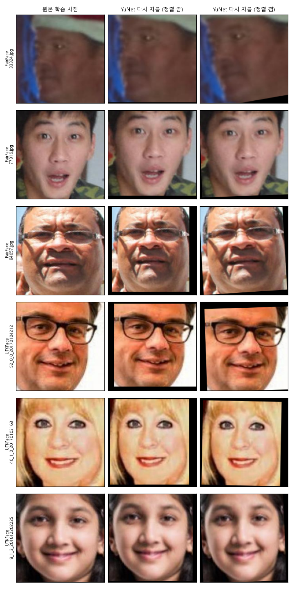

# Gradio 시연 — YuNet 얼굴 자르기 + 세 모델 비교 + Grad-CAM

- **날짜**: 2026-11-28
- **프로젝트**: 얼굴 이미지 기반 나이대 분류 (인공지능 4조)
- **담당**: 임성빈 — 작은 CNN(4층), 시연 화면
- **작업 범위**: 사진(업로드·웹캠) → 얼굴 검출·자르기 → 작은 CNN / ConvNeXt-Tiny / ResNet-50 예측 + Grad-CAM, 세 모델 비교 모드
- **상태**: ✅ 완료 — 앱 예측이 `gradcam_utils.py` 직접 계산과 같음(확률 차이 4e-7 이하). 1280×960 사진 1장 처리 시간: 단일 0.02~0.05초, 세 모델 비교 0.09초(GPU) / 단일 0.05~0.19초, 비교 0.35초(CPU)
- **기존 `시연/app.py`는 수정하지 않음** (참고만 함). 새 앱은 `작은CNN/app_gradio.py`
- **시험 데이터(test.csv)는 사용하지 않음** — 여백 측정은 training, 확인은 val

---

## 1. 파일

| 파일 | 역할 |
|---|---|
| `작은CNN/app_gradio.py` (새 파일) | 시연 화면. `--selftest`로 점검 |
| `작은CNN/face_align.py` (새 파일) | YuNet 검출 → 가장 큰 얼굴 → (눈 수평 정렬) → 여백으로 자르기 → 224. 앱과 여백 측정이 함께 씀. 실행하면 정렬 점검 |
| `작은CNN/face_crop_measure.py` (새 파일) | 학습 사진에서 YuNet 상자 기준 여백 측정 + 크롭 예시 그림 |
| `작은CNN/models/face_detection_yunet_2026may.onnx` (새 파일) | YuNet 모델 (229,738바이트) |
| `작은CNN/gradcam_utils.py` (기존) | 모델 읽기, 전처리, Grad-CAM, 히트맵 겹치기 — 그대로 재사용 |

새 라이브러리는 없다. `opencv-python-headless 5.1.0.95`, `gradio 6.32.0`이 이미 `requirements.txt`에 있어서 바꾸지 않았다.

---

## 2. 화면 구성

| 위치 | 내용 |
|---|---|
| 왼쪽 위 | 사진 입력 (업로드 / 웹캠 촬영), 모델 선택 라디오(작은 CNN / ConvNeXt-Tiny / ResNet-50), "세 모델 비교" 체크박스, "얼굴 정렬 (두 눈 수평)" 체크박스(기본 끔), 예측 버튼 |
| 오른쪽 위 | 안내 문구(얼굴 개수·처리 시간·장치), ① 잘라낸 얼굴 = 모델에 들어가는 224×224 그대로 |
| 아래 3칸 | 모델마다 ② 예측 나이대 상위 3개와 확률(`gr.Label`, 한국어 이름) ③ Grad-CAM 겹친 그림. 단일 모드면 선택한 모델 1칸만, 비교 모드면 3칸이 한 줄로 |
| 맨 아래 | "예측은 겉보기 나이 기준이며 참고용입니다. 업로드한 사진은 저장하지 않습니다." |

- 얼굴이 없으면: "얼굴을 찾지 못했습니다. 얼굴이 정면으로 잘 보이는 밝은 사진으로 다시 시도해 주세요."
- 얼굴이 여러 개면: 가장 큰 얼굴을 쓰고 "얼굴 N개 중 가장 큰 얼굴"이라고 표시
- Grad-CAM은 각 모델이 **예측한 1위 나이대** 기준. 빨강 = 많이 본 곳

---

## 3. 실행 방법

```
# 저장소 최상위에서
.venv\Scripts\python 작은CNN\app_gradio.py
# → 브라우저에서 http://127.0.0.1:7860  (포트를 바꾸려면 --port 7861)

# 점검 (전처리 일치, 합성 사진 검출, 처리 시간)
.venv\Scripts\python 작은CNN\app_gradio.py --selftest --image-root C:\3th_project\whats_your_face_age\division_224AFAD-X

# 얼굴 정렬 점검 / 여백 다시 재기
.venv\Scripts\python 작은CNN\face_align.py
.venv\Scripts\python 작은CNN\face_crop_measure.py --image-root C:\3th_project\whats_your_face_age\division_224AFAD-X
```

- 모델 3개는 앱을 켤 때 한 번만 읽는다. GPU가 있으면 GPU, 없으면 CPU를 쓴다.
- 켤 때 세 모델을 빈 사진으로 한 번씩 미리 돌린다. 이걸 안 하면 첫 사진이 3~4초 걸린다.
- 기본은 `127.0.0.1`에서만 열려서 같은 PC에서만 접속된다. 팀원에게 보여 줄 때만 아래 옵션을 켠다.

### 팀원 공유 옵션 (2026-11-28 추가)

| 옵션 | 하는 일 |
|---|---|
| (없음) | 이 PC에서만 접속 (`127.0.0.1`) |
| `--lan` | 같은 와이파이·네트워크에서 접속 (`0.0.0.0`). 실행하면 `[같은 네트워크 접속 주소] http://192.168.x.x:7860`을 출력 |
| `--share` | Gradio 공유 링크(`https://xxxx.gradio.live`)를 만들어 인터넷 어디서나 접속. 사진이 Gradio 공유 서버를 거쳐 전달됨 |
| `--auth 아이디:비번` | 로그인 화면을 띄움. 형식이 틀리면 바로 멈춤. `--share`·`--lan`인데 `--auth`가 없으면 경고 출력 |

```
.venv\Scripts\python 작은CNN\app_gradio.py --lan --auth team4:비밀번호      # 같은 네트워크 팀원
.venv\Scripts\python 작은CNN\app_gradio.py --share --auth team4:비밀번호    # 인터넷 공유 링크
```

**확인 (2026-11-28 22시)**:
- **로그인**: `--lan --auth`로 띄워 `127.0.0.1`과 이 PC IP(192.168.0.22) 두 주소 모두 확인했다.
  - 첫 화면은 로그인 화면이고, 로그인 전 `/config`는 401(안내문 포함)이다.
  - 틀린 비밀번호는 400으로 거부되고, 맞는 비밀번호로 로그인하면 화면이 열린다.
  - 로그인 없이 예측 API(`/run`)를 부르면 `AuthenticationError`로 거부된다.
- **종료**: Ctrl+C와 같은 신호(메인 스레드 `KeyboardInterrupt`)로 끄면 서버가 닫히고 임시 폴더도 지워진다.
- **`--share`는 이 시점에 링크가 만들어지지 않았다.** Gradio 공유 서버 `gradio-live.com:7000`의 인증서가 2026-11-28 09:01:34 UTC(한국 18:01)에 만료됐기 때문이다(`openssl`로 확인, PC 시계는 정확함).
  - Gradio 운영 쪽 문제라 우리 코드로는 고칠 수 없다. 인증서 검사를 끄는 우회는 하지 않았다.
  - 실패하면 앱이 "[공유 링크 실패] … 같은 네트워크 팀원에게는 --lan 을 쓰세요"를 출력하고 이 PC 전용으로 계속 동작한다.
  - Gradio가 인증서를 갱신하면 같은 명령으로 다시 시도한다.
- **방화벽**: `--lan`을 처음 쓰면 Windows 방화벽 창이 뜰 수 있다. "개인 네트워크"만 허용한다.

### 사진을 디스크에 남기지 않기

Gradio는 브라우저에 그림을 보내려고 업로드 사진과 출력 그림을 임시 폴더에 파일로 둔다. 그래서 다음처럼 처리했다.

1. 임시 폴더를 **이 앱 전용 새 폴더**(`%TEMP%\face_age_gradio_xxxx`)로 바꾼다. `GRADIO_TEMP_DIR`을 gradio를 import하기 전에 설정해야 적용된다.
2. `delete_cache=(60, 60)`: 1분마다 확인해서 만든 지 1분이 넘은 파일을 지운다.
3. 앱을 끌 때(Ctrl+C) 폴더째 지운다. 강제 종료로 남은 폴더는 다음에 켤 때 지운다.
4. 앱 코드는 사진을 메모리(PIL)로만 다룬다. Gradio 사용 통계 전송도 끈다.

**확인**: 실행 중인 앱에 API로 비교 모드 사진 1장을 보냈다. 임시 폴더에 업로드 원본 1개와 출력 그림 4개(잘라낸 얼굴 + Grad-CAM 3개)가 생겼다(21:21:20). 다른 요청 없이 기다리자 21:23:12에 모두 지워졌다(1분 52초 뒤).

---

## 4. 얼굴 검출 방식 — 학습 전처리와의 차이

### 4-1. 학습 사진은 어떻게 잘렸나

저장소에서 `division_224AFAD-X` / `splits_csv_v2`를 만든 코드를 찾았다. **얼굴 검출·정렬·자르기 코드는 없었다.**

| 파일 | 하는 일 |
|---|---|
| `설명 & python 코드/AAF.py`, `UTK.py`, `fairface_train.py`, `fairface_val.py` | 파일 이름·CSV에서 나이를 읽어 나이대 폴더로 복사·이동 |
| `division.py` | train/val/test 분할 |
| `remove.py` | 10~30대 사진 수를 맞추려고 무작위 삭제 |
| `ConvNeXt/code/make_split_csv.py` | 폴더 목록 → CSV |

즉 학습 사진은 **각 원본 데이터셋이 배포할 때 이미 잘라 둔 그대로**다. val 사진을 출처별로 직접 보고, 개발일지 17의 측정값과 맞춰 보면 다음과 같다.

| 출처 (val 비율) | 모습 | Haar 얼굴 폭 ÷ 사진 폭 | 정렬 |
|---|---|---:|---|
| FairFace (70%) | 얼굴이 꽉 참, 이마 위·턱 아래가 잘림 | 0.96 | 일부 회전 흔적 |
| UTKFace (19%) | 꽉 참, 눈 수평, 모서리에 회전 쐐기 | 1.02 | 정렬됨 |
| AAF (11%) | 머리·어깨·배경 포함, 얼굴이 작음 | 0.60 | 안 됨 |

### 4-2. 검출기 고르기

| 후보 | 장점 | 단점 |
|---|---|---|
| **YuNet** (`cv2.FaceDetectorYN`) — 선택 | 이미 설치된 OpenCV에 들어 있어 새 패키지가 필요 없음. 눈·코·입 5점을 줘서 정렬 가능. Haar보다 꽉 찬 얼굴·옆얼굴에 강함. CPU에서도 빠름(1280×960 사진 0.017초) | 모델 파일(onnx)을 따로 받아야 함. 여백을 YuNet 상자 기준으로 다시 재야 함 |
| MediaPipe Face Detection | 웹캠용 실시간 검출, 랜드마크 6점, 모델이 패키지에 들어 있음 | `.venv`에 새로 설치해야 함(수십 MB, 의존성 추가). 함께 설치되는 OpenCV와 충돌할 수 있음 |
| 기존 Haar (`시연/app.py`) | 측정된 여백·검출률 기록이 있음 | 랜드마크가 없어 정렬 불가. 꽉 찬 얼굴은 검은 테두리 우회가 필요함. **OpenCV 5.x에는 없음** (아래) |

**주의 — 기존 `시연/app.py`는 지금 `.venv`에서 안 돌 수 있다.** 저장소 최상위 `requirements.txt`와 `.venv`에는 `opencv-python-headless 5.1.0.95`가 설치돼 있다. 5.x에는 Haar cascade(`cv2.CascadeClassifier`)가 빠져 있다(개발일지 13, `시연/README.md`). `시연/app.py`를 쓰려면 `시연/requirements.txt`대로 OpenCV 4.x 환경이 따로 필요하다. 새 앱(`작은CNN/app_gradio.py`)은 5.1에서 동작한다.

### 4-3. 검출기 설정: YuNet (`cv2.FaceDetectorYN`)

- **모델 파일**: `face_detection_yunet_2026may.onnx`
  - 출처: opencv_zoo 공식 저장소 `models/face_detection_yunet/` (https://github.com/opencv/opencv_zoo/tree/main/models/face_detection_yunet)
  - 받은 주소: `https://media.githubusercontent.com/media/opencv/opencv_zoo/main/models/face_detection_yunet/face_detection_yunet_2026may.onnx`
  - SHA-256 `ebafce4e3c118d6554634be5c27ab333b4c047a9a8c3faf1d7cf93101c22f0f0` (저장소 LFS 포인터의 oid와 같음)
- **라이선스**: MIT License, Copyright (c) 2020 Shiqi Yu (opencv_zoo 같은 폴더의 `LICENSE`. README: "All files in this directory are licensed under MIT License"). MIT는 다시 배포할 때 저작권·허가 문구를 함께 두라고 하므로 원문을 `작은CNN/models/LICENSE_YuNet.txt`로 같이 올렸다
- **`.gitignore`**: 걸리지 않음을 확인 (`git check-ignore` 결과 없음)
- **OpenCV 버전과 맞추기**:
  - 설치된 버전은 `opencv-python-headless 5.1.0.95`다.
  - opencv_zoo README에 따르면 `2023mar` 파일은 입력 크기가 고정이라 OpenCV 5.x의 ONNX Runtime 엔진에서 쓸 수 없다. 그래서 **동적 크기로 다시 내보낸 `2026may`** 를 받았다.
  - 224·333·448 크기에서 상자가 크기에 비례해 나오는 것을 확인했다.
- **처리 중 만난 문제와 해결**:
  - `raw.githubusercontent.com`에서 받으면 131바이트 LFS 포인터만 온다 → `media.githubusercontent.com` 주소로 받음
  - OpenCV가 한글 경로(`작은CNN`)를 못 읽음 → 파일을 바이트로 읽어 `FaceDetectorYN.create("onnx", buffer, …)`로 넘김
- **설정**:
  - 점수 기준 0.6 (기본 0.9는 꽉 찬 얼굴을 자주 놓침)
  - 검출 전에 사진 둘레에 긴 변 × 0.25 두께의 테두리를 붙임. **가장자리 픽셀 복제**(`cv2.BORDER_REPLICATE`)로 채운다. 정렬 회전도 같은 방식이다. 처음에는 검은색이었는데, 자를 범위가 사진 밖으로 나가면 검은 띠가 들어가서 바꿨다(4-4)
  - 큰 사진은 긴 변 640으로 줄여서 검출 (YuNet은 300픽셀 이하 얼굴에 맞게 학습됨)

### 4-4. 여백 측정 (training, `face_crop_measure.py`)

- **사진**: FairFace · UTKFace 각 1,000장 무작위(시드 42). AAF는 넓은 크롭이라 기준을 흐려서 뺐다.
- **여백**: (원래 사진 테두리 − YuNet 상자) ÷ 상자 크기를 왼·위·오른·아래로 잰다. 음수면 상자 안쪽에서 자른다는 뜻이다.
- **IoU**: 여백으로 다시 자른 상자 vs 원래 사진 영역(정렬 켬이면 회전된 사각형).

**지금 앱이 쓰는 값 — 테두리 = 가장자리 픽셀 복제:**

| 출처 | 정렬 | 검출률 | 왼 | 위 | 오른 | 아래 | IoU (출처별 여백) | IoU (최종 여백) |
|---|---|---:|---:|---:|---:|---:|---:|---:|
| FairFace | 끔 | 99.4% | 0.131 | −0.138 | 0.132 | 0.033 | 0.796 | 0.794 |
| FairFace | 켬 | 99.4% | 0.135 | −0.139 | 0.130 | 0.031 | 0.782 | 0.777 |
| UTKFace | 끔 | 100% | 0.091 | −0.154 | 0.113 | 0.018 | 0.873 | 0.868 |
| UTKFace | 켬 | 100% | 0.091 | −0.154 | 0.112 | 0.019 | 0.868 | 0.861 |

- **최종 여백**: 두 출처의 중앙값을 학습 데이터 비율 70 : 19로 가중 평균했다.
  - 정렬 끔: **(0.123, −0.141, 0.128, 0.030)**, 가중 IoU 0.809, 가중 검출률 99.5%
  - 정렬 켬: (0.125, −0.142, 0.126, 0.029), 가중 IoU 0.795

**처음 측정 — 테두리 = 검은색 (참고, 지금은 안 씀):**

| 출처 | 정렬 | 검출률 | 왼 | 위 | 오른 | 아래 | IoU (출처별 여백) | IoU (최종 여백) |
|---|---|---:|---:|---:|---:|---:|---:|---:|
| FairFace | 끔 | 99.7% | 0.116 | −0.100 | 0.116 | 0.039 | 0.812 | 0.810 |
| FairFace | 켬 | 99.7% | 0.117 | −0.096 | 0.116 | 0.038 | 0.802 | 0.801 |
| UTKFace | 끔 | 100% | 0.068 | −0.121 | 0.088 | 0.031 | 0.880 | 0.865 |
| UTKFace | 켬 | 100% | 0.069 | −0.119 | 0.086 | 0.031 | 0.875 | 0.861 |

최종 여백은 정렬 끔 (0.106, −0.104, 0.110, 0.038), 가중 IoU 0.821이었다.

- **테두리를 바꾸면 여백이 왜 달라지나**: 같은 사진이라도 테두리에 따라 YuNet 상자가 달라진다. 복제 테두리에서는 상자가 좌우로 조금 좁고 위쪽으로 더 올라가게 잡힌다(왼·오른 여백 ↑, 위 여백이 더 음수, 아래 여백 ↓). 그래서 여백을 다시 쟀다. 가중 IoU는 0.821 → 0.809로 조금 낮아졌다.
- **정렬 기본값 = 끔**: 두 테두리 방식 모두에서 원본 재현이 조금 더 좋다. 학습 사진이 대부분 이미 정렬돼 있고, YuNet 눈 좌표가 224 사진에서 ±6° 정도 흔들려서 정렬하면 오히려 조금 틀어진다. 20° 기울인 사진은 정렬하면 대부분 3° 이하로 돌아오므로, 기울어진 웹캠 사진에서는 켜는 게 낫다.
- **IoU가 0.8 정도에 머무는 이유**: 학습 사진마다 자른 크기가 제각각이다. FairFace의 "사진 폭 ÷ 상자 폭"은 1.14~1.37(10~90%, 검은 테두리 측정)이다. 그래서 고정 여백 하나로는 다 맞출 수 없고, 출처별로 따로 맞춘 여백도 최종 여백과 거의 같다. 검은 테두리 측정에서 IoU 0.85 이상인 사진은 FairFace 32%, UTKFace 61%였다. 처음에 잡은 기준 0.85는 임의 값이라 멈춤 기준에서 뺐다.
- **크롭 예시**: [crop_examples.png](../../작은CNN/results/face_crop/crop_examples.png) — [원본 | 다시 자름(끔) | 다시 자름(켬)] 6쌍, 복제 테두리로 다시 만듦. 얼굴 위치·크기·잘린 위치는 원본과 비슷하다. 검은 테두리일 때 보이던 검은 띠는 없어졌다. 대신 자를 범위가 학습 사진 밖으로 나간 쪽(주로 아래·옆)에는 **가장자리 픽셀이 늘어난 줄무늬**가 생긴다. 이건 측정에서만 생긴다. 이미 잘린 학습 사진에는 그 밖의 정보가 없기 때문이다. 일반 사진에서는 그 자리에 실제 배경이 들어가고, 얼굴이 사진 끝에 걸릴 때만 줄무늬가 생긴다.



### 4-5. 학습 전처리와의 차이 정리

| 항목 | 학습 사진 | 앱 |
|---|---|---|
| 검출기 | 원본 데이터셋마다 다름 (UTKFace는 정렬된 칩, FairFace·AAF는 각자 방식) | YuNet 하나 |
| 여백 | 출처·사진마다 다름 (FairFace 사진 폭/상자 폭 1.14~1.37, AAF는 얼굴 폭이 사진의 60%) | FairFace·UTKFace 중앙값을 가중 평균한 고정값 하나 (0.123, −0.141, 0.128, 0.030). AAF처럼 넓게 잘린 사진은 재현하지 않음 |
| 사진 밖 채우기 | 원본 데이터셋 방식 (UTKFace는 회전 쐐기가 검은색·흰색) | 가장자리 픽셀 복제 |
| 정렬 | UTKFace만 확실히 정렬됨 | 기본 끔, 체크박스로 켬 |
| 크기 맞추기 | 224×224 | 자른 뒤 224×224로 맞추고, 팀 검증 전처리(Resize 224×224 → ToTensor → ImageNet 정규화)를 그대로 적용 |

---

## 5. 확인 결과 (`--selftest`, GPU)

### 5-1. 전처리 일치 — val 5장 (시드 42)

앱의 `predict` 함수와 `gradcam_utils.py`로 직접 계산한 값(5장 묶음)을 비교했다.

| 모델 | 확률 최대 차이 | 히트맵 최대 차이 (0~1) |
|---|---:|---:|
| 작은 CNN | 3.0e-08 | 0 |
| ConvNeXt-Tiny | 1.5e-07 | 9.8e-07 |
| ResNet-50 | 4.2e-07 | 2.1e-06 |

- **TF32를 끔**: 처음에는 ResNet-50만 확률 차이가 0.0018이었다. GPU 기본값인 TF32(합성곱을 낮은 정밀도로 계산)가 묶음 크기마다 다른 계산 방법을 골라서다. TF32를 끄면 4e-7이다. CPU에서는 세 모델 모두 확률·히트맵 차이가 0이었다. 시연은 사진 1장씩이라 속도 차이가 거의 없으므로 앱에서 TF32를 껐다.

### 5-2. 크롭 안 된 사진 — 합성 사진 30장

val 사진을 3배 크기의 흐린 배경(672×672) 위 무작위 위치에 붙여 만들었다. 인터넷 사진은 쓰지 않았다.

- 검출: **30 / 30** (테두리 변경 전후 모두)
- 다시 자른 얼굴의 1위 예측이 원본 224 사진의 예측과 같은 비율. 같은 30장(시드 0, 붙이는 위치 시드 42)으로 검은 테두리 → 복제 테두리:

| 모델 | 1위 일치 (이전 → 이후) | ±1 나이대 일치 (이전 → 이후) |
|---|---:|---:|
| 작은 CNN | 15 → **13** / 30 | 24 → 24 / 30 |
| ConvNeXt-Tiny | 22 → **24** / 30 | 28 → 29 / 30 |
| ResNet-50 | 19 → **20** / 30 | 27 → 26 / 30 |

- 합성 사진은 흐린 배경이 실제로 있어서, 자를 범위가 사진 밖으로 나가는 일이 거의 없다. 그래서 이 차이는 테두리 색보다 **다시 잰 여백**(상자가 달라짐)에서 온 것이다. 30장이라 1~2장 차이는 우연 범위다.
- 세 모델이 원본 224에서 모두 맞힌 val 174장(나이대별 25장, 시드 1)으로도 확인했다.
  - 900×700 흐린 배경 합성 사진: 검은 테두리일 때는 검출 174, 셋 다 맞음 103, 작은 CNN만 틀림 33(19%). 복제 테두리로 바꾼 뒤에는 검출 173, 셋 다 맞음 94, 작은 CNN만 틀림 30(17%).
  - 합성 없이 224 사진을 그대로 올렸을 때(복제 테두리, 앱이 다시 자름): 셋 다 맞음 118, 작은 CNN만 틀림 12.
  - 합성 사진에서 셋 다 맞힌 수가 줄었으므로, 테두리 변경이 예측을 더 좋게 만들었다고 보기는 어렵다. 변경의 목적은 정확도가 아니라 화면에 검은 띠가 생기지 않게 하는 것이다.

**해석 — 사전학습 없는 모델이 크롭 변화에 약하다.**
- 테두리를 바꾸고 여백을 다시 맞춘 뒤에도 작은 CNN의 1위 일치(13/30)는 사전학습 두 모델(24/30, 20/30)보다 낮다. 크롭 처리를 어떻게 바꿔도 작은 CNN이 가장 흔들린다는 뜻이다.
- 같은 얼굴인데 자른 범위만 조금 달라져도 작은 CNN의 1위가 절반 이상 바뀐다. 그래도 ±1 나이대 안에는 80%(24/30)가 남는다. 이웃 나이대 사이에서 흔들리는 것이다.
- 원인은 개발일지 16~18, GradCAM 3모델 비교와 같은 방향이다. 작은 CNN은 6만 4천 장으로 처음부터 배우면서 테두리 밝기·얼굴 크기 같은 쉬운 단서를 함께 배웠다. ImageNet으로 먼저 학습한 ConvNeXt·ResNet은 얼굴 모양 특징을 이미 갖고 시작해서 크롭 변화에 덜 민감하다.
- 재학습은 하지 않았다. 줄이는 방법(학습 때 자르기 증강 범위 넓히기, 모든 사진을 같은 검출기로 다시 자르기)은 GradCAM 3모델 비교 문서 6장 Q3에 정리해 두었다.

### 5-3. 처리 시간 (1280×960 사진 1장, 검출·자르기 포함, 5회 평균)

| 모드 | GPU (RTX 3070 Ti Laptop) | CPU (`CUDA_VISIBLE_DEVICES=-1`) |
|---|---:|---:|
| 작은 CNN 단일 | 0.025초 | 0.046초 |
| ConvNeXt-Tiny 단일 | 0.054초 | 0.186초 |
| ResNet-50 단일 | 0.047초 | 0.167초 |
| 세 모델 비교 | 0.088초 | 0.352초 |
| (그중 얼굴 검출·자르기) | 0.017초 | 0.017초 |

위 시간은 검은 테두리일 때 잰 값이다. 복제 테두리로 바꾼 뒤 검출 시간만 같은 사진으로 비교하면 0.013초(복제) vs 0.015초(검은색)로 차이가 없다. 바꾼 뒤 다시 재면 비교 모드가 0.16초로 나왔다. 이건 측정 시점에 다른 Python 프로세스(이 앱이 아님)가 GPU를 96% 쓰고 있었기 때문이다.

브라우저에서 처음 누를 때만 1~2초 걸린다. Gradio가 요청을 별도 스레드에서 처리해서, 그 스레드에서 처음 GPU를 쓸 때 준비 시간이 들기 때문이다.

### 5-4. 화면 동작 (실행 중인 앱에 API로 요청)

| 사진 | 안내 문구 | 결과 |
|---|---|---|
| 얼굴 1개 (900×700 흐린 배경) | "얼굴 1개 검출" | 세 칸 모두 표시 |
| 얼굴 2개 (큰 얼굴 + 작은 얼굴) | "얼굴 2개 중 가장 큰 얼굴" | 큰 얼굴로 예측 |
| 빈 회색 사진 | "얼굴을 찾지 못했습니다…" | 출력 없음 |

---

## 6. 발표용 3분 시연 시나리오

준비: 앱을 켜고, 아래 사진 1장으로 **비교 모드를 한 번 미리 실행**한다(첫 실행 지연 제거). 사진은 val 폴더(`division_224AFAD-X\validation\`)에서 연다.

| 시간 | 할 일 | 사진 | 보여 줄 것 / 말할 것 |
|---|---|---|---|
| 0:00–0:30 | 화면 소개, 작은 CNN 단일 예측 | `60plus\15657.jpg` | "사진을 올리면 YuNet이 얼굴을 찾아 학습 사진과 같은 비율로 자릅니다." ① 잘라낸 얼굴, ② 60세 이상 0.85 (비교 모드면 ConvNeXt 0.79, ResNet 0.58도 60세 이상) |
| 0:30–1:15 | **세 모델 비교** + Grad-CAM | `0_9\38541.jpg` | 세 모델 모두 0-9세 (0.94 / 0.91 / 0.98). Grad-CAM: 작은 CNN은 두 눈동자에 작은 점 두 개, ConvNeXt는 콧등·눈 사이 넓은 덩어리, ResNet은 눈 높이 가로 띠. "셋 다 얼굴을 보지만, 작은 CNN은 좁은 점, 사전학습 모델은 넓은 영역을 봅니다" |
| 1:15–2:05 | **작은 CNN만 틀리는 사진** | `20s\32069.jpg` | 원본 224에서는 셋 다 20대였다. 앱이 다시 자른 얼굴은 원본과 거의 같다(사진 밖으로 나간 부분 3.5픽셀, 줄무늬 없음). 그런데 작은 CNN만 30대(0.29)이고 ConvNeXt는 20대 0.66, ResNet은 20대 0.75다. Grad-CAM: 작은 CNN은 위쪽 머리카락·사진 가장자리와 아래 가장자리에 흩어지고, ConvNeXt는 눈·볼, ResNet은 코 중심을 본다. "자른 범위가 몇 픽셀 달라졌을 뿐인데 처음부터 학습한 작은 CNN은 예측이 바뀝니다. 사전학습 모델은 그대로입니다(개발일지 16~18)." |
| 2:05–2:40 | **웹캠** 실시간 | 발표자 얼굴 | 비교 모드로 촬영. 얼굴 정렬 체크박스를 켜고 고개를 기울여 다시 촬영 → 잘라낸 얼굴이 수평으로 바뀌는 것 |
| 2:40–3:00 | 마무리 | — | 화면 아래 안내 문구를 짚으며 "겉보기 나이 기준 참고용이고 사진은 저장하지 않습니다." 결론: 처음부터 학습한 작은 CNN은 지름길 단서에 약하고, 사전학습 모델이 더 안정적 |

시간이 남으면: `30s\04507A35.jpg`(AAF). 넓게 잘린 AAF 사진을 앱이 꽉 차게 다시 자르면, 작은 CNN만 10대(0.37)로 어려지고 ConvNeXt(0.60)·ResNet(0.51)은 30대를 유지한다. 개발일지 18의 "AAF 다시 자르기 → 평균 0.55칸 어리게"를 화면에서 바로 보여 주는 사례다.

예비 사진 (복제 테두리 앱에서 세 모델 모두 맞힘, 작은 CNN / ConvNeXt / ResNet 확률): `10s\67067.jpg`(10대 0.75 / 0.93 / 0.87), `20s\65061.jpg`(20대 0.45 / 0.80 / 0.71), `30s\6167.jpg`(30대 0.30 / 0.50 / 0.54). `40s\37350.jpg`는 테두리 변경 뒤 ResNet이 50대(0.55)로 바뀌어 뺐다.

**바꾼 사진 — `0_9\17835.jpg`는 뺐다.** 위를 올려다보는 아기 사진이다. 검은 테두리일 때는 아래·오른쪽에 검은 띠가 들어가 작은 CNN만 20대(0.26)로 틀렸다(ConvNeXt 0.97, ResNet 0.91로 0-9세). 복제 테두리로 바꾼 뒤에는 검은 띠 대신 왼쪽·위쪽에 늘어난 줄무늬가 들어간다. 그러면 작은 CNN 20대(0.26), **ConvNeXt도 10대(0.37)**, ResNet만 0-9세(0.86)가 된다. 얼굴이 위를 향해 YuNet 상자가 얼굴과 잘 맞지 않는 어려운 사진이라 "작은 CNN만 틀린다"는 예로 쓸 수 없다.

---

## 7. 시연 중 실패할 수 있는 상황과 대처

| 상황 | 원인 | 대처 |
|---|---|---|
| "얼굴을 찾지 못했습니다" | 너무 어둡거나, 옆얼굴이 심하거나, 마스크·손으로 가림 | 조명을 밝게, 정면을 보고 다시 촬영. 예비 val 사진으로 넘어감 |
| 웹캠이 안 켜짐 | 브라우저 카메라 권한, 다른 프로그램(Zoom 등)이 카메라 사용 중 | 주소창 자물쇠 → 카메라 허용. `127.0.0.1`(localhost)이라 https가 없어도 카메라 허용됨. 안 되면 업로드로 진행 |
| 첫 예측이 1~2초 걸림 | 첫 GPU 실행 준비 | 발표 전에 비교 모드 1회 실행 |
| 예측이 실제 나이와 크게 다름 | 겉보기 나이 기준, 조명·화장·안경 영향, 작은 CNN macro-F1 0.46 | "참고용" 안내를 짚고, 비교 모드로 사전학습 모델 결과도 함께 보여 줌. 틀린 예측도 Grad-CAM으로 이유를 설명하는 소재로 씀 |
| 뒤에 다른 사람 얼굴이 잡힘 | 가장 큰 얼굴을 쓰므로 보통 발표자가 선택됨 | 안내 문구 "얼굴 N개 중 가장 큰 얼굴"을 확인. 카메라에 더 가까이 |
| 얼굴이 사진 끝에 걸림 | 자를 범위가 사진 밖 → 가장자리 픽셀이 늘어난 줄무늬가 들어감 (작은 CNN이 특히 흔들림) | 얼굴을 화면 가운데에 두고 다시 촬영 |
| 기울어진 얼굴에서 예측이 이상함 | 학습 사진은 대부분 눈이 수평 | "얼굴 정렬" 켬 |
| GPU 메모리 부족 / GPU 없음 | 다른 프로그램이 GPU 사용 | GPU가 없으면 자동으로 CPU 사용 (CPU에서도 비교 모드 0.35초). GPU 메모리가 부족하면 다른 프로그램을 끄고 앱을 다시 켬 |
| 포트 7860이 이미 사용 중 | 앱이 이미 켜져 있음 | 기존 창을 쓰거나 `--port 7861` |
| 앱을 2개 동시에 켬 | 나중에 켠 앱이 먼저 켠 앱의 임시 폴더를 지움 | 앱은 1개만 켬 |

---

## 8. 실행 메모 — 테스트 서버가 "exit code 127"로 끝난 이유

확인하면서 백그라운드로 띄운 테스트 서버 두 개가 "exit code 127"로 끝났다. **앱 오류가 아니다.**
- 두 서버 모두 로그에 오류가 없고, API 요청에 정상 응답했다.
- 확인이 끝난 뒤 포트로 프로세스를 찾아 `Stop-Process`로 강제 종료했다. 이렇게 강제 종료된 프로세스를 Git Bash가 127로 보고한다.
- 같은 상황을 재현했다. `time.sleep(120)`만 하는 Python 프로세스를 `Stop-Process`로 끄자 똑같이 127이 나왔다.
- 강제 종료에서는 `atexit`가 돌지 않아 임시 폴더가 남을 수 있다. 다음에 앱을 켤 때 지워진다. 평소에는 터미널에서 **Ctrl+C**로 끄면 바로 지워진다.

직접 실행 (PowerShell, 저장소 최상위):

```
.venv\Scripts\python 작은CNN\app_gradio.py
```

→ http://127.0.0.1:7860 접속, 끌 때는 Ctrl+C.

---

## 9. 다음 할 일

- 실제 웹캠 사진 여러 장으로 정렬 켬/끔 비교
- AAF처럼 넓게 잘린 사진에 맞춘 여백도 필요한지 결정 (지금은 FairFace·UTKFace 기준)
