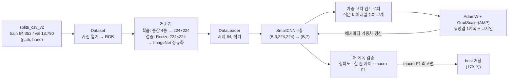
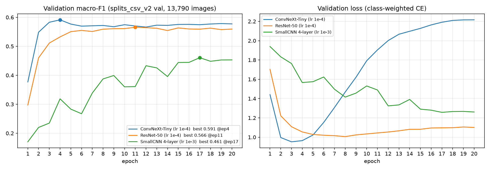
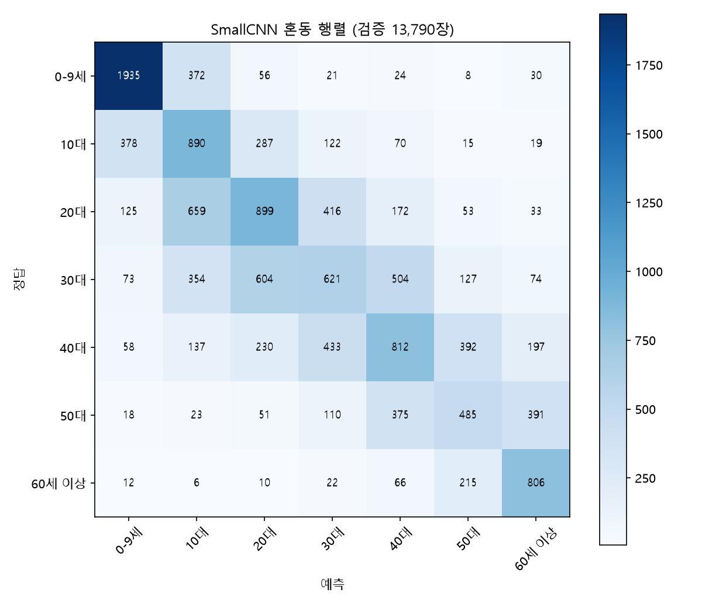

# 작은 CNN v2 학습 — 팀 조건 대조, 검증 결과, 개념 정리

- **날짜**: 2026-11-28
- **프로젝트**: 얼굴 이미지 기반 나이대 분류 (인공지능 4조)
- **담당**: 임성빈 — 작은 CNN(4층)
- **작업 범위**: v2 데이터(`splits_csv_v2`)로 학습한 작은 CNN(`results/small_cnn_v2_lr1e-3`)이 팀원 학습 코드(`step4_train.py`)와 같은 조건인지 줄 단위로 대조 → 저장 형식을 팀원과 맞춤 → 검증(val) 결과 정리 → ConvNeXt·ResNet-50과 비교
- **상태**: ✅ 완료 — **학습 결과에 영향을 주는 조건은 모두 같다(학습률 1e-3만 의도한 차이).** 그래서 다시 학습하지 않았다. 검증 macro-F1은 **0.461** (ConvNeXt 0.591, ResNet-50 0.566)
- **시험 데이터(test.csv)는 사용하지 않음** — 팀이 최종 모델을 정한 뒤 한 번만 평가
- **결과 파일**: `작은CNN/results/small_cnn_v2_lr1e-3/` — `learning_curve.png`, `confusion_matrix.png`, `val_f1_compare_3models.png`, `small_cnn_best.pth`(원본), `best.pt`(팀 형식, `.gitignore`의 `*.pt` 때문에 내 PC에만 있음)

---

## 0. 한 일 요약

1. 사진 폴더 확인: 팀원 `run_v2.bat`의 `data_v2`는 `division_224AFAD-X`를 복사한 폴더다(`run_v2.bat:4`). 내 PC에는 `C:\3th_project\whats_your_face_age\division_224AFAD-X`로 있고, `splits_csv_v2`의 train 64,353 / val 13,790 / test 13,789줄이 **전부 실제 파일과 일치**(없는 파일 0개).
2. 팀원 코드와 학습 조건 대조 (아래 [1장](#1-팀원-코드와-학습-조건-대조)) → 다시 학습할 필요 없음.
3. 저장 형식 맞춤: 원래 `small_cnn_best.pth`(가중치만)를 불러 팀원과 같은 `{model, model_name: "small_cnn_4layers", epoch: 17}` 형식으로 `best.pt`에 추가 저장. 두 파일로 같은 입력을 넣었을 때 출력이 **완전히 같음**을 확인했다. 원본은 그대로 둠.
4. 검증 결과 그림 3장 정리, 세 모델 비교표 작성.

---

## 1. 팀원 코드와 학습 조건 대조

- 팀원 코드: `ConvNeXt/code/step4_train.py`, `common.py` (ResNet50 폴더의 두 파일도 내용이 같음)
- 내 코드: `작은CNN/CNN_4layers_unified.py`, 실제 실행 기록은 내 PC `results/small_cnn_v2_lr1e-3/config.json`

| 항목 | 팀원 값 (파일:줄) | 내 학습 값 (파일:줄) | 일치 |
|---|---|---|---|
| 학습 증강 | `RandomResizedCrop(224, scale 0.9~1.0, ratio 0.95~1.05)` → 좌우 뒤집기 → 회전 10° → `ColorJitter(밝기 0.2, 대비 0.2)` (`common.py:31-37`) | 같은 4가지, 같은 값 (`CNN_4layers_unified.py:93-97`) | ✅ |
| 검증 transform | `Resize((224,224))` → `ToTensor` → `Normalize` (`common.py:38-40`) | 같음 (`:103-107`) | ✅ |
| 정규화 | ImageNet mean (0.485, 0.456, 0.406) / std (0.229, 0.224, 0.225) (`common.py:13-14`) | 같음 (`:64-65`) | ✅ |
| 가중 손실 | `전체 / (7 × 나이대 장수)`, `CrossEntropyLoss(weight=)` (`step4_train.py:113-117`) | 같은 식 (`:175-178`, `:353`). 실제 값 [0.805, 1.106, 0.836, 0.836, 0.872, 1.356, 1.733] (`config.json`) | ✅ |
| AdamW | `weight_decay=0.05`, 작은 CNN이면 출력층도 같은 학습률 (`step4_train.py:122-123`) | `AdamW(lr, weight_decay=0.05)` 하나로 전체 (`:59`, `:355`) | ✅ (같은 계산) |
| 워밍업 + 코사인 | 워밍업 = 1 에폭(`len(tr_dl)`), 이후 코사인, 배치마다 갱신 (`step4_train.py:126-134`) | 같음: 워밍업 1,005스텝 / 전체 20,100스텝 (`:191-204`, `:356-359`) | ✅ |
| 처음 1 에폭 출력층만 학습 | 사전학습 모델만. `small_cnn`이면 안 함 (`step4_train.py:150`) | 안 함 | ✅ (작은 CNN 경로와 같음) |
| AMP | 학습·검증 모두 `autocast` + `GradScaler` (`step4_train.py:46-56`, `:135`) | 같음 (`:229`, `:239-241`, `:257`, `:360`) | ✅ |
| 배치 | 학습 64, `drop_last=True` (`step4_train.py:78`, `:105`) | 64, `drop_last=True` (`:56`, `:345`) | ✅ |
| 에폭 | 20, `run_v2.bat`에서 `--patience 100` → 조기 종료 사실상 없음 (`run_v2.bat:7`) | 20, 조기 종료 없음 (`:70`) | ✅ |
| 시드 | `torch.manual_seed(42)` + `np.random.seed(42)` (`step4_train.py:88-89`) | `torch.manual_seed(42)` (`:57`, `:310`) | ✅ (넘파이 난수는 학습에 안 쓰임) |
| 학습률 | 1e-4, 출력층 1e-3 (`step4_train.py:75`, `:122`. `run_v2.bat`은 `--lr`을 안 줌) | **1e-3** (`:71`, `config.json`) | ⚠ **의도한 차이** — 처음부터 배우는 모델이라 1e-3 (예전 데이터에서 1e-4: 0.401, 1e-3: 0.505) |
| best 선택 | 검증 macro-F1이 이전 최고보다 **클 때** 저장 (`step4_train.py:164-166`) | 같음 (`:400-402`) | ✅ |
| 사용한 CSV | `splits_csv_v2/train.csv`, `val.csv`, 사진 `data_v2` (`run_v2.bat:7`) | `splits_csv_v2\train.csv`, `val.csv`, 사진 `division_224AFAD-X` (`config.json`) | ✅ (같은 사진) |

**결과에 영향이 없는 차이** (그래서 다시 학습하지 않음):

| 항목 | 팀원 | 나 | 영향이 없는 이유 |
|---|---|---|---|
| 검증 배치 | 128 (`step4_train.py:106`) | 64 | 평가 모드에서는 BatchNorm이 저장된 통계를 써서 배치 크기와 상관없이 같은 예측 |
| `persistent_workers` | 없음 | 있음 | 속도만 달라짐 |
| 저장 형식 | `best.pt` = `{model, model_name, epoch}`, `history.csv`, `last.pt` | `small_cnn_best.pth` = 가중치만, `small_cnn_history.csv` | 형식만 다름 → `best.pt`를 추가로 저장 |
| history 열 | `head_only` 열 있음 | 없음 | 작은 CNN은 항상 False |

---

## 2. 전체 흐름

글로 적으면: **CSV에서 사진 경로와 나이대 번호를 읽고 → 사진을 224×224로 맞춰 정규화하고 → 64장씩 묶어 모델에 넣고 → 7개 점수와 정답으로 손실을 계산하고 → AdamW가 가중치를 조금 고친다.** 이걸 에폭당 1,005번, 20 에폭 반복하고, 매 에폭 끝에 검증 사진으로 macro-F1을 재서 가장 높았던 에폭의 가중치를 남긴다.

---

## 3. 파일별·함수별 역할

| 파일 | 함수·클래스 | 역할 |
|---|---|---|
| `작은CNN/CNN_4layers_unified.py` | `parse_args` | 명령줄 옵션(에폭, 학습률, CSV 폴더, 사진 폴더 등) 읽기 |
| | `train_transform`, `val_transform` | 학습용(증강 있음) / 검증용(크기만 맞춤) 전처리 |
| | `FaceCSVDataset` | CSV 한 줄 → (사진 텐서, 나이대 번호). 사진은 필요할 때마다 파일에서 읽음 |
| | `SmallCNN` | 4층 합성곱 모델 ([5장](#5-4층-cnn-층별-크기)) |
| | `class_weights` | 나이대별 손실 가중치 계산, 팀 기준값과 다르면 멈춤 |
| | `make_lr_lambda` | 워밍업 + 코사인 학습률 배율 함수 |
| | `train_one_epoch` | 학습 1 에폭: 순전파 → 손실 → 역전파 → 가중치 갱신 → 학습률 갱신 |
| | `evaluate` | 검증 1 에폭: 손실, 정확도, 한 칸 차이 정확도, macro-F1 |
| | `plot_curves` | 학습 곡선 그림 (`learning_curve.png`) |
| | `if __name__ == "__main__":` | 실행부. 윈도우에서 `num_workers > 0`이면 자식 프로세스가 파일을 다시 import하므로, 학습 코드를 이 안에 둬야 무한 반복 실행이 안 됨 |
| `작은CNN/eval_small_cnn.py` | `predict_all` | 저장된 가중치로 검증 사진 전체 예측 |
| | `plot_confusion` | 혼동 행렬 그림 (`confusion_matrix.png`) |
| | 실행부 | `metrics.json`, `per_band.csv`(나이대별 정밀도·재현율·F1), `predictions.csv` 저장 |
| `ConvNeXt/code/common.py` (팀원) | `BANDS`, `build_transforms`, `FaceDataset`, `build_model`, `compute_metrics` | 나이대 정의, 전처리, 데이터셋, 모델 생성, 지표. 위 대조표의 기준 |
| `ConvNeXt/code/step4_train.py` (팀원) | `run_epoch`, `main` | 팀원 학습 루프. 위 대조표의 기준 |
| `ConvNeXt/code/run_v2.bat` (팀원) | — | v2 학습 명령 (사용한 CSV·옵션의 근거) |

---

## 4. 핵심 개념 쉬운 설명

### 4-1. 가중 손실 (class-weighted cross entropy)
- **문제**: 학습 사진이 0-9세는 11,416장인데 60세 이상은 5,304장이다. 그냥 학습하면 모델은 "많이 나오는 나이대"를 맞히는 쪽으로 기운다.
- **해결**: 틀렸을 때의 벌점(손실)에 나이대별 배수를 곱한다. 배수 = `전체 장수 / (7 × 그 나이대 장수)`. 사진이 평균보다 적으면 1보다 크고, 많으면 1보다 작다.
- **v2 값**: 0-9세 0.81, 10대 1.11, 20대·30대 0.84, 40대 0.87, 50대 1.36, **60세 이상 1.73**. 60세 이상 사진 1장을 틀리면 0-9세 사진 2장을 틀린 것보다 조금 더 큰 벌점을 받는다.

### 4-2. AdamW
- **Adam**: 가중치마다 "최근 기울기의 평균(방향)"과 "기울기 크기의 평균"을 기억해서, 자주 크게 흔들리는 가중치는 조금씩, 잘 안 움직이는 가중치는 더 크게 고친다. 학습률을 가중치마다 자동으로 조절하는 셈이다.
- **W (weight decay를 분리)**: 매 스텝 가중치를 조금씩 0쪽으로 당긴다(여기서는 0.05). 가중치가 너무 커지지 않게 해서 과적합을 줄인다. Adam에 weight decay를 그냥 넣으면 위의 "자동 조절"에 섞여 효과가 약해지는데, AdamW는 그 계산과 따로 적용해서 의도대로 작동한다.

### 4-3. 워밍업 + 코사인 학습률
- 학습률 = 한 번에 가중치를 얼마나 크게 고칠지.
- **워밍업(첫 1 에폭, 1,005스텝)**: 0에 가까운 값에서 1e-3까지 직선으로 올린다. 처음에는 가중치가 무작위라 기울기가 크고 엉망인데, 이때 큰 학습률을 쓰면 크게 튀어 학습이 망가질 수 있다.
- **코사인(나머지 19 에폭)**: 1e-3에서 0까지 코사인 곡선 모양으로 줄인다. 처음엔 천천히, 중간엔 빠르게, 끝에선 다시 천천히 줄어든다. 초반엔 크게 움직여 좋은 영역을 찾고, 끝에선 작게 움직여 미세 조정한다.
- `learning_curve.png` 오른쪽 그림이 이 모양이다.

### 4-4. AMP (자동 혼합 정밀도)
- 보통은 모든 계산을 32비트 소수(float32)로 한다. AMP는 합성곱·행렬곱처럼 안전한 계산을 16비트(float16)로 해서 **GPU 계산이 빨라지고 메모리를 덜 쓴다.** 손실·softmax처럼 정밀도가 필요한 계산은 자동으로 32비트를 유지한다.
- 16비트는 아주 작은 수를 표현하지 못해서 작은 기울기가 0이 될 수 있다. **GradScaler**가 손실에 큰 수를 곱해 기울기를 키운 뒤 역전파하고, 가중치를 고치기 직전에 다시 나눠서 원래 크기로 되돌린다. 기울기가 inf/NaN이면 그 배치는 건너뛴다.
- 확인: AMP로 잰 검증 macro-F1 0.4608, 32비트로 다시 잰 값 0.4605 → 결과에 거의 영향 없음.

### 4-5. macro-F1
- **정밀도(precision)**: "30대"라고 예측한 것 중 진짜 30대 비율.
- **재현율(recall)**: 진짜 30대 중 "30대"라고 맞힌 비율.
- **F1**: 둘의 조화평균. 둘 중 하나만 높으면 낮게 나온다(예측을 남발하면 정밀도가, 너무 아끼면 재현율이 떨어짐).
- **macro-F1**: 7개 나이대 F1의 단순 평균. 사진 수와 상관없이 모든 나이대를 같은 무게로 본다. 그래서 정확도와 달리 **적은 나이대(50대, 60세 이상)를 못 맞히면 점수가 확 떨어진다.** 팀이 best 선택 기준으로 쓰는 이유.
- **한 칸 차이 정확도(off1)**: 정답과 예측이 1칸 이내면 맞은 것으로 친다. 나이대는 순서가 있어서 "30대를 20대로" 틀린 것과 "30대를 60세 이상으로" 틀린 것은 다른 실수다.

---

## 5. 4층 CNN 층별 크기

입력 1장 기준. 각 블록 = `Conv 3×3 (padding 1) → BatchNorm → ReLU → MaxPool 2×2`. 합성곱은 크기를 유지하고, MaxPool이 가로·세로를 절반으로 줄인다.

| 단계 | 출력 크기 (채널×높이×너비) | 파라미터 수 | 한 칸이 보는 원본 범위(수용 영역) |
|---|---|---|---|
| 입력 | 3 × 224 × 224 | — | 1 × 1 |
| 블록 1: Conv(3→32) + BN | 32 × 224 × 224 | 864 + 64 = 928 | 3 × 3 |
| MaxPool | 32 × 112 × 112 | 0 | 4 × 4 |
| 블록 2: Conv(32→64) + BN | 64 × 112 × 112 | 18,432 + 128 = 18,560 | 8 × 8 |
| MaxPool | 64 × 56 × 56 | 0 | 10 × 10 |
| 블록 3: Conv(64→128) + BN | 128 × 56 × 56 | 73,728 + 256 = 73,984 | 18 × 18 |
| MaxPool | 128 × 28 × 28 | 0 | 22 × 22 |
| 블록 4: Conv(128→256) + BN | 256 × 28 × 28 | 294,912 + 512 = 295,424 | 38 × 38 |
| MaxPool | 256 × 14 × 14 | 0 | 46 × 46 |
| Global Average Pooling | 256 × 1 × 1 → 펼쳐서 256 | 0 | (14×14칸의 평균) |
| Dropout 0.3 | 256 | 0 | |
| Linear(256→7) | **7** (나이대 점수) | 1,792 + 7 = 1,799 | |
| **합계** | | **390,695** | |

- Conv 파라미터 = 입력 채널 × 출력 채널 × 3 × 3 (편향 없음, BN이 대신함). BN은 채널마다 2개(γ, β).
- 파라미터의 75%가 마지막 합성곱(블록 4)에 있다.
- **수용 영역**: 마지막 특징 지도의 한 칸이 원본에서 보는 범위가 **46×46픽셀**(224의 약 1/5)이다. 그래서 이 모델은 얼굴 전체 구조를 한 번에 보지 못하고, 부분 특징(주름·피부 결·윤곽 일부)을 14×14칸에서 찾아 평균 내서 판단한다. 사전학습 모델과 차이 나는 이유 중 하나다 ([6-3](#6-3-사전학습-모델과-차이-나는-이유)).

---

## 6. 결과 (검증 13,790장)

### 6-1. 세 모델 비교

| 모델 | 파라미터 | 사전학습 | 학습률 (몸통 / 출력층) | best 에폭 | 정확도 | 한 칸 차이 | **macro-F1** | 기준 |
|---|---|---|---|---|---|---|---|---|
| ConvNeXt-Tiny (`convnext_tiny.fb_in1k`) | 27.8M | ImageNet-1k | 1e-4 / 1e-3 | 4 | 58.6% | 94.2% | **0.591** | val |
| ResNet-50 (`resnet50`) | 23.5M | ImageNet | 1e-4 / 1e-3 | 11 | 56.7% | 92.0% | **0.566** | val |
| 작은 CNN 4층 (내 모델) | **0.39M** | 없음 | 1e-3 / 1e-3 | 17 | 46.8% | 83.2% | **0.461** | val |

- 세 값 모두 **검증(val) 기준**이다. 시험(test) 점수는 아직 아무도 없다.
- 출처: 학습 중 매 에폭 검증 기록(`ConvNeXt/results/v2_convnext_history.csv`, `ResNet50/results/v2_resnet50_history.csv`, 내 PC `small_cnn_history.csv`)의 best 에폭 행. 팀원 `summary_val.csv`(0.592 / 0.565)와 소수 셋째 자리에서 반올림 차이만 있다.
- 작은 CNN은 파라미터가 ConvNeXt의 **1/71**인데 macro-F1은 0.13 낮다.

### 6-2. 작은 CNN 나이대별 결과

| 나이대 | 정밀도 | 재현율 | **F1** | 실제 장수 | 예측한 장수 | 쏠림 (예측/실제) |
|---|---|---|---|---|---|---|
| 0-9세 | 0.745 | 0.791 | **0.767** | 2,446 | 2,599 | 1.06 |
| 10대 | 0.365 | 0.500 | 0.422 | 1,781 | 2,441 | **1.37** |
| 20대 | 0.421 | 0.381 | 0.400 | 2,357 | 2,137 | 0.91 |
| 30대 | 0.356 | 0.263 | **0.303** | 2,357 | 1,745 | 0.74 |
| 40대 | 0.401 | 0.359 | 0.379 | 2,259 | 2,023 | 0.90 |
| 50대 | 0.375 | 0.334 | 0.353 | 1,453 | 1,295 | 0.89 |
| 60세 이상 | 0.520 | 0.709 | **0.600** | 1,137 | 1,550 | **1.36** |

(32비트로 다시 잰 값: 정확도 46.8%, macro-F1 0.4605. 내 PC `eval_val/per_band_with_bias.csv`)

**잘 맞히는 나이대: 양 끝 (0-9세 0.77, 60세 이상 0.60)**
- 아이 얼굴(큰 눈, 둥근 윤곽, 작은 코)과 노인 얼굴(깊은 주름, 흰머리)은 다른 나이대와 겉모습 차이가 크다.
- 양 끝은 한쪽에만 이웃이 있어서 헷갈릴 대상이 적다.

**못 맞히는 나이대: 가운데 (30대 0.30, 50대 0.35, 40대 0.38)**
- 30대 2,357장 중 621장만 맞혔다. 20대로 604장, 40대로 504장 → **틀린 것의 대부분이 바로 옆 나이대**다. 30대 얼굴은 20대·40대와 겉모습 차이가 작고, 나이대 경계(29세/30세)는 사람 눈으로도 구분이 어렵다.
- 그래서 정확도는 46.8%인데 **한 칸 차이 정확도는 83.2%**다. 크게 틀리기보다 옆 칸으로 틀린다.

**한쪽으로 쏠리는 예측**
- 10대와 60세 이상을 실제보다 1.4배 많이 예측한다. 둘 다 가중 손실 배수가 큰 나이대(1.11, 1.73)라 "틀리면 벌점이 큰" 쪽으로 예측이 끌려간 것으로 보인다. 그 대신 30대는 실제의 0.74배만 예측한다.
- 20대 실제 2,357장 중 659장을 10대로 예측했다. 개발일지 17·18에서 확인한 **"얼굴이 화면을 꽉 채우면 어리게 본다"는 지름길**도 원인 중 하나다(AAF 사진을 꽉 차게 자르면 평균 0.55칸 어리게 예측).

### 6-3. 사전학습 모델과 차이 나는 이유

1. **사전학습**: ConvNeXt·ResNet-50은 ImageNet 사진 약 128만 장으로 "윤곽·질감·부분 모양을 보는 법"을 먼저 배운 상태에서 시작한다. 작은 CNN은 무작위 가중치에서 6만 4천 장만으로 그걸 처음부터 배워야 한다. 위 그래프 왼쪽에서 사전학습 모델은 **2~3에폭 만에 0.5를 넘지만**, 작은 CNN은 12에폭에야 0.43에 도달한다.
2. **모델 크기와 깊이**: 파라미터가 60~70배 많고, 층이 수십 개라 단순한 특징을 여러 번 조합해 "눈가 주름 + 피부 처짐" 같은 복잡한 단서를 만들 수 있다. 작은 CNN은 합성곱 4개뿐이고, 한 칸이 보는 범위도 46×46픽셀이라 얼굴 전체 구조를 한 번에 보지 못한다.
3. **작은 CNN은 아직 덜 배운 상태(과소적합)**: 20에폭 끝에도 학습 정확도(45.7%)가 검증 정확도(46.1%)보다 낮고, 학습률이 0이 되는 마지막까지 점수가 오르는 중이었다. 반대로 ConvNeXt는 4에폭 이후 학습 정확도가 99.7%까지 올라가고 **검증 손실이 0.96 → 2.22로 커졌다(과적합)**. 검증 macro-F1은 0.57~0.58로 유지돼서 best 4에폭 가중치는 괜찮지만, 확신만 과도하게 커진 상태다. 즉 큰 모델은 "너무 잘 외우는" 문제, 작은 모델은 "표현력이 부족한" 문제를 가진다.
4. **차이가 가장 큰 곳**: 한 칸 차이 정확도는 83% vs 94%로 11%p 차이, macro-F1은 0.13 차이. 사전학습 모델은 틀려도 거의 항상 옆 칸으로 틀리고, 작은 CNN은 2칸 이상 틀리는 경우가 17%다.

---

## 7. 발표 예상 질문과 답

**Q1. 왜 작은 CNN만 학습률이 1e-3인가요? 공정한 비교가 아니지 않나요?**
> 사전학습 모델은 이미 좋은 가중치에서 시작해서 1e-4로 조금씩 고치는 게 맞지만, 작은 CNN은 무작위에서 시작해서 1e-4면 20에폭 안에 충분히 배우지 못합니다. 예전 데이터에서 같은 조건으로 1e-4와 1e-3을 둘 다 돌려 보니 macro-F1이 0.401 vs 0.505였습니다. 학습률 외에 데이터·증강·손실·옵티마이저·스케줄·AMP·배치·에폭·시드는 모두 같습니다. 각 모델에 맞는 학습률을 쓰는 게 공정한 비교라고 판단했습니다. 팀원 모델도 새로 붙인 출력층은 1e-3을 씁니다.

**Q2. 정확도가 아니라 macro-F1로 best를 고른 이유는?**
> 나이대별 사진 수가 최대 2배 넘게 차이 나서(0-9세 11,416장, 60세 이상 5,304장), 정확도는 많은 나이대만 잘 맞혀도 높게 나옵니다. macro-F1은 7개 나이대를 같은 무게로 평균하므로 적은 나이대를 무시하면 점수가 떨어집니다. 팀 공통 기준입니다.

**Q3. 가중 손실을 쓰면 무엇이 달라지나요? 부작용은 없나요?**
> 적은 나이대를 틀렸을 때 벌점이 커져서 모델이 그 나이대를 더 신경 씁니다. 부작용으로 배수가 큰 10대(1.11)·60세 이상(1.73)을 실제보다 약 1.4배 많이 예측하는 쏠림이 생겼습니다. 대신 60세 이상 재현율이 0.71로 높습니다. 정밀도와 재현율의 교환이라고 볼 수 있습니다.

**Q4. 작은 CNN이 정확도 47%면 쓸모가 있나요?**
> 7개 중 무작위로 고르면 약 14%라서 3배 이상입니다. 한 칸 차이까지 인정하면 83%입니다. 그리고 이 모델의 역할은 비교 기준(baseline)입니다. 파라미터 39만 개(ConvNeXt의 1/71), 사전학습 없이 이 정도가 나오고, 사전학습·큰 모델이 macro-F1을 0.13 더 올린다는 것을 보여 주는 게 목적입니다. 크기가 1.5MB라 휴대폰 같은 작은 기기에서 빠르게 돌릴 수 있다는 장점도 있습니다.

**Q5. 모델이 진짜 얼굴의 나이 특징을 보고 판단한다고 확신할 수 있나요?**
> 전부는 아닙니다. Grad-CAM 평균 히트맵(개발일지 15)에서 20대는 사진 위쪽 모서리, 30대는 아래 가장자리에 뜨거운 띠가 있어, 얼굴이 아닌 사진 형식을 단서로 쓸 가능성이 보였습니다. 이어서 출처별 분석(개발일지 17·18)에서 "얼굴이 화면을 꽉 채운 사진은 어리게 본다"는 지름길을 확인했습니다. AAF 사진을 꽉 차게 다시 자르면 평균 0.55칸 어리게 예측합니다. 데이터 출처마다 얼굴을 자른 방식이 달라서 생긴 문제라, 자르는 방식을 통일하면 개선될 수 있습니다.

---

## 8. 다음 할 일

- 팀이 최종 모델을 정하면 `test.csv`로 **한 번만** 평가 (세 모델 같은 조건)
- 세 모델의 나이대별 F1 비교: 팀원 가중치로 같은 검증 사진을 예측하면 "사전학습이 어느 나이대를 가장 많이 올리는지" 볼 수 있음
- `best.pt`를 저장소에 올릴지 팀과 상의 (지금은 `.gitignore`의 `*.pt` 때문에 제외됨)
