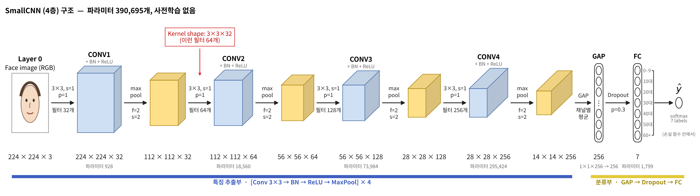
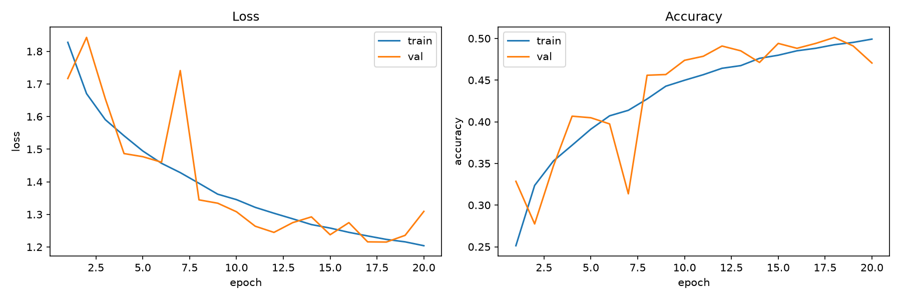
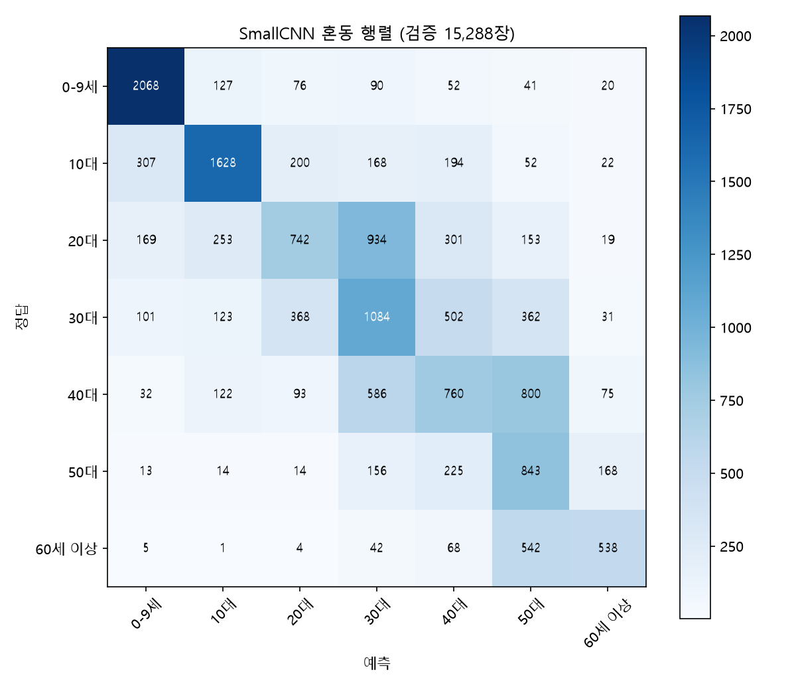
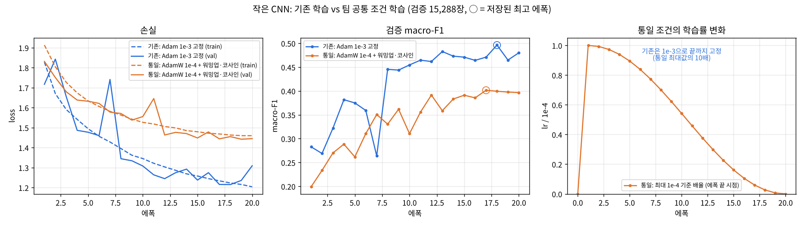
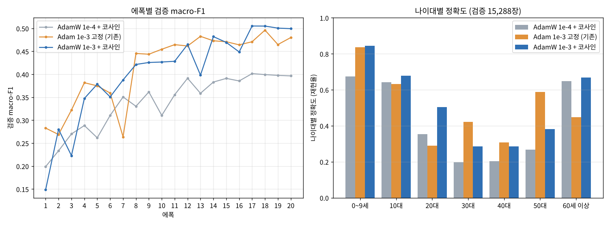
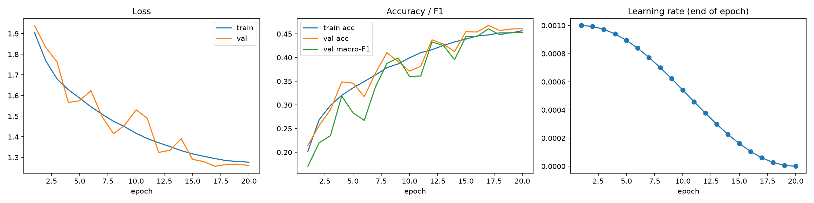
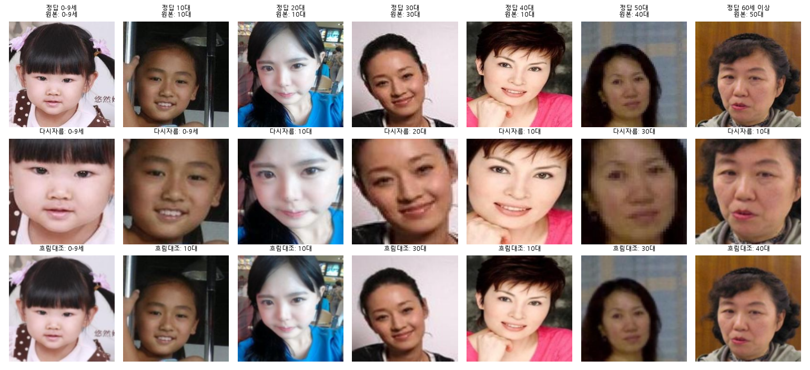

# 작은 CNN(4층) 학습 기록

전처리된 얼굴 사진(224×224)으로 **사전학습 없이 처음부터** 학습한 4층 CNN으로 7개 나이대(0~9세, 10대, 20대, 30대, 40대, 50대, 60세 이상)를 분류한 코드와 결과를 정리한 폴더

- **담당**: 임성빈 (LIM)
- **역할**: 사전학습 없는 **비교 기준(baseline) 모델**. ResNet-50·ConvNeXt-Tiny와 비교해 "사전학습 + 모델 크기"의 효과를 확인합니다.
- **구현 방식**: 바이브 코딩이 아니라 직접 이해하면서 작성했고, 모든 줄에 한국어 주석을 달았습니다.
- **진행 상황**: 본 학습(20 에폭), 검증 평가, 나이대별 성능 분석을 마쳤고, **팀 공통 학습 조건으로 다시 학습**하고, 같은 조건에서 **학습률만 1e-3으로 바꿔** 한 번 더 학습해 비교했습니다(2026-11-23). 이후 **새 데이터(v2, `splits_csv_v2`)로 다시 학습**하고(macro-F1 0.461), Grad-CAM·출처별 분석으로 **모델이 '얼굴이 화면에서 차지하는 크기'를 나이 단서로 쓴다**는 것을 확인했습니다(2026-11-28, [5-5](#5-5-새-데이터-v2로-다시-학습-2026-11-28)·[5-6](#5-6-판단-근거와-지름길-학습-분석-2026-11-28)). 자세한 과정은 [개발일지/LIM](../개발일지/LIM)에 있습니다.

> **용어 안내**
> - **에폭**: 학습 데이터 전체를 한 번 다 보는 것을 1에폭이라고 합니다.
> - **한 칸 차이 정확도**: 정답이거나 바로 옆 나이대를 맞힌 비율입니다.
> - **macro-F1**: 나이대마다 F1 점수를 따로 낸 뒤 평균한 값입니다. 사진이 적은 나이대의 성능도 똑같이 반영됩니다.

## 결과 요약

> **현재 기준은 v2 데이터 결과입니다.** 시연 앱도 v2 가중치를 씁니다.

| 데이터 | 학습 조건 | 검증 장수 | 정확도 | 한 칸 차이 정확도 | macro-F1 | 최고 에폭 | 가중치 |
|---|---|---:|---:|---:|---:|---:|---|
| **v2** (`splits_csv_v2`) | 팀 공통 조건 + 학습률 1e-3 | 13,790 | **46.8%** | **83.2%** | **0.461** | 17 | `results/small_cnn_v2_lr1e-3/small_cnn_best.pth` (저장소에 있음) |

v2는 사진 구성·장수·검증 세트가 달라 아래 예전 데이터 결과와 직접 비교할 수 없습니다 ([5-5](#5-5-새-데이터-v2로-다시-학습-2026-11-28)).

### 예전 데이터 결과 (검증 데이터 15,288장)

작은 CNN은 세 가지 학습 조건으로 학습했습니다. 모델 구조(파라미터 390,695개)와 데이터·증강·손실은 같고, **최적화 방법과 학습률만 다릅니다.**

| 학습 조건 | 정확도 | 한 칸 차이 정확도 | macro-F1 | 최고 에폭 | 결과 폴더 |
|---|---:|---:|---:|---:|---|
| **팀 공통 조건** (AdamW 1e-4, 워밍업·코사인, AMP) | 41.9% | 72.8% | **0.401** | 17 | `results/small_cnn_unified` |
| **팀 공통 조건 + 학습률 1e-3** (나머지 동일) | 51.8% | 82.9% | **0.505** | 17 | `results/small_cnn_unified_lr1e-3` |
| 기존 조건 (Adam 1e-3 고정) | 50.1% | 82.9% | **0.496** | 18 | `results/small_cnn_main` |

아래 표의 세 모델은 데이터·증강·손실·옵티마이저(AdamW)·스케줄(워밍업·코사인)·AMP·배치·에폭·시드가 모두 같습니다. 작은 CNN은 최대 학습률 1e-4(팀 공통 값)와 1e-3(처음부터 배우는 모델에 맞춘 값) 두 결과를 함께 적었습니다. **팀 비교표에 어느 값을 쓸지는 팀에서 정합니다.**

| 팀 공통 조건 | **작은 CNN (lr 1e-4)** | **작은 CNN (lr 1e-3)** | ResNet-50 | ConvNeXt-Tiny |
|---|---:|---:|---:|---:|
| 정확도 | **41.9%** | **51.8%** | 61.9% | 65.2% |
| 한 칸 차이 정확도 | **72.8%** | **82.9%** | 92.9% | 95.1% |
| macro-F1 | **0.401** | **0.505** | 0.615 | 0.648 |
| 두 칸 이상 틀린 비율 | **27.2%** | **17.1%** | 7.1% | 4.9% |
| 파라미터 수 | **약 39만** | **약 39만** | 약 2,500만 | 약 2,800만 |
| 사전학습 | 없음 | 없음 | ImageNet | 더 큰 데이터 |

- 무작위로 찍으면 정확도는 약 14%(1/7)입니다. 작은 CNN에 맞는 학습률(1e-3)을 써도 사전학습 모델과 macro-F1 약 0.11~0.14 차이가 납니다. 이것이 **"사전학습 + 모델 크기"의 효과**입니다.
- 학습률 1e-4는 사전학습 모델 미세조정용 값이라, 처음부터 배우는 작은 CNN에는 작습니다. 1e-3으로 올리자 macro-F1이 0.401 → 0.505로 올랐습니다 ([5-4](#5-4-팀-공통-조건--학습률-1e-3-2026-11-23)).
- 세 조건 모두 과적합은 없고, 아직 덜 배운 상태(과소적합)입니다.

---

## 1. 폴더 구성

```
작은CNN/
├── README.md                    ← 이 문서
├── CNN_4layers.py               ← 학습 코드 (기존 조건, 모듈 4-1 ~ 4-5)
├── CNN_4layers_unified.py       ← 학습 코드 (팀 공통 조건: CSV, AdamW, 워밍업·코사인, AMP)
├── make_splits_csv.py           ← data/ 폴더 → splits_csv 만들기
├── eval_small_cnn.py            ← 평가 전용 코드 (학습 없이 저장된 모델만 평가)
├── gradcam_analysis.py          ← Grad-CAM 판단 근거 분석 (개발일지 15)
├── edge_check.py                ← 가장자리 Grad-CAM 원인 확인, 가장자리 가림 (개발일지 16)
├── source_check.py              ← 출처(FairFace·UTKFace·AAF)별 성능·얼굴 크기, 중앙 가림 대조 (개발일지 17)
├── aaf_recrop.py                ← AAF 다시 자르기 실험, 해상도 대조 (개발일지 18)
├── requirements.txt             ← 실행 환경 패키지 목록
├── splits_csv/                  ← train.csv / val.csv / test.csv (71,735 / 15,288 / 15,289장)
└── results/
    ├── small_cnn_v2_lr1e-3/     ← v2 데이터 결과 (2026-11-28). best 가중치(17 에폭)만 저장소에 올림, 나머지는 내 PC
    ├── small_cnn_unified_lr1e-3/← 팀 공통 조건 + 학습률 1e-3 결과 (2026-11-23, 형식은 small_cnn_unified와 같음)
    ├── small_cnn_unified/       ← 팀 공통 조건 본 학습 결과 (2026-11-23)
    │   ├── config.json          ← 사용한 학습 조건 전부
    │   ├── small_cnn_best.pth   ← 17 에폭 모델 가중치
    │   ├── small_cnn_history.csv← 에폭별 학습 기록 (lr 열 포함)
    │   ├── learning_curve.png   ← 학습 곡선
    │   ├── train_log.txt        ← 실행 로그
    │   └── eval_val/            ← 평가 결과 (형식은 아래 small_cnn_main/eval_val과 같음)
    ├── check_subset100/         ← 점검: 100장 과적합 테스트 (통일 코드)
    ├── check_full2/             ← 점검: 전체 데이터 2 에폭 (통일 코드)
    └── small_cnn_main/          ← 기존 조건 본 학습 결과 (2026-11-12)
        ├── README.md            ← 학습 조건, 최고 성적, 모델 불러오는 방법
        ├── CNN_4layers_used.py  ← 이 결과를 만든 코드 그대로
        ├── small_cnn_best.pth   ← 18 에폭 모델 가중치 (1.5MB)
        ├── small_cnn_history.csv← 에폭별 학습 기록
        ├── learning_curve.png   ← 학습 곡선
        ├── pred_samples.png     ← 검증 무작위 8장 예측
        └── eval_val/            ← 평가 결과 (2026-11-23)
            ├── metrics.json         정확도, 한 칸 차이 정확도, macro-F1
            ├── per_band.csv         나이대별 정밀도·재현율·F1·장수
            ├── confusion_matrix.png 혼동 행렬
            └── predictions.csv      사진마다 정답과 예측
```

## 2. 코드 구성 (`CNN_4layers.py`)

코드는 모듈 5개로 나뉘어 있고, 파일 안에 `▶ [모듈 4-x 시작]` / `◀ [모듈 4-x 끝]` 표시가 있습니다.

| 모듈 | 내용 | 만들어지는 것 |
|---|---|---|
| 4-1 데이터셋 구성 | ImageFolder로 사진 불러오기, 전처리·증강, DataLoader | `train_loader`, `val_loader` |
| 4-2 모델 | SmallCNN: [Conv 3×3 → BN → ReLU → MaxPool] × 4 → GAP → Dropout 0.3 → Linear | `model` |
| 4-3 손실·최적화 | 나이대별 가중치를 넣은 CrossEntropyLoss, Adam | `criterion`, `optimizer` |
| 4-4 학습 루프 | 에폭마다 학습·검증, macro-F1이 가장 높을 때 모델 저장 | `small_cnn_best.pth`, `small_cnn_history.csv` |
| 4-5 시각화 | 학습 곡선, 예측 샘플 그림 | `learning_curve.png`, `pred_samples.png` |

모델 구조 (채널 3 → 32 → 64 → 128 → 256, 이미지 크기 224 → 112 → 56 → 28 → 14 → 1):



## 3. 실행 방법

### 3-1. 준비

```
프로젝트 폴더/
├── data/
│   ├── training/     ← 0 9, 10 19, 20 29, 30 39, 40 49, 50 59, 60over 폴더 (71,735장)
│   └── validation/   ← 같은 폴더 구성 (15,288장)
├── CNN_4layers.py
└── eval_small_cnn.py
```

- 데이터는 팀원이 7개 나이대로 나눈 `split_result_224.zip`(학습 70 : 검증 15 : 시험 15)을 사용합니다. 사진은 용량 때문에 git에 올리지 않았습니다.
- 패키지 설치: `pip install -r requirements.txt` (PyTorch는 CUDA 12.6 버전)

### 3-2. 학습 (기존 조건)

```
python CNN_4layers.py
```

- 파일 위쪽의 `USE_SUBSET` 값으로 모드를 바꿉니다.
  - `True`: 100장 과적합 테스트 (코드에 버그가 없는지 몇 분 만에 확인)
  - `False`: 본 학습 (전체 데이터, 20 에폭, 약 1시간 50분)
- 실행하면 프로젝트 폴더에 `small_cnn_best.pth`, `small_cnn_history.csv`가 **덮어쓰기**됩니다. 결과를 남기려면 `results/` 아래 새 폴더로 옮겨 두세요.

### 3-2-1. 팀 공통 조건으로 학습

```
python make_splits_csv.py                   # 처음 한 번만: data/ → splits_csv/
python CNN_4layers_unified.py               # 20 에폭, 결과는 results/small_cnn_unified/
python CNN_4layers_unified.py --lr 1e-3 --out-dir results/small_cnn_unified_lr1e-3   # 학습률만 1e-3
```

- 프로젝트 폴더(`data/`, `splits_csv/`가 있는 위치)에서 실행합니다.
- 옵션: `--epochs`(20), `--lr`(1e-4), `--workers`(4), `--out-dir`, `--subset N`(N장만 쓰는 점검용), `--stop-after K`(K 에폭만 돌고 멈춤, 점검용)
- 결과는 `--out-dir` 폴더에 저장되므로 기존 결과를 덮어쓰지 않습니다.
- RTX GPU + AMP 기준 에폭당 약 2~5분 (기존 코드의 약 1/2.8)

### 3-2-2. v2 데이터로 학습·평가 (현재 기준)

```
python CNN_4layers_unified.py --csv-dir ..\splits_csv_v2 --image-root <사진 폴더>\division_224AFAD-X --out-dir results\small_cnn_v2_lr1e-3
python eval_small_cnn.py --csv-dir ..\splits_csv_v2 --image-root <사진 폴더>\division_224AFAD-X --weights results\small_cnn_v2_lr1e-3\small_cnn_best.pth --out-dir results\small_cnn_v2_lr1e-3\eval_val --workers 4
```

- `--lr` 기본값은 이제 **1e-3**입니다 (작은 CNN만 팀 공통 값과 다름, 개발일지 12·14).
- `splits_csv_v2/`는 저장소 최상위에 있고, 사진 폴더 `division_224AFAD-X/`는 용량 때문에 올리지 않았습니다.

### 3-2-3. 분석 스크립트 (재학습 없음, 검증 데이터만)

모두 사진·결과가 있는 프로젝트 폴더에서 `--device cpu`로 실행합니다. 정확한 명령은 각 파일 맨 위 `[실행]` 주석에 있습니다.
`--csv` 이름에 `test`가 있으면 멈춥니다 (시험 데이터는 최종 모델을 정한 뒤 한 번만).

| 스크립트 | 입력 | 결과 | 개발일지 |
|---|---|---|---|
| `gradcam_analysis.py` | v2 가중치, `val.csv`, `predictions.csv` | 나이대별·헷갈린 쌍 Grad-CAM, 평균 히트맵, 얼굴 구역 비율 | 15 |
| `edge_check.py` | 같음 | 가장자리 열점 사진 모아 보기, 가장자리 10% 가림 재현율 | 16 |
| `source_check.py` | 같음 + `train.csv` | 출처 규칙 점검, 나이대 × 출처 구성, 출처별 성능, 얼굴 크기, 중앙 가림 대조 | 17 |
| `aaf_recrop.py` | 같음 | 원본 / 다시자름 / 흐림대조 예측 비교 (출처 × 나이대) | 18 |

### 3-3. 평가 (학습 없이)

```
python eval_small_cnn.py
```

- 기본값은 저장된 `results/small_cnn_main/small_cnn_best.pth`를 불러와 검증 데이터 전체를 평가하고, 결과를 `results/small_cnn_main/eval_val/`에 저장합니다. 출력 형식은 팀원 `step5_evaluate.py`와 같습니다.
- 기본 경로는 **프로젝트 폴더 최상위에서 실행**하는 기준입니다. 다른 위치에서 실행하면 경로를 직접 지정합니다.

```
python eval_small_cnn.py --weights 가중치경로 --data-dir 검증폴더 --out-dir 결과폴더 --workers 4
```

- ⚠️ 다른 결과를 평가할 때는 `--weights`와 `--out-dir`를 꼭 같이 지정합니다. 빼면 `small_cnn_main/eval_val`을 덮어씁니다.
- 출력 마지막의 `기록값 비교`와 `metrics.json`의 `best_epoch`는 기존 조건 값(0.5012 / 0.4962, 18 에폭)으로 고정돼 있어서, 다른 결과를 평가하면 "불일치"로 나옵니다. 학습 로그의 최고 에폭 값과 같으면 정상입니다.

- `CNN_4layers.py`를 `import`하면 학습이 다시 시작되기 때문에, 모델과 검증용 전처리는 `CNN_4layers_used.py`에서 그대로 옮겨 왔습니다.

## 4. 학습 조건 (기존 조건, 팀 공통 조건과의 차이)

| 항목 | 값 | 팀원과 같은가 |
|---|---|---|
| 데이터 | 학습 71,735장 / 검증 15,288장 | ✅ |
| 입력 크기 | 224×224, ImageNet 평균·표준편차로 정규화 | ✅ |
| 증강 (학습만) | RandomResizedCrop(0.9~1.0), 좌우 반전, ±10° 회전, 밝기·대비 ±0.2 | ✅ |
| 손실 | CrossEntropyLoss + 나이대별 가중치 `[0.89 0.85 0.85 0.85 0.85 1.51 1.94]` | ✅ |
| 최적화 | Adam, 학습률 0.001 **고정** | ✖ (팀원: AdamW + 워밍업·코사인) |
| 배치 / 에폭 / 시드 | 64 / 20 / 42 | ✅ |
| 최고 모델 기준 | 검증 macro-F1 | ✅ |
| 조기 종료 | 없음 (20 에폭 끝까지) | ✖ |

## 5. 결과

### 5-1. 학습 곡선 (기존 조건)



- 학습·검증 곡선이 거의 붙어서 함께 올라갑니다 → **과적합 없음**.
- 학습 손실이 20 에폭까지 계속 내려갑니다 → **아직 수렴 전**이라 에폭을 늘리면 더 오를 여지가 있습니다.
- 검증 곡선이 7·20 에폭에서 크게 튑니다. 학습률 0.001을 끝까지 고정한 것이 주된 원인으로 보입니다. macro-F1 기준으로 18 에폭 모델을 저장해서 마지막 에폭의 하락 영향은 받지 않았습니다.

### 5-2. 나이대별 성능 (기존 조건)



| 나이대 | 정밀도 | 재현율 (나이대별 정확도) | F1 | ResNet-50 정확도 | ConvNeXt 정확도 |
|---|---:|---:|---:|---:|---:|
| 0~9세 | 0.767 | **0.836** | **0.800** | 91% | 93% |
| 10대 | 0.718 | 0.633 | 0.673 | 75% | 77% |
| 20대 | 0.496 | **0.289** | 0.365 | 58% | 64% |
| 30대 | 0.354 | 0.422 | 0.385 | 47% | 50% |
| 40대 | 0.362 | 0.308 | **0.333** | 45% | 48% |
| 50대 | **0.302** | 0.588 | 0.399 | 48% | 52% |
| 60세 이상 | 0.616 | 0.448 | 0.519 | 66% | 71% |

- **0~9세가 가장 쉽습니다.** 사전학습 없이도 84%를 맞혔습니다.
- **틀린 사진의 65.7%는 바로 옆 나이대**입니다. 팀원 모델과 같은 경향입니다.
- **20대가 가장 약합니다(29%).** 20대 사진의 36%를 30대로 예측했습니다. 팀원 모델은 30~50대가 가장 어려웠던 것과 다릅니다.
- **50대로 몰아서 예측합니다.** "50대" 예측이 실제 50대 장수의 1.95배라서, 정확도는 높지만 정밀도는 가장 낮습니다. 40대와 60세 이상의 상당수가 50대로 예측됐습니다.
- 실제보다 나이를 **많게** 예측한 경우(28.7%)가 **적게** 예측한 경우(21.2%)보다 많습니다.

### 5-3. 팀 공통 조건으로 다시 학습 (2026-11-23)



| 나이대 | 기존 조건 정확도 | **팀 공통 조건 정확도** |
|---|---:|---:|
| 0~9세 | 83.6% | **67.5%** |
| 10대 | 63.3% | **64.3%** |
| 20대 | 28.9% | **35.3%** |
| 30대 | 42.2% | **19.7%** |
| 40대 | 30.8% | **20.4%** |
| 50대 | 58.8% | **26.8%** |
| 60세 이상 | 44.8% | **64.8%** |

- **성능이 내려간 이유**: 학습률이 기존의 1/10이라 다 배우기 전에 코사인 감소로 학습률이 0이 되었습니다 (마지막 train acc 40.6%).
- **좋아진 점**: 학습률이 줄어든 15 에폭 이후에는 검증 F1이 0.386~0.402로 안정적입니다. 기존 학습의 출렁임이 **고정 학습률** 때문이었다는 것을 확인했습니다. AMP와 `num_workers`로 에폭당 시간도 약 2.8배 빨라졌습니다.
- **예측 쏠림**: 60세 이상을 실제의 1.65배 예측하고, 30~50대는 20% 안팎으로 떨어졌습니다. 덜 배운 모델일수록 손실 가중치가 큰 나이대로 예측이 쏠리는 것으로 보입니다.
- 자세한 내용: [개발일지 11](../개발일지/LIM/2026-11-23_11_팀공통조건_재학습.md)

### 5-4. 팀 공통 조건 + 학습률 1e-3 (2026-11-23)

5-3의 원인이 학습률이라는 것을 확인하려고, 팀 공통 조건 코드를 그대로 두고 **최대 학습률만 1e-3으로** 바꿔 학습했습니다.



| 나이대 | 기존 조건 | 팀 공통 (1e-4) | **팀 공통 + 1e-3** |
|---|---:|---:|---:|
| 0~9세 | 83.6% | 67.5% | **84.4%** |
| 10대 | 63.3% | 64.3% | **67.9%** |
| 20대 | 28.9% | 35.3% | **50.3%** |
| 30대 | 42.2% | 19.7% | **28.6%** |
| 40대 | 30.8% | 20.4% | **28.5%** |
| 50대 | 58.8% | 26.8% | **38.2%** |
| 60세 이상 | 44.8% | 64.8% | **66.7%** |

- **최고 검증 macro-F1 0.505 (17 에폭)**: 1e-4(0.401)보다 0.10 넘게 높고, 기존 조건(0.496)과 같거나 약간 높습니다 (시드 하나로 한 번 학습한 결과).
- **안정성**: 앞부분은 학습률이 커서 출렁이지만, 학습률이 줄어든 14 에폭 이후에는 F1이 0.482~0.505로 안정적입니다. 에폭당 약 126초로 기존 조건의 약 2.5배 빠릅니다.
- **예측이 고르게 바뀜**: 기존 모델의 약점이던 20대가 28.9% → 50.3%로 올랐고, 50대로 몰아 예측하던 경향(1.95배 → 1.20배)이 줄었습니다. 대신 이제 30~40대가 가장 어렵습니다(약 28%). 팀원 모델들과 같은 경향입니다.
- 혼동 행렬과 자세한 내용: [개발일지 12](../개발일지/LIM/2026-11-23_12_학습률1e-3_재학습.md)

### 5-5. 새 데이터 v2로 다시 학습 (2026-11-28)

팀이 새로 만든 분할(`splits_csv_v2`, 사진 폴더 `division_224AFAD-X`)로 팀 공통 조건 + 학습률 1e-3 그대로 20 에폭 학습했습니다.



| 나이대 | 정밀도 | 재현율 | F1 | 쏠림 (예측 ÷ 실제) |
|---|---:|---:|---:|---:|
| 0-9세 | 0.745 | 0.791 | 0.767 | 1.06 |
| 10대 | 0.365 | 0.500 | 0.422 | **1.37** |
| 20대 | 0.421 | 0.381 | 0.400 | 0.91 |
| 30대 | 0.356 | **0.263** | 0.303 | 0.74 |
| 40대 | 0.401 | 0.359 | 0.379 | 0.90 |
| 50대 | 0.375 | 0.334 | 0.353 | 0.89 |
| 60세 이상 | 0.520 | 0.709 | 0.600 | 1.36 |

- 최고 검증 macro-F1 **0.461 (17 에폭)**, 정확도 46.8%, 한 칸 차이 정확도 83.2%. 학습·검증 정확도가 거의 같아 과적합은 없습니다.
- 예전 데이터(0.505)보다 낮은 차이는 대부분 **10대 F1(0.681 → 0.422)** 에서 나옵니다. 10대 학습 사진이 12,000 → 8,310장으로 줄고 손실 가중치가 커져 10대로 너무 많이 예측합니다.
- 자세한 내용: [개발일지 14](../개발일지/LIM/2026-11-28_14_새데이터v2_재학습.md)

### 5-6. 판단 근거와 지름길 학습 분석 (2026-11-28)

v2 가중치가 사진의 어디를 보고, 무엇을 단서로 나이를 판단하는지 재학습 없이 확인했습니다.

| 개발일지 | 확인한 것 | 결과 |
|---|---|---|
| [15](../개발일지/LIM/2026-11-28_15_GradCAM_판단근거분석.md) | Grad-CAM 평균 히트맵, 얼굴 구역별 비율 | 대체로 얼굴 가운데를 보지만, 20·30대 평균 히트맵에 가장자리 열점이 있음 |
| [16](../개발일지/LIM/2026-11-28_16_가장자리_GradCAM_원인확인.md) | 가장자리 열점의 원인 | 검은 테두리·여백은 없음. 얼굴이 화면을 꽉 채운 사진에서 생김 |
| [17](../개발일지/LIM/2026-11-28_17_출처별_자르기차이_지름길확인.md) | 출처별 구성·성능·얼굴 크기, 중앙 가림 대조 | **AAF는 얼굴 폭이 사진의 0.60배**(FairFace 0.96, UTKFace 1.02)로 크기만으로 구분되고, 나이가 많을수록 AAF 비율이 높음. 같은 면적이면 중앙 가림이 예측을 더 많이 바꿈(63% vs 38%) |
| [18](../개발일지/LIM/2026-11-28_18_AAF_다시자르기_실험.md) | AAF를 꽉 차게 다시 잘라 예측 (해상도 대조 포함) | **해상도를 맞춰도 평균 0.55칸 어리게 예측.** FairFace·UTKFace는 거의 변화 없음(0.00 / +0.01) |



- **정리**: 모델은 주로 얼굴 가운데를 보지만, **"얼굴이 작게(배경이 많이) 찍힌 사진 = 나이가 많다"** 는 지름길도 함께 씁니다. 학습 데이터에서 얼굴이 작게 찍힌 AAF가 나이 많은 쪽에 많기 때문으로 보입니다.
- 얼굴 크기 자체가 단서인지, 자를 때 함께 빠지는 머리카락·옷·배경이 단서인지는 아직 나누지 못했습니다.
- 출처 구분 규칙 (팀 전처리 코드 기준): `숫자A나이.jpg` = AAF, `….jpg.chip.jpg` = UTKFace, `숫자.jpg` = FairFace. v2에 AFAD 형식 사진은 없습니다.

## 6. 개발일지

| 번호 | 날짜 | 내용 |
|---|---|---|
| [01](../개발일지/LIM/2026-11-08_01_데이터셋_구성.md) | 11-08 | 데이터셋 구성 (모듈 4-1) |
| [02](../개발일지/LIM/2026-11-10_02_모델_구성.md) | 11-10 | 모델 구성 (모듈 4-2) |
| [03](../개발일지/LIM/2026-11-10_03_손실함수_학습루프.md) | 11-10 | 손실함수·학습 루프, 100장 과적합 테스트 (모듈 4-3, 4-4) |
| [04](../개발일지/LIM/2026-11-12_04_시각화.md) | 11-12 | 시각화 (모듈 4-5) |
| [05](../개발일지/LIM/2026-11-12_05_평가지표.md) | 11-12 | 평가 지표 추가 (한 칸 차이 정확도, macro-F1) |
| [06](../개발일지/LIM/2026-11-12_06_본학습설정.md) | 11-12 | 본 학습 설정 |
| [07](../개발일지/LIM/2026-11-12_07_본학습_결과.md) | 11-12 | 본 학습 결과 (20 에폭) |
| [08](../개발일지/LIM/2026-11-15_08_모듈별_코드정리.md) | 11-15 | 모듈별 코드 정리 |
| [09](../개발일지/LIM/2026-11-15_09_SmallCNN_20에폭_100에폭_결과정리.md) | 11-15 | 20 에폭 / 100 에폭 결과와 과적합 여부 정리 |
| [10](../개발일지/LIM/2026-11-23_10_나이대별_성능분석.md) | 11-23 | 평가 전용 코드와 나이대별 성능 분석 |
| [11](../개발일지/LIM/2026-11-23_11_팀공통조건_재학습.md) | 11-23 | 팀 공통 학습 조건으로 다시 학습, 기존 학습과 비교 |
| [12](../개발일지/LIM/2026-11-23_12_학습률1e-3_재학습.md) | 11-23 | 팀 공통 조건에서 학습률만 1e-3으로 다시 학습, 세 조건 비교 |
| [13](../개발일지/LIM/2026-11-27_13_Gradio_시연화면.md) | 11-27 | Gradio 시연 화면 + Grad-CAM 모듈 ([시연 폴더](../시연)) |
| [14](../개발일지/LIM/2026-11-28_14_새데이터v2_재학습.md) | 11-28 | 새 데이터(v2)로 다시 학습, 검증 평가 |
| [15](../개발일지/LIM/2026-11-28_15_GradCAM_판단근거분석.md) | 11-28 | Grad-CAM으로 판단 근거 분석 (v2) |
| [16](../개발일지/LIM/2026-11-28_16_가장자리_GradCAM_원인확인.md) | 11-28 | 20·30대 가장자리 Grad-CAM 원인 확인 |
| [17](../개발일지/LIM/2026-11-28_17_출처별_자르기차이_지름길확인.md) | 11-28 | 출처별 자르기 차이가 지름길 학습인지 확인 |
| [18](../개발일지/LIM/2026-11-28_18_AAF_다시자르기_실험.md) | 11-28 | AAF 다시 자르기 실험 — 얼굴 크기를 나이 단서로 쓰는지 직접 확인 |

## 7. 다음 할 일

- [ ] 팀 비교표에 넣을 작은 CNN 값(lr 1e-4의 0.401 / lr 1e-3의 0.505) 팀과 결정
- [ ] `eval_small_cnn.py`에 `--best-epoch`, 기록값 옵션 추가
- [x] 팀 공통 조건에서 최대 학습률만 1e-3으로 바꿔 학습 (macro-F1 0.505, 개발일지 12)
- [ ] (선택) 에폭 늘려 학습, 학습률 3e-4 학습, 손실 가중치 끄고 학습
- [x] 새 데이터(v2)로 다시 학습 (macro-F1 0.461, 개발일지 14)
- [x] Grad-CAM·출처별 분석으로 지름길 학습 확인 (개발일지 15~18)
- [ ] FairFace 사진을 회색 바탕에 작게 놓아 예측 → 주변 정보 없이 크기만으로도 단서가 되는지 (개발일지 18)
- [ ] (재학습 필요, 팀과 상의) 확대·축소 증강을 넓히거나 모든 출처를 같은 기준으로 다시 자르기
- [ ] v2 10대 성능이 떨어진 원인 확인 (개발일지 14)
- [ ] 시험 데이터 평가는 팀이 최종 모델을 정한 뒤 **한 번만**
