# 추가 실험 — 3그룹 분류 · 흐린 사진 · 여러 얼굴 사진

최종 모델 **ConvNeXt-Tiny (v2 데이터, 증강 있음, `v2_convnext`)** 를 기준으로 한 추가 실험 세 가지.
모든 점수는 **검증 데이터 13,790장** 기준이다 (시험 데이터는 사용하지 않음).

| 실험 | 질문 | 결과 한 줄 |
|---|---|---|
| ① 3그룹 분류 | 7개 대신 어린이·성인·노인 3개로 나누면? | 정확도 58.6% → 88.2%, macro-F1 0.592 → 0.830 |
| ② 흐린 사진 | 흐린 사진에서 점수가 떨어지나? 고칠 수 있나? | 강한 흐림 F1 0.546 → 0.565, 저해상도 0.564 → 0.577 (하락 폭 약 절반 회복) |
| ③ 여러 얼굴 사진 | 다른 사람 얼굴이 같이 찍히면? 고칠 수 있나? | 얼굴 붙인 사진 F1 0.569 → 0.585 (하락 폭 −0.022 → −0.008) |

---

## 폴더 구성

```
추가실험/
├── README.md              ← 이 문서
├── code/
│   ├── make_3group_csv.py ← 7개 나이대 CSV → 3그룹 CSV (band7 열 보존)
│   ├── eval_3groups.py    ← 7개 모델 예측을 3그룹으로 묶어 채점
│   ├── eval_blur.py       ← 검증 사진에 인공 흐림·저해상도를 입혀 평가
│   ├── analyze_quality.py ← 사진 선명도·얼굴 수별 정확도 분석 (MTCNN)
│   └── eval_paste.py      ← 다른 얼굴을 구석에 붙여 평가 (+ 다른 얼굴 가리기)
├── results/
│   ├── eval_3groups.csv   ← ① 묶어 채점 결과 (ResNet50, ConvNeXt)
│   ├── blur_eval.csv      ← ② 흐림 정도별 평가 (기존 vs 흐림 증강)
│   └── paste_eval.csv     ← ③ 얼굴 붙임·가리기 조건별 평가 (기존 vs 붙이기 증강)
└── images/                ← 실행 화면 캡처
```

학습 코드(`common.py`, `step4_train.py`, `step5_evaluate.py`)는 `ConvNeXt/code/`, `ResNet50/code/`에 있는 파일을 최신으로 바꿨다. 기본값은 이전과 같아서, 옵션을 안 주면 예전과 똑같이 학습한다.

| 바뀐 점 | 사용법 |
|---|---|
| 3그룹 모드 | cmd에서 `set AGE_GROUPS=3` 후 학습·평가 (기본 7) |
| 흐림 증강 | `step4_train.py ... --blur-aug` |
| 얼굴 붙이기 증강 | `step4_train.py ... --paste-aug 0.3` |
| 클래스 수 저장·확인 | `best.pt`에 `num_classes` 저장, 평가 때 다르면 멈춤 |

분석 스크립트는 `C:\age_project`처럼 `common.py`가 있는 폴더에 같이 두고 실행한다.
`analyze_quality.py`, `eval_paste.py`는 얼굴 검출에 `facenet-pytorch`를 쓴다 (`pip install facenet-pytorch --no-deps`, `pip install requests`).

---

## ① 3그룹 분류 (어린이 · 성인 · 노인)

### 왜 했나
실제 쓰임(나이 확인 등)에서는 7개 나이대보다 "미성년자인지, 성인인지, 노인인지"만 알면 되는 경우가 많다.

### 그룹
| 그룹 | 포함 나이대 | 근거 |
|---|---|---|
| 소아청소년 | 0~9세, 10대 | 만 19세 성인 기준에 가장 가까운 구간 |
| 성인 | 20대~50대 | |
| 노인 | 60세 이상 | 만 65세 기준에 가장 가까운 구간 |

### 방법 두 가지
1. **묶어 채점**: 7개로 학습한 모델의 답을 3그룹으로 묶어 채점 (`eval_3groups.py`)
2. **3그룹으로 다시 학습**: `make_3group_csv.py`로 CSV를 만들고 `AGE_GROUPS=3`으로 학습 (`v2_convnext_3g`)

```
python make_3group_csv.py --in-dir splits_csv_v2 --out-dir splits_csv_3g
set AGE_GROUPS=3
python step4_train.py --name v2_convnext_3g --model convnext_tiny.fb_in1k --train-csv splits_csv_3g/train.csv --val-csv splits_csv_3g/val.csv --image-root data_v2 --epochs 20 --patience 100
python step5_evaluate.py --exp-dir results/v2_convnext_3g --split-csv splits_csv_3g/val.csv --image-root data_v2 --tag val
set AGE_GROUPS=7
```

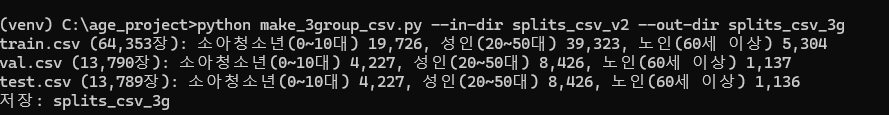

### 결과

| 방법 | 정확도 | macro-F1 | 소아청소년 | 성인 | 노인 |
|---|---|---|---|---|---|
| ResNet-50 7개 → 묶어 채점 | 85.5% | 0.804 | 88.0% | 86.1% | 71.8% |
| ConvNeXt 7개 → 묶어 채점 | 87.9% | 0.833 | 87.9% | 90.0% | 73.0% |
| ConvNeXt 3그룹으로 학습 (20에폭) | **88.2%** | 0.830 | 87.9% | 90.9% | 69.6% |

(그룹 칸 = 그 그룹 사진 중 맞힌 비율)

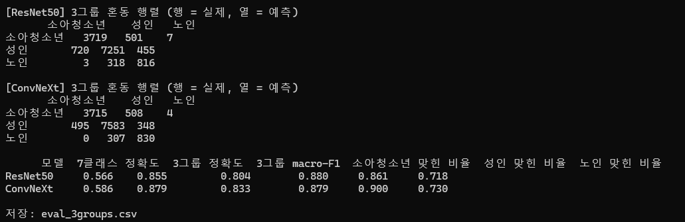
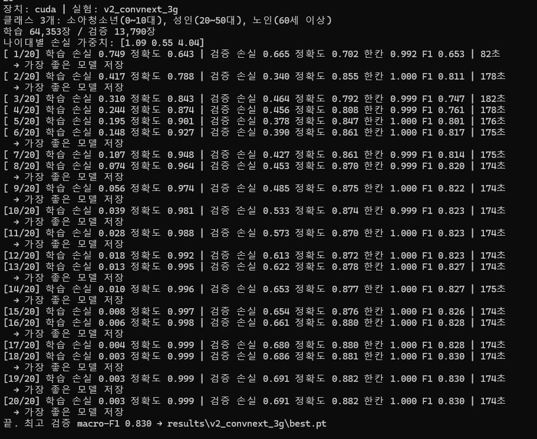
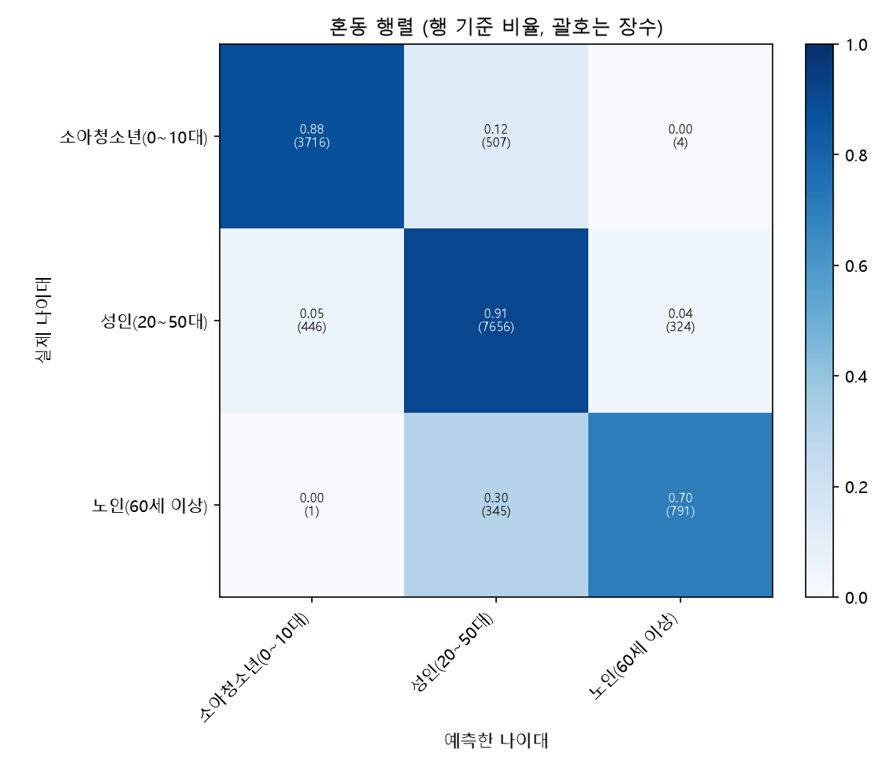

**7개 vs 3개 (ConvNeXt)**: 정확도 58.6% → 88.2%, macro-F1 0.592 → 0.830

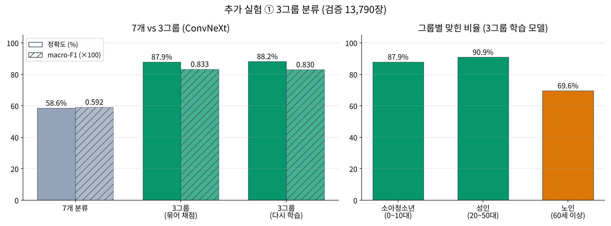

### 해석
- **묶어 채점 ≈ 다시 학습**: 87.9% vs 88.2%로 거의 같다. 7개 모델 하나로 두 용도를 다 쓸 수 있다.
- **오류는 경계에서만** (3그룹 학습 모델): 소아청소년↔성인 953장, 성인↔노인 669장, 소아청소년↔노인 5장. 7개 분류에서 틀린 것 대부분이 바로 옆 나이대였기 때문에, 크게 묶으면 그 오류가 사라진다.
- **노인 그룹이 가장 약함 (69.6%)**: 사진 수가 가장 적고(검증 1,137장) 50대와 겉모습이 비슷하다. 손실 가중치를 4.04까지 줬는데도 남았다.
- 3그룹 학습은 20에폭에서 최고점이라, 에폭을 늘리면 조금 더 오를 여지가 있다.

---

## ② 흐린 사진

### 문제 확인
`analyze_quality.py`로 검증 사진을 선명도(라플라시안 분산) 4구간으로 나눠 봤다.

| 선명도 구간 | 장수 | 정확도 |
|---|---|---|
| 1 (가장 흐림) | 3,448 | 54.9% |
| 2 | 3,447 | 58.3% |
| 3 | 3,447 | 60.2% |
| 4 (가장 선명) | 3,448 | 61.1% |

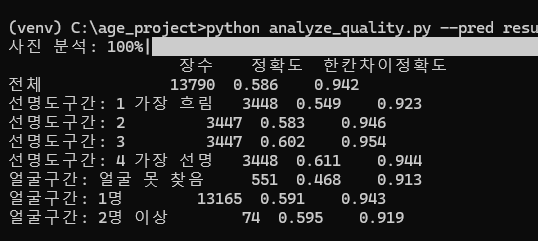

가장 흐린 25%가 가장 선명한 25%보다 6.2%p 낮다.

### 해결: 흐림 증강
학습 사진에 무작위로 흐림을 넣었다 (`--blur-aug`). 기존 증강(자르기·반전·회전·밝기) 뒤에 추가.

| 증강 | 확률 | 내용 |
|---|---|---|
| 초점 흐림 | 20% | GaussianBlur(kernel 9, σ 0.5~2.5) |
| 저해상도 | 20% | 56 / 80 / 112px로 줄였다가 224로 다시 키움 |

둘 중 하나 이상 적용되는 사진은 약 36%.

```python
if blur:
    steps += [
        T.RandomApply([T.GaussianBlur(kernel_size=9, sigma=(0.5, 2.5))], p=0.2),
        T.RandomApply([T.RandomChoice([
            T.Compose([T.Resize(56),  T.Resize((224, 224))]),
            T.Compose([T.Resize(80),  T.Resize((224, 224))]),
            T.Compose([T.Resize(112), T.Resize((224, 224))]),
        ])], p=0.2),
    ]
```

```
python step4_train.py --name v2_convnext_blur --model convnext_tiny.fb_in1k --train-csv splits_csv_v2/train.csv --val-csv splits_csv_v2/val.csv --image-root data_v2 --epochs 20 --patience 100 --blur-aug
python step5_evaluate.py --exp-dir results/v2_convnext_blur --split-csv splits_csv_v2/val.csv --image-root data_v2 --tag val
python eval_blur.py --exp-dirs results/v2_convnext results/v2_convnext_blur --split-csv splits_csv_v2/val.csv --image-root data_v2
```

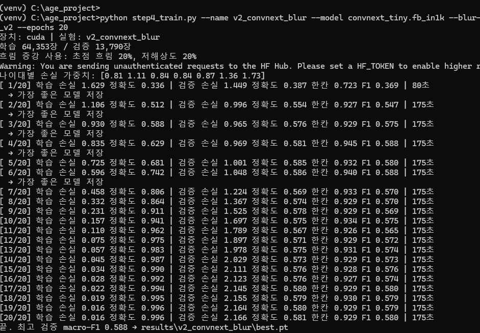

### 결과 (검증 사진에 흐림을 인공으로 입혀 평가, macro-F1)

| 흐림 정도 | 기존 모델 | 흐림 증강 모델 | 차이 |
|---|---|---|---|
| 원본 | 0.591 | 0.588 | −0.003 |
| 블러 σ=1 | 0.592 | 0.584 | −0.008 |
| 블러 σ=2 | 0.576 | 0.577 | +0.001 |
| 블러 σ=3 | 0.546 | **0.565** | +0.019 |
| 저해상도 112px | 0.591 | 0.582 | −0.009 |
| 저해상도 56px | 0.564 | **0.577** | +0.013 |

원래부터 흐린 실제 사진(선명도 1구간) 정확도: 54.9% → 55.0%

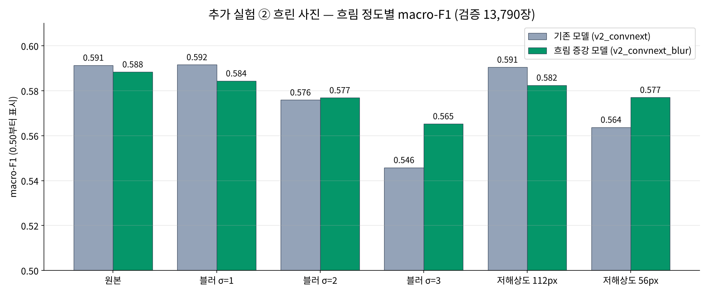

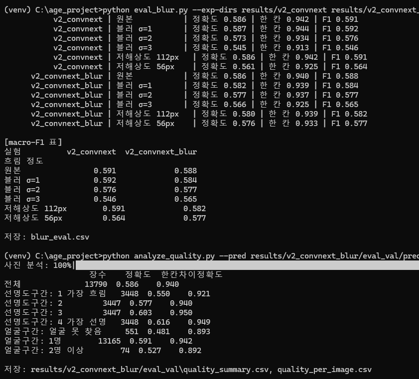

### 해석
- **강한 흐림·아주 작은 사진에서는 효과**: 떨어진 점수의 약 절반을 되찾았다 (σ3: −0.045 → −0.023, 56px: −0.027 → −0.011).
- **원본과 약한 흐림에서는 조금 손해** (−0.003 ~ −0.009). 학습 사진의 36%를 흐리게 보여 준 대가로 보인다.
- **원래 흐린 실제 사진에서는 개선 없음**. 실제 흐림은 흔들림·잡음·압축 손상이 섞여 있어 인공 가우시안 흐림과 다르다. 또 선명도 점수는 피부가 매끈한 얼굴(어린 얼굴, 화장)도 "흐림"으로 잡기 때문에, 흐림만의 영향으로 보기 어렵다.

---

## ③ 여러 얼굴 사진

### 문제 확인
- 실제 검증 사진 중 얼굴이 2개 이상인 사진은 **74장(0.5%)** 뿐이었고, 정확도도 떨어지지 않았다 (59.5%). 너무 적어서 판단할 수 없다.
- 그래서 **다른 검증 사진의 얼굴을 구석에 붙여** 일부러 만든 사진으로 시험했다 (`eval_paste.py`, 시드 0으로 고정 → 항상 같은 시험 사진).
- 얼굴을 붙이면 macro-F1 **0.591 → 0.569 (−0.022)**.

### 해결 두 가지
| 방법 | 내용 | 결과 (얼굴 붙인 사진) |
|---|---|---|
| A. 다른 얼굴 가리기 | MTCNN으로 얼굴을 찾아 가장 큰 얼굴 외에는 흐리게 가림 (평가 때만) | 0.561 — 오히려 하락 |
| B. 얼굴 붙이기 증강 | 학습 사진 30%에 다른 학습 사진의 얼굴을 구석에 붙임, 정답은 그대로 | **0.585** |

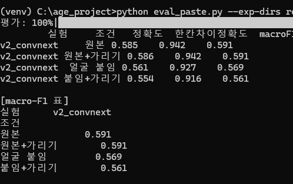

### 얼굴 붙이기 증강 (`--paste-aug 0.3`)
- 다른 학습 사진의 가운데 70%(얼굴 부분)를 잘라
- 사진 폭의 30~45% 크기로 줄여
- 네 구석 중 하나에, 0~30%는 사진 밖으로 나가게 붙인다 (단체 사진에서 옆 사람이 반쯤 걸린 상황)
- **정답 나이대는 가운데 얼굴 그대로** → "옆 얼굴은 무시하고 가운데 얼굴을 보라"를 배운다

```
python step4_train.py --name v2_convnext_paste --model convnext_tiny.fb_in1k --train-csv splits_csv_v2/train.csv --val-csv splits_csv_v2/val.csv --image-root data_v2 --epochs 20 --patience 100 --paste-aug 0.3
python eval_paste.py --exp-dirs results/v2_convnext results/v2_convnext_paste --split-csv splits_csv_v2/val.csv --image-root data_v2
```

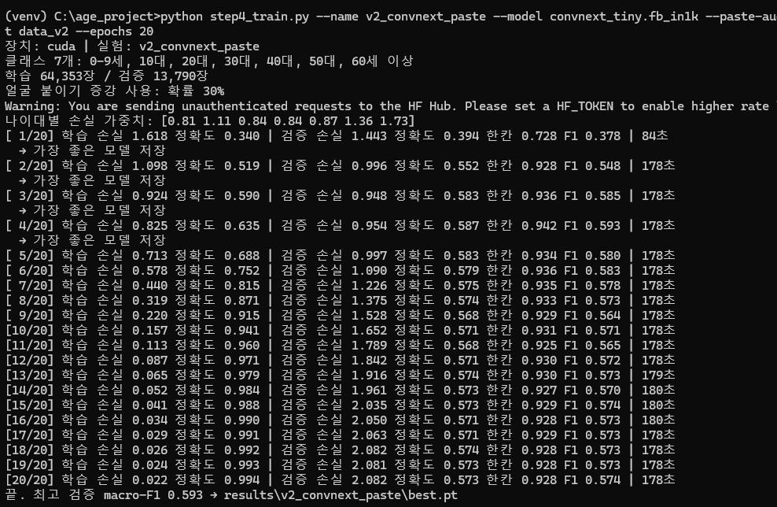

### 결과

| 조건 | v2_convnext | v2_convnext_paste |
|---|---|---|
| 원본 | 0.591 | **0.593** |
| 원본 + 가리기 | 0.591 | 0.593 |
| 얼굴 붙임 | 0.569 | **0.585** |
| 붙임 + 가리기 | 0.561 | 0.574 |

얼굴 붙인 사진의 정확도 56.1% → 57.9%, 한 칸 차이 정확도 92.7% → 93.7%

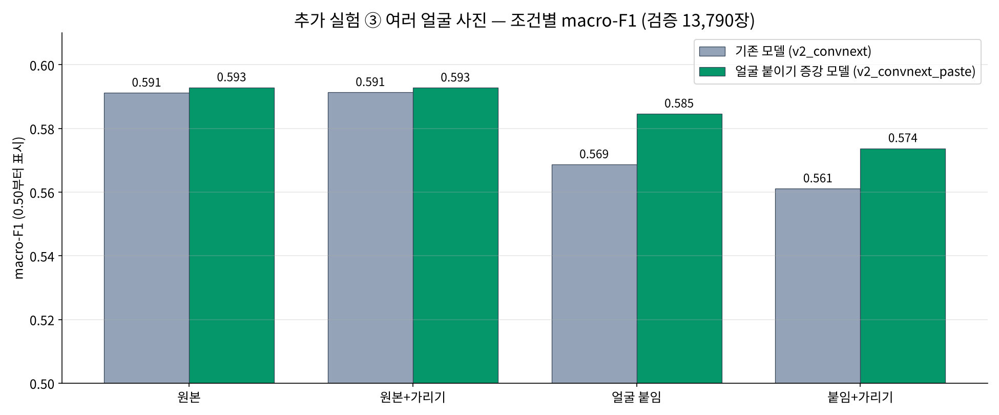

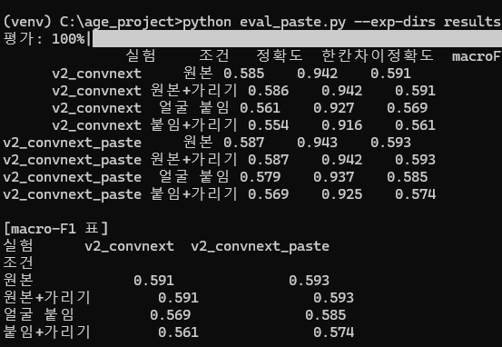

### 해석
- **B(붙이기 증강)가 효과적**: 하락 폭이 −0.022 → −0.008로 줄었고, 원본 점수도 떨어지지 않았다 (0.593).
- **A(가리기)는 오히려 손해**: 가린 자국 자체가 학습 때 한 번도 못 본 무늬라 모델을 헷갈리게 했다. 평가 때 손대는 것보다 **학습 때 그런 사진을 보여 주는 것**이 낫다.
- 한계: 효과는 인공으로 만든 사진으로만 확인했다. 실제 단체 사진은 74장뿐이다.

---

## 전체 요약

| 실험 | 기준 모델 | 개선 방법 | 핵심 숫자 |
|---|---|---|---|
| 3그룹 | 7개 58.6% | 3그룹으로 묶기 | 88.2% (묶어 채점 87.9%) |
| 흐린 사진 | σ3 0.546 / 56px 0.564 | 흐림 증강 20% + 20% | 0.565 / 0.577 |
| 여러 얼굴 | 붙인 사진 0.569 | 얼굴 붙이기 증강 30% | 0.585 |
